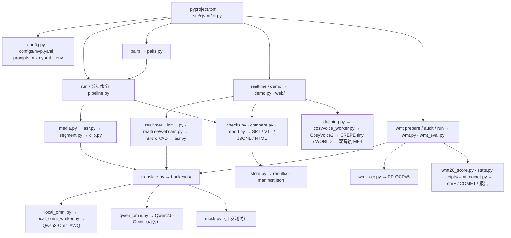

# CJ-VMT 项目架构与 AutoDL 部署复核

CJ-VMT 是一个中日双向多模态视频翻译原型。Whisper 负责把语音转成带时间戳的文字，Qwen3-Omni 用同一套权重分别处理文字、语音和画面的不同组合，FastAPI 提供实时字幕与回放，CosyVoice 负责可选配音。WMT 评测是独立的离线流程，用来衡量增加语音和画面之后，译文质量是否发生变化。当前阶段为 M5 待验收。 [阶段目标](../GOALS.md) · [验收记录](../reports/progress.md)

## 代码入口与文件路径图

项目根目录为 `/root/autodl-tmp/project/demo/cj-vmt`。CLI 从 `pyproject.toml` 的入口进入 `src/cjvmt/cli.py`。MVP 加载 `configs/mvp.yaml` 和 `configs/prompts/prompts_mvp.yaml`，本地覆盖项由 `.env` 提供。Qwen3-Omni 有单独的 `configs/local_omni_deploy.yaml`。 `configs/models.yaml`、`configs/pipeline.yaml` 和 `docs/roadmap/` 属于后续完整计划。 [入口](../pyproject.toml) · [设置加载](../src/cjvmt/config.py)



图中 Python 文件以 `src/cjvmt/` 为基准，部署脚本位于仓库根目录下的 `scripts/`。下面列出运行中生成和读取的主要目录。

| 路径 | 职责 |
| --- | --- |
| `configs/mvp.yaml`、`configs/prompts/prompts_mvp.yaml` | 控制模型输入、切句、语气、解码和评测，保留提示词模板与模态说明 |
| `src/cjvmt/backends/` | 定义翻译请求，适配本地 vLLM-Omni、Transformers 和 Mock |
| `src/cjvmt/web/` | 网页、摄像头采集、PCM AudioWorklet、字幕播放交互 |
| `data/external/commons/`、`data/external/wmt26/` | 本机公开演示素材和 WMT26 发布评测数据，自录配对的入口为 `data/raw/own/pairs.csv`。WMT25 媒体位于 `/root/autodl-tmp/dataset_create/data/external/wmt25-ja-zh/wmt25_genmt_assets.zip` |
| `results/<run_id>/` | 每次运行的 manifest、媒体、推理记录、字幕。实时过程和延迟放在 `session/`，WMT 放在 `documents.jsonl`、`summary.csv`、`comparisons.csv` 等文件 |
| `.cache/cjvmt/` | 翻译缓存和 vLLM-Omni 进程日志。配音环境、源代码和权重另存于 `.cache/` 下 |
| `reports/`、`scripts/`、`tests/` | 环境与实验报告、AutoDL 启动与打包脚本、离线及 Web 回归测试 |

## 实际模型与权重路径

下表中的仓库内路径以项目根目录为基准。Whisper、Qwen3-Omni、OCR 和 COMET 的现有权重位于相邻项目的本地目录 `/root/autodl-tmp/dataset_create/.work/`，迁移时需单独准备。

| 步骤 | 使用的模型或算法 | 代码入口 | 实际权重位置 |
| --- | --- | --- | --- |
| 识别语种和台词 | `Systran/faster-whisper-large-v3`，CTranslate2，本机为 CUDA FP16。离线输出词级时间戳，实时对每个 VAD 句子用 beam 1 | `asr.py → WhisperASR` | `/root/autodl-tmp/dataset_create/.work/models/faster-whisper-large-v3/` 中的 `model.bin`、`config.json`、`tokenizer.json`。配置修订 `edaa852ec7e145841d8ffdb056a99866b5f0a478` |
| 找到语音起止 | Silero VAD v6，由 faster-whisper 自带的 ONNX 文件提供。实时跟踪模型状态和静音长度，离线转写也可启用内置 VAD | `realtime/__init__.py → Silero / SilenceDetector`，离线由 `asr.py` 调用 | `.venv/lib/python3.12/site-packages/faster_whisper/assets/silero_vad_v6.onnx` |
| 翻译和语气观察 | `cyankiwi/Qwen3-Omni-30B-A3B-Instruct-AWQ-4bit`，vLLM-Omni 加载 Thinker 单阶段，输出文字 | `translate.py → backends/local_omni.py → backends/local_omni_worker.py` | `/root/autodl-tmp/dataset_create/.work/models/qwen3-omni-awq/b8f7bfd32ec3e7a59fa78cad0be54463eb89e9a9/`，六片 `model-*-of-00006.safetensors`、索引、processor 配置和 `receipt.json` |
| 可选的翻译后端 | `Qwen/Qwen2.5-Omni-7B`，Transformers，CUDA，关闭语音生成 | `backends/qwen_omni.py` | `CJVMT_OMNI_PATH` 或本地 Hugging Face 缓存。本机部署未配置正式 Qwen2.5 权重，历史四模态适配验证使用随机初始化小模型 |
| 译文语音合成 | 官方 `CosyVoice2-0.5B`。语义生成、flow 声学模型与 HiFT 声码器合成波形。说话人嵌入和语音 token 来自两个 ONNX 模型 | `dubbing.py → cosyvoice_worker.py` | `.cache/cosyvoice-model/` 下的 `llm.pt`、`flow.pt`、`hift.pt`、`campplus.onnx`、`speech_tokenizer_v2.onnx`、`cosyvoice2.yaml` 与 `CosyVoice-BlankEN/`。权重修订 `eec1ae6c79877dbd9379285cf8789c9e0879293d` |
| 译文语调匹配 | `CREPE tiny` 识别原声基频，`WORLD` 让合成语音跟随原声的句级音高走势，两步在 CPU 执行 | `cosyvoice_worker.py → prosody.py` | `.cache/cosyvoice-env/lib/python3.10/site-packages/torchcrepe/assets/tiny.pth` |
| WMT26 字幕审计 | PaddleOCR `PP-OCRv5_server_det` 定位文字框、`PP-OCRv5_server_rec` 识别文字，两者在 CPU 运行 | `wmt_eval.py → wmt_ocr.py` | `/root/autodl-tmp/dataset_create/.work/models/PP-OCRv5_server_det/` 与同级 `PP-OCRv5_server_rec/` 中的 `inference.pdiparams` 和推理配置 |
| WMT 翻译质量 | `Unbabel/wmt22-comet-da`，以原文、机器译文、人工参考三元组评分，编码器架构为 XLM-R | `scripts/wmt_comet.py` | `/root/autodl-tmp/dataset_create/.work/models/x1-comet-da/2760a223ac957f30acfb18c8aa649b01cf1d75f2/checkpoints/model.ckpt`，编码器配置及词表位于同一 `models/` 下的 `x1-comet-xlmr/c23d21b0620b635a76227c604d44e43a9f0ee389/` |

Qwen3-Omni 使用 `/root/autodl-tmp/dataset_create/.work/p3-omni-env/bin/python`，其 vLLM 与 vLLM-Omni 都是 0.32.0，PyTorch 2.13.0 构建对应 CUDA 13.0。CosyVoice 使用 `.cache/cosyvoice-env/bin/python`（Python 3.10.12）和 `.cache/CosyVoice/` 源码，代码修订为 `074ca6dc9e80a2f424f1f74b48bdd7d3fea531cc`。PaddleOCR 和 COMET 可用相邻项目的 `p3-mining-env`、`p3-x1-comet-env` 独立运行。当前按 Qwen3-Omni、本地 ASR 与本地配音部署。SenseVoice、HF Whisper、情感评测与 OpenAI 兼容接口仍是配置或规划项。 [本地翻译适配器](../src/cjvmt/backends/local_omni.py) · [后端选择](../src/cjvmt/backends/__init__.py) · [配音运行环境](../src/cjvmt/dubbing.py)

FFmpeg、切句规则、字幕生成、文本差异、fugashi/UniDic-lite 文体判断、sacreBLEU chrF 和统计检验承担媒体处理或评估工作。问句与文体规则给出可追溯的代理指标，具体译文是否正确还需结合同句原文、参考以及上下文判断。 [判定规则](../src/cjvmt/checks.py) · [统计实现](../src/cjvmt/stats.py)

## 三条执行链

### 离线视频翻译

1. `media.py` 用 ffprobe 校验媒体，用 FFmpeg 从第一音轨生成 16 kHz 单声道 WAV，同时生成静音 MP4 与带第一音轨的标准回放 MP4。
2. `asr.py` 识别语种或使用指定语向，从音频转写中日台词。默认离线 beam 5，记录词级时间戳和 ASR 可疑标记。自动语向要求识别到中日语且置信度至少为 0.6。
3. `segment.py` 按句末标点、不短于 600 ms 的间隔、字数和最长 10 秒切句。输出 `text_asr` 与减弱问号等语调标记的 `text_neutral`，并附最近 30 秒内、最多三句的前文。
4. `clip.py` 为每句保留前 3 秒和后 1 秒画面，视频窗口最多 15 秒。音频只保留该句及前后 200 ms，边缘做 20 ms 淡入淡出，其余样本置零。分别写无声视频、门控 WAV、重新封装音画以及人工预览。
5. `translate.py` 按条件组装媒体和提示词。Qwen3 worker 用 FFmpeg 抽帧、按像素预算缩放、送入 Qwen，采用确定性解码并返回文字。句级默认 2 fps，每帧上限 200,704 像素。缓存按模型修订、部署与适配器哈希、提示词、媒体哈希、条件和解码参数索引。
6. `checks.py` 与 `compare.py` 标注问句、文体、简体字混入、敬称和译文差异。 `pipeline.py`、`demo.py` 和 `report.py` 导出各条件的双语 SRT/VTT、逐句记录和回放页。 [离线入口](../src/cjvmt/pipeline.py) · [切片实现](../src/cjvmt/clip.py) · [提示词](../configs/prompts/prompts_mvp.yaml)

| 条件 | 文字 | 额外输入 |
| --- | --- | --- |
| `T_neutral` | 中性化台词 | 无 |
| `T_asr` | 带原标点的 ASR 台词 | 无 |
| `T+A` | 中性化台词 | 门控 WAV |
| `T+V` | 中性化台词 | 无声 MP4 |
| `T+V+A` | 中性化台词 | 一份音画 MP4，启用 `use_audio_in_video` |
| `T+A_shuf`、`T+V_shuf` | 中性化台词 | 固定种子选择另一视频的音频或画面 |
| `T+V+A_sep` | 实时比较用中性化台词，实时引导与感知用原 ASR 台词 | 单独的音频和帧序列，离线也可通过独立视频与 WAV 使用 |

`compare` 用于研究模态差异，同一输入文字时只改变模态说明。 `guided` 对带媒体的条件提示关注问句、动作、说话对象，并要求自然地保留语气。 `perceive` 先用同一个 Qwen 观察语调、动作、对象、语气，再将观察带入翻译。感知给出的语气和强度作为未核实的模型观察留存。

### 物体线索在什么情况下能帮助翻译

日语「このはしを見てください」里的「はし」可能指桥，也可能指筷子。中文译文连量词都会受影响。另一个方向，中文「把那个递给我」可以自然译为「あれを渡して」。即便看到桌上有剪刀，只要无法确定手指所向，保留「あれ」就很合适。衡量视觉能力时应同时考查选对词义和保留原文的含糊程度。

句级引导和先感知后翻译共用配置 `prompt_modes.object_grounding`。开启时，有细节的画面才触发物体提示。引导模式一次翻译，感知模式在原有观察中增加一题，请模型指出与台词有关的一件物体以及画面中的依据。网页可展开「模型观察」查看该线索。近乎纯色的抽样画面会标为无法辨认，只有这类画面且没有声音时直接跳过观察调用。无声画面、有声画面和单独传入的摄像头帧都沿用各自的媒体通道。该功能输出文字线索，尚无物框、跨镜头跟踪或经校准的正确概率。 [提示词](../configs/prompts/prompts_mvp.yaml) · [媒体检查](../src/cjvmt/media.py) · [翻译入口](../src/cjvmt/translate.py)

在 11 月 27 日的本地 Qwen3-Omni 对照中，同一句日语搭配碗筷图得到“请看这双筷子”，搭配河桥图得到“请看这座桥”。原有感知模式也答对这两张图。初版物体提示在灰屏上编出了手拿筷子的动作。加上纯色检查后，灰屏和另一张蓝屏都显示无法辨认，最终译文仍然猜了“桥”。两张物体图属于自制示意图，例子显示画面能改变选词，也留下了具体的失败案例。项目已有的 WMT26 结果来自另一套实验，不能据此给新功能估算总体收益。 [WMT26 历史评测](../reports/eval_wmt26.md)

下一轮适合分别采集指代、同音词、量词或动作，以及无需看画面的台词。每个方向按原视频留出独立场景。固定转写、前文、模型和解码，逐句对照纯文本、原有音画、加物体提示的音画、错配画面。由懂两种语言的人标出可接受的译法，统计消歧正确率、背景物品被加进译文的比例、证据不足时保留指代的比例和延迟。若特定物品经常漏看，再用该类素材测试更密的抽帧、局部裁剪或物体检测。画面错配和控制歧义是已有多模态翻译研究使用过的设计。 [CoMMuTE 研究](https://aclanthology.org/2023.acl-long.295/)

### 模拟直播、摄像头与配音

1. 模拟直播按原速喂入视频对应的音频和抽帧。摄像头通过浏览器的 getUserMedia、AudioWorklet 和摄像头录像，把实时 PCM 与抽样 JPEG 帧交给后端。服务在播放计时前加载模型。
2. Silero 用 512 样本的窗口接收 16 kHz PCM，检测说话段。内存缓存覆盖约 20 秒，停顿达到约 600 ms 切句，最长 12 秒强制切句。每句最多提供 12 帧和开始前约 3 秒画面。
3. Whisper 输出原文，Qwen 先给快速译文，再用分开的语音和帧修订。队列积压超过 3 句或画面不可用时跳过第二阶段并记录原因。产物包括 `session/session.jsonl`、`session/latency_summary.csv` 和 `session/subtitles.srt`。
4. 可配音会话可由 `dubbing.py` 整段重新转写并切句，以已有译文或 Qwen 的重新翻译、语气观察和原声片段为输入。Qwen 任务结束后释放 vLLM，再调用 CosyVoice。输出对齐的 `media/dub.mp4` 与 `media/dub.srt`，视频包含目标语音轨、备用原声及 AI 合成标识。 [实时调度](../src/cjvmt/realtime/__init__.py) · [摄像头接收](../src/cjvmt/realtime/webcam.py) · [浏览器采集](../src/cjvmt/web/webcam.js) · [配音流程](../src/cjvmt/dubbing.py)

### 如何提高固定人物的配音相似度

听感要分开评估。同一个人压低声音反问时，音色、句尾走向、停顿和时长同时发生变化。换语言后，中文的词汇声调和日语的音高重音又各有约束。把原句的每个基频点都强行套到译文上，可能把目标语的发音和重音带偏。

| 想改善的问题 | 当前做法 | 优先验证 |
| --- | --- | --- |
| 听起来像另一个人 | CosyVoice2 以原视频参考声音合成。短于 3 秒的句子可借用同视频、分组一致、时间标注匹配的较长单人片段，按有效发声占比选取。缺少可靠分组时仅取本句，极短情况用静音补足提取特征的下限。回放可查参考句 | 用同一人物的干净参考与原视频参考合成相同译文，做盲听。声纹相似度作为辅助。多人交叠和分组错误仍会影响结果 |
| 尾音抬升、强调位置不对 | 语调取自完整原句。CREPE 和 WORLD 估计有声部分，按两种语言的发声进度对齐句级升降。默认平滑 500 毫秒，单帧修正最多 2.5 半音 | 分别听问句、陈述、反问和长停顿。记录句尾上扬方向、半音误差和母语者对声调或重音的听感 |
| 听起来像赶时间、停顿位置生硬 | 现有流程估计目标时长，调合成语速并做有限的时间伸缩，保留原声轨对照 | 同看字幕、原声音轨和配音。区分译文太长、切句错误、合成发音太慢、句内缺停顿，再决定改哪一层 |

若要长期给本人配音，第一轮可在相同设备、安静房间录 6–10 段自然说话，每段约 4–10 秒，包含陈述、问句、强调和不同语速。把它们当候选参考，每次选一段，并保留另一批未参与选音的句子作盲听。录音可作为推理输入，当前网页实际使用同一视频内的参考片段，尚无跨视频个人音色库。若做多人产品，使用独立参考需要明确对应到哪位说话人，并取得本人对用途的同意。

建议固定译文分两轮比较。第一轮只换参考音，解决音色漂移。第二轮采用胜出的参考，再比较基础配音、句级语调迁移及候选模型。听者分别评价像不像本人、说法像不像当时的语气、日语或中文自然度，并让目标语转写核对漏读和错读。若同一授权人物长期使用、跨录制场次仍稳定地出现同一种缺陷，才值得整理带准确逐句文本的数据，按录制场次留出测试集，尝试微调。参考音时长与训练数据量是两件事，所需训练量应从个人留出测试评估。另一个可比较的候选是同样约 0.5B 参数的 Fun-CosyVoice3，模型代际、训练数据和中日发音都值得分别验证。 [CosyVoice 2](https://arxiv.org/abs/2412.10117) · [CosyVoice 3](https://arxiv.org/abs/2505.17589)

本机另用 CosyVoice 官方的 3.48 秒中文例音生成一句日语，再对同一条 3.129 秒的干声应用句级语调迁移。按有声进度归一化并去除各自的中位音高后，采用 WORLD 重测，平滑走势的平均绝对误差由 3.961 降至 2.707 半音。该数值只衡量这一句的音高走势。本人声音的相似度、中日发音的自然度和多人对话效果都需要独立听评。 [配音选段](../src/cjvmt/dubbing.py) · [语调处理](../src/cjvmt/prosody.py)

### 人物与语气标注

回放可按原声和字幕时间启动独立分析。CAMPPlus 分组说话人，YuNet 和 MediaPipe 核对画面口型，WORLD 测量基频。逐句标签写入 `speakers.json`，可按需调用 Qwen3-Omni 补充模型语气。 [执行链、权重路径和网页实测](speaker_analysis.md)

### WMT 实验与统计

- `wmt.py` 读取原发布 JSONL 和媒体，按语种对与域筛选，保留输入哈希、参考和对齐信息。WMT26 使用发布数据的人工转写做主条件，只中性化句尾问号，`T_asr` 使用发布方的 ASR。WMT25 使用发布 ASR 的中性化文档文本。两条评测链的转写来自语料发布，当前机器的 Whisper 用于视频翻译功能。
- `wmt_ocr.py` 每两秒抽取候选帧，正式运行每段抽样三帧。假名用于标记可能的目标语画面字幕，带汉字且无假名的 OCR 识别片段作为可能的中文字幕。评测按这些标签分层。
- `wmt_eval.py` 整段给 Qwen 带编号的文字或媒体。文档默认 1 fps、每帧 100,352 像素、最多 1,024 输出 token。输出编号或行数异常时严格重试一次，之后逐行回退。WMT 的全模态用发布原视频音轨，句级演示则使用门控音频。
- `wmt26_score.py` 计算问句召回、误报率、文体一致率和错配影响，并按中文疑问线索分 Q1–Q5。chrF 来自 sacreBLEU，COMET 由独立脚本补算。代码以文档为单位做配对 bootstrap，并提供 McNemar、Holm 校正和 Wilson 区间等统计。 [WMT 输入](../src/cjvmt/wmt.py) · [评测调度](../src/cjvmt/wmt_eval.py) · [评分](../src/cjvmt/wmt26_score.py) · [COMET](../scripts/wmt_comet.py)

已有报告的 WMT25 正式评测覆盖 59 段与四个条件，WMT26 正式评测覆盖 114 段、662 句与七个条件，生成 798 条文档条件结果、800 条推理调用记录，逐行回退为零。这两次正式语料评测使用历史 RTX 5090 实例。本轮 4090 的小样本用于验证部署与链路。WMT26 主分层排除可能含日语字幕的画面，包含 656 句，四条件结果如下。 [WMT25 报告](../reports/eval_wmt25.md) · [WMT26 报告](../reports/eval_wmt26.md) · [WMT26 运行证据](../results/20261125-0247_wmt26-eval_bb2b92a1/manifest.json)

| WMT26 主分层条件 | chrF | COMET |
| --- | ---: | ---: |
| `T_neutral` | 28.146 | 0.86998 |
| `T+A` | 28.542 | 0.87125 |
| `T+V` | 28.000 | 0.86763 |
| `T+V+A` | 27.277 | 0.86501 |

该实验里音频单独加入时点估计最高，完整音画条件点估计低于文字基线。模态成效应结合配对差值、置信区间、错配和字幕分层解释。画面 OCR 采用稀疏抽样，文体和语气都需要人工例子进一步验证。

## 当前 AutoDL 的运行配置

| 项目 | 2026-11-25 实测 |
| --- | --- |
| GPU | 1 张 RTX 4090，49,140 MiB，Compute Capability 8.9，驱动 580.105.08 |
| 容器资源 | 25 个逻辑 CPU 的 CPU 时间配额，90 GiB 内存上限。宿主显示 208 个逻辑 CPU |
| 磁盘 | 数据盘约 270 GB，检查时约剩 46 GiB。项目 `.cache` 约 24 GiB，外部 Qwen3 权重约 26 GiB |
| 主环境 | Ubuntu 22.04.4，Python 3.12.3，FFmpeg 4.4.2，faster-whisper 1.2.1、CTranslate2 4.9.1 |
| CUDA 实测 | Whisper CUDA FP16 预热和转写通过，Qwen 独立环境的 BF16 矩阵计算通过 |
| 当前部署 | vLLM 单卡、单序列，8,192 token 上下文，2 GiB KV 缓存，`gpu_memory_utilization: 0.77`，eager 推理。Web 进程内逐个执行推理任务 |

`scripts/start_autodl.sh` 是本机在线入口。它给 Whisper 设置 CUDA 12 用户态库的搜索路径，并给 Qwen 的独立运行环境保留进入脚本前的动态库路径。当前 6006 服务在线。两套 Python 与 CUDA 运行环境各自保留，适合本机已缓存的权重。 [环境记录](../reports/env.md) · [启动脚本](../scripts/start_autodl.sh) · [vLLM 配置](../configs/local_omni_deploy.yaml)

```bash
.venv/bin/cjvmt doctor
.venv/bin/cjvmt run --input /path/to/video.mp4 --direction auto --backend local_omni \
  --conditions T_neutral,T_asr,T+A,T+V,T+V+A --limit 2
.venv/bin/cjvmt validate --run results/RUN_ID
bash scripts/start_autodl.sh --source /path/to/video.mp4 --direction auto --mode perceive
```

## 本次完善与后续优先级

| 优先级 | 发现与处理 |
| --- | --- |
| 已完成 | `doctor` 现在显示当前容器的 CPU、内存、GPU，以及真实 `local_omni` 权重和 Python 路径，保留旧机器的历史实测。检查解释器和权重下载记录时给出具体故障路径 |
| 已完成 | 固定从第一音轨抽取识别音频，与标准回放保持一致。已有配音 MP4 包含多条音轨，这项修复也适用于重新上传此类视频 |
| 已完成 | vLLM 解释器路径保留 venv 的符号链接，并转成绝对路径。启动前检查解释器权限，部署时可定位缺失的环境和下载记录 |
| 已完成 | 旧部署根据显存比例自动保留约 16.23 GiB KV 缓存。单序列部署将其设为 2 GiB，运行日志报告可缓存 21,840 token。历史实验的 manifest 仍引用原部署哈希，续跑这些实验需要原 YAML 配置 |
| 已完成 | 实时会话增加分段延迟记录和快译字幕轨。网页默认实时用引导，离线研究用对比。4 线程在本轮实测中未取得稳定优势，继续采用现有线程配置 |
| 待素材验收 | 最小对支持四条件人工判定与相对纯文字的成对统计。获准的同词异音、同词异画样本可用于判断问句、接受与婉拒、礼貌和语气 |
| 优先 | 固定交付代码、环境锁定文件和权重清单，归档后用 Git 版本与 manifest 关联。当前仓库尚无提交。独立安装评测环境时一并固定 fugashi 和 UniDic-lite，保持文体规则的依赖一致 |
| 后续 | 盘点约 24 GiB 的项目缓存，其中四个旧复现实验环境共约 4.4 GiB。确认保留期后归档旧环境、过期上传物和缓存 |
| 后续 | 复核多说话人配音参考、姓名和术语转写、原声与配音校对。当前参考音频取自邻近时间段，长译文可能顺延并延长末帧，视频沿用原口型 |

## 本次验证记录

离线验证使用同一公开日语社区会议片段，自动识别为日→中，两句分别跑五个条件。调整前后各有十次真实推理，十条输出逐条相同。无声画面、门控音频时长与区间、音画封装、字幕均通过校验。NVML 设备已用显存包含 Whisper、vLLM 和它们的缓存。 [旧配置 manifest](../results/20261125-1357_auto_9966bc94/manifest.json) · [新配置 manifest](../results/20261125-1400_auto_e135591a/manifest.json) · [新配置逐次调用](../results/20261125-1400_auto_e135591a/predictions.jsonl) · [逐句回放](../results/20261125-1400_auto_e135591a/compare.html)

| 指标 | 旧配置 | 2 GiB 配置 |
| --- | ---: | ---: |
| 设备峰值显存 | 42,833.5 MiB | 28,369.5 MiB |
| 第一次文字调用，含冷启动 | 72.92 秒 | 68.56 秒 |
| 第二句纯文字调用 | 0.31 秒 | 0.32 秒 |
| 第二句声音调用 | 0.43 秒 | 0.44 秒 |
| 第二句画面调用 | 0.63 秒 | 0.69 秒 |
| 第二句音画调用 | 0.70 秒 | 0.76 秒 |

设备峰值减少 14.125 GiB，约 33.8%。表中的时间来自两次小样本运行，配置目标为释放显存。冷启动、实时延迟和热模型调用分别解读。

新配置的中文模拟直播自动选择中→日，完成两句快译和音画修订，跳过零句。相对句末的快译中位延迟为 5.19 秒，音画修订为 9.33 秒。另用缓存未命中的 WMT26 全模态输入测试了一段 16 行文档，单次调用得到全部 16 行，未触发回退。 [模拟直播 manifest](../results/20261125-1401_session_e4077ea0/manifest.json) · [延迟 CSV](../results/20261125-1401_session_e4077ea0/session/latency_summary.csv) · [WMT 文档验证](../results/20261125-1400_auto_e135591a/wmt_document_probe.json)

`make check` 通过 43 项测试。 `make smoke` 通过 2 句 Mock 链路，生成明确标注的离线回放。课程报告、WMT25 和 WMT26 的实测数字分别复核 30、26 和 2,227 个。配音与全量 WMT 的结论引用已有运行记录，课堂实体设备和授权的自录最小对还需验收。 [进度记录](../reports/progress.md) · [演示素材署名](demo_media.md)

## 实时提示词与线程对照

在 RTX 4090 上为同一段 18 秒公开中文素材顺序运行引导和先感知后翻译。每种线程配置用独立进程，分别将 `OMP_NUM_THREADS` 和 `MKL_NUM_THREADS` 设为 25 或 4。两种配置各完成四句，均生成快译和修订。表中的冷启动耗时单独记录，快译和修订从媒体句末算到服务侧结果事件。

| 线程数 | 模式 | 快译中位数 | 音画修订中位数 | 媒体观察调用中位数 | 实测 |
| --- | --- | ---: | ---: | ---: | --- |
| 25 | 引导 | 4.21 秒 | 6.77 秒 | — | [manifest](../results/20261125-1407_session_0de701fe/manifest.json) |
| 25 | 先感知后翻译 | 4.53 秒 | 8.32 秒 | 1.47 秒 | [manifest](../results/20261125-1409_session_2a1099bc/manifest.json) |
| 4 | 引导 | 4.31 秒 | 6.92 秒 | — | [manifest](../results/20261125-1412_session_2e171a94/manifest.json) |
| 4 | 先感知后翻译 | 4.80 秒 | 8.72 秒 | 1.51 秒 | [manifest](../results/20261125-1414_session_583cae9e/manifest.json) |

首次翻译模型预热分别为 66.37 秒和 68.57 秒，随后复用该进程。相同提示词模式下，两种线程配置的识别原文、快译与修订逐句相同。引导模式省去独立的媒体观察调用。该样本每个组合只有两句，首句以 12 秒上限切分，末句在输入结束时提交。这个对照用于选择网页默认模式和继续沿用现有线程配置。翻译正确性仍待授权最小对的逐条件人工判定。 [计时定义](realtime_design.md#7-会话日志与事后分析)
