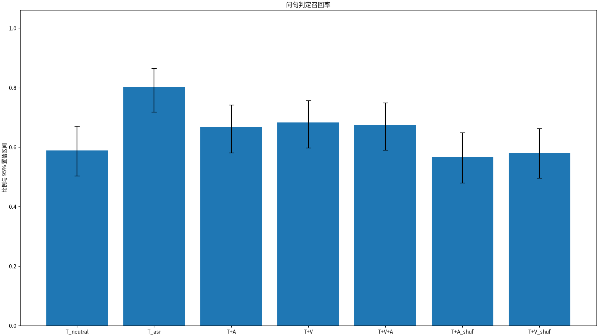
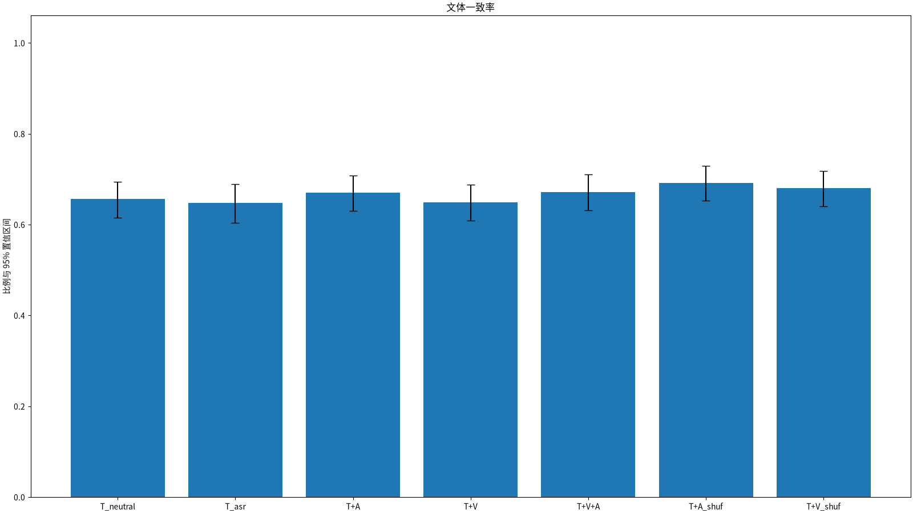

# WMT26 中文 → 日语语音翻译

评测运行 `20261125-0247_wmt26-eval_bb2b92a1`，准备记录 `20261125-0214_wmt26-prepare_800787aa`。
参与评测 114 段。<!-- run=20261125-0247_wmt26-eval_bb2b92a1 file=manifest.json key=document_count value=114 -->
模型 `cyankiwi/Qwen3-Omni-30B-A3B-Instruct-AWQ-4bit`，修订 `b8f7bfd32ec3e7a59fa78cad0be54463eb89e9a9`。
发布集共 114 段。<!-- run=20261125-0247_wmt26-eval_bb2b92a1 file=manifest.json key=total_available value=114 -->
运行覆盖准备记录中的全部语音文档。
文本核对、标点对齐方法和问句分层见准备记录。
主表剔除有假名的画面。OCR 把带汉字且无假名的识别片段计作可能的中文字幕。
`T_asr` 的规则判断用字对齐近似映射到人工行，chrF 与 COMET 按文档。其余条件按行评测。
chrF 和 COMET 的置信区间按视频文档重采样，保留同一文档内部的各行。
数据量少的单元格用 † 标出。功效列是未校正双侧检验设计下的近似最小差异，仅作量级参考。

## 发布语料问句分层

| 分组 | 行数 |
|---|---:|
| Q1 | 4 | <!-- run=20261125-0214_wmt26-prepare_800787aa file=manifest.json key=question_groups.Q1 value=4 -->
| Q2 | 59 | <!-- run=20261125-0214_wmt26-prepare_800787aa file=manifest.json key=question_groups.Q2 value=59 -->
| Q3 | 8 | <!-- run=20261125-0214_wmt26-prepare_800787aa file=manifest.json key=question_groups.Q3 value=8 -->
| Q4 | 32 | <!-- run=20261125-0214_wmt26-prepare_800787aa file=manifest.json key=question_groups.Q4 value=32 -->
| Q5 | 26 | <!-- run=20261125-0214_wmt26-prepare_800787aa file=manifest.json key=question_groups.Q5 value=26 -->

## 各条件结果

| 分层 | 条件 | 指标 | 样本数 | 数值 | 95% CI 下界 | 95% CI 上界 |
|---|---|---|---:|---:|---:|---:|
| main | T_neutral | recall | 129 | 0.58915 | 0.50287 | 0.67027 | <!-- run=20261125-0247_wmt26-eval_bb2b92a1 file=summary.csv key=id:main/T_neutral/recall:n value=129 --> <!-- run=20261125-0247_wmt26-eval_bb2b92a1 file=summary.csv key=id:main/T_neutral/recall:value value=0.58915 --> <!-- run=20261125-0247_wmt26-eval_bb2b92a1 file=summary.csv key=id:main/T_neutral/recall:ci_low value=0.50287 --> <!-- run=20261125-0247_wmt26-eval_bb2b92a1 file=summary.csv key=id:main/T_neutral/recall:ci_high value=0.67027 -->
| main | T_neutral | false_positive | 527 | 0.01898 | 0.01034 | 0.03457 | <!-- run=20261125-0247_wmt26-eval_bb2b92a1 file=summary.csv key=id:main/T_neutral/false_positive:n value=527 --> <!-- run=20261125-0247_wmt26-eval_bb2b92a1 file=summary.csv key=id:main/T_neutral/false_positive:value value=0.01898 --> <!-- run=20261125-0247_wmt26-eval_bb2b92a1 file=summary.csv key=id:main/T_neutral/false_positive:ci_low value=0.01034 --> <!-- run=20261125-0247_wmt26-eval_bb2b92a1 file=summary.csv key=id:main/T_neutral/false_positive:ci_high value=0.03457 -->
| main | T_neutral | style | 552 | 0.6558 | 0.61521 | 0.69423 | <!-- run=20261125-0247_wmt26-eval_bb2b92a1 file=summary.csv key=id:main/T_neutral/style:n value=552 --> <!-- run=20261125-0247_wmt26-eval_bb2b92a1 file=summary.csv key=id:main/T_neutral/style:value value=0.6558 --> <!-- run=20261125-0247_wmt26-eval_bb2b92a1 file=summary.csv key=id:main/T_neutral/style:ci_low value=0.61521 --> <!-- run=20261125-0247_wmt26-eval_bb2b92a1 file=summary.csv key=id:main/T_neutral/style:ci_high value=0.69423 -->
| main | T_neutral | plain_baseline | 552 | 0.48913 | 0.44765 | 0.53076 | <!-- run=20261125-0247_wmt26-eval_bb2b92a1 file=summary.csv key=id:main/T_neutral/plain_baseline:n value=552 --> <!-- run=20261125-0247_wmt26-eval_bb2b92a1 file=summary.csv key=id:main/T_neutral/plain_baseline:value value=0.48913 --> <!-- run=20261125-0247_wmt26-eval_bb2b92a1 file=summary.csv key=id:main/T_neutral/plain_baseline:ci_low value=0.44765 --> <!-- run=20261125-0247_wmt26-eval_bb2b92a1 file=summary.csv key=id:main/T_neutral/plain_baseline:ci_high value=0.53076 -->
| main | T_neutral | Q1 † | 4 | 0.0 | 0.0 | 0.48989 | <!-- run=20261125-0247_wmt26-eval_bb2b92a1 file=summary.csv key=id:main/T_neutral/Q1:n value=4 --> <!-- run=20261125-0247_wmt26-eval_bb2b92a1 file=summary.csv key=id:main/T_neutral/Q1:value value=0.0 --> <!-- run=20261125-0247_wmt26-eval_bb2b92a1 file=summary.csv key=id:main/T_neutral/Q1:ci_low value=0.0 --> <!-- run=20261125-0247_wmt26-eval_bb2b92a1 file=summary.csv key=id:main/T_neutral/Q1:ci_high value=0.48989 -->
| main | T_neutral | Q2 | 59 | 0.69492 | 0.56854 | 0.79746 | <!-- run=20261125-0247_wmt26-eval_bb2b92a1 file=summary.csv key=id:main/T_neutral/Q2:n value=59 --> <!-- run=20261125-0247_wmt26-eval_bb2b92a1 file=summary.csv key=id:main/T_neutral/Q2:value value=0.69492 --> <!-- run=20261125-0247_wmt26-eval_bb2b92a1 file=summary.csv key=id:main/T_neutral/Q2:ci_low value=0.56854 --> <!-- run=20261125-0247_wmt26-eval_bb2b92a1 file=summary.csv key=id:main/T_neutral/Q2:ci_high value=0.79746 -->
| main | T_neutral | Q3 † | 8 | 0.875 | 0.52911 | 0.97758 | <!-- run=20261125-0247_wmt26-eval_bb2b92a1 file=summary.csv key=id:main/T_neutral/Q3:n value=8 --> <!-- run=20261125-0247_wmt26-eval_bb2b92a1 file=summary.csv key=id:main/T_neutral/Q3:value value=0.875 --> <!-- run=20261125-0247_wmt26-eval_bb2b92a1 file=summary.csv key=id:main/T_neutral/Q3:ci_low value=0.52911 --> <!-- run=20261125-0247_wmt26-eval_bb2b92a1 file=summary.csv key=id:main/T_neutral/Q3:ci_high value=0.97758 -->
| main | T_neutral | Q4 | 32 | 0.59375 | 0.4226 | 0.7448 | <!-- run=20261125-0247_wmt26-eval_bb2b92a1 file=summary.csv key=id:main/T_neutral/Q4:n value=32 --> <!-- run=20261125-0247_wmt26-eval_bb2b92a1 file=summary.csv key=id:main/T_neutral/Q4:value value=0.59375 --> <!-- run=20261125-0247_wmt26-eval_bb2b92a1 file=summary.csv key=id:main/T_neutral/Q4:ci_low value=0.4226 --> <!-- run=20261125-0247_wmt26-eval_bb2b92a1 file=summary.csv key=id:main/T_neutral/Q4:ci_high value=0.7448 -->
| main | T_neutral | f1 | 656 | 0.70698 | — | — | <!-- run=20261125-0247_wmt26-eval_bb2b92a1 file=summary.csv key=id:main/T_neutral/f1:n value=656 --> <!-- run=20261125-0247_wmt26-eval_bb2b92a1 file=summary.csv key=id:main/T_neutral/f1:value value=0.70698 -->
| main | T_neutral | kappa | 552 | 0.31665 | — | — | <!-- run=20261125-0247_wmt26-eval_bb2b92a1 file=summary.csv key=id:main/T_neutral/kappa:n value=552 --> <!-- run=20261125-0247_wmt26-eval_bb2b92a1 file=summary.csv key=id:main/T_neutral/kappa:value value=0.31665 -->
| main | T_neutral | plain_as_plain | 552 | 225 | — | — | <!-- run=20261125-0247_wmt26-eval_bb2b92a1 file=summary.csv key=id:main/T_neutral/plain_as_plain:n value=552 --> <!-- run=20261125-0247_wmt26-eval_bb2b92a1 file=summary.csv key=id:main/T_neutral/plain_as_plain:value value=225 -->
| main | T_neutral | plain_as_polite | 552 | 45 | — | — | <!-- run=20261125-0247_wmt26-eval_bb2b92a1 file=summary.csv key=id:main/T_neutral/plain_as_polite:n value=552 --> <!-- run=20261125-0247_wmt26-eval_bb2b92a1 file=summary.csv key=id:main/T_neutral/plain_as_polite:value value=45 -->
| main | T_neutral | polite_as_plain | 552 | 145 | — | — | <!-- run=20261125-0247_wmt26-eval_bb2b92a1 file=summary.csv key=id:main/T_neutral/polite_as_plain:n value=552 --> <!-- run=20261125-0247_wmt26-eval_bb2b92a1 file=summary.csv key=id:main/T_neutral/polite_as_plain:value value=145 -->
| main | T_neutral | polite_as_polite | 552 | 137 | — | — | <!-- run=20261125-0247_wmt26-eval_bb2b92a1 file=summary.csv key=id:main/T_neutral/polite_as_polite:n value=552 --> <!-- run=20261125-0247_wmt26-eval_bb2b92a1 file=summary.csv key=id:main/T_neutral/polite_as_polite:value value=137 -->
| main | T_neutral | chrf | 656 | 28.146 | 26.774 | 29.577 | <!-- run=20261125-0247_wmt26-eval_bb2b92a1 file=summary.csv key=id:main/T_neutral/chrf:n value=656 --> <!-- run=20261125-0247_wmt26-eval_bb2b92a1 file=summary.csv key=id:main/T_neutral/chrf:value value=28.146 --> <!-- run=20261125-0247_wmt26-eval_bb2b92a1 file=summary.csv key=id:main/T_neutral/chrf:ci_low value=26.774 --> <!-- run=20261125-0247_wmt26-eval_bb2b92a1 file=summary.csv key=id:main/T_neutral/chrf:ci_high value=29.577 -->
| main | T_neutral | fallback | 656 | 0.0 | 0.0 | 0.00582 | <!-- run=20261125-0247_wmt26-eval_bb2b92a1 file=summary.csv key=id:main/T_neutral/fallback:n value=656 --> <!-- run=20261125-0247_wmt26-eval_bb2b92a1 file=summary.csv key=id:main/T_neutral/fallback:value value=0.0 --> <!-- run=20261125-0247_wmt26-eval_bb2b92a1 file=summary.csv key=id:main/T_neutral/fallback:ci_low value=0.0 --> <!-- run=20261125-0247_wmt26-eval_bb2b92a1 file=summary.csv key=id:main/T_neutral/fallback:ci_high value=0.00582 -->
| main | T_neutral | simplified_leak | 656 | 0.00762 | 0.00326 | 0.01772 | <!-- run=20261125-0247_wmt26-eval_bb2b92a1 file=summary.csv key=id:main/T_neutral/simplified_leak:n value=656 --> <!-- run=20261125-0247_wmt26-eval_bb2b92a1 file=summary.csv key=id:main/T_neutral/simplified_leak:value value=0.00762 --> <!-- run=20261125-0247_wmt26-eval_bb2b92a1 file=summary.csv key=id:main/T_neutral/simplified_leak:ci_low value=0.00326 --> <!-- run=20261125-0247_wmt26-eval_bb2b92a1 file=summary.csv key=id:main/T_neutral/simplified_leak:ci_high value=0.01772 -->
| main | T_neutral | comet | 656 | 0.86998 | 0.86239 | 0.87781 | <!-- run=20261125-0247_wmt26-eval_bb2b92a1 file=summary.csv key=id:main/T_neutral/comet:n value=656 --> <!-- run=20261125-0247_wmt26-eval_bb2b92a1 file=summary.csv key=id:main/T_neutral/comet:value value=0.86998 --> <!-- run=20261125-0247_wmt26-eval_bb2b92a1 file=summary.csv key=id:main/T_neutral/comet:ci_low value=0.86239 --> <!-- run=20261125-0247_wmt26-eval_bb2b92a1 file=summary.csv key=id:main/T_neutral/comet:ci_high value=0.87781 -->
| japanese_onscreen | T_neutral | false_positive † | 6 | 0.0 | 0.0 | 0.39033 | <!-- run=20261125-0247_wmt26-eval_bb2b92a1 file=summary.csv key=id:japanese_onscreen/T_neutral/false_positive:n value=6 --> <!-- run=20261125-0247_wmt26-eval_bb2b92a1 file=summary.csv key=id:japanese_onscreen/T_neutral/false_positive:value value=0.0 --> <!-- run=20261125-0247_wmt26-eval_bb2b92a1 file=summary.csv key=id:japanese_onscreen/T_neutral/false_positive:ci_low value=0.0 --> <!-- run=20261125-0247_wmt26-eval_bb2b92a1 file=summary.csv key=id:japanese_onscreen/T_neutral/false_positive:ci_high value=0.39033 -->
| japanese_onscreen | T_neutral | style † | 4 | 0.5 | 0.15004 | 0.84996 | <!-- run=20261125-0247_wmt26-eval_bb2b92a1 file=summary.csv key=id:japanese_onscreen/T_neutral/style:n value=4 --> <!-- run=20261125-0247_wmt26-eval_bb2b92a1 file=summary.csv key=id:japanese_onscreen/T_neutral/style:value value=0.5 --> <!-- run=20261125-0247_wmt26-eval_bb2b92a1 file=summary.csv key=id:japanese_onscreen/T_neutral/style:ci_low value=0.15004 --> <!-- run=20261125-0247_wmt26-eval_bb2b92a1 file=summary.csv key=id:japanese_onscreen/T_neutral/style:ci_high value=0.84996 -->
| japanese_onscreen | T_neutral | plain_baseline † | 4 | 0.5 | 0.15004 | 0.84996 | <!-- run=20261125-0247_wmt26-eval_bb2b92a1 file=summary.csv key=id:japanese_onscreen/T_neutral/plain_baseline:n value=4 --> <!-- run=20261125-0247_wmt26-eval_bb2b92a1 file=summary.csv key=id:japanese_onscreen/T_neutral/plain_baseline:value value=0.5 --> <!-- run=20261125-0247_wmt26-eval_bb2b92a1 file=summary.csv key=id:japanese_onscreen/T_neutral/plain_baseline:ci_low value=0.15004 --> <!-- run=20261125-0247_wmt26-eval_bb2b92a1 file=summary.csv key=id:japanese_onscreen/T_neutral/plain_baseline:ci_high value=0.84996 -->
| japanese_onscreen | T_neutral | kappa † | 4 | 0.0 | — | — | <!-- run=20261125-0247_wmt26-eval_bb2b92a1 file=summary.csv key=id:japanese_onscreen/T_neutral/kappa:n value=4 --> <!-- run=20261125-0247_wmt26-eval_bb2b92a1 file=summary.csv key=id:japanese_onscreen/T_neutral/kappa:value value=0.0 -->
| japanese_onscreen | T_neutral | plain_as_plain † | 4 | 2 | — | — | <!-- run=20261125-0247_wmt26-eval_bb2b92a1 file=summary.csv key=id:japanese_onscreen/T_neutral/plain_as_plain:n value=4 --> <!-- run=20261125-0247_wmt26-eval_bb2b92a1 file=summary.csv key=id:japanese_onscreen/T_neutral/plain_as_plain:value value=2 -->
| japanese_onscreen | T_neutral | plain_as_polite † | 4 | 0 | — | — | <!-- run=20261125-0247_wmt26-eval_bb2b92a1 file=summary.csv key=id:japanese_onscreen/T_neutral/plain_as_polite:n value=4 --> <!-- run=20261125-0247_wmt26-eval_bb2b92a1 file=summary.csv key=id:japanese_onscreen/T_neutral/plain_as_polite:value value=0 -->
| japanese_onscreen | T_neutral | polite_as_plain † | 4 | 2 | — | — | <!-- run=20261125-0247_wmt26-eval_bb2b92a1 file=summary.csv key=id:japanese_onscreen/T_neutral/polite_as_plain:n value=4 --> <!-- run=20261125-0247_wmt26-eval_bb2b92a1 file=summary.csv key=id:japanese_onscreen/T_neutral/polite_as_plain:value value=2 -->
| japanese_onscreen | T_neutral | polite_as_polite † | 4 | 0 | — | — | <!-- run=20261125-0247_wmt26-eval_bb2b92a1 file=summary.csv key=id:japanese_onscreen/T_neutral/polite_as_polite:n value=4 --> <!-- run=20261125-0247_wmt26-eval_bb2b92a1 file=summary.csv key=id:japanese_onscreen/T_neutral/polite_as_polite:value value=0 -->
| japanese_onscreen | T_neutral | chrf † | 6 | 27.079 | 27.079 | 27.079 | <!-- run=20261125-0247_wmt26-eval_bb2b92a1 file=summary.csv key=id:japanese_onscreen/T_neutral/chrf:n value=6 --> <!-- run=20261125-0247_wmt26-eval_bb2b92a1 file=summary.csv key=id:japanese_onscreen/T_neutral/chrf:value value=27.079 --> <!-- run=20261125-0247_wmt26-eval_bb2b92a1 file=summary.csv key=id:japanese_onscreen/T_neutral/chrf:ci_low value=27.079 --> <!-- run=20261125-0247_wmt26-eval_bb2b92a1 file=summary.csv key=id:japanese_onscreen/T_neutral/chrf:ci_high value=27.079 -->
| japanese_onscreen | T_neutral | fallback † | 6 | 0.0 | 0.0 | 0.39033 | <!-- run=20261125-0247_wmt26-eval_bb2b92a1 file=summary.csv key=id:japanese_onscreen/T_neutral/fallback:n value=6 --> <!-- run=20261125-0247_wmt26-eval_bb2b92a1 file=summary.csv key=id:japanese_onscreen/T_neutral/fallback:value value=0.0 --> <!-- run=20261125-0247_wmt26-eval_bb2b92a1 file=summary.csv key=id:japanese_onscreen/T_neutral/fallback:ci_low value=0.0 --> <!-- run=20261125-0247_wmt26-eval_bb2b92a1 file=summary.csv key=id:japanese_onscreen/T_neutral/fallback:ci_high value=0.39033 -->
| japanese_onscreen | T_neutral | simplified_leak † | 6 | 0.0 | 0.0 | 0.39033 | <!-- run=20261125-0247_wmt26-eval_bb2b92a1 file=summary.csv key=id:japanese_onscreen/T_neutral/simplified_leak:n value=6 --> <!-- run=20261125-0247_wmt26-eval_bb2b92a1 file=summary.csv key=id:japanese_onscreen/T_neutral/simplified_leak:value value=0.0 --> <!-- run=20261125-0247_wmt26-eval_bb2b92a1 file=summary.csv key=id:japanese_onscreen/T_neutral/simplified_leak:ci_low value=0.0 --> <!-- run=20261125-0247_wmt26-eval_bb2b92a1 file=summary.csv key=id:japanese_onscreen/T_neutral/simplified_leak:ci_high value=0.39033 -->
| japanese_onscreen | T_neutral | comet † | 6 | 0.92084 | 0.92084 | 0.92084 | <!-- run=20261125-0247_wmt26-eval_bb2b92a1 file=summary.csv key=id:japanese_onscreen/T_neutral/comet:n value=6 --> <!-- run=20261125-0247_wmt26-eval_bb2b92a1 file=summary.csv key=id:japanese_onscreen/T_neutral/comet:value value=0.92084 --> <!-- run=20261125-0247_wmt26-eval_bb2b92a1 file=summary.csv key=id:japanese_onscreen/T_neutral/comet:ci_low value=0.92084 --> <!-- run=20261125-0247_wmt26-eval_bb2b92a1 file=summary.csv key=id:japanese_onscreen/T_neutral/comet:ci_high value=0.92084 -->
| chinese_onscreen | T_neutral | recall | 111 | 0.58559 | 0.49258 | 0.67287 | <!-- run=20261125-0247_wmt26-eval_bb2b92a1 file=summary.csv key=id:chinese_onscreen/T_neutral/recall:n value=111 --> <!-- run=20261125-0247_wmt26-eval_bb2b92a1 file=summary.csv key=id:chinese_onscreen/T_neutral/recall:value value=0.58559 --> <!-- run=20261125-0247_wmt26-eval_bb2b92a1 file=summary.csv key=id:chinese_onscreen/T_neutral/recall:ci_low value=0.49258 --> <!-- run=20261125-0247_wmt26-eval_bb2b92a1 file=summary.csv key=id:chinese_onscreen/T_neutral/recall:ci_high value=0.67287 -->
| chinese_onscreen | T_neutral | false_positive | 469 | 0.01493 | 0.00725 | 0.03048 | <!-- run=20261125-0247_wmt26-eval_bb2b92a1 file=summary.csv key=id:chinese_onscreen/T_neutral/false_positive:n value=469 --> <!-- run=20261125-0247_wmt26-eval_bb2b92a1 file=summary.csv key=id:chinese_onscreen/T_neutral/false_positive:value value=0.01493 --> <!-- run=20261125-0247_wmt26-eval_bb2b92a1 file=summary.csv key=id:chinese_onscreen/T_neutral/false_positive:ci_low value=0.00725 --> <!-- run=20261125-0247_wmt26-eval_bb2b92a1 file=summary.csv key=id:chinese_onscreen/T_neutral/false_positive:ci_high value=0.03048 -->
| chinese_onscreen | T_neutral | style | 482 | 0.6473 | 0.60364 | 0.68864 | <!-- run=20261125-0247_wmt26-eval_bb2b92a1 file=summary.csv key=id:chinese_onscreen/T_neutral/style:n value=482 --> <!-- run=20261125-0247_wmt26-eval_bb2b92a1 file=summary.csv key=id:chinese_onscreen/T_neutral/style:value value=0.6473 --> <!-- run=20261125-0247_wmt26-eval_bb2b92a1 file=summary.csv key=id:chinese_onscreen/T_neutral/style:ci_low value=0.60364 --> <!-- run=20261125-0247_wmt26-eval_bb2b92a1 file=summary.csv key=id:chinese_onscreen/T_neutral/style:ci_high value=0.68864 -->
| chinese_onscreen | T_neutral | plain_baseline | 482 | 0.49793 | 0.45348 | 0.5424 | <!-- run=20261125-0247_wmt26-eval_bb2b92a1 file=summary.csv key=id:chinese_onscreen/T_neutral/plain_baseline:n value=482 --> <!-- run=20261125-0247_wmt26-eval_bb2b92a1 file=summary.csv key=id:chinese_onscreen/T_neutral/plain_baseline:value value=0.49793 --> <!-- run=20261125-0247_wmt26-eval_bb2b92a1 file=summary.csv key=id:chinese_onscreen/T_neutral/plain_baseline:ci_low value=0.45348 --> <!-- run=20261125-0247_wmt26-eval_bb2b92a1 file=summary.csv key=id:chinese_onscreen/T_neutral/plain_baseline:ci_high value=0.5424 -->
| chinese_onscreen | T_neutral | Q1 † | 4 | 0.0 | 0.0 | 0.48989 | <!-- run=20261125-0247_wmt26-eval_bb2b92a1 file=summary.csv key=id:chinese_onscreen/T_neutral/Q1:n value=4 --> <!-- run=20261125-0247_wmt26-eval_bb2b92a1 file=summary.csv key=id:chinese_onscreen/T_neutral/Q1:value value=0.0 --> <!-- run=20261125-0247_wmt26-eval_bb2b92a1 file=summary.csv key=id:chinese_onscreen/T_neutral/Q1:ci_low value=0.0 --> <!-- run=20261125-0247_wmt26-eval_bb2b92a1 file=summary.csv key=id:chinese_onscreen/T_neutral/Q1:ci_high value=0.48989 -->
| chinese_onscreen | T_neutral | Q2 | 50 | 0.72 | 0.58335 | 0.82526 | <!-- run=20261125-0247_wmt26-eval_bb2b92a1 file=summary.csv key=id:chinese_onscreen/T_neutral/Q2:n value=50 --> <!-- run=20261125-0247_wmt26-eval_bb2b92a1 file=summary.csv key=id:chinese_onscreen/T_neutral/Q2:value value=0.72 --> <!-- run=20261125-0247_wmt26-eval_bb2b92a1 file=summary.csv key=id:chinese_onscreen/T_neutral/Q2:ci_low value=0.58335 --> <!-- run=20261125-0247_wmt26-eval_bb2b92a1 file=summary.csv key=id:chinese_onscreen/T_neutral/Q2:ci_high value=0.82526 -->
| chinese_onscreen | T_neutral | Q3 † | 7 | 0.85714 | 0.48687 | 0.97432 | <!-- run=20261125-0247_wmt26-eval_bb2b92a1 file=summary.csv key=id:chinese_onscreen/T_neutral/Q3:n value=7 --> <!-- run=20261125-0247_wmt26-eval_bb2b92a1 file=summary.csv key=id:chinese_onscreen/T_neutral/Q3:value value=0.85714 --> <!-- run=20261125-0247_wmt26-eval_bb2b92a1 file=summary.csv key=id:chinese_onscreen/T_neutral/Q3:ci_low value=0.48687 --> <!-- run=20261125-0247_wmt26-eval_bb2b92a1 file=summary.csv key=id:chinese_onscreen/T_neutral/Q3:ci_high value=0.97432 -->
| chinese_onscreen | T_neutral | Q4 | 26 | 0.53846 | 0.35458 | 0.71244 | <!-- run=20261125-0247_wmt26-eval_bb2b92a1 file=summary.csv key=id:chinese_onscreen/T_neutral/Q4:n value=26 --> <!-- run=20261125-0247_wmt26-eval_bb2b92a1 file=summary.csv key=id:chinese_onscreen/T_neutral/Q4:value value=0.53846 --> <!-- run=20261125-0247_wmt26-eval_bb2b92a1 file=summary.csv key=id:chinese_onscreen/T_neutral/Q4:ci_low value=0.35458 --> <!-- run=20261125-0247_wmt26-eval_bb2b92a1 file=summary.csv key=id:chinese_onscreen/T_neutral/Q4:ci_high value=0.71244 -->
| chinese_onscreen | T_neutral | f1 | 580 | 0.71038 | — | — | <!-- run=20261125-0247_wmt26-eval_bb2b92a1 file=summary.csv key=id:chinese_onscreen/T_neutral/f1:n value=580 --> <!-- run=20261125-0247_wmt26-eval_bb2b92a1 file=summary.csv key=id:chinese_onscreen/T_neutral/f1:value value=0.71038 -->
| chinese_onscreen | T_neutral | kappa | 482 | 0.29571 | — | — | <!-- run=20261125-0247_wmt26-eval_bb2b92a1 file=summary.csv key=id:chinese_onscreen/T_neutral/kappa:n value=482 --> <!-- run=20261125-0247_wmt26-eval_bb2b92a1 file=summary.csv key=id:chinese_onscreen/T_neutral/kappa:value value=0.29571 -->
| chinese_onscreen | T_neutral | plain_as_plain | 482 | 201 | — | — | <!-- run=20261125-0247_wmt26-eval_bb2b92a1 file=summary.csv key=id:chinese_onscreen/T_neutral/plain_as_plain:n value=482 --> <!-- run=20261125-0247_wmt26-eval_bb2b92a1 file=summary.csv key=id:chinese_onscreen/T_neutral/plain_as_plain:value value=201 -->
| chinese_onscreen | T_neutral | plain_as_polite | 482 | 39 | — | — | <!-- run=20261125-0247_wmt26-eval_bb2b92a1 file=summary.csv key=id:chinese_onscreen/T_neutral/plain_as_polite:n value=482 --> <!-- run=20261125-0247_wmt26-eval_bb2b92a1 file=summary.csv key=id:chinese_onscreen/T_neutral/plain_as_polite:value value=39 -->
| chinese_onscreen | T_neutral | polite_as_plain | 482 | 131 | — | — | <!-- run=20261125-0247_wmt26-eval_bb2b92a1 file=summary.csv key=id:chinese_onscreen/T_neutral/polite_as_plain:n value=482 --> <!-- run=20261125-0247_wmt26-eval_bb2b92a1 file=summary.csv key=id:chinese_onscreen/T_neutral/polite_as_plain:value value=131 -->
| chinese_onscreen | T_neutral | polite_as_polite | 482 | 111 | — | — | <!-- run=20261125-0247_wmt26-eval_bb2b92a1 file=summary.csv key=id:chinese_onscreen/T_neutral/polite_as_polite:n value=482 --> <!-- run=20261125-0247_wmt26-eval_bb2b92a1 file=summary.csv key=id:chinese_onscreen/T_neutral/polite_as_polite:value value=111 -->
| chinese_onscreen | T_neutral | chrf | 580 | 28.121 | 26.626 | 29.662 | <!-- run=20261125-0247_wmt26-eval_bb2b92a1 file=summary.csv key=id:chinese_onscreen/T_neutral/chrf:n value=580 --> <!-- run=20261125-0247_wmt26-eval_bb2b92a1 file=summary.csv key=id:chinese_onscreen/T_neutral/chrf:value value=28.121 --> <!-- run=20261125-0247_wmt26-eval_bb2b92a1 file=summary.csv key=id:chinese_onscreen/T_neutral/chrf:ci_low value=26.626 --> <!-- run=20261125-0247_wmt26-eval_bb2b92a1 file=summary.csv key=id:chinese_onscreen/T_neutral/chrf:ci_high value=29.662 -->
| chinese_onscreen | T_neutral | fallback | 580 | 0.0 | 0.0 | 0.00658 | <!-- run=20261125-0247_wmt26-eval_bb2b92a1 file=summary.csv key=id:chinese_onscreen/T_neutral/fallback:n value=580 --> <!-- run=20261125-0247_wmt26-eval_bb2b92a1 file=summary.csv key=id:chinese_onscreen/T_neutral/fallback:value value=0.0 --> <!-- run=20261125-0247_wmt26-eval_bb2b92a1 file=summary.csv key=id:chinese_onscreen/T_neutral/fallback:ci_low value=0.0 --> <!-- run=20261125-0247_wmt26-eval_bb2b92a1 file=summary.csv key=id:chinese_onscreen/T_neutral/fallback:ci_high value=0.00658 -->
| chinese_onscreen | T_neutral | simplified_leak | 580 | 0.00862 | 0.00369 | 0.02002 | <!-- run=20261125-0247_wmt26-eval_bb2b92a1 file=summary.csv key=id:chinese_onscreen/T_neutral/simplified_leak:n value=580 --> <!-- run=20261125-0247_wmt26-eval_bb2b92a1 file=summary.csv key=id:chinese_onscreen/T_neutral/simplified_leak:value value=0.00862 --> <!-- run=20261125-0247_wmt26-eval_bb2b92a1 file=summary.csv key=id:chinese_onscreen/T_neutral/simplified_leak:ci_low value=0.00369 --> <!-- run=20261125-0247_wmt26-eval_bb2b92a1 file=summary.csv key=id:chinese_onscreen/T_neutral/simplified_leak:ci_high value=0.02002 -->
| chinese_onscreen | T_neutral | comet | 580 | 0.8691 | 0.86068 | 0.87764 | <!-- run=20261125-0247_wmt26-eval_bb2b92a1 file=summary.csv key=id:chinese_onscreen/T_neutral/comet:n value=580 --> <!-- run=20261125-0247_wmt26-eval_bb2b92a1 file=summary.csv key=id:chinese_onscreen/T_neutral/comet:value value=0.8691 --> <!-- run=20261125-0247_wmt26-eval_bb2b92a1 file=summary.csv key=id:chinese_onscreen/T_neutral/comet:ci_low value=0.86068 --> <!-- run=20261125-0247_wmt26-eval_bb2b92a1 file=summary.csv key=id:chinese_onscreen/T_neutral/comet:ci_high value=0.87764 -->
| no_chinese_onscreen | T_neutral | recall † | 18 | 0.61111 | 0.38619 | 0.79695 | <!-- run=20261125-0247_wmt26-eval_bb2b92a1 file=summary.csv key=id:no_chinese_onscreen/T_neutral/recall:n value=18 --> <!-- run=20261125-0247_wmt26-eval_bb2b92a1 file=summary.csv key=id:no_chinese_onscreen/T_neutral/recall:value value=0.61111 --> <!-- run=20261125-0247_wmt26-eval_bb2b92a1 file=summary.csv key=id:no_chinese_onscreen/T_neutral/recall:ci_low value=0.38619 --> <!-- run=20261125-0247_wmt26-eval_bb2b92a1 file=summary.csv key=id:no_chinese_onscreen/T_neutral/recall:ci_high value=0.79695 -->
| no_chinese_onscreen | T_neutral | false_positive | 58 | 0.05172 | 0.01775 | 0.14139 | <!-- run=20261125-0247_wmt26-eval_bb2b92a1 file=summary.csv key=id:no_chinese_onscreen/T_neutral/false_positive:n value=58 --> <!-- run=20261125-0247_wmt26-eval_bb2b92a1 file=summary.csv key=id:no_chinese_onscreen/T_neutral/false_positive:value value=0.05172 --> <!-- run=20261125-0247_wmt26-eval_bb2b92a1 file=summary.csv key=id:no_chinese_onscreen/T_neutral/false_positive:ci_low value=0.01775 --> <!-- run=20261125-0247_wmt26-eval_bb2b92a1 file=summary.csv key=id:no_chinese_onscreen/T_neutral/false_positive:ci_high value=0.14139 -->
| no_chinese_onscreen | T_neutral | style | 70 | 0.71429 | 0.5995 | 0.80678 | <!-- run=20261125-0247_wmt26-eval_bb2b92a1 file=summary.csv key=id:no_chinese_onscreen/T_neutral/style:n value=70 --> <!-- run=20261125-0247_wmt26-eval_bb2b92a1 file=summary.csv key=id:no_chinese_onscreen/T_neutral/style:value value=0.71429 --> <!-- run=20261125-0247_wmt26-eval_bb2b92a1 file=summary.csv key=id:no_chinese_onscreen/T_neutral/style:ci_low value=0.5995 --> <!-- run=20261125-0247_wmt26-eval_bb2b92a1 file=summary.csv key=id:no_chinese_onscreen/T_neutral/style:ci_high value=0.80678 -->
| no_chinese_onscreen | T_neutral | plain_baseline | 70 | 0.42857 | 0.31935 | 0.54522 | <!-- run=20261125-0247_wmt26-eval_bb2b92a1 file=summary.csv key=id:no_chinese_onscreen/T_neutral/plain_baseline:n value=70 --> <!-- run=20261125-0247_wmt26-eval_bb2b92a1 file=summary.csv key=id:no_chinese_onscreen/T_neutral/plain_baseline:value value=0.42857 --> <!-- run=20261125-0247_wmt26-eval_bb2b92a1 file=summary.csv key=id:no_chinese_onscreen/T_neutral/plain_baseline:ci_low value=0.31935 --> <!-- run=20261125-0247_wmt26-eval_bb2b92a1 file=summary.csv key=id:no_chinese_onscreen/T_neutral/plain_baseline:ci_high value=0.54522 -->
| no_chinese_onscreen | T_neutral | Q2 † | 9 | 0.55556 | 0.26665 | 0.81122 | <!-- run=20261125-0247_wmt26-eval_bb2b92a1 file=summary.csv key=id:no_chinese_onscreen/T_neutral/Q2:n value=9 --> <!-- run=20261125-0247_wmt26-eval_bb2b92a1 file=summary.csv key=id:no_chinese_onscreen/T_neutral/Q2:value value=0.55556 --> <!-- run=20261125-0247_wmt26-eval_bb2b92a1 file=summary.csv key=id:no_chinese_onscreen/T_neutral/Q2:ci_low value=0.26665 --> <!-- run=20261125-0247_wmt26-eval_bb2b92a1 file=summary.csv key=id:no_chinese_onscreen/T_neutral/Q2:ci_high value=0.81122 -->
| no_chinese_onscreen | T_neutral | Q3 † | 1 | 1.0 | 0.20655 | 1.0 | <!-- run=20261125-0247_wmt26-eval_bb2b92a1 file=summary.csv key=id:no_chinese_onscreen/T_neutral/Q3:n value=1 --> <!-- run=20261125-0247_wmt26-eval_bb2b92a1 file=summary.csv key=id:no_chinese_onscreen/T_neutral/Q3:value value=1.0 --> <!-- run=20261125-0247_wmt26-eval_bb2b92a1 file=summary.csv key=id:no_chinese_onscreen/T_neutral/Q3:ci_low value=0.20655 --> <!-- run=20261125-0247_wmt26-eval_bb2b92a1 file=summary.csv key=id:no_chinese_onscreen/T_neutral/Q3:ci_high value=1.0 -->
| no_chinese_onscreen | T_neutral | Q4 † | 6 | 0.83333 | 0.4365 | 0.96995 | <!-- run=20261125-0247_wmt26-eval_bb2b92a1 file=summary.csv key=id:no_chinese_onscreen/T_neutral/Q4:n value=6 --> <!-- run=20261125-0247_wmt26-eval_bb2b92a1 file=summary.csv key=id:no_chinese_onscreen/T_neutral/Q4:value value=0.83333 --> <!-- run=20261125-0247_wmt26-eval_bb2b92a1 file=summary.csv key=id:no_chinese_onscreen/T_neutral/Q4:ci_low value=0.4365 --> <!-- run=20261125-0247_wmt26-eval_bb2b92a1 file=summary.csv key=id:no_chinese_onscreen/T_neutral/Q4:ci_high value=0.96995 -->
| no_chinese_onscreen | T_neutral | f1 | 76 | 0.6875 | — | — | <!-- run=20261125-0247_wmt26-eval_bb2b92a1 file=summary.csv key=id:no_chinese_onscreen/T_neutral/f1:n value=76 --> <!-- run=20261125-0247_wmt26-eval_bb2b92a1 file=summary.csv key=id:no_chinese_onscreen/T_neutral/f1:value value=0.6875 -->
| no_chinese_onscreen | T_neutral | kappa | 70 | 0.43548 | — | — | <!-- run=20261125-0247_wmt26-eval_bb2b92a1 file=summary.csv key=id:no_chinese_onscreen/T_neutral/kappa:n value=70 --> <!-- run=20261125-0247_wmt26-eval_bb2b92a1 file=summary.csv key=id:no_chinese_onscreen/T_neutral/kappa:value value=0.43548 -->
| no_chinese_onscreen | T_neutral | plain_as_plain | 70 | 24 | — | — | <!-- run=20261125-0247_wmt26-eval_bb2b92a1 file=summary.csv key=id:no_chinese_onscreen/T_neutral/plain_as_plain:n value=70 --> <!-- run=20261125-0247_wmt26-eval_bb2b92a1 file=summary.csv key=id:no_chinese_onscreen/T_neutral/plain_as_plain:value value=24 -->
| no_chinese_onscreen | T_neutral | plain_as_polite | 70 | 6 | — | — | <!-- run=20261125-0247_wmt26-eval_bb2b92a1 file=summary.csv key=id:no_chinese_onscreen/T_neutral/plain_as_polite:n value=70 --> <!-- run=20261125-0247_wmt26-eval_bb2b92a1 file=summary.csv key=id:no_chinese_onscreen/T_neutral/plain_as_polite:value value=6 -->
| no_chinese_onscreen | T_neutral | polite_as_plain | 70 | 14 | — | — | <!-- run=20261125-0247_wmt26-eval_bb2b92a1 file=summary.csv key=id:no_chinese_onscreen/T_neutral/polite_as_plain:n value=70 --> <!-- run=20261125-0247_wmt26-eval_bb2b92a1 file=summary.csv key=id:no_chinese_onscreen/T_neutral/polite_as_plain:value value=14 -->
| no_chinese_onscreen | T_neutral | polite_as_polite | 70 | 26 | — | — | <!-- run=20261125-0247_wmt26-eval_bb2b92a1 file=summary.csv key=id:no_chinese_onscreen/T_neutral/polite_as_polite:n value=70 --> <!-- run=20261125-0247_wmt26-eval_bb2b92a1 file=summary.csv key=id:no_chinese_onscreen/T_neutral/polite_as_polite:value value=26 -->
| no_chinese_onscreen | T_neutral | chrf | 76 | 28.293 | 24.908 | 32.586 | <!-- run=20261125-0247_wmt26-eval_bb2b92a1 file=summary.csv key=id:no_chinese_onscreen/T_neutral/chrf:n value=76 --> <!-- run=20261125-0247_wmt26-eval_bb2b92a1 file=summary.csv key=id:no_chinese_onscreen/T_neutral/chrf:value value=28.293 --> <!-- run=20261125-0247_wmt26-eval_bb2b92a1 file=summary.csv key=id:no_chinese_onscreen/T_neutral/chrf:ci_low value=24.908 --> <!-- run=20261125-0247_wmt26-eval_bb2b92a1 file=summary.csv key=id:no_chinese_onscreen/T_neutral/chrf:ci_high value=32.586 -->
| no_chinese_onscreen | T_neutral | fallback | 76 | 0.0 | 0.0 | 0.04811 | <!-- run=20261125-0247_wmt26-eval_bb2b92a1 file=summary.csv key=id:no_chinese_onscreen/T_neutral/fallback:n value=76 --> <!-- run=20261125-0247_wmt26-eval_bb2b92a1 file=summary.csv key=id:no_chinese_onscreen/T_neutral/fallback:value value=0.0 --> <!-- run=20261125-0247_wmt26-eval_bb2b92a1 file=summary.csv key=id:no_chinese_onscreen/T_neutral/fallback:ci_low value=0.0 --> <!-- run=20261125-0247_wmt26-eval_bb2b92a1 file=summary.csv key=id:no_chinese_onscreen/T_neutral/fallback:ci_high value=0.04811 -->
| no_chinese_onscreen | T_neutral | simplified_leak | 76 | 0.0 | 0.0 | 0.04811 | <!-- run=20261125-0247_wmt26-eval_bb2b92a1 file=summary.csv key=id:no_chinese_onscreen/T_neutral/simplified_leak:n value=76 --> <!-- run=20261125-0247_wmt26-eval_bb2b92a1 file=summary.csv key=id:no_chinese_onscreen/T_neutral/simplified_leak:value value=0.0 --> <!-- run=20261125-0247_wmt26-eval_bb2b92a1 file=summary.csv key=id:no_chinese_onscreen/T_neutral/simplified_leak:ci_low value=0.0 --> <!-- run=20261125-0247_wmt26-eval_bb2b92a1 file=summary.csv key=id:no_chinese_onscreen/T_neutral/simplified_leak:ci_high value=0.04811 -->
| no_chinese_onscreen | T_neutral | comet | 76 | 0.87671 | 0.85769 | 0.8921 | <!-- run=20261125-0247_wmt26-eval_bb2b92a1 file=summary.csv key=id:no_chinese_onscreen/T_neutral/comet:n value=76 --> <!-- run=20261125-0247_wmt26-eval_bb2b92a1 file=summary.csv key=id:no_chinese_onscreen/T_neutral/comet:value value=0.87671 --> <!-- run=20261125-0247_wmt26-eval_bb2b92a1 file=summary.csv key=id:no_chinese_onscreen/T_neutral/comet:ci_low value=0.85769 --> <!-- run=20261125-0247_wmt26-eval_bb2b92a1 file=summary.csv key=id:no_chinese_onscreen/T_neutral/comet:ci_high value=0.8921 -->
| chinese_question_onscreen | T_neutral | recall † | 13 | 0.38462 | 0.1771 | 0.64477 | <!-- run=20261125-0247_wmt26-eval_bb2b92a1 file=summary.csv key=id:chinese_question_onscreen/T_neutral/recall:n value=13 --> <!-- run=20261125-0247_wmt26-eval_bb2b92a1 file=summary.csv key=id:chinese_question_onscreen/T_neutral/recall:value value=0.38462 --> <!-- run=20261125-0247_wmt26-eval_bb2b92a1 file=summary.csv key=id:chinese_question_onscreen/T_neutral/recall:ci_low value=0.1771 --> <!-- run=20261125-0247_wmt26-eval_bb2b92a1 file=summary.csv key=id:chinese_question_onscreen/T_neutral/recall:ci_high value=0.64477 -->
| chinese_question_onscreen | T_neutral | false_positive | 29 | 0.03448 | 0.00611 | 0.17176 | <!-- run=20261125-0247_wmt26-eval_bb2b92a1 file=summary.csv key=id:chinese_question_onscreen/T_neutral/false_positive:n value=29 --> <!-- run=20261125-0247_wmt26-eval_bb2b92a1 file=summary.csv key=id:chinese_question_onscreen/T_neutral/false_positive:value value=0.03448 --> <!-- run=20261125-0247_wmt26-eval_bb2b92a1 file=summary.csv key=id:chinese_question_onscreen/T_neutral/false_positive:ci_low value=0.00611 --> <!-- run=20261125-0247_wmt26-eval_bb2b92a1 file=summary.csv key=id:chinese_question_onscreen/T_neutral/false_positive:ci_high value=0.17176 -->
| chinese_question_onscreen | T_neutral | style | 34 | 0.61765 | 0.45041 | 0.761 | <!-- run=20261125-0247_wmt26-eval_bb2b92a1 file=summary.csv key=id:chinese_question_onscreen/T_neutral/style:n value=34 --> <!-- run=20261125-0247_wmt26-eval_bb2b92a1 file=summary.csv key=id:chinese_question_onscreen/T_neutral/style:value value=0.61765 --> <!-- run=20261125-0247_wmt26-eval_bb2b92a1 file=summary.csv key=id:chinese_question_onscreen/T_neutral/style:ci_low value=0.45041 --> <!-- run=20261125-0247_wmt26-eval_bb2b92a1 file=summary.csv key=id:chinese_question_onscreen/T_neutral/style:ci_high value=0.761 -->
| chinese_question_onscreen | T_neutral | plain_baseline | 34 | 0.47059 | 0.31452 | 0.63263 | <!-- run=20261125-0247_wmt26-eval_bb2b92a1 file=summary.csv key=id:chinese_question_onscreen/T_neutral/plain_baseline:n value=34 --> <!-- run=20261125-0247_wmt26-eval_bb2b92a1 file=summary.csv key=id:chinese_question_onscreen/T_neutral/plain_baseline:value value=0.47059 --> <!-- run=20261125-0247_wmt26-eval_bb2b92a1 file=summary.csv key=id:chinese_question_onscreen/T_neutral/plain_baseline:ci_low value=0.31452 --> <!-- run=20261125-0247_wmt26-eval_bb2b92a1 file=summary.csv key=id:chinese_question_onscreen/T_neutral/plain_baseline:ci_high value=0.63263 -->
| chinese_question_onscreen | T_neutral | Q1 † | 1 | 0.0 | 0.0 | 0.79345 | <!-- run=20261125-0247_wmt26-eval_bb2b92a1 file=summary.csv key=id:chinese_question_onscreen/T_neutral/Q1:n value=1 --> <!-- run=20261125-0247_wmt26-eval_bb2b92a1 file=summary.csv key=id:chinese_question_onscreen/T_neutral/Q1:value value=0.0 --> <!-- run=20261125-0247_wmt26-eval_bb2b92a1 file=summary.csv key=id:chinese_question_onscreen/T_neutral/Q1:ci_low value=0.0 --> <!-- run=20261125-0247_wmt26-eval_bb2b92a1 file=summary.csv key=id:chinese_question_onscreen/T_neutral/Q1:ci_high value=0.79345 -->
| chinese_question_onscreen | T_neutral | Q2 † | 7 | 0.57143 | 0.25046 | 0.84178 | <!-- run=20261125-0247_wmt26-eval_bb2b92a1 file=summary.csv key=id:chinese_question_onscreen/T_neutral/Q2:n value=7 --> <!-- run=20261125-0247_wmt26-eval_bb2b92a1 file=summary.csv key=id:chinese_question_onscreen/T_neutral/Q2:value value=0.57143 --> <!-- run=20261125-0247_wmt26-eval_bb2b92a1 file=summary.csv key=id:chinese_question_onscreen/T_neutral/Q2:ci_low value=0.25046 --> <!-- run=20261125-0247_wmt26-eval_bb2b92a1 file=summary.csv key=id:chinese_question_onscreen/T_neutral/Q2:ci_high value=0.84178 -->
| chinese_question_onscreen | T_neutral | Q3 † | 1 | 0.0 | 0.0 | 0.79345 | <!-- run=20261125-0247_wmt26-eval_bb2b92a1 file=summary.csv key=id:chinese_question_onscreen/T_neutral/Q3:n value=1 --> <!-- run=20261125-0247_wmt26-eval_bb2b92a1 file=summary.csv key=id:chinese_question_onscreen/T_neutral/Q3:value value=0.0 --> <!-- run=20261125-0247_wmt26-eval_bb2b92a1 file=summary.csv key=id:chinese_question_onscreen/T_neutral/Q3:ci_low value=0.0 --> <!-- run=20261125-0247_wmt26-eval_bb2b92a1 file=summary.csv key=id:chinese_question_onscreen/T_neutral/Q3:ci_high value=0.79345 -->
| chinese_question_onscreen | T_neutral | Q4 † | 1 | 0.0 | 0.0 | 0.79345 | <!-- run=20261125-0247_wmt26-eval_bb2b92a1 file=summary.csv key=id:chinese_question_onscreen/T_neutral/Q4:n value=1 --> <!-- run=20261125-0247_wmt26-eval_bb2b92a1 file=summary.csv key=id:chinese_question_onscreen/T_neutral/Q4:value value=0.0 --> <!-- run=20261125-0247_wmt26-eval_bb2b92a1 file=summary.csv key=id:chinese_question_onscreen/T_neutral/Q4:ci_low value=0.0 --> <!-- run=20261125-0247_wmt26-eval_bb2b92a1 file=summary.csv key=id:chinese_question_onscreen/T_neutral/Q4:ci_high value=0.79345 -->
| chinese_question_onscreen | T_neutral | f1 | 42 | 0.52632 | — | — | <!-- run=20261125-0247_wmt26-eval_bb2b92a1 file=summary.csv key=id:chinese_question_onscreen/T_neutral/f1:n value=42 --> <!-- run=20261125-0247_wmt26-eval_bb2b92a1 file=summary.csv key=id:chinese_question_onscreen/T_neutral/f1:value value=0.52632 -->
| chinese_question_onscreen | T_neutral | kappa | 34 | 0.25589 | — | — | <!-- run=20261125-0247_wmt26-eval_bb2b92a1 file=summary.csv key=id:chinese_question_onscreen/T_neutral/kappa:n value=34 --> <!-- run=20261125-0247_wmt26-eval_bb2b92a1 file=summary.csv key=id:chinese_question_onscreen/T_neutral/kappa:value value=0.25589 -->
| chinese_question_onscreen | T_neutral | plain_as_plain | 34 | 14 | — | — | <!-- run=20261125-0247_wmt26-eval_bb2b92a1 file=summary.csv key=id:chinese_question_onscreen/T_neutral/plain_as_plain:n value=34 --> <!-- run=20261125-0247_wmt26-eval_bb2b92a1 file=summary.csv key=id:chinese_question_onscreen/T_neutral/plain_as_plain:value value=14 -->
| chinese_question_onscreen | T_neutral | plain_as_polite | 34 | 2 | — | — | <!-- run=20261125-0247_wmt26-eval_bb2b92a1 file=summary.csv key=id:chinese_question_onscreen/T_neutral/plain_as_polite:n value=34 --> <!-- run=20261125-0247_wmt26-eval_bb2b92a1 file=summary.csv key=id:chinese_question_onscreen/T_neutral/plain_as_polite:value value=2 -->
| chinese_question_onscreen | T_neutral | polite_as_plain | 34 | 11 | — | — | <!-- run=20261125-0247_wmt26-eval_bb2b92a1 file=summary.csv key=id:chinese_question_onscreen/T_neutral/polite_as_plain:n value=34 --> <!-- run=20261125-0247_wmt26-eval_bb2b92a1 file=summary.csv key=id:chinese_question_onscreen/T_neutral/polite_as_plain:value value=11 -->
| chinese_question_onscreen | T_neutral | polite_as_polite | 34 | 7 | — | — | <!-- run=20261125-0247_wmt26-eval_bb2b92a1 file=summary.csv key=id:chinese_question_onscreen/T_neutral/polite_as_polite:n value=34 --> <!-- run=20261125-0247_wmt26-eval_bb2b92a1 file=summary.csv key=id:chinese_question_onscreen/T_neutral/polite_as_polite:value value=7 -->
| chinese_question_onscreen | T_neutral | chrf | 42 | 27.046 | 23.054 | 32.199 | <!-- run=20261125-0247_wmt26-eval_bb2b92a1 file=summary.csv key=id:chinese_question_onscreen/T_neutral/chrf:n value=42 --> <!-- run=20261125-0247_wmt26-eval_bb2b92a1 file=summary.csv key=id:chinese_question_onscreen/T_neutral/chrf:value value=27.046 --> <!-- run=20261125-0247_wmt26-eval_bb2b92a1 file=summary.csv key=id:chinese_question_onscreen/T_neutral/chrf:ci_low value=23.054 --> <!-- run=20261125-0247_wmt26-eval_bb2b92a1 file=summary.csv key=id:chinese_question_onscreen/T_neutral/chrf:ci_high value=32.199 -->
| chinese_question_onscreen | T_neutral | fallback | 42 | 0.0 | 0.0 | 0.0838 | <!-- run=20261125-0247_wmt26-eval_bb2b92a1 file=summary.csv key=id:chinese_question_onscreen/T_neutral/fallback:n value=42 --> <!-- run=20261125-0247_wmt26-eval_bb2b92a1 file=summary.csv key=id:chinese_question_onscreen/T_neutral/fallback:value value=0.0 --> <!-- run=20261125-0247_wmt26-eval_bb2b92a1 file=summary.csv key=id:chinese_question_onscreen/T_neutral/fallback:ci_low value=0.0 --> <!-- run=20261125-0247_wmt26-eval_bb2b92a1 file=summary.csv key=id:chinese_question_onscreen/T_neutral/fallback:ci_high value=0.0838 -->
| chinese_question_onscreen | T_neutral | simplified_leak | 42 | 0.0 | 0.0 | 0.0838 | <!-- run=20261125-0247_wmt26-eval_bb2b92a1 file=summary.csv key=id:chinese_question_onscreen/T_neutral/simplified_leak:n value=42 --> <!-- run=20261125-0247_wmt26-eval_bb2b92a1 file=summary.csv key=id:chinese_question_onscreen/T_neutral/simplified_leak:value value=0.0 --> <!-- run=20261125-0247_wmt26-eval_bb2b92a1 file=summary.csv key=id:chinese_question_onscreen/T_neutral/simplified_leak:ci_low value=0.0 --> <!-- run=20261125-0247_wmt26-eval_bb2b92a1 file=summary.csv key=id:chinese_question_onscreen/T_neutral/simplified_leak:ci_high value=0.0838 -->
| chinese_question_onscreen | T_neutral | comet | 42 | 0.87507 | 0.84543 | 0.90387 | <!-- run=20261125-0247_wmt26-eval_bb2b92a1 file=summary.csv key=id:chinese_question_onscreen/T_neutral/comet:n value=42 --> <!-- run=20261125-0247_wmt26-eval_bb2b92a1 file=summary.csv key=id:chinese_question_onscreen/T_neutral/comet:value value=0.87507 --> <!-- run=20261125-0247_wmt26-eval_bb2b92a1 file=summary.csv key=id:chinese_question_onscreen/T_neutral/comet:ci_low value=0.84543 --> <!-- run=20261125-0247_wmt26-eval_bb2b92a1 file=summary.csv key=id:chinese_question_onscreen/T_neutral/comet:ci_high value=0.90387 -->
| main | T_asr | recall | 111 | 0.8018 | 0.7181 | 0.86531 | <!-- run=20261125-0247_wmt26-eval_bb2b92a1 file=summary.csv key=id:main/T_asr/recall:n value=111 --> <!-- run=20261125-0247_wmt26-eval_bb2b92a1 file=summary.csv key=id:main/T_asr/recall:value value=0.8018 --> <!-- run=20261125-0247_wmt26-eval_bb2b92a1 file=summary.csv key=id:main/T_asr/recall:ci_low value=0.7181 --> <!-- run=20261125-0247_wmt26-eval_bb2b92a1 file=summary.csv key=id:main/T_asr/recall:ci_high value=0.86531 -->
| main | T_asr | false_positive | 432 | 0.07407 | 0.05296 | 0.1027 | <!-- run=20261125-0247_wmt26-eval_bb2b92a1 file=summary.csv key=id:main/T_asr/false_positive:n value=432 --> <!-- run=20261125-0247_wmt26-eval_bb2b92a1 file=summary.csv key=id:main/T_asr/false_positive:value value=0.07407 --> <!-- run=20261125-0247_wmt26-eval_bb2b92a1 file=summary.csv key=id:main/T_asr/false_positive:ci_low value=0.05296 --> <!-- run=20261125-0247_wmt26-eval_bb2b92a1 file=summary.csv key=id:main/T_asr/false_positive:ci_high value=0.1027 -->
| main | T_asr | style | 474 | 0.64768 | 0.60364 | 0.68934 | <!-- run=20261125-0247_wmt26-eval_bb2b92a1 file=summary.csv key=id:main/T_asr/style:n value=474 --> <!-- run=20261125-0247_wmt26-eval_bb2b92a1 file=summary.csv key=id:main/T_asr/style:value value=0.64768 --> <!-- run=20261125-0247_wmt26-eval_bb2b92a1 file=summary.csv key=id:main/T_asr/style:ci_low value=0.60364 --> <!-- run=20261125-0247_wmt26-eval_bb2b92a1 file=summary.csv key=id:main/T_asr/style:ci_high value=0.68934 -->
| main | T_asr | plain_baseline | 474 | 0.4789 | 0.43428 | 0.52386 | <!-- run=20261125-0247_wmt26-eval_bb2b92a1 file=summary.csv key=id:main/T_asr/plain_baseline:n value=474 --> <!-- run=20261125-0247_wmt26-eval_bb2b92a1 file=summary.csv key=id:main/T_asr/plain_baseline:value value=0.4789 --> <!-- run=20261125-0247_wmt26-eval_bb2b92a1 file=summary.csv key=id:main/T_asr/plain_baseline:ci_low value=0.43428 --> <!-- run=20261125-0247_wmt26-eval_bb2b92a1 file=summary.csv key=id:main/T_asr/plain_baseline:ci_high value=0.52386 -->
| main | T_asr | Q1 † | 4 | 0.75 | 0.30064 | 0.95441 | <!-- run=20261125-0247_wmt26-eval_bb2b92a1 file=summary.csv key=id:main/T_asr/Q1:n value=4 --> <!-- run=20261125-0247_wmt26-eval_bb2b92a1 file=summary.csv key=id:main/T_asr/Q1:value value=0.75 --> <!-- run=20261125-0247_wmt26-eval_bb2b92a1 file=summary.csv key=id:main/T_asr/Q1:ci_low value=0.30064 --> <!-- run=20261125-0247_wmt26-eval_bb2b92a1 file=summary.csv key=id:main/T_asr/Q1:ci_high value=0.95441 -->
| main | T_asr | Q2 | 55 | 0.83636 | 0.71736 | 0.91145 | <!-- run=20261125-0247_wmt26-eval_bb2b92a1 file=summary.csv key=id:main/T_asr/Q2:n value=55 --> <!-- run=20261125-0247_wmt26-eval_bb2b92a1 file=summary.csv key=id:main/T_asr/Q2:value value=0.83636 --> <!-- run=20261125-0247_wmt26-eval_bb2b92a1 file=summary.csv key=id:main/T_asr/Q2:ci_low value=0.71736 --> <!-- run=20261125-0247_wmt26-eval_bb2b92a1 file=summary.csv key=id:main/T_asr/Q2:ci_high value=0.91145 -->
| main | T_asr | Q3 † | 7 | 0.85714 | 0.48687 | 0.97432 | <!-- run=20261125-0247_wmt26-eval_bb2b92a1 file=summary.csv key=id:main/T_asr/Q3:n value=7 --> <!-- run=20261125-0247_wmt26-eval_bb2b92a1 file=summary.csv key=id:main/T_asr/Q3:value value=0.85714 --> <!-- run=20261125-0247_wmt26-eval_bb2b92a1 file=summary.csv key=id:main/T_asr/Q3:ci_low value=0.48687 --> <!-- run=20261125-0247_wmt26-eval_bb2b92a1 file=summary.csv key=id:main/T_asr/Q3:ci_high value=0.97432 -->
| main | T_asr | Q4 | 29 | 0.89655 | 0.73615 | 0.96419 | <!-- run=20261125-0247_wmt26-eval_bb2b92a1 file=summary.csv key=id:main/T_asr/Q4:n value=29 --> <!-- run=20261125-0247_wmt26-eval_bb2b92a1 file=summary.csv key=id:main/T_asr/Q4:value value=0.89655 --> <!-- run=20261125-0247_wmt26-eval_bb2b92a1 file=summary.csv key=id:main/T_asr/Q4:ci_low value=0.73615 --> <!-- run=20261125-0247_wmt26-eval_bb2b92a1 file=summary.csv key=id:main/T_asr/Q4:ci_high value=0.96419 -->
| main | T_asr | f1 | 543 | 0.76724 | — | — | <!-- run=20261125-0247_wmt26-eval_bb2b92a1 file=summary.csv key=id:main/T_asr/f1:n value=543 --> <!-- run=20261125-0247_wmt26-eval_bb2b92a1 file=summary.csv key=id:main/T_asr/f1:value value=0.76724 -->
| main | T_asr | kappa | 474 | 0.30293 | — | — | <!-- run=20261125-0247_wmt26-eval_bb2b92a1 file=summary.csv key=id:main/T_asr/kappa:n value=474 --> <!-- run=20261125-0247_wmt26-eval_bb2b92a1 file=summary.csv key=id:main/T_asr/kappa:value value=0.30293 -->
| main | T_asr | plain_as_plain | 474 | 179 | — | — | <!-- run=20261125-0247_wmt26-eval_bb2b92a1 file=summary.csv key=id:main/T_asr/plain_as_plain:n value=474 --> <!-- run=20261125-0247_wmt26-eval_bb2b92a1 file=summary.csv key=id:main/T_asr/plain_as_plain:value value=179 -->
| main | T_asr | plain_as_polite | 474 | 48 | — | — | <!-- run=20261125-0247_wmt26-eval_bb2b92a1 file=summary.csv key=id:main/T_asr/plain_as_polite:n value=474 --> <!-- run=20261125-0247_wmt26-eval_bb2b92a1 file=summary.csv key=id:main/T_asr/plain_as_polite:value value=48 -->
| main | T_asr | polite_as_plain | 474 | 119 | — | — | <!-- run=20261125-0247_wmt26-eval_bb2b92a1 file=summary.csv key=id:main/T_asr/polite_as_plain:n value=474 --> <!-- run=20261125-0247_wmt26-eval_bb2b92a1 file=summary.csv key=id:main/T_asr/polite_as_plain:value value=119 -->
| main | T_asr | polite_as_polite | 474 | 128 | — | — | <!-- run=20261125-0247_wmt26-eval_bb2b92a1 file=summary.csv key=id:main/T_asr/polite_as_polite:n value=474 --> <!-- run=20261125-0247_wmt26-eval_bb2b92a1 file=summary.csv key=id:main/T_asr/polite_as_polite:value value=128 -->
| main | T_asr | chrf | 113 | 25.968 | 24.691 | 27.255 | <!-- run=20261125-0247_wmt26-eval_bb2b92a1 file=summary.csv key=id:main/T_asr/chrf:n value=113 --> <!-- run=20261125-0247_wmt26-eval_bb2b92a1 file=summary.csv key=id:main/T_asr/chrf:value value=25.968 --> <!-- run=20261125-0247_wmt26-eval_bb2b92a1 file=summary.csv key=id:main/T_asr/chrf:ci_low value=24.691 --> <!-- run=20261125-0247_wmt26-eval_bb2b92a1 file=summary.csv key=id:main/T_asr/chrf:ci_high value=27.255 -->
| main | T_asr | fallback | 626 | 0.0 | 0.0 | 0.0061 | <!-- run=20261125-0247_wmt26-eval_bb2b92a1 file=summary.csv key=id:main/T_asr/fallback:n value=626 --> <!-- run=20261125-0247_wmt26-eval_bb2b92a1 file=summary.csv key=id:main/T_asr/fallback:value value=0.0 --> <!-- run=20261125-0247_wmt26-eval_bb2b92a1 file=summary.csv key=id:main/T_asr/fallback:ci_low value=0.0 --> <!-- run=20261125-0247_wmt26-eval_bb2b92a1 file=summary.csv key=id:main/T_asr/fallback:ci_high value=0.0061 -->
| main | T_asr | simplified_leak | 113 | 0.06195 | 0.03033 | 0.12237 | <!-- run=20261125-0247_wmt26-eval_bb2b92a1 file=summary.csv key=id:main/T_asr/simplified_leak:n value=113 --> <!-- run=20261125-0247_wmt26-eval_bb2b92a1 file=summary.csv key=id:main/T_asr/simplified_leak:value value=0.06195 --> <!-- run=20261125-0247_wmt26-eval_bb2b92a1 file=summary.csv key=id:main/T_asr/simplified_leak:ci_low value=0.03033 --> <!-- run=20261125-0247_wmt26-eval_bb2b92a1 file=summary.csv key=id:main/T_asr/simplified_leak:ci_high value=0.12237 -->
| main | T_asr | comet | 113 | 0.80877 | 0.79556 | 0.82151 | <!-- run=20261125-0247_wmt26-eval_bb2b92a1 file=summary.csv key=id:main/T_asr/comet:n value=113 --> <!-- run=20261125-0247_wmt26-eval_bb2b92a1 file=summary.csv key=id:main/T_asr/comet:value value=0.80877 --> <!-- run=20261125-0247_wmt26-eval_bb2b92a1 file=summary.csv key=id:main/T_asr/comet:ci_low value=0.79556 --> <!-- run=20261125-0247_wmt26-eval_bb2b92a1 file=summary.csv key=id:main/T_asr/comet:ci_high value=0.82151 -->
| japanese_onscreen | T_asr | false_positive † | 4 | 0.0 | 0.0 | 0.48989 | <!-- run=20261125-0247_wmt26-eval_bb2b92a1 file=summary.csv key=id:japanese_onscreen/T_asr/false_positive:n value=4 --> <!-- run=20261125-0247_wmt26-eval_bb2b92a1 file=summary.csv key=id:japanese_onscreen/T_asr/false_positive:value value=0.0 --> <!-- run=20261125-0247_wmt26-eval_bb2b92a1 file=summary.csv key=id:japanese_onscreen/T_asr/false_positive:ci_low value=0.0 --> <!-- run=20261125-0247_wmt26-eval_bb2b92a1 file=summary.csv key=id:japanese_onscreen/T_asr/false_positive:ci_high value=0.48989 -->
| japanese_onscreen | T_asr | style † | 4 | 0.5 | 0.15004 | 0.84996 | <!-- run=20261125-0247_wmt26-eval_bb2b92a1 file=summary.csv key=id:japanese_onscreen/T_asr/style:n value=4 --> <!-- run=20261125-0247_wmt26-eval_bb2b92a1 file=summary.csv key=id:japanese_onscreen/T_asr/style:value value=0.5 --> <!-- run=20261125-0247_wmt26-eval_bb2b92a1 file=summary.csv key=id:japanese_onscreen/T_asr/style:ci_low value=0.15004 --> <!-- run=20261125-0247_wmt26-eval_bb2b92a1 file=summary.csv key=id:japanese_onscreen/T_asr/style:ci_high value=0.84996 -->
| japanese_onscreen | T_asr | plain_baseline † | 4 | 0.25 | 0.04559 | 0.69936 | <!-- run=20261125-0247_wmt26-eval_bb2b92a1 file=summary.csv key=id:japanese_onscreen/T_asr/plain_baseline:n value=4 --> <!-- run=20261125-0247_wmt26-eval_bb2b92a1 file=summary.csv key=id:japanese_onscreen/T_asr/plain_baseline:value value=0.25 --> <!-- run=20261125-0247_wmt26-eval_bb2b92a1 file=summary.csv key=id:japanese_onscreen/T_asr/plain_baseline:ci_low value=0.04559 --> <!-- run=20261125-0247_wmt26-eval_bb2b92a1 file=summary.csv key=id:japanese_onscreen/T_asr/plain_baseline:ci_high value=0.69936 -->
| japanese_onscreen | T_asr | kappa † | 4 | -0.33333 | — | — | <!-- run=20261125-0247_wmt26-eval_bb2b92a1 file=summary.csv key=id:japanese_onscreen/T_asr/kappa:n value=4 --> <!-- run=20261125-0247_wmt26-eval_bb2b92a1 file=summary.csv key=id:japanese_onscreen/T_asr/kappa:value value=-0.33333 -->
| japanese_onscreen | T_asr | plain_as_plain † | 4 | 0 | — | — | <!-- run=20261125-0247_wmt26-eval_bb2b92a1 file=summary.csv key=id:japanese_onscreen/T_asr/plain_as_plain:n value=4 --> <!-- run=20261125-0247_wmt26-eval_bb2b92a1 file=summary.csv key=id:japanese_onscreen/T_asr/plain_as_plain:value value=0 -->
| japanese_onscreen | T_asr | plain_as_polite † | 4 | 1 | — | — | <!-- run=20261125-0247_wmt26-eval_bb2b92a1 file=summary.csv key=id:japanese_onscreen/T_asr/plain_as_polite:n value=4 --> <!-- run=20261125-0247_wmt26-eval_bb2b92a1 file=summary.csv key=id:japanese_onscreen/T_asr/plain_as_polite:value value=1 -->
| japanese_onscreen | T_asr | polite_as_plain † | 4 | 1 | — | — | <!-- run=20261125-0247_wmt26-eval_bb2b92a1 file=summary.csv key=id:japanese_onscreen/T_asr/polite_as_plain:n value=4 --> <!-- run=20261125-0247_wmt26-eval_bb2b92a1 file=summary.csv key=id:japanese_onscreen/T_asr/polite_as_plain:value value=1 -->
| japanese_onscreen | T_asr | polite_as_polite † | 4 | 2 | — | — | <!-- run=20261125-0247_wmt26-eval_bb2b92a1 file=summary.csv key=id:japanese_onscreen/T_asr/polite_as_polite:n value=4 --> <!-- run=20261125-0247_wmt26-eval_bb2b92a1 file=summary.csv key=id:japanese_onscreen/T_asr/polite_as_polite:value value=2 -->
| japanese_onscreen | T_asr | chrf † | 1 | 25.585 | 25.585 | 25.585 | <!-- run=20261125-0247_wmt26-eval_bb2b92a1 file=summary.csv key=id:japanese_onscreen/T_asr/chrf:n value=1 --> <!-- run=20261125-0247_wmt26-eval_bb2b92a1 file=summary.csv key=id:japanese_onscreen/T_asr/chrf:value value=25.585 --> <!-- run=20261125-0247_wmt26-eval_bb2b92a1 file=summary.csv key=id:japanese_onscreen/T_asr/chrf:ci_low value=25.585 --> <!-- run=20261125-0247_wmt26-eval_bb2b92a1 file=summary.csv key=id:japanese_onscreen/T_asr/chrf:ci_high value=25.585 -->
| japanese_onscreen | T_asr | fallback † | 7 | 0.0 | 0.0 | 0.35433 | <!-- run=20261125-0247_wmt26-eval_bb2b92a1 file=summary.csv key=id:japanese_onscreen/T_asr/fallback:n value=7 --> <!-- run=20261125-0247_wmt26-eval_bb2b92a1 file=summary.csv key=id:japanese_onscreen/T_asr/fallback:value value=0.0 --> <!-- run=20261125-0247_wmt26-eval_bb2b92a1 file=summary.csv key=id:japanese_onscreen/T_asr/fallback:ci_low value=0.0 --> <!-- run=20261125-0247_wmt26-eval_bb2b92a1 file=summary.csv key=id:japanese_onscreen/T_asr/fallback:ci_high value=0.35433 -->
| japanese_onscreen | T_asr | simplified_leak † | 1 | 0.0 | 0.0 | 0.79345 | <!-- run=20261125-0247_wmt26-eval_bb2b92a1 file=summary.csv key=id:japanese_onscreen/T_asr/simplified_leak:n value=1 --> <!-- run=20261125-0247_wmt26-eval_bb2b92a1 file=summary.csv key=id:japanese_onscreen/T_asr/simplified_leak:value value=0.0 --> <!-- run=20261125-0247_wmt26-eval_bb2b92a1 file=summary.csv key=id:japanese_onscreen/T_asr/simplified_leak:ci_low value=0.0 --> <!-- run=20261125-0247_wmt26-eval_bb2b92a1 file=summary.csv key=id:japanese_onscreen/T_asr/simplified_leak:ci_high value=0.79345 -->
| japanese_onscreen | T_asr | comet † | 1 | 0.84077 | 0.84077 | 0.84077 | <!-- run=20261125-0247_wmt26-eval_bb2b92a1 file=summary.csv key=id:japanese_onscreen/T_asr/comet:n value=1 --> <!-- run=20261125-0247_wmt26-eval_bb2b92a1 file=summary.csv key=id:japanese_onscreen/T_asr/comet:value value=0.84077 --> <!-- run=20261125-0247_wmt26-eval_bb2b92a1 file=summary.csv key=id:japanese_onscreen/T_asr/comet:ci_low value=0.84077 --> <!-- run=20261125-0247_wmt26-eval_bb2b92a1 file=summary.csv key=id:japanese_onscreen/T_asr/comet:ci_high value=0.84077 -->
| chinese_onscreen | T_asr | recall | 96 | 0.80208 | 0.71145 | 0.86947 | <!-- run=20261125-0247_wmt26-eval_bb2b92a1 file=summary.csv key=id:chinese_onscreen/T_asr/recall:n value=96 --> <!-- run=20261125-0247_wmt26-eval_bb2b92a1 file=summary.csv key=id:chinese_onscreen/T_asr/recall:value value=0.80208 --> <!-- run=20261125-0247_wmt26-eval_bb2b92a1 file=summary.csv key=id:chinese_onscreen/T_asr/recall:ci_low value=0.71145 --> <!-- run=20261125-0247_wmt26-eval_bb2b92a1 file=summary.csv key=id:chinese_onscreen/T_asr/recall:ci_high value=0.86947 -->
| chinese_onscreen | T_asr | false_positive | 380 | 0.07632 | 0.05366 | 0.10745 | <!-- run=20261125-0247_wmt26-eval_bb2b92a1 file=summary.csv key=id:chinese_onscreen/T_asr/false_positive:n value=380 --> <!-- run=20261125-0247_wmt26-eval_bb2b92a1 file=summary.csv key=id:chinese_onscreen/T_asr/false_positive:value value=0.07632 --> <!-- run=20261125-0247_wmt26-eval_bb2b92a1 file=summary.csv key=id:chinese_onscreen/T_asr/false_positive:ci_low value=0.05366 --> <!-- run=20261125-0247_wmt26-eval_bb2b92a1 file=summary.csv key=id:chinese_onscreen/T_asr/false_positive:ci_high value=0.10745 -->
| chinese_onscreen | T_asr | style | 410 | 0.64146 | 0.59393 | 0.68637 | <!-- run=20261125-0247_wmt26-eval_bb2b92a1 file=summary.csv key=id:chinese_onscreen/T_asr/style:n value=410 --> <!-- run=20261125-0247_wmt26-eval_bb2b92a1 file=summary.csv key=id:chinese_onscreen/T_asr/style:value value=0.64146 --> <!-- run=20261125-0247_wmt26-eval_bb2b92a1 file=summary.csv key=id:chinese_onscreen/T_asr/style:ci_low value=0.59393 --> <!-- run=20261125-0247_wmt26-eval_bb2b92a1 file=summary.csv key=id:chinese_onscreen/T_asr/style:ci_high value=0.68637 -->
| chinese_onscreen | T_asr | plain_baseline | 410 | 0.48537 | 0.43735 | 0.53365 | <!-- run=20261125-0247_wmt26-eval_bb2b92a1 file=summary.csv key=id:chinese_onscreen/T_asr/plain_baseline:n value=410 --> <!-- run=20261125-0247_wmt26-eval_bb2b92a1 file=summary.csv key=id:chinese_onscreen/T_asr/plain_baseline:value value=0.48537 --> <!-- run=20261125-0247_wmt26-eval_bb2b92a1 file=summary.csv key=id:chinese_onscreen/T_asr/plain_baseline:ci_low value=0.43735 --> <!-- run=20261125-0247_wmt26-eval_bb2b92a1 file=summary.csv key=id:chinese_onscreen/T_asr/plain_baseline:ci_high value=0.53365 -->
| chinese_onscreen | T_asr | Q1 † | 4 | 0.75 | 0.30064 | 0.95441 | <!-- run=20261125-0247_wmt26-eval_bb2b92a1 file=summary.csv key=id:chinese_onscreen/T_asr/Q1:n value=4 --> <!-- run=20261125-0247_wmt26-eval_bb2b92a1 file=summary.csv key=id:chinese_onscreen/T_asr/Q1:value value=0.75 --> <!-- run=20261125-0247_wmt26-eval_bb2b92a1 file=summary.csv key=id:chinese_onscreen/T_asr/Q1:ci_low value=0.30064 --> <!-- run=20261125-0247_wmt26-eval_bb2b92a1 file=summary.csv key=id:chinese_onscreen/T_asr/Q1:ci_high value=0.95441 -->
| chinese_onscreen | T_asr | Q2 | 46 | 0.84783 | 0.71776 | 0.92428 | <!-- run=20261125-0247_wmt26-eval_bb2b92a1 file=summary.csv key=id:chinese_onscreen/T_asr/Q2:n value=46 --> <!-- run=20261125-0247_wmt26-eval_bb2b92a1 file=summary.csv key=id:chinese_onscreen/T_asr/Q2:value value=0.84783 --> <!-- run=20261125-0247_wmt26-eval_bb2b92a1 file=summary.csv key=id:chinese_onscreen/T_asr/Q2:ci_low value=0.71776 --> <!-- run=20261125-0247_wmt26-eval_bb2b92a1 file=summary.csv key=id:chinese_onscreen/T_asr/Q2:ci_high value=0.92428 -->
| chinese_onscreen | T_asr | Q3 † | 7 | 0.85714 | 0.48687 | 0.97432 | <!-- run=20261125-0247_wmt26-eval_bb2b92a1 file=summary.csv key=id:chinese_onscreen/T_asr/Q3:n value=7 --> <!-- run=20261125-0247_wmt26-eval_bb2b92a1 file=summary.csv key=id:chinese_onscreen/T_asr/Q3:value value=0.85714 --> <!-- run=20261125-0247_wmt26-eval_bb2b92a1 file=summary.csv key=id:chinese_onscreen/T_asr/Q3:ci_low value=0.48687 --> <!-- run=20261125-0247_wmt26-eval_bb2b92a1 file=summary.csv key=id:chinese_onscreen/T_asr/Q3:ci_high value=0.97432 -->
| chinese_onscreen | T_asr | Q4 | 24 | 0.875 | 0.68996 | 0.95656 | <!-- run=20261125-0247_wmt26-eval_bb2b92a1 file=summary.csv key=id:chinese_onscreen/T_asr/Q4:n value=24 --> <!-- run=20261125-0247_wmt26-eval_bb2b92a1 file=summary.csv key=id:chinese_onscreen/T_asr/Q4:value value=0.875 --> <!-- run=20261125-0247_wmt26-eval_bb2b92a1 file=summary.csv key=id:chinese_onscreen/T_asr/Q4:ci_low value=0.68996 --> <!-- run=20261125-0247_wmt26-eval_bb2b92a1 file=summary.csv key=id:chinese_onscreen/T_asr/Q4:ci_high value=0.95656 -->
| chinese_onscreen | T_asr | f1 | 476 | 0.76238 | — | — | <!-- run=20261125-0247_wmt26-eval_bb2b92a1 file=summary.csv key=id:chinese_onscreen/T_asr/f1:n value=476 --> <!-- run=20261125-0247_wmt26-eval_bb2b92a1 file=summary.csv key=id:chinese_onscreen/T_asr/f1:value value=0.76238 -->
| chinese_onscreen | T_asr | kappa | 410 | 0.28851 | — | — | <!-- run=20261125-0247_wmt26-eval_bb2b92a1 file=summary.csv key=id:chinese_onscreen/T_asr/kappa:n value=410 --> <!-- run=20261125-0247_wmt26-eval_bb2b92a1 file=summary.csv key=id:chinese_onscreen/T_asr/kappa:value value=0.28851 -->
| chinese_onscreen | T_asr | plain_as_plain | 410 | 156 | — | — | <!-- run=20261125-0247_wmt26-eval_bb2b92a1 file=summary.csv key=id:chinese_onscreen/T_asr/plain_as_plain:n value=410 --> <!-- run=20261125-0247_wmt26-eval_bb2b92a1 file=summary.csv key=id:chinese_onscreen/T_asr/plain_as_plain:value value=156 -->
| chinese_onscreen | T_asr | plain_as_polite | 410 | 43 | — | — | <!-- run=20261125-0247_wmt26-eval_bb2b92a1 file=summary.csv key=id:chinese_onscreen/T_asr/plain_as_polite:n value=410 --> <!-- run=20261125-0247_wmt26-eval_bb2b92a1 file=summary.csv key=id:chinese_onscreen/T_asr/plain_as_polite:value value=43 -->
| chinese_onscreen | T_asr | polite_as_plain | 410 | 104 | — | — | <!-- run=20261125-0247_wmt26-eval_bb2b92a1 file=summary.csv key=id:chinese_onscreen/T_asr/polite_as_plain:n value=410 --> <!-- run=20261125-0247_wmt26-eval_bb2b92a1 file=summary.csv key=id:chinese_onscreen/T_asr/polite_as_plain:value value=104 -->
| chinese_onscreen | T_asr | polite_as_polite | 410 | 107 | — | — | <!-- run=20261125-0247_wmt26-eval_bb2b92a1 file=summary.csv key=id:chinese_onscreen/T_asr/polite_as_polite:n value=410 --> <!-- run=20261125-0247_wmt26-eval_bb2b92a1 file=summary.csv key=id:chinese_onscreen/T_asr/polite_as_polite:value value=107 -->
| chinese_onscreen | T_asr | chrf | 97 | 25.778 | 24.389 | 27.218 | <!-- run=20261125-0247_wmt26-eval_bb2b92a1 file=summary.csv key=id:chinese_onscreen/T_asr/chrf:n value=97 --> <!-- run=20261125-0247_wmt26-eval_bb2b92a1 file=summary.csv key=id:chinese_onscreen/T_asr/chrf:value value=25.778 --> <!-- run=20261125-0247_wmt26-eval_bb2b92a1 file=summary.csv key=id:chinese_onscreen/T_asr/chrf:ci_low value=24.389 --> <!-- run=20261125-0247_wmt26-eval_bb2b92a1 file=summary.csv key=id:chinese_onscreen/T_asr/chrf:ci_high value=27.218 -->
| chinese_onscreen | T_asr | fallback | 551 | 0.0 | 0.0 | 0.00692 | <!-- run=20261125-0247_wmt26-eval_bb2b92a1 file=summary.csv key=id:chinese_onscreen/T_asr/fallback:n value=551 --> <!-- run=20261125-0247_wmt26-eval_bb2b92a1 file=summary.csv key=id:chinese_onscreen/T_asr/fallback:value value=0.0 --> <!-- run=20261125-0247_wmt26-eval_bb2b92a1 file=summary.csv key=id:chinese_onscreen/T_asr/fallback:ci_low value=0.0 --> <!-- run=20261125-0247_wmt26-eval_bb2b92a1 file=summary.csv key=id:chinese_onscreen/T_asr/fallback:ci_high value=0.00692 -->
| chinese_onscreen | T_asr | simplified_leak | 97 | 0.07216 | 0.03539 | 0.14153 | <!-- run=20261125-0247_wmt26-eval_bb2b92a1 file=summary.csv key=id:chinese_onscreen/T_asr/simplified_leak:n value=97 --> <!-- run=20261125-0247_wmt26-eval_bb2b92a1 file=summary.csv key=id:chinese_onscreen/T_asr/simplified_leak:value value=0.07216 --> <!-- run=20261125-0247_wmt26-eval_bb2b92a1 file=summary.csv key=id:chinese_onscreen/T_asr/simplified_leak:ci_low value=0.03539 --> <!-- run=20261125-0247_wmt26-eval_bb2b92a1 file=summary.csv key=id:chinese_onscreen/T_asr/simplified_leak:ci_high value=0.14153 -->
| chinese_onscreen | T_asr | comet | 97 | 0.80628 | 0.7914 | 0.82067 | <!-- run=20261125-0247_wmt26-eval_bb2b92a1 file=summary.csv key=id:chinese_onscreen/T_asr/comet:n value=97 --> <!-- run=20261125-0247_wmt26-eval_bb2b92a1 file=summary.csv key=id:chinese_onscreen/T_asr/comet:value value=0.80628 --> <!-- run=20261125-0247_wmt26-eval_bb2b92a1 file=summary.csv key=id:chinese_onscreen/T_asr/comet:ci_low value=0.7914 --> <!-- run=20261125-0247_wmt26-eval_bb2b92a1 file=summary.csv key=id:chinese_onscreen/T_asr/comet:ci_high value=0.82067 -->
| no_chinese_onscreen | T_asr | recall † | 15 | 0.8 | 0.54815 | 0.92952 | <!-- run=20261125-0247_wmt26-eval_bb2b92a1 file=summary.csv key=id:no_chinese_onscreen/T_asr/recall:n value=15 --> <!-- run=20261125-0247_wmt26-eval_bb2b92a1 file=summary.csv key=id:no_chinese_onscreen/T_asr/recall:value value=0.8 --> <!-- run=20261125-0247_wmt26-eval_bb2b92a1 file=summary.csv key=id:no_chinese_onscreen/T_asr/recall:ci_low value=0.54815 --> <!-- run=20261125-0247_wmt26-eval_bb2b92a1 file=summary.csv key=id:no_chinese_onscreen/T_asr/recall:ci_high value=0.92952 -->
| no_chinese_onscreen | T_asr | false_positive | 52 | 0.05769 | 0.01981 | 0.15643 | <!-- run=20261125-0247_wmt26-eval_bb2b92a1 file=summary.csv key=id:no_chinese_onscreen/T_asr/false_positive:n value=52 --> <!-- run=20261125-0247_wmt26-eval_bb2b92a1 file=summary.csv key=id:no_chinese_onscreen/T_asr/false_positive:value value=0.05769 --> <!-- run=20261125-0247_wmt26-eval_bb2b92a1 file=summary.csv key=id:no_chinese_onscreen/T_asr/false_positive:ci_low value=0.01981 --> <!-- run=20261125-0247_wmt26-eval_bb2b92a1 file=summary.csv key=id:no_chinese_onscreen/T_asr/false_positive:ci_high value=0.15643 -->
| no_chinese_onscreen | T_asr | style | 64 | 0.6875 | 0.56608 | 0.78769 | <!-- run=20261125-0247_wmt26-eval_bb2b92a1 file=summary.csv key=id:no_chinese_onscreen/T_asr/style:n value=64 --> <!-- run=20261125-0247_wmt26-eval_bb2b92a1 file=summary.csv key=id:no_chinese_onscreen/T_asr/style:value value=0.6875 --> <!-- run=20261125-0247_wmt26-eval_bb2b92a1 file=summary.csv key=id:no_chinese_onscreen/T_asr/style:ci_low value=0.56608 --> <!-- run=20261125-0247_wmt26-eval_bb2b92a1 file=summary.csv key=id:no_chinese_onscreen/T_asr/style:ci_high value=0.78769 -->
| no_chinese_onscreen | T_asr | plain_baseline | 64 | 0.4375 | 0.32294 | 0.55914 | <!-- run=20261125-0247_wmt26-eval_bb2b92a1 file=summary.csv key=id:no_chinese_onscreen/T_asr/plain_baseline:n value=64 --> <!-- run=20261125-0247_wmt26-eval_bb2b92a1 file=summary.csv key=id:no_chinese_onscreen/T_asr/plain_baseline:value value=0.4375 --> <!-- run=20261125-0247_wmt26-eval_bb2b92a1 file=summary.csv key=id:no_chinese_onscreen/T_asr/plain_baseline:ci_low value=0.32294 --> <!-- run=20261125-0247_wmt26-eval_bb2b92a1 file=summary.csv key=id:no_chinese_onscreen/T_asr/plain_baseline:ci_high value=0.55914 -->
| no_chinese_onscreen | T_asr | Q2 † | 9 | 0.77778 | 0.45259 | 0.93677 | <!-- run=20261125-0247_wmt26-eval_bb2b92a1 file=summary.csv key=id:no_chinese_onscreen/T_asr/Q2:n value=9 --> <!-- run=20261125-0247_wmt26-eval_bb2b92a1 file=summary.csv key=id:no_chinese_onscreen/T_asr/Q2:value value=0.77778 --> <!-- run=20261125-0247_wmt26-eval_bb2b92a1 file=summary.csv key=id:no_chinese_onscreen/T_asr/Q2:ci_low value=0.45259 --> <!-- run=20261125-0247_wmt26-eval_bb2b92a1 file=summary.csv key=id:no_chinese_onscreen/T_asr/Q2:ci_high value=0.93677 -->
| no_chinese_onscreen | T_asr | Q4 † | 5 | 1.0 | 0.56552 | 1.0 | <!-- run=20261125-0247_wmt26-eval_bb2b92a1 file=summary.csv key=id:no_chinese_onscreen/T_asr/Q4:n value=5 --> <!-- run=20261125-0247_wmt26-eval_bb2b92a1 file=summary.csv key=id:no_chinese_onscreen/T_asr/Q4:value value=1.0 --> <!-- run=20261125-0247_wmt26-eval_bb2b92a1 file=summary.csv key=id:no_chinese_onscreen/T_asr/Q4:ci_low value=0.56552 --> <!-- run=20261125-0247_wmt26-eval_bb2b92a1 file=summary.csv key=id:no_chinese_onscreen/T_asr/Q4:ci_high value=1.0 -->
| no_chinese_onscreen | T_asr | f1 | 67 | 0.8 | — | — | <!-- run=20261125-0247_wmt26-eval_bb2b92a1 file=summary.csv key=id:no_chinese_onscreen/T_asr/f1:n value=67 --> <!-- run=20261125-0247_wmt26-eval_bb2b92a1 file=summary.csv key=id:no_chinese_onscreen/T_asr/f1:value value=0.8 -->
| no_chinese_onscreen | T_asr | kappa | 64 | 0.38931 | — | — | <!-- run=20261125-0247_wmt26-eval_bb2b92a1 file=summary.csv key=id:no_chinese_onscreen/T_asr/kappa:n value=64 --> <!-- run=20261125-0247_wmt26-eval_bb2b92a1 file=summary.csv key=id:no_chinese_onscreen/T_asr/kappa:value value=0.38931 -->
| no_chinese_onscreen | T_asr | plain_as_plain | 64 | 23 | — | — | <!-- run=20261125-0247_wmt26-eval_bb2b92a1 file=summary.csv key=id:no_chinese_onscreen/T_asr/plain_as_plain:n value=64 --> <!-- run=20261125-0247_wmt26-eval_bb2b92a1 file=summary.csv key=id:no_chinese_onscreen/T_asr/plain_as_plain:value value=23 -->
| no_chinese_onscreen | T_asr | plain_as_polite | 64 | 5 | — | — | <!-- run=20261125-0247_wmt26-eval_bb2b92a1 file=summary.csv key=id:no_chinese_onscreen/T_asr/plain_as_polite:n value=64 --> <!-- run=20261125-0247_wmt26-eval_bb2b92a1 file=summary.csv key=id:no_chinese_onscreen/T_asr/plain_as_polite:value value=5 -->
| no_chinese_onscreen | T_asr | polite_as_plain | 64 | 15 | — | — | <!-- run=20261125-0247_wmt26-eval_bb2b92a1 file=summary.csv key=id:no_chinese_onscreen/T_asr/polite_as_plain:n value=64 --> <!-- run=20261125-0247_wmt26-eval_bb2b92a1 file=summary.csv key=id:no_chinese_onscreen/T_asr/polite_as_plain:value value=15 -->
| no_chinese_onscreen | T_asr | polite_as_polite | 64 | 21 | — | — | <!-- run=20261125-0247_wmt26-eval_bb2b92a1 file=summary.csv key=id:no_chinese_onscreen/T_asr/polite_as_polite:n value=64 --> <!-- run=20261125-0247_wmt26-eval_bb2b92a1 file=summary.csv key=id:no_chinese_onscreen/T_asr/polite_as_polite:value value=21 -->
| no_chinese_onscreen | T_asr | chrf † | 16 | 27.052 | 24.088 | 29.958 | <!-- run=20261125-0247_wmt26-eval_bb2b92a1 file=summary.csv key=id:no_chinese_onscreen/T_asr/chrf:n value=16 --> <!-- run=20261125-0247_wmt26-eval_bb2b92a1 file=summary.csv key=id:no_chinese_onscreen/T_asr/chrf:value value=27.052 --> <!-- run=20261125-0247_wmt26-eval_bb2b92a1 file=summary.csv key=id:no_chinese_onscreen/T_asr/chrf:ci_low value=24.088 --> <!-- run=20261125-0247_wmt26-eval_bb2b92a1 file=summary.csv key=id:no_chinese_onscreen/T_asr/chrf:ci_high value=29.958 -->
| no_chinese_onscreen | T_asr | fallback | 75 | 0.0 | 0.0 | 0.04872 | <!-- run=20261125-0247_wmt26-eval_bb2b92a1 file=summary.csv key=id:no_chinese_onscreen/T_asr/fallback:n value=75 --> <!-- run=20261125-0247_wmt26-eval_bb2b92a1 file=summary.csv key=id:no_chinese_onscreen/T_asr/fallback:value value=0.0 --> <!-- run=20261125-0247_wmt26-eval_bb2b92a1 file=summary.csv key=id:no_chinese_onscreen/T_asr/fallback:ci_low value=0.0 --> <!-- run=20261125-0247_wmt26-eval_bb2b92a1 file=summary.csv key=id:no_chinese_onscreen/T_asr/fallback:ci_high value=0.04872 -->
| no_chinese_onscreen | T_asr | simplified_leak † | 16 | 0.0 | 0.0 | 0.19361 | <!-- run=20261125-0247_wmt26-eval_bb2b92a1 file=summary.csv key=id:no_chinese_onscreen/T_asr/simplified_leak:n value=16 --> <!-- run=20261125-0247_wmt26-eval_bb2b92a1 file=summary.csv key=id:no_chinese_onscreen/T_asr/simplified_leak:value value=0.0 --> <!-- run=20261125-0247_wmt26-eval_bb2b92a1 file=summary.csv key=id:no_chinese_onscreen/T_asr/simplified_leak:ci_low value=0.0 --> <!-- run=20261125-0247_wmt26-eval_bb2b92a1 file=summary.csv key=id:no_chinese_onscreen/T_asr/simplified_leak:ci_high value=0.19361 -->
| no_chinese_onscreen | T_asr | comet † | 16 | 0.82383 | 0.80031 | 0.84533 | <!-- run=20261125-0247_wmt26-eval_bb2b92a1 file=summary.csv key=id:no_chinese_onscreen/T_asr/comet:n value=16 --> <!-- run=20261125-0247_wmt26-eval_bb2b92a1 file=summary.csv key=id:no_chinese_onscreen/T_asr/comet:value value=0.82383 --> <!-- run=20261125-0247_wmt26-eval_bb2b92a1 file=summary.csv key=id:no_chinese_onscreen/T_asr/comet:ci_low value=0.80031 --> <!-- run=20261125-0247_wmt26-eval_bb2b92a1 file=summary.csv key=id:no_chinese_onscreen/T_asr/comet:ci_high value=0.84533 -->
| chinese_question_onscreen | T_asr | recall † | 12 | 0.83333 | 0.55197 | 0.95303 | <!-- run=20261125-0247_wmt26-eval_bb2b92a1 file=summary.csv key=id:chinese_question_onscreen/T_asr/recall:n value=12 --> <!-- run=20261125-0247_wmt26-eval_bb2b92a1 file=summary.csv key=id:chinese_question_onscreen/T_asr/recall:value value=0.83333 --> <!-- run=20261125-0247_wmt26-eval_bb2b92a1 file=summary.csv key=id:chinese_question_onscreen/T_asr/recall:ci_low value=0.55197 --> <!-- run=20261125-0247_wmt26-eval_bb2b92a1 file=summary.csv key=id:chinese_question_onscreen/T_asr/recall:ci_high value=0.95303 -->
| chinese_question_onscreen | T_asr | false_positive | 27 | 0.07407 | 0.02055 | 0.2337 | <!-- run=20261125-0247_wmt26-eval_bb2b92a1 file=summary.csv key=id:chinese_question_onscreen/T_asr/false_positive:n value=27 --> <!-- run=20261125-0247_wmt26-eval_bb2b92a1 file=summary.csv key=id:chinese_question_onscreen/T_asr/false_positive:value value=0.07407 --> <!-- run=20261125-0247_wmt26-eval_bb2b92a1 file=summary.csv key=id:chinese_question_onscreen/T_asr/false_positive:ci_low value=0.02055 --> <!-- run=20261125-0247_wmt26-eval_bb2b92a1 file=summary.csv key=id:chinese_question_onscreen/T_asr/false_positive:ci_high value=0.2337 -->
| chinese_question_onscreen | T_asr | style | 33 | 0.54545 | 0.37986 | 0.70157 | <!-- run=20261125-0247_wmt26-eval_bb2b92a1 file=summary.csv key=id:chinese_question_onscreen/T_asr/style:n value=33 --> <!-- run=20261125-0247_wmt26-eval_bb2b92a1 file=summary.csv key=id:chinese_question_onscreen/T_asr/style:value value=0.54545 --> <!-- run=20261125-0247_wmt26-eval_bb2b92a1 file=summary.csv key=id:chinese_question_onscreen/T_asr/style:ci_low value=0.37986 --> <!-- run=20261125-0247_wmt26-eval_bb2b92a1 file=summary.csv key=id:chinese_question_onscreen/T_asr/style:ci_high value=0.70157 -->
| chinese_question_onscreen | T_asr | plain_baseline | 33 | 0.51515 | 0.35218 | 0.67496 | <!-- run=20261125-0247_wmt26-eval_bb2b92a1 file=summary.csv key=id:chinese_question_onscreen/T_asr/plain_baseline:n value=33 --> <!-- run=20261125-0247_wmt26-eval_bb2b92a1 file=summary.csv key=id:chinese_question_onscreen/T_asr/plain_baseline:value value=0.51515 --> <!-- run=20261125-0247_wmt26-eval_bb2b92a1 file=summary.csv key=id:chinese_question_onscreen/T_asr/plain_baseline:ci_low value=0.35218 --> <!-- run=20261125-0247_wmt26-eval_bb2b92a1 file=summary.csv key=id:chinese_question_onscreen/T_asr/plain_baseline:ci_high value=0.67496 -->
| chinese_question_onscreen | T_asr | Q1 † | 1 | 1.0 | 0.20655 | 1.0 | <!-- run=20261125-0247_wmt26-eval_bb2b92a1 file=summary.csv key=id:chinese_question_onscreen/T_asr/Q1:n value=1 --> <!-- run=20261125-0247_wmt26-eval_bb2b92a1 file=summary.csv key=id:chinese_question_onscreen/T_asr/Q1:value value=1.0 --> <!-- run=20261125-0247_wmt26-eval_bb2b92a1 file=summary.csv key=id:chinese_question_onscreen/T_asr/Q1:ci_low value=0.20655 --> <!-- run=20261125-0247_wmt26-eval_bb2b92a1 file=summary.csv key=id:chinese_question_onscreen/T_asr/Q1:ci_high value=1.0 -->
| chinese_question_onscreen | T_asr | Q2 † | 7 | 0.71429 | 0.35893 | 0.91778 | <!-- run=20261125-0247_wmt26-eval_bb2b92a1 file=summary.csv key=id:chinese_question_onscreen/T_asr/Q2:n value=7 --> <!-- run=20261125-0247_wmt26-eval_bb2b92a1 file=summary.csv key=id:chinese_question_onscreen/T_asr/Q2:value value=0.71429 --> <!-- run=20261125-0247_wmt26-eval_bb2b92a1 file=summary.csv key=id:chinese_question_onscreen/T_asr/Q2:ci_low value=0.35893 --> <!-- run=20261125-0247_wmt26-eval_bb2b92a1 file=summary.csv key=id:chinese_question_onscreen/T_asr/Q2:ci_high value=0.91778 -->
| chinese_question_onscreen | T_asr | Q3 † | 1 | 1.0 | 0.20655 | 1.0 | <!-- run=20261125-0247_wmt26-eval_bb2b92a1 file=summary.csv key=id:chinese_question_onscreen/T_asr/Q3:n value=1 --> <!-- run=20261125-0247_wmt26-eval_bb2b92a1 file=summary.csv key=id:chinese_question_onscreen/T_asr/Q3:value value=1.0 --> <!-- run=20261125-0247_wmt26-eval_bb2b92a1 file=summary.csv key=id:chinese_question_onscreen/T_asr/Q3:ci_low value=0.20655 --> <!-- run=20261125-0247_wmt26-eval_bb2b92a1 file=summary.csv key=id:chinese_question_onscreen/T_asr/Q3:ci_high value=1.0 -->
| chinese_question_onscreen | T_asr | Q4 † | 1 | 1.0 | 0.20655 | 1.0 | <!-- run=20261125-0247_wmt26-eval_bb2b92a1 file=summary.csv key=id:chinese_question_onscreen/T_asr/Q4:n value=1 --> <!-- run=20261125-0247_wmt26-eval_bb2b92a1 file=summary.csv key=id:chinese_question_onscreen/T_asr/Q4:value value=1.0 --> <!-- run=20261125-0247_wmt26-eval_bb2b92a1 file=summary.csv key=id:chinese_question_onscreen/T_asr/Q4:ci_low value=0.20655 --> <!-- run=20261125-0247_wmt26-eval_bb2b92a1 file=summary.csv key=id:chinese_question_onscreen/T_asr/Q4:ci_high value=1.0 -->
| chinese_question_onscreen | T_asr | f1 | 39 | 0.83333 | — | — | <!-- run=20261125-0247_wmt26-eval_bb2b92a1 file=summary.csv key=id:chinese_question_onscreen/T_asr/f1:n value=39 --> <!-- run=20261125-0247_wmt26-eval_bb2b92a1 file=summary.csv key=id:chinese_question_onscreen/T_asr/f1:value value=0.83333 -->
| chinese_question_onscreen | T_asr | kappa | 33 | 0.07129 | — | — | <!-- run=20261125-0247_wmt26-eval_bb2b92a1 file=summary.csv key=id:chinese_question_onscreen/T_asr/kappa:n value=33 --> <!-- run=20261125-0247_wmt26-eval_bb2b92a1 file=summary.csv key=id:chinese_question_onscreen/T_asr/kappa:value value=0.07129 -->
| chinese_question_onscreen | T_asr | plain_as_plain | 33 | 15 | — | — | <!-- run=20261125-0247_wmt26-eval_bb2b92a1 file=summary.csv key=id:chinese_question_onscreen/T_asr/plain_as_plain:n value=33 --> <!-- run=20261125-0247_wmt26-eval_bb2b92a1 file=summary.csv key=id:chinese_question_onscreen/T_asr/plain_as_plain:value value=15 -->
| chinese_question_onscreen | T_asr | plain_as_polite | 33 | 2 | — | — | <!-- run=20261125-0247_wmt26-eval_bb2b92a1 file=summary.csv key=id:chinese_question_onscreen/T_asr/plain_as_polite:n value=33 --> <!-- run=20261125-0247_wmt26-eval_bb2b92a1 file=summary.csv key=id:chinese_question_onscreen/T_asr/plain_as_polite:value value=2 -->
| chinese_question_onscreen | T_asr | polite_as_plain | 33 | 13 | — | — | <!-- run=20261125-0247_wmt26-eval_bb2b92a1 file=summary.csv key=id:chinese_question_onscreen/T_asr/polite_as_plain:n value=33 --> <!-- run=20261125-0247_wmt26-eval_bb2b92a1 file=summary.csv key=id:chinese_question_onscreen/T_asr/polite_as_plain:value value=13 -->
| chinese_question_onscreen | T_asr | polite_as_polite | 33 | 3 | — | — | <!-- run=20261125-0247_wmt26-eval_bb2b92a1 file=summary.csv key=id:chinese_question_onscreen/T_asr/polite_as_polite:n value=33 --> <!-- run=20261125-0247_wmt26-eval_bb2b92a1 file=summary.csv key=id:chinese_question_onscreen/T_asr/polite_as_polite:value value=3 -->
| chinese_question_onscreen | T_asr | chrf † | 7 | 25.774 | 21.11 | 30.032 | <!-- run=20261125-0247_wmt26-eval_bb2b92a1 file=summary.csv key=id:chinese_question_onscreen/T_asr/chrf:n value=7 --> <!-- run=20261125-0247_wmt26-eval_bb2b92a1 file=summary.csv key=id:chinese_question_onscreen/T_asr/chrf:value value=25.774 --> <!-- run=20261125-0247_wmt26-eval_bb2b92a1 file=summary.csv key=id:chinese_question_onscreen/T_asr/chrf:ci_low value=21.11 --> <!-- run=20261125-0247_wmt26-eval_bb2b92a1 file=summary.csv key=id:chinese_question_onscreen/T_asr/chrf:ci_high value=30.032 -->
| chinese_question_onscreen | T_asr | fallback | 41 | 0.0 | 0.0 | 0.08567 | <!-- run=20261125-0247_wmt26-eval_bb2b92a1 file=summary.csv key=id:chinese_question_onscreen/T_asr/fallback:n value=41 --> <!-- run=20261125-0247_wmt26-eval_bb2b92a1 file=summary.csv key=id:chinese_question_onscreen/T_asr/fallback:value value=0.0 --> <!-- run=20261125-0247_wmt26-eval_bb2b92a1 file=summary.csv key=id:chinese_question_onscreen/T_asr/fallback:ci_low value=0.0 --> <!-- run=20261125-0247_wmt26-eval_bb2b92a1 file=summary.csv key=id:chinese_question_onscreen/T_asr/fallback:ci_high value=0.08567 -->
| chinese_question_onscreen | T_asr | simplified_leak † | 7 | 0.0 | 0.0 | 0.35433 | <!-- run=20261125-0247_wmt26-eval_bb2b92a1 file=summary.csv key=id:chinese_question_onscreen/T_asr/simplified_leak:n value=7 --> <!-- run=20261125-0247_wmt26-eval_bb2b92a1 file=summary.csv key=id:chinese_question_onscreen/T_asr/simplified_leak:value value=0.0 --> <!-- run=20261125-0247_wmt26-eval_bb2b92a1 file=summary.csv key=id:chinese_question_onscreen/T_asr/simplified_leak:ci_low value=0.0 --> <!-- run=20261125-0247_wmt26-eval_bb2b92a1 file=summary.csv key=id:chinese_question_onscreen/T_asr/simplified_leak:ci_high value=0.35433 -->
| chinese_question_onscreen | T_asr | comet † | 7 | 0.82562 | 0.77885 | 0.87037 | <!-- run=20261125-0247_wmt26-eval_bb2b92a1 file=summary.csv key=id:chinese_question_onscreen/T_asr/comet:n value=7 --> <!-- run=20261125-0247_wmt26-eval_bb2b92a1 file=summary.csv key=id:chinese_question_onscreen/T_asr/comet:value value=0.82562 --> <!-- run=20261125-0247_wmt26-eval_bb2b92a1 file=summary.csv key=id:chinese_question_onscreen/T_asr/comet:ci_low value=0.77885 --> <!-- run=20261125-0247_wmt26-eval_bb2b92a1 file=summary.csv key=id:chinese_question_onscreen/T_asr/comet:ci_high value=0.87037 -->
| main | T+A | recall | 129 | 0.66667 | 0.58154 | 0.74216 | <!-- run=20261125-0247_wmt26-eval_bb2b92a1 file=summary.csv key=id:main/T+A/recall:n value=129 --> <!-- run=20261125-0247_wmt26-eval_bb2b92a1 file=summary.csv key=id:main/T+A/recall:value value=0.66667 --> <!-- run=20261125-0247_wmt26-eval_bb2b92a1 file=summary.csv key=id:main/T+A/recall:ci_low value=0.58154 --> <!-- run=20261125-0247_wmt26-eval_bb2b92a1 file=summary.csv key=id:main/T+A/recall:ci_high value=0.74216 -->
| main | T+A | false_positive | 527 | 0.01898 | 0.01034 | 0.03457 | <!-- run=20261125-0247_wmt26-eval_bb2b92a1 file=summary.csv key=id:main/T+A/false_positive:n value=527 --> <!-- run=20261125-0247_wmt26-eval_bb2b92a1 file=summary.csv key=id:main/T+A/false_positive:value value=0.01898 --> <!-- run=20261125-0247_wmt26-eval_bb2b92a1 file=summary.csv key=id:main/T+A/false_positive:ci_low value=0.01034 --> <!-- run=20261125-0247_wmt26-eval_bb2b92a1 file=summary.csv key=id:main/T+A/false_positive:ci_high value=0.03457 -->
| main | T+A | style | 554 | 0.66968 | 0.62946 | 0.70755 | <!-- run=20261125-0247_wmt26-eval_bb2b92a1 file=summary.csv key=id:main/T+A/style:n value=554 --> <!-- run=20261125-0247_wmt26-eval_bb2b92a1 file=summary.csv key=id:main/T+A/style:value value=0.66968 --> <!-- run=20261125-0247_wmt26-eval_bb2b92a1 file=summary.csv key=id:main/T+A/style:ci_low value=0.62946 --> <!-- run=20261125-0247_wmt26-eval_bb2b92a1 file=summary.csv key=id:main/T+A/style:ci_high value=0.70755 -->
| main | T+A | plain_baseline | 554 | 0.49097 | 0.44955 | 0.53252 | <!-- run=20261125-0247_wmt26-eval_bb2b92a1 file=summary.csv key=id:main/T+A/plain_baseline:n value=554 --> <!-- run=20261125-0247_wmt26-eval_bb2b92a1 file=summary.csv key=id:main/T+A/plain_baseline:value value=0.49097 --> <!-- run=20261125-0247_wmt26-eval_bb2b92a1 file=summary.csv key=id:main/T+A/plain_baseline:ci_low value=0.44955 --> <!-- run=20261125-0247_wmt26-eval_bb2b92a1 file=summary.csv key=id:main/T+A/plain_baseline:ci_high value=0.53252 -->
| main | T+A | Q1 † | 4 | 0.25 | 0.04559 | 0.69936 | <!-- run=20261125-0247_wmt26-eval_bb2b92a1 file=summary.csv key=id:main/T+A/Q1:n value=4 --> <!-- run=20261125-0247_wmt26-eval_bb2b92a1 file=summary.csv key=id:main/T+A/Q1:value value=0.25 --> <!-- run=20261125-0247_wmt26-eval_bb2b92a1 file=summary.csv key=id:main/T+A/Q1:ci_low value=0.04559 --> <!-- run=20261125-0247_wmt26-eval_bb2b92a1 file=summary.csv key=id:main/T+A/Q1:ci_high value=0.69936 -->
| main | T+A | Q2 | 59 | 0.77966 | 0.65867 | 0.86646 | <!-- run=20261125-0247_wmt26-eval_bb2b92a1 file=summary.csv key=id:main/T+A/Q2:n value=59 --> <!-- run=20261125-0247_wmt26-eval_bb2b92a1 file=summary.csv key=id:main/T+A/Q2:value value=0.77966 --> <!-- run=20261125-0247_wmt26-eval_bb2b92a1 file=summary.csv key=id:main/T+A/Q2:ci_low value=0.65867 --> <!-- run=20261125-0247_wmt26-eval_bb2b92a1 file=summary.csv key=id:main/T+A/Q2:ci_high value=0.86646 -->
| main | T+A | Q3 † | 8 | 0.75 | 0.40928 | 0.92852 | <!-- run=20261125-0247_wmt26-eval_bb2b92a1 file=summary.csv key=id:main/T+A/Q3:n value=8 --> <!-- run=20261125-0247_wmt26-eval_bb2b92a1 file=summary.csv key=id:main/T+A/Q3:value value=0.75 --> <!-- run=20261125-0247_wmt26-eval_bb2b92a1 file=summary.csv key=id:main/T+A/Q3:ci_low value=0.40928 --> <!-- run=20261125-0247_wmt26-eval_bb2b92a1 file=summary.csv key=id:main/T+A/Q3:ci_high value=0.92852 -->
| main | T+A | Q4 | 32 | 0.78125 | 0.61245 | 0.88976 | <!-- run=20261125-0247_wmt26-eval_bb2b92a1 file=summary.csv key=id:main/T+A/Q4:n value=32 --> <!-- run=20261125-0247_wmt26-eval_bb2b92a1 file=summary.csv key=id:main/T+A/Q4:value value=0.78125 --> <!-- run=20261125-0247_wmt26-eval_bb2b92a1 file=summary.csv key=id:main/T+A/Q4:ci_low value=0.61245 --> <!-- run=20261125-0247_wmt26-eval_bb2b92a1 file=summary.csv key=id:main/T+A/Q4:ci_high value=0.88976 -->
| main | T+A | f1 | 656 | 0.76444 | — | — | <!-- run=20261125-0247_wmt26-eval_bb2b92a1 file=summary.csv key=id:main/T+A/f1:n value=656 --> <!-- run=20261125-0247_wmt26-eval_bb2b92a1 file=summary.csv key=id:main/T+A/f1:value value=0.76444 -->
| main | T+A | kappa | 554 | 0.34209 | — | — | <!-- run=20261125-0247_wmt26-eval_bb2b92a1 file=summary.csv key=id:main/T+A/kappa:n value=554 --> <!-- run=20261125-0247_wmt26-eval_bb2b92a1 file=summary.csv key=id:main/T+A/kappa:value value=0.34209 -->
| main | T+A | plain_as_plain | 554 | 215 | — | — | <!-- run=20261125-0247_wmt26-eval_bb2b92a1 file=summary.csv key=id:main/T+A/plain_as_plain:n value=554 --> <!-- run=20261125-0247_wmt26-eval_bb2b92a1 file=summary.csv key=id:main/T+A/plain_as_plain:value value=215 -->
| main | T+A | plain_as_polite | 554 | 57 | — | — | <!-- run=20261125-0247_wmt26-eval_bb2b92a1 file=summary.csv key=id:main/T+A/plain_as_polite:n value=554 --> <!-- run=20261125-0247_wmt26-eval_bb2b92a1 file=summary.csv key=id:main/T+A/plain_as_polite:value value=57 -->
| main | T+A | polite_as_plain | 554 | 126 | — | — | <!-- run=20261125-0247_wmt26-eval_bb2b92a1 file=summary.csv key=id:main/T+A/polite_as_plain:n value=554 --> <!-- run=20261125-0247_wmt26-eval_bb2b92a1 file=summary.csv key=id:main/T+A/polite_as_plain:value value=126 -->
| main | T+A | polite_as_polite | 554 | 156 | — | — | <!-- run=20261125-0247_wmt26-eval_bb2b92a1 file=summary.csv key=id:main/T+A/polite_as_polite:n value=554 --> <!-- run=20261125-0247_wmt26-eval_bb2b92a1 file=summary.csv key=id:main/T+A/polite_as_polite:value value=156 -->
| main | T+A | chrf | 656 | 28.542 | 26.913 | 30.247 | <!-- run=20261125-0247_wmt26-eval_bb2b92a1 file=summary.csv key=id:main/T+A/chrf:n value=656 --> <!-- run=20261125-0247_wmt26-eval_bb2b92a1 file=summary.csv key=id:main/T+A/chrf:value value=28.542 --> <!-- run=20261125-0247_wmt26-eval_bb2b92a1 file=summary.csv key=id:main/T+A/chrf:ci_low value=26.913 --> <!-- run=20261125-0247_wmt26-eval_bb2b92a1 file=summary.csv key=id:main/T+A/chrf:ci_high value=30.247 -->
| main | T+A | fallback | 656 | 0.0 | 0.0 | 0.00582 | <!-- run=20261125-0247_wmt26-eval_bb2b92a1 file=summary.csv key=id:main/T+A/fallback:n value=656 --> <!-- run=20261125-0247_wmt26-eval_bb2b92a1 file=summary.csv key=id:main/T+A/fallback:value value=0.0 --> <!-- run=20261125-0247_wmt26-eval_bb2b92a1 file=summary.csv key=id:main/T+A/fallback:ci_low value=0.0 --> <!-- run=20261125-0247_wmt26-eval_bb2b92a1 file=summary.csv key=id:main/T+A/fallback:ci_high value=0.00582 -->
| main | T+A | simplified_leak | 656 | 0.01677 | 0.00939 | 0.02977 | <!-- run=20261125-0247_wmt26-eval_bb2b92a1 file=summary.csv key=id:main/T+A/simplified_leak:n value=656 --> <!-- run=20261125-0247_wmt26-eval_bb2b92a1 file=summary.csv key=id:main/T+A/simplified_leak:value value=0.01677 --> <!-- run=20261125-0247_wmt26-eval_bb2b92a1 file=summary.csv key=id:main/T+A/simplified_leak:ci_low value=0.00939 --> <!-- run=20261125-0247_wmt26-eval_bb2b92a1 file=summary.csv key=id:main/T+A/simplified_leak:ci_high value=0.02977 -->
| main | T+A | comet | 656 | 0.87125 | 0.86252 | 0.87998 | <!-- run=20261125-0247_wmt26-eval_bb2b92a1 file=summary.csv key=id:main/T+A/comet:n value=656 --> <!-- run=20261125-0247_wmt26-eval_bb2b92a1 file=summary.csv key=id:main/T+A/comet:value value=0.87125 --> <!-- run=20261125-0247_wmt26-eval_bb2b92a1 file=summary.csv key=id:main/T+A/comet:ci_low value=0.86252 --> <!-- run=20261125-0247_wmt26-eval_bb2b92a1 file=summary.csv key=id:main/T+A/comet:ci_high value=0.87998 -->
| japanese_onscreen | T+A | false_positive † | 6 | 0.0 | 0.0 | 0.39033 | <!-- run=20261125-0247_wmt26-eval_bb2b92a1 file=summary.csv key=id:japanese_onscreen/T+A/false_positive:n value=6 --> <!-- run=20261125-0247_wmt26-eval_bb2b92a1 file=summary.csv key=id:japanese_onscreen/T+A/false_positive:value value=0.0 --> <!-- run=20261125-0247_wmt26-eval_bb2b92a1 file=summary.csv key=id:japanese_onscreen/T+A/false_positive:ci_low value=0.0 --> <!-- run=20261125-0247_wmt26-eval_bb2b92a1 file=summary.csv key=id:japanese_onscreen/T+A/false_positive:ci_high value=0.39033 -->
| japanese_onscreen | T+A | style † | 5 | 0.6 | 0.23072 | 0.88238 | <!-- run=20261125-0247_wmt26-eval_bb2b92a1 file=summary.csv key=id:japanese_onscreen/T+A/style:n value=5 --> <!-- run=20261125-0247_wmt26-eval_bb2b92a1 file=summary.csv key=id:japanese_onscreen/T+A/style:value value=0.6 --> <!-- run=20261125-0247_wmt26-eval_bb2b92a1 file=summary.csv key=id:japanese_onscreen/T+A/style:ci_low value=0.23072 --> <!-- run=20261125-0247_wmt26-eval_bb2b92a1 file=summary.csv key=id:japanese_onscreen/T+A/style:ci_high value=0.88238 -->
| japanese_onscreen | T+A | plain_baseline † | 5 | 0.4 | 0.11762 | 0.76928 | <!-- run=20261125-0247_wmt26-eval_bb2b92a1 file=summary.csv key=id:japanese_onscreen/T+A/plain_baseline:n value=5 --> <!-- run=20261125-0247_wmt26-eval_bb2b92a1 file=summary.csv key=id:japanese_onscreen/T+A/plain_baseline:value value=0.4 --> <!-- run=20261125-0247_wmt26-eval_bb2b92a1 file=summary.csv key=id:japanese_onscreen/T+A/plain_baseline:ci_low value=0.11762 --> <!-- run=20261125-0247_wmt26-eval_bb2b92a1 file=summary.csv key=id:japanese_onscreen/T+A/plain_baseline:ci_high value=0.76928 -->
| japanese_onscreen | T+A | kappa † | 5 | 0.16667 | — | — | <!-- run=20261125-0247_wmt26-eval_bb2b92a1 file=summary.csv key=id:japanese_onscreen/T+A/kappa:n value=5 --> <!-- run=20261125-0247_wmt26-eval_bb2b92a1 file=summary.csv key=id:japanese_onscreen/T+A/kappa:value value=0.16667 -->
| japanese_onscreen | T+A | plain_as_plain † | 5 | 1 | — | — | <!-- run=20261125-0247_wmt26-eval_bb2b92a1 file=summary.csv key=id:japanese_onscreen/T+A/plain_as_plain:n value=5 --> <!-- run=20261125-0247_wmt26-eval_bb2b92a1 file=summary.csv key=id:japanese_onscreen/T+A/plain_as_plain:value value=1 -->
| japanese_onscreen | T+A | plain_as_polite † | 5 | 1 | — | — | <!-- run=20261125-0247_wmt26-eval_bb2b92a1 file=summary.csv key=id:japanese_onscreen/T+A/plain_as_polite:n value=5 --> <!-- run=20261125-0247_wmt26-eval_bb2b92a1 file=summary.csv key=id:japanese_onscreen/T+A/plain_as_polite:value value=1 -->
| japanese_onscreen | T+A | polite_as_plain † | 5 | 1 | — | — | <!-- run=20261125-0247_wmt26-eval_bb2b92a1 file=summary.csv key=id:japanese_onscreen/T+A/polite_as_plain:n value=5 --> <!-- run=20261125-0247_wmt26-eval_bb2b92a1 file=summary.csv key=id:japanese_onscreen/T+A/polite_as_plain:value value=1 -->
| japanese_onscreen | T+A | polite_as_polite † | 5 | 2 | — | — | <!-- run=20261125-0247_wmt26-eval_bb2b92a1 file=summary.csv key=id:japanese_onscreen/T+A/polite_as_polite:n value=5 --> <!-- run=20261125-0247_wmt26-eval_bb2b92a1 file=summary.csv key=id:japanese_onscreen/T+A/polite_as_polite:value value=2 -->
| japanese_onscreen | T+A | chrf † | 6 | 30.785 | 30.785 | 30.785 | <!-- run=20261125-0247_wmt26-eval_bb2b92a1 file=summary.csv key=id:japanese_onscreen/T+A/chrf:n value=6 --> <!-- run=20261125-0247_wmt26-eval_bb2b92a1 file=summary.csv key=id:japanese_onscreen/T+A/chrf:value value=30.785 --> <!-- run=20261125-0247_wmt26-eval_bb2b92a1 file=summary.csv key=id:japanese_onscreen/T+A/chrf:ci_low value=30.785 --> <!-- run=20261125-0247_wmt26-eval_bb2b92a1 file=summary.csv key=id:japanese_onscreen/T+A/chrf:ci_high value=30.785 -->
| japanese_onscreen | T+A | fallback † | 6 | 0.0 | 0.0 | 0.39033 | <!-- run=20261125-0247_wmt26-eval_bb2b92a1 file=summary.csv key=id:japanese_onscreen/T+A/fallback:n value=6 --> <!-- run=20261125-0247_wmt26-eval_bb2b92a1 file=summary.csv key=id:japanese_onscreen/T+A/fallback:value value=0.0 --> <!-- run=20261125-0247_wmt26-eval_bb2b92a1 file=summary.csv key=id:japanese_onscreen/T+A/fallback:ci_low value=0.0 --> <!-- run=20261125-0247_wmt26-eval_bb2b92a1 file=summary.csv key=id:japanese_onscreen/T+A/fallback:ci_high value=0.39033 -->
| japanese_onscreen | T+A | simplified_leak † | 6 | 0.0 | 0.0 | 0.39033 | <!-- run=20261125-0247_wmt26-eval_bb2b92a1 file=summary.csv key=id:japanese_onscreen/T+A/simplified_leak:n value=6 --> <!-- run=20261125-0247_wmt26-eval_bb2b92a1 file=summary.csv key=id:japanese_onscreen/T+A/simplified_leak:value value=0.0 --> <!-- run=20261125-0247_wmt26-eval_bb2b92a1 file=summary.csv key=id:japanese_onscreen/T+A/simplified_leak:ci_low value=0.0 --> <!-- run=20261125-0247_wmt26-eval_bb2b92a1 file=summary.csv key=id:japanese_onscreen/T+A/simplified_leak:ci_high value=0.39033 -->
| japanese_onscreen | T+A | comet † | 6 | 0.91917 | 0.91917 | 0.91917 | <!-- run=20261125-0247_wmt26-eval_bb2b92a1 file=summary.csv key=id:japanese_onscreen/T+A/comet:n value=6 --> <!-- run=20261125-0247_wmt26-eval_bb2b92a1 file=summary.csv key=id:japanese_onscreen/T+A/comet:value value=0.91917 --> <!-- run=20261125-0247_wmt26-eval_bb2b92a1 file=summary.csv key=id:japanese_onscreen/T+A/comet:ci_low value=0.91917 --> <!-- run=20261125-0247_wmt26-eval_bb2b92a1 file=summary.csv key=id:japanese_onscreen/T+A/comet:ci_high value=0.91917 -->
| chinese_onscreen | T+A | recall | 111 | 0.67568 | 0.58398 | 0.75562 | <!-- run=20261125-0247_wmt26-eval_bb2b92a1 file=summary.csv key=id:chinese_onscreen/T+A/recall:n value=111 --> <!-- run=20261125-0247_wmt26-eval_bb2b92a1 file=summary.csv key=id:chinese_onscreen/T+A/recall:value value=0.67568 --> <!-- run=20261125-0247_wmt26-eval_bb2b92a1 file=summary.csv key=id:chinese_onscreen/T+A/recall:ci_low value=0.58398 --> <!-- run=20261125-0247_wmt26-eval_bb2b92a1 file=summary.csv key=id:chinese_onscreen/T+A/recall:ci_high value=0.75562 -->
| chinese_onscreen | T+A | false_positive | 469 | 0.01919 | 0.01013 | 0.03606 | <!-- run=20261125-0247_wmt26-eval_bb2b92a1 file=summary.csv key=id:chinese_onscreen/T+A/false_positive:n value=469 --> <!-- run=20261125-0247_wmt26-eval_bb2b92a1 file=summary.csv key=id:chinese_onscreen/T+A/false_positive:value value=0.01919 --> <!-- run=20261125-0247_wmt26-eval_bb2b92a1 file=summary.csv key=id:chinese_onscreen/T+A/false_positive:ci_low value=0.01013 --> <!-- run=20261125-0247_wmt26-eval_bb2b92a1 file=summary.csv key=id:chinese_onscreen/T+A/false_positive:ci_high value=0.03606 -->
| chinese_onscreen | T+A | style | 483 | 0.6501 | 0.60654 | 0.6913 | <!-- run=20261125-0247_wmt26-eval_bb2b92a1 file=summary.csv key=id:chinese_onscreen/T+A/style:n value=483 --> <!-- run=20261125-0247_wmt26-eval_bb2b92a1 file=summary.csv key=id:chinese_onscreen/T+A/style:value value=0.6501 --> <!-- run=20261125-0247_wmt26-eval_bb2b92a1 file=summary.csv key=id:chinese_onscreen/T+A/style:ci_low value=0.60654 --> <!-- run=20261125-0247_wmt26-eval_bb2b92a1 file=summary.csv key=id:chinese_onscreen/T+A/style:ci_high value=0.6913 -->
| chinese_onscreen | T+A | plain_baseline | 483 | 0.49896 | 0.45456 | 0.54339 | <!-- run=20261125-0247_wmt26-eval_bb2b92a1 file=summary.csv key=id:chinese_onscreen/T+A/plain_baseline:n value=483 --> <!-- run=20261125-0247_wmt26-eval_bb2b92a1 file=summary.csv key=id:chinese_onscreen/T+A/plain_baseline:value value=0.49896 --> <!-- run=20261125-0247_wmt26-eval_bb2b92a1 file=summary.csv key=id:chinese_onscreen/T+A/plain_baseline:ci_low value=0.45456 --> <!-- run=20261125-0247_wmt26-eval_bb2b92a1 file=summary.csv key=id:chinese_onscreen/T+A/plain_baseline:ci_high value=0.54339 -->
| chinese_onscreen | T+A | Q1 † | 4 | 0.25 | 0.04559 | 0.69936 | <!-- run=20261125-0247_wmt26-eval_bb2b92a1 file=summary.csv key=id:chinese_onscreen/T+A/Q1:n value=4 --> <!-- run=20261125-0247_wmt26-eval_bb2b92a1 file=summary.csv key=id:chinese_onscreen/T+A/Q1:value value=0.25 --> <!-- run=20261125-0247_wmt26-eval_bb2b92a1 file=summary.csv key=id:chinese_onscreen/T+A/Q1:ci_low value=0.04559 --> <!-- run=20261125-0247_wmt26-eval_bb2b92a1 file=summary.csv key=id:chinese_onscreen/T+A/Q1:ci_high value=0.69936 -->
| chinese_onscreen | T+A | Q2 | 50 | 0.84 | 0.71486 | 0.91663 | <!-- run=20261125-0247_wmt26-eval_bb2b92a1 file=summary.csv key=id:chinese_onscreen/T+A/Q2:n value=50 --> <!-- run=20261125-0247_wmt26-eval_bb2b92a1 file=summary.csv key=id:chinese_onscreen/T+A/Q2:value value=0.84 --> <!-- run=20261125-0247_wmt26-eval_bb2b92a1 file=summary.csv key=id:chinese_onscreen/T+A/Q2:ci_low value=0.71486 --> <!-- run=20261125-0247_wmt26-eval_bb2b92a1 file=summary.csv key=id:chinese_onscreen/T+A/Q2:ci_high value=0.91663 -->
| chinese_onscreen | T+A | Q3 † | 7 | 0.71429 | 0.35893 | 0.91778 | <!-- run=20261125-0247_wmt26-eval_bb2b92a1 file=summary.csv key=id:chinese_onscreen/T+A/Q3:n value=7 --> <!-- run=20261125-0247_wmt26-eval_bb2b92a1 file=summary.csv key=id:chinese_onscreen/T+A/Q3:value value=0.71429 --> <!-- run=20261125-0247_wmt26-eval_bb2b92a1 file=summary.csv key=id:chinese_onscreen/T+A/Q3:ci_low value=0.35893 --> <!-- run=20261125-0247_wmt26-eval_bb2b92a1 file=summary.csv key=id:chinese_onscreen/T+A/Q3:ci_high value=0.91778 -->
| chinese_onscreen | T+A | Q4 | 26 | 0.73077 | 0.53917 | 0.86296 | <!-- run=20261125-0247_wmt26-eval_bb2b92a1 file=summary.csv key=id:chinese_onscreen/T+A/Q4:n value=26 --> <!-- run=20261125-0247_wmt26-eval_bb2b92a1 file=summary.csv key=id:chinese_onscreen/T+A/Q4:value value=0.73077 --> <!-- run=20261125-0247_wmt26-eval_bb2b92a1 file=summary.csv key=id:chinese_onscreen/T+A/Q4:ci_low value=0.53917 --> <!-- run=20261125-0247_wmt26-eval_bb2b92a1 file=summary.csv key=id:chinese_onscreen/T+A/Q4:ci_high value=0.86296 -->
| chinese_onscreen | T+A | f1 | 580 | 0.76923 | — | — | <!-- run=20261125-0247_wmt26-eval_bb2b92a1 file=summary.csv key=id:chinese_onscreen/T+A/f1:n value=580 --> <!-- run=20261125-0247_wmt26-eval_bb2b92a1 file=summary.csv key=id:chinese_onscreen/T+A/f1:value value=0.76923 -->
| chinese_onscreen | T+A | kappa | 483 | 0.30064 | — | — | <!-- run=20261125-0247_wmt26-eval_bb2b92a1 file=summary.csv key=id:chinese_onscreen/T+A/kappa:n value=483 --> <!-- run=20261125-0247_wmt26-eval_bb2b92a1 file=summary.csv key=id:chinese_onscreen/T+A/kappa:value value=0.30064 -->
| chinese_onscreen | T+A | plain_as_plain | 483 | 193 | — | — | <!-- run=20261125-0247_wmt26-eval_bb2b92a1 file=summary.csv key=id:chinese_onscreen/T+A/plain_as_plain:n value=483 --> <!-- run=20261125-0247_wmt26-eval_bb2b92a1 file=summary.csv key=id:chinese_onscreen/T+A/plain_as_plain:value value=193 -->
| chinese_onscreen | T+A | plain_as_polite | 483 | 48 | — | — | <!-- run=20261125-0247_wmt26-eval_bb2b92a1 file=summary.csv key=id:chinese_onscreen/T+A/plain_as_polite:n value=483 --> <!-- run=20261125-0247_wmt26-eval_bb2b92a1 file=summary.csv key=id:chinese_onscreen/T+A/plain_as_polite:value value=48 -->
| chinese_onscreen | T+A | polite_as_plain | 483 | 121 | — | — | <!-- run=20261125-0247_wmt26-eval_bb2b92a1 file=summary.csv key=id:chinese_onscreen/T+A/polite_as_plain:n value=483 --> <!-- run=20261125-0247_wmt26-eval_bb2b92a1 file=summary.csv key=id:chinese_onscreen/T+A/polite_as_plain:value value=121 -->
| chinese_onscreen | T+A | polite_as_polite | 483 | 121 | — | — | <!-- run=20261125-0247_wmt26-eval_bb2b92a1 file=summary.csv key=id:chinese_onscreen/T+A/polite_as_polite:n value=483 --> <!-- run=20261125-0247_wmt26-eval_bb2b92a1 file=summary.csv key=id:chinese_onscreen/T+A/polite_as_polite:value value=121 -->
| chinese_onscreen | T+A | chrf | 580 | 28.519 | 26.681 | 30.368 | <!-- run=20261125-0247_wmt26-eval_bb2b92a1 file=summary.csv key=id:chinese_onscreen/T+A/chrf:n value=580 --> <!-- run=20261125-0247_wmt26-eval_bb2b92a1 file=summary.csv key=id:chinese_onscreen/T+A/chrf:value value=28.519 --> <!-- run=20261125-0247_wmt26-eval_bb2b92a1 file=summary.csv key=id:chinese_onscreen/T+A/chrf:ci_low value=26.681 --> <!-- run=20261125-0247_wmt26-eval_bb2b92a1 file=summary.csv key=id:chinese_onscreen/T+A/chrf:ci_high value=30.368 -->
| chinese_onscreen | T+A | fallback | 580 | 0.0 | 0.0 | 0.00658 | <!-- run=20261125-0247_wmt26-eval_bb2b92a1 file=summary.csv key=id:chinese_onscreen/T+A/fallback:n value=580 --> <!-- run=20261125-0247_wmt26-eval_bb2b92a1 file=summary.csv key=id:chinese_onscreen/T+A/fallback:value value=0.0 --> <!-- run=20261125-0247_wmt26-eval_bb2b92a1 file=summary.csv key=id:chinese_onscreen/T+A/fallback:ci_low value=0.0 --> <!-- run=20261125-0247_wmt26-eval_bb2b92a1 file=summary.csv key=id:chinese_onscreen/T+A/fallback:ci_high value=0.00658 -->
| chinese_onscreen | T+A | simplified_leak | 580 | 0.01897 | 0.01062 | 0.03364 | <!-- run=20261125-0247_wmt26-eval_bb2b92a1 file=summary.csv key=id:chinese_onscreen/T+A/simplified_leak:n value=580 --> <!-- run=20261125-0247_wmt26-eval_bb2b92a1 file=summary.csv key=id:chinese_onscreen/T+A/simplified_leak:value value=0.01897 --> <!-- run=20261125-0247_wmt26-eval_bb2b92a1 file=summary.csv key=id:chinese_onscreen/T+A/simplified_leak:ci_low value=0.01062 --> <!-- run=20261125-0247_wmt26-eval_bb2b92a1 file=summary.csv key=id:chinese_onscreen/T+A/simplified_leak:ci_high value=0.03364 -->
| chinese_onscreen | T+A | comet | 580 | 0.87111 | 0.86124 | 0.88065 | <!-- run=20261125-0247_wmt26-eval_bb2b92a1 file=summary.csv key=id:chinese_onscreen/T+A/comet:n value=580 --> <!-- run=20261125-0247_wmt26-eval_bb2b92a1 file=summary.csv key=id:chinese_onscreen/T+A/comet:value value=0.87111 --> <!-- run=20261125-0247_wmt26-eval_bb2b92a1 file=summary.csv key=id:chinese_onscreen/T+A/comet:ci_low value=0.86124 --> <!-- run=20261125-0247_wmt26-eval_bb2b92a1 file=summary.csv key=id:chinese_onscreen/T+A/comet:ci_high value=0.88065 -->
| no_chinese_onscreen | T+A | recall † | 18 | 0.61111 | 0.38619 | 0.79695 | <!-- run=20261125-0247_wmt26-eval_bb2b92a1 file=summary.csv key=id:no_chinese_onscreen/T+A/recall:n value=18 --> <!-- run=20261125-0247_wmt26-eval_bb2b92a1 file=summary.csv key=id:no_chinese_onscreen/T+A/recall:value value=0.61111 --> <!-- run=20261125-0247_wmt26-eval_bb2b92a1 file=summary.csv key=id:no_chinese_onscreen/T+A/recall:ci_low value=0.38619 --> <!-- run=20261125-0247_wmt26-eval_bb2b92a1 file=summary.csv key=id:no_chinese_onscreen/T+A/recall:ci_high value=0.79695 -->
| no_chinese_onscreen | T+A | false_positive | 58 | 0.01724 | 0.00305 | 0.09141 | <!-- run=20261125-0247_wmt26-eval_bb2b92a1 file=summary.csv key=id:no_chinese_onscreen/T+A/false_positive:n value=58 --> <!-- run=20261125-0247_wmt26-eval_bb2b92a1 file=summary.csv key=id:no_chinese_onscreen/T+A/false_positive:value value=0.01724 --> <!-- run=20261125-0247_wmt26-eval_bb2b92a1 file=summary.csv key=id:no_chinese_onscreen/T+A/false_positive:ci_low value=0.00305 --> <!-- run=20261125-0247_wmt26-eval_bb2b92a1 file=summary.csv key=id:no_chinese_onscreen/T+A/false_positive:ci_high value=0.09141 -->
| no_chinese_onscreen | T+A | style | 71 | 0.80282 | 0.6958 | 0.87874 | <!-- run=20261125-0247_wmt26-eval_bb2b92a1 file=summary.csv key=id:no_chinese_onscreen/T+A/style:n value=71 --> <!-- run=20261125-0247_wmt26-eval_bb2b92a1 file=summary.csv key=id:no_chinese_onscreen/T+A/style:value value=0.80282 --> <!-- run=20261125-0247_wmt26-eval_bb2b92a1 file=summary.csv key=id:no_chinese_onscreen/T+A/style:ci_low value=0.6958 --> <!-- run=20261125-0247_wmt26-eval_bb2b92a1 file=summary.csv key=id:no_chinese_onscreen/T+A/style:ci_high value=0.87874 -->
| no_chinese_onscreen | T+A | plain_baseline | 71 | 0.43662 | 0.32746 | 0.55228 | <!-- run=20261125-0247_wmt26-eval_bb2b92a1 file=summary.csv key=id:no_chinese_onscreen/T+A/plain_baseline:n value=71 --> <!-- run=20261125-0247_wmt26-eval_bb2b92a1 file=summary.csv key=id:no_chinese_onscreen/T+A/plain_baseline:value value=0.43662 --> <!-- run=20261125-0247_wmt26-eval_bb2b92a1 file=summary.csv key=id:no_chinese_onscreen/T+A/plain_baseline:ci_low value=0.32746 --> <!-- run=20261125-0247_wmt26-eval_bb2b92a1 file=summary.csv key=id:no_chinese_onscreen/T+A/plain_baseline:ci_high value=0.55228 -->
| no_chinese_onscreen | T+A | Q2 † | 9 | 0.44444 | 0.18878 | 0.73335 | <!-- run=20261125-0247_wmt26-eval_bb2b92a1 file=summary.csv key=id:no_chinese_onscreen/T+A/Q2:n value=9 --> <!-- run=20261125-0247_wmt26-eval_bb2b92a1 file=summary.csv key=id:no_chinese_onscreen/T+A/Q2:value value=0.44444 --> <!-- run=20261125-0247_wmt26-eval_bb2b92a1 file=summary.csv key=id:no_chinese_onscreen/T+A/Q2:ci_low value=0.18878 --> <!-- run=20261125-0247_wmt26-eval_bb2b92a1 file=summary.csv key=id:no_chinese_onscreen/T+A/Q2:ci_high value=0.73335 -->
| no_chinese_onscreen | T+A | Q3 † | 1 | 1.0 | 0.20655 | 1.0 | <!-- run=20261125-0247_wmt26-eval_bb2b92a1 file=summary.csv key=id:no_chinese_onscreen/T+A/Q3:n value=1 --> <!-- run=20261125-0247_wmt26-eval_bb2b92a1 file=summary.csv key=id:no_chinese_onscreen/T+A/Q3:value value=1.0 --> <!-- run=20261125-0247_wmt26-eval_bb2b92a1 file=summary.csv key=id:no_chinese_onscreen/T+A/Q3:ci_low value=0.20655 --> <!-- run=20261125-0247_wmt26-eval_bb2b92a1 file=summary.csv key=id:no_chinese_onscreen/T+A/Q3:ci_high value=1.0 -->
| no_chinese_onscreen | T+A | Q4 † | 6 | 1.0 | 0.60967 | 1.0 | <!-- run=20261125-0247_wmt26-eval_bb2b92a1 file=summary.csv key=id:no_chinese_onscreen/T+A/Q4:n value=6 --> <!-- run=20261125-0247_wmt26-eval_bb2b92a1 file=summary.csv key=id:no_chinese_onscreen/T+A/Q4:value value=1.0 --> <!-- run=20261125-0247_wmt26-eval_bb2b92a1 file=summary.csv key=id:no_chinese_onscreen/T+A/Q4:ci_low value=0.60967 --> <!-- run=20261125-0247_wmt26-eval_bb2b92a1 file=summary.csv key=id:no_chinese_onscreen/T+A/Q4:ci_high value=1.0 -->
| no_chinese_onscreen | T+A | f1 | 76 | 0.73333 | — | — | <!-- run=20261125-0247_wmt26-eval_bb2b92a1 file=summary.csv key=id:no_chinese_onscreen/T+A/f1:n value=76 --> <!-- run=20261125-0247_wmt26-eval_bb2b92a1 file=summary.csv key=id:no_chinese_onscreen/T+A/f1:value value=0.73333 -->
| no_chinese_onscreen | T+A | kappa | 71 | 0.59329 | — | — | <!-- run=20261125-0247_wmt26-eval_bb2b92a1 file=summary.csv key=id:no_chinese_onscreen/T+A/kappa:n value=71 --> <!-- run=20261125-0247_wmt26-eval_bb2b92a1 file=summary.csv key=id:no_chinese_onscreen/T+A/kappa:value value=0.59329 -->
| no_chinese_onscreen | T+A | plain_as_plain | 71 | 22 | — | — | <!-- run=20261125-0247_wmt26-eval_bb2b92a1 file=summary.csv key=id:no_chinese_onscreen/T+A/plain_as_plain:n value=71 --> <!-- run=20261125-0247_wmt26-eval_bb2b92a1 file=summary.csv key=id:no_chinese_onscreen/T+A/plain_as_plain:value value=22 -->
| no_chinese_onscreen | T+A | plain_as_polite | 71 | 9 | — | — | <!-- run=20261125-0247_wmt26-eval_bb2b92a1 file=summary.csv key=id:no_chinese_onscreen/T+A/plain_as_polite:n value=71 --> <!-- run=20261125-0247_wmt26-eval_bb2b92a1 file=summary.csv key=id:no_chinese_onscreen/T+A/plain_as_polite:value value=9 -->
| no_chinese_onscreen | T+A | polite_as_plain | 71 | 5 | — | — | <!-- run=20261125-0247_wmt26-eval_bb2b92a1 file=summary.csv key=id:no_chinese_onscreen/T+A/polite_as_plain:n value=71 --> <!-- run=20261125-0247_wmt26-eval_bb2b92a1 file=summary.csv key=id:no_chinese_onscreen/T+A/polite_as_plain:value value=5 -->
| no_chinese_onscreen | T+A | polite_as_polite | 71 | 35 | — | — | <!-- run=20261125-0247_wmt26-eval_bb2b92a1 file=summary.csv key=id:no_chinese_onscreen/T+A/polite_as_polite:n value=71 --> <!-- run=20261125-0247_wmt26-eval_bb2b92a1 file=summary.csv key=id:no_chinese_onscreen/T+A/polite_as_polite:value value=35 -->
| no_chinese_onscreen | T+A | chrf | 76 | 28.68 | 24.891 | 33.045 | <!-- run=20261125-0247_wmt26-eval_bb2b92a1 file=summary.csv key=id:no_chinese_onscreen/T+A/chrf:n value=76 --> <!-- run=20261125-0247_wmt26-eval_bb2b92a1 file=summary.csv key=id:no_chinese_onscreen/T+A/chrf:value value=28.68 --> <!-- run=20261125-0247_wmt26-eval_bb2b92a1 file=summary.csv key=id:no_chinese_onscreen/T+A/chrf:ci_low value=24.891 --> <!-- run=20261125-0247_wmt26-eval_bb2b92a1 file=summary.csv key=id:no_chinese_onscreen/T+A/chrf:ci_high value=33.045 -->
| no_chinese_onscreen | T+A | fallback | 76 | 0.0 | 0.0 | 0.04811 | <!-- run=20261125-0247_wmt26-eval_bb2b92a1 file=summary.csv key=id:no_chinese_onscreen/T+A/fallback:n value=76 --> <!-- run=20261125-0247_wmt26-eval_bb2b92a1 file=summary.csv key=id:no_chinese_onscreen/T+A/fallback:value value=0.0 --> <!-- run=20261125-0247_wmt26-eval_bb2b92a1 file=summary.csv key=id:no_chinese_onscreen/T+A/fallback:ci_low value=0.0 --> <!-- run=20261125-0247_wmt26-eval_bb2b92a1 file=summary.csv key=id:no_chinese_onscreen/T+A/fallback:ci_high value=0.04811 -->
| no_chinese_onscreen | T+A | simplified_leak | 76 | 0.0 | 0.0 | 0.04811 | <!-- run=20261125-0247_wmt26-eval_bb2b92a1 file=summary.csv key=id:no_chinese_onscreen/T+A/simplified_leak:n value=76 --> <!-- run=20261125-0247_wmt26-eval_bb2b92a1 file=summary.csv key=id:no_chinese_onscreen/T+A/simplified_leak:value value=0.0 --> <!-- run=20261125-0247_wmt26-eval_bb2b92a1 file=summary.csv key=id:no_chinese_onscreen/T+A/simplified_leak:ci_low value=0.0 --> <!-- run=20261125-0247_wmt26-eval_bb2b92a1 file=summary.csv key=id:no_chinese_onscreen/T+A/simplified_leak:ci_high value=0.04811 -->
| no_chinese_onscreen | T+A | comet | 76 | 0.87224 | 0.85418 | 0.88987 | <!-- run=20261125-0247_wmt26-eval_bb2b92a1 file=summary.csv key=id:no_chinese_onscreen/T+A/comet:n value=76 --> <!-- run=20261125-0247_wmt26-eval_bb2b92a1 file=summary.csv key=id:no_chinese_onscreen/T+A/comet:value value=0.87224 --> <!-- run=20261125-0247_wmt26-eval_bb2b92a1 file=summary.csv key=id:no_chinese_onscreen/T+A/comet:ci_low value=0.85418 --> <!-- run=20261125-0247_wmt26-eval_bb2b92a1 file=summary.csv key=id:no_chinese_onscreen/T+A/comet:ci_high value=0.88987 -->
| chinese_question_onscreen | T+A | recall † | 13 | 0.38462 | 0.1771 | 0.64477 | <!-- run=20261125-0247_wmt26-eval_bb2b92a1 file=summary.csv key=id:chinese_question_onscreen/T+A/recall:n value=13 --> <!-- run=20261125-0247_wmt26-eval_bb2b92a1 file=summary.csv key=id:chinese_question_onscreen/T+A/recall:value value=0.38462 --> <!-- run=20261125-0247_wmt26-eval_bb2b92a1 file=summary.csv key=id:chinese_question_onscreen/T+A/recall:ci_low value=0.1771 --> <!-- run=20261125-0247_wmt26-eval_bb2b92a1 file=summary.csv key=id:chinese_question_onscreen/T+A/recall:ci_high value=0.64477 -->
| chinese_question_onscreen | T+A | false_positive | 29 | 0.10345 | 0.03581 | 0.26385 | <!-- run=20261125-0247_wmt26-eval_bb2b92a1 file=summary.csv key=id:chinese_question_onscreen/T+A/false_positive:n value=29 --> <!-- run=20261125-0247_wmt26-eval_bb2b92a1 file=summary.csv key=id:chinese_question_onscreen/T+A/false_positive:value value=0.10345 --> <!-- run=20261125-0247_wmt26-eval_bb2b92a1 file=summary.csv key=id:chinese_question_onscreen/T+A/false_positive:ci_low value=0.03581 --> <!-- run=20261125-0247_wmt26-eval_bb2b92a1 file=summary.csv key=id:chinese_question_onscreen/T+A/false_positive:ci_high value=0.26385 -->
| chinese_question_onscreen | T+A | style | 34 | 0.85294 | 0.69872 | 0.93551 | <!-- run=20261125-0247_wmt26-eval_bb2b92a1 file=summary.csv key=id:chinese_question_onscreen/T+A/style:n value=34 --> <!-- run=20261125-0247_wmt26-eval_bb2b92a1 file=summary.csv key=id:chinese_question_onscreen/T+A/style:value value=0.85294 --> <!-- run=20261125-0247_wmt26-eval_bb2b92a1 file=summary.csv key=id:chinese_question_onscreen/T+A/style:ci_low value=0.69872 --> <!-- run=20261125-0247_wmt26-eval_bb2b92a1 file=summary.csv key=id:chinese_question_onscreen/T+A/style:ci_high value=0.93551 -->
| chinese_question_onscreen | T+A | plain_baseline | 34 | 0.47059 | 0.31452 | 0.63263 | <!-- run=20261125-0247_wmt26-eval_bb2b92a1 file=summary.csv key=id:chinese_question_onscreen/T+A/plain_baseline:n value=34 --> <!-- run=20261125-0247_wmt26-eval_bb2b92a1 file=summary.csv key=id:chinese_question_onscreen/T+A/plain_baseline:value value=0.47059 --> <!-- run=20261125-0247_wmt26-eval_bb2b92a1 file=summary.csv key=id:chinese_question_onscreen/T+A/plain_baseline:ci_low value=0.31452 --> <!-- run=20261125-0247_wmt26-eval_bb2b92a1 file=summary.csv key=id:chinese_question_onscreen/T+A/plain_baseline:ci_high value=0.63263 -->
| chinese_question_onscreen | T+A | Q1 † | 1 | 0.0 | 0.0 | 0.79345 | <!-- run=20261125-0247_wmt26-eval_bb2b92a1 file=summary.csv key=id:chinese_question_onscreen/T+A/Q1:n value=1 --> <!-- run=20261125-0247_wmt26-eval_bb2b92a1 file=summary.csv key=id:chinese_question_onscreen/T+A/Q1:value value=0.0 --> <!-- run=20261125-0247_wmt26-eval_bb2b92a1 file=summary.csv key=id:chinese_question_onscreen/T+A/Q1:ci_low value=0.0 --> <!-- run=20261125-0247_wmt26-eval_bb2b92a1 file=summary.csv key=id:chinese_question_onscreen/T+A/Q1:ci_high value=0.79345 -->
| chinese_question_onscreen | T+A | Q2 † | 7 | 0.71429 | 0.35893 | 0.91778 | <!-- run=20261125-0247_wmt26-eval_bb2b92a1 file=summary.csv key=id:chinese_question_onscreen/T+A/Q2:n value=7 --> <!-- run=20261125-0247_wmt26-eval_bb2b92a1 file=summary.csv key=id:chinese_question_onscreen/T+A/Q2:value value=0.71429 --> <!-- run=20261125-0247_wmt26-eval_bb2b92a1 file=summary.csv key=id:chinese_question_onscreen/T+A/Q2:ci_low value=0.35893 --> <!-- run=20261125-0247_wmt26-eval_bb2b92a1 file=summary.csv key=id:chinese_question_onscreen/T+A/Q2:ci_high value=0.91778 -->
| chinese_question_onscreen | T+A | Q3 † | 1 | 0.0 | 0.0 | 0.79345 | <!-- run=20261125-0247_wmt26-eval_bb2b92a1 file=summary.csv key=id:chinese_question_onscreen/T+A/Q3:n value=1 --> <!-- run=20261125-0247_wmt26-eval_bb2b92a1 file=summary.csv key=id:chinese_question_onscreen/T+A/Q3:value value=0.0 --> <!-- run=20261125-0247_wmt26-eval_bb2b92a1 file=summary.csv key=id:chinese_question_onscreen/T+A/Q3:ci_low value=0.0 --> <!-- run=20261125-0247_wmt26-eval_bb2b92a1 file=summary.csv key=id:chinese_question_onscreen/T+A/Q3:ci_high value=0.79345 -->
| chinese_question_onscreen | T+A | Q4 † | 1 | 0.0 | 0.0 | 0.79345 | <!-- run=20261125-0247_wmt26-eval_bb2b92a1 file=summary.csv key=id:chinese_question_onscreen/T+A/Q4:n value=1 --> <!-- run=20261125-0247_wmt26-eval_bb2b92a1 file=summary.csv key=id:chinese_question_onscreen/T+A/Q4:value value=0.0 --> <!-- run=20261125-0247_wmt26-eval_bb2b92a1 file=summary.csv key=id:chinese_question_onscreen/T+A/Q4:ci_low value=0.0 --> <!-- run=20261125-0247_wmt26-eval_bb2b92a1 file=summary.csv key=id:chinese_question_onscreen/T+A/Q4:ci_high value=0.79345 -->
| chinese_question_onscreen | T+A | f1 | 42 | 0.47619 | — | — | <!-- run=20261125-0247_wmt26-eval_bb2b92a1 file=summary.csv key=id:chinese_question_onscreen/T+A/f1:n value=42 --> <!-- run=20261125-0247_wmt26-eval_bb2b92a1 file=summary.csv key=id:chinese_question_onscreen/T+A/f1:value value=0.47619 -->
| chinese_question_onscreen | T+A | kappa | 34 | 0.7079 | — | — | <!-- run=20261125-0247_wmt26-eval_bb2b92a1 file=summary.csv key=id:chinese_question_onscreen/T+A/kappa:n value=34 --> <!-- run=20261125-0247_wmt26-eval_bb2b92a1 file=summary.csv key=id:chinese_question_onscreen/T+A/kappa:value value=0.7079 -->
| chinese_question_onscreen | T+A | plain_as_plain | 34 | 15 | — | — | <!-- run=20261125-0247_wmt26-eval_bb2b92a1 file=summary.csv key=id:chinese_question_onscreen/T+A/plain_as_plain:n value=34 --> <!-- run=20261125-0247_wmt26-eval_bb2b92a1 file=summary.csv key=id:chinese_question_onscreen/T+A/plain_as_plain:value value=15 -->
| chinese_question_onscreen | T+A | plain_as_polite | 34 | 1 | — | — | <!-- run=20261125-0247_wmt26-eval_bb2b92a1 file=summary.csv key=id:chinese_question_onscreen/T+A/plain_as_polite:n value=34 --> <!-- run=20261125-0247_wmt26-eval_bb2b92a1 file=summary.csv key=id:chinese_question_onscreen/T+A/plain_as_polite:value value=1 -->
| chinese_question_onscreen | T+A | polite_as_plain | 34 | 4 | — | — | <!-- run=20261125-0247_wmt26-eval_bb2b92a1 file=summary.csv key=id:chinese_question_onscreen/T+A/polite_as_plain:n value=34 --> <!-- run=20261125-0247_wmt26-eval_bb2b92a1 file=summary.csv key=id:chinese_question_onscreen/T+A/polite_as_plain:value value=4 -->
| chinese_question_onscreen | T+A | polite_as_polite | 34 | 14 | — | — | <!-- run=20261125-0247_wmt26-eval_bb2b92a1 file=summary.csv key=id:chinese_question_onscreen/T+A/polite_as_polite:n value=34 --> <!-- run=20261125-0247_wmt26-eval_bb2b92a1 file=summary.csv key=id:chinese_question_onscreen/T+A/polite_as_polite:value value=14 -->
| chinese_question_onscreen | T+A | chrf | 42 | 29.527 | 22.849 | 36.33 | <!-- run=20261125-0247_wmt26-eval_bb2b92a1 file=summary.csv key=id:chinese_question_onscreen/T+A/chrf:n value=42 --> <!-- run=20261125-0247_wmt26-eval_bb2b92a1 file=summary.csv key=id:chinese_question_onscreen/T+A/chrf:value value=29.527 --> <!-- run=20261125-0247_wmt26-eval_bb2b92a1 file=summary.csv key=id:chinese_question_onscreen/T+A/chrf:ci_low value=22.849 --> <!-- run=20261125-0247_wmt26-eval_bb2b92a1 file=summary.csv key=id:chinese_question_onscreen/T+A/chrf:ci_high value=36.33 -->
| chinese_question_onscreen | T+A | fallback | 42 | 0.0 | 0.0 | 0.0838 | <!-- run=20261125-0247_wmt26-eval_bb2b92a1 file=summary.csv key=id:chinese_question_onscreen/T+A/fallback:n value=42 --> <!-- run=20261125-0247_wmt26-eval_bb2b92a1 file=summary.csv key=id:chinese_question_onscreen/T+A/fallback:value value=0.0 --> <!-- run=20261125-0247_wmt26-eval_bb2b92a1 file=summary.csv key=id:chinese_question_onscreen/T+A/fallback:ci_low value=0.0 --> <!-- run=20261125-0247_wmt26-eval_bb2b92a1 file=summary.csv key=id:chinese_question_onscreen/T+A/fallback:ci_high value=0.0838 -->
| chinese_question_onscreen | T+A | simplified_leak | 42 | 0.0 | 0.0 | 0.0838 | <!-- run=20261125-0247_wmt26-eval_bb2b92a1 file=summary.csv key=id:chinese_question_onscreen/T+A/simplified_leak:n value=42 --> <!-- run=20261125-0247_wmt26-eval_bb2b92a1 file=summary.csv key=id:chinese_question_onscreen/T+A/simplified_leak:value value=0.0 --> <!-- run=20261125-0247_wmt26-eval_bb2b92a1 file=summary.csv key=id:chinese_question_onscreen/T+A/simplified_leak:ci_low value=0.0 --> <!-- run=20261125-0247_wmt26-eval_bb2b92a1 file=summary.csv key=id:chinese_question_onscreen/T+A/simplified_leak:ci_high value=0.0838 -->
| chinese_question_onscreen | T+A | comet | 42 | 0.87857 | 0.84189 | 0.91092 | <!-- run=20261125-0247_wmt26-eval_bb2b92a1 file=summary.csv key=id:chinese_question_onscreen/T+A/comet:n value=42 --> <!-- run=20261125-0247_wmt26-eval_bb2b92a1 file=summary.csv key=id:chinese_question_onscreen/T+A/comet:value value=0.87857 --> <!-- run=20261125-0247_wmt26-eval_bb2b92a1 file=summary.csv key=id:chinese_question_onscreen/T+A/comet:ci_low value=0.84189 --> <!-- run=20261125-0247_wmt26-eval_bb2b92a1 file=summary.csv key=id:chinese_question_onscreen/T+A/comet:ci_high value=0.91092 -->
| main | T+V | recall | 129 | 0.68217 | 0.59755 | 0.75626 | <!-- run=20261125-0247_wmt26-eval_bb2b92a1 file=summary.csv key=id:main/T+V/recall:n value=129 --> <!-- run=20261125-0247_wmt26-eval_bb2b92a1 file=summary.csv key=id:main/T+V/recall:value value=0.68217 --> <!-- run=20261125-0247_wmt26-eval_bb2b92a1 file=summary.csv key=id:main/T+V/recall:ci_low value=0.59755 --> <!-- run=20261125-0247_wmt26-eval_bb2b92a1 file=summary.csv key=id:main/T+V/recall:ci_high value=0.75626 -->
| main | T+V | false_positive | 527 | 0.02087 | 0.01169 | 0.03699 | <!-- run=20261125-0247_wmt26-eval_bb2b92a1 file=summary.csv key=id:main/T+V/false_positive:n value=527 --> <!-- run=20261125-0247_wmt26-eval_bb2b92a1 file=summary.csv key=id:main/T+V/false_positive:value value=0.02087 --> <!-- run=20261125-0247_wmt26-eval_bb2b92a1 file=summary.csv key=id:main/T+V/false_positive:ci_low value=0.01169 --> <!-- run=20261125-0247_wmt26-eval_bb2b92a1 file=summary.csv key=id:main/T+V/false_positive:ci_high value=0.03699 -->
| main | T+V | style | 556 | 0.64928 | 0.60871 | 0.6878 | <!-- run=20261125-0247_wmt26-eval_bb2b92a1 file=summary.csv key=id:main/T+V/style:n value=556 --> <!-- run=20261125-0247_wmt26-eval_bb2b92a1 file=summary.csv key=id:main/T+V/style:value value=0.64928 --> <!-- run=20261125-0247_wmt26-eval_bb2b92a1 file=summary.csv key=id:main/T+V/style:ci_low value=0.60871 --> <!-- run=20261125-0247_wmt26-eval_bb2b92a1 file=summary.csv key=id:main/T+V/style:ci_high value=0.6878 -->
| main | T+V | plain_baseline | 556 | 0.49281 | 0.45144 | 0.53427 | <!-- run=20261125-0247_wmt26-eval_bb2b92a1 file=summary.csv key=id:main/T+V/plain_baseline:n value=556 --> <!-- run=20261125-0247_wmt26-eval_bb2b92a1 file=summary.csv key=id:main/T+V/plain_baseline:value value=0.49281 --> <!-- run=20261125-0247_wmt26-eval_bb2b92a1 file=summary.csv key=id:main/T+V/plain_baseline:ci_low value=0.45144 --> <!-- run=20261125-0247_wmt26-eval_bb2b92a1 file=summary.csv key=id:main/T+V/plain_baseline:ci_high value=0.53427 -->
| main | T+V | Q1 † | 4 | 0.0 | 0.0 | 0.48989 | <!-- run=20261125-0247_wmt26-eval_bb2b92a1 file=summary.csv key=id:main/T+V/Q1:n value=4 --> <!-- run=20261125-0247_wmt26-eval_bb2b92a1 file=summary.csv key=id:main/T+V/Q1:value value=0.0 --> <!-- run=20261125-0247_wmt26-eval_bb2b92a1 file=summary.csv key=id:main/T+V/Q1:ci_low value=0.0 --> <!-- run=20261125-0247_wmt26-eval_bb2b92a1 file=summary.csv key=id:main/T+V/Q1:ci_high value=0.48989 -->
| main | T+V | Q2 | 59 | 0.81356 | 0.69621 | 0.89257 | <!-- run=20261125-0247_wmt26-eval_bb2b92a1 file=summary.csv key=id:main/T+V/Q2:n value=59 --> <!-- run=20261125-0247_wmt26-eval_bb2b92a1 file=summary.csv key=id:main/T+V/Q2:value value=0.81356 --> <!-- run=20261125-0247_wmt26-eval_bb2b92a1 file=summary.csv key=id:main/T+V/Q2:ci_low value=0.69621 --> <!-- run=20261125-0247_wmt26-eval_bb2b92a1 file=summary.csv key=id:main/T+V/Q2:ci_high value=0.89257 -->
| main | T+V | Q3 † | 8 | 0.875 | 0.52911 | 0.97758 | <!-- run=20261125-0247_wmt26-eval_bb2b92a1 file=summary.csv key=id:main/T+V/Q3:n value=8 --> <!-- run=20261125-0247_wmt26-eval_bb2b92a1 file=summary.csv key=id:main/T+V/Q3:value value=0.875 --> <!-- run=20261125-0247_wmt26-eval_bb2b92a1 file=summary.csv key=id:main/T+V/Q3:ci_low value=0.52911 --> <!-- run=20261125-0247_wmt26-eval_bb2b92a1 file=summary.csv key=id:main/T+V/Q3:ci_high value=0.97758 -->
| main | T+V | Q4 | 32 | 0.78125 | 0.61245 | 0.88976 | <!-- run=20261125-0247_wmt26-eval_bb2b92a1 file=summary.csv key=id:main/T+V/Q4:n value=32 --> <!-- run=20261125-0247_wmt26-eval_bb2b92a1 file=summary.csv key=id:main/T+V/Q4:value value=0.78125 --> <!-- run=20261125-0247_wmt26-eval_bb2b92a1 file=summary.csv key=id:main/T+V/Q4:ci_low value=0.61245 --> <!-- run=20261125-0247_wmt26-eval_bb2b92a1 file=summary.csv key=id:main/T+V/Q4:ci_high value=0.88976 -->
| main | T+V | f1 | 656 | 0.77193 | — | — | <!-- run=20261125-0247_wmt26-eval_bb2b92a1 file=summary.csv key=id:main/T+V/f1:n value=656 --> <!-- run=20261125-0247_wmt26-eval_bb2b92a1 file=summary.csv key=id:main/T+V/f1:value value=0.77193 -->
| main | T+V | kappa | 556 | 0.30156 | — | — | <!-- run=20261125-0247_wmt26-eval_bb2b92a1 file=summary.csv key=id:main/T+V/kappa:n value=556 --> <!-- run=20261125-0247_wmt26-eval_bb2b92a1 file=summary.csv key=id:main/T+V/kappa:value value=0.30156 -->
| main | T+V | plain_as_plain | 556 | 220 | — | — | <!-- run=20261125-0247_wmt26-eval_bb2b92a1 file=summary.csv key=id:main/T+V/plain_as_plain:n value=556 --> <!-- run=20261125-0247_wmt26-eval_bb2b92a1 file=summary.csv key=id:main/T+V/plain_as_plain:value value=220 -->
| main | T+V | plain_as_polite | 556 | 54 | — | — | <!-- run=20261125-0247_wmt26-eval_bb2b92a1 file=summary.csv key=id:main/T+V/plain_as_polite:n value=556 --> <!-- run=20261125-0247_wmt26-eval_bb2b92a1 file=summary.csv key=id:main/T+V/plain_as_polite:value value=54 -->
| main | T+V | polite_as_plain | 556 | 141 | — | — | <!-- run=20261125-0247_wmt26-eval_bb2b92a1 file=summary.csv key=id:main/T+V/polite_as_plain:n value=556 --> <!-- run=20261125-0247_wmt26-eval_bb2b92a1 file=summary.csv key=id:main/T+V/polite_as_plain:value value=141 -->
| main | T+V | polite_as_polite | 556 | 141 | — | — | <!-- run=20261125-0247_wmt26-eval_bb2b92a1 file=summary.csv key=id:main/T+V/polite_as_polite:n value=556 --> <!-- run=20261125-0247_wmt26-eval_bb2b92a1 file=summary.csv key=id:main/T+V/polite_as_polite:value value=141 -->
| main | T+V | chrf | 656 | 28.0 | 26.65 | 29.444 | <!-- run=20261125-0247_wmt26-eval_bb2b92a1 file=summary.csv key=id:main/T+V/chrf:n value=656 --> <!-- run=20261125-0247_wmt26-eval_bb2b92a1 file=summary.csv key=id:main/T+V/chrf:value value=28.0 --> <!-- run=20261125-0247_wmt26-eval_bb2b92a1 file=summary.csv key=id:main/T+V/chrf:ci_low value=26.65 --> <!-- run=20261125-0247_wmt26-eval_bb2b92a1 file=summary.csv key=id:main/T+V/chrf:ci_high value=29.444 -->
| main | T+V | fallback | 656 | 0.0 | 0.0 | 0.00582 | <!-- run=20261125-0247_wmt26-eval_bb2b92a1 file=summary.csv key=id:main/T+V/fallback:n value=656 --> <!-- run=20261125-0247_wmt26-eval_bb2b92a1 file=summary.csv key=id:main/T+V/fallback:value value=0.0 --> <!-- run=20261125-0247_wmt26-eval_bb2b92a1 file=summary.csv key=id:main/T+V/fallback:ci_low value=0.0 --> <!-- run=20261125-0247_wmt26-eval_bb2b92a1 file=summary.csv key=id:main/T+V/fallback:ci_high value=0.00582 -->
| main | T+V | simplified_leak | 656 | 0.01067 | 0.00518 | 0.02186 | <!-- run=20261125-0247_wmt26-eval_bb2b92a1 file=summary.csv key=id:main/T+V/simplified_leak:n value=656 --> <!-- run=20261125-0247_wmt26-eval_bb2b92a1 file=summary.csv key=id:main/T+V/simplified_leak:value value=0.01067 --> <!-- run=20261125-0247_wmt26-eval_bb2b92a1 file=summary.csv key=id:main/T+V/simplified_leak:ci_low value=0.00518 --> <!-- run=20261125-0247_wmt26-eval_bb2b92a1 file=summary.csv key=id:main/T+V/simplified_leak:ci_high value=0.02186 -->
| main | T+V | comet | 656 | 0.86763 | 0.85924 | 0.87617 | <!-- run=20261125-0247_wmt26-eval_bb2b92a1 file=summary.csv key=id:main/T+V/comet:n value=656 --> <!-- run=20261125-0247_wmt26-eval_bb2b92a1 file=summary.csv key=id:main/T+V/comet:value value=0.86763 --> <!-- run=20261125-0247_wmt26-eval_bb2b92a1 file=summary.csv key=id:main/T+V/comet:ci_low value=0.85924 --> <!-- run=20261125-0247_wmt26-eval_bb2b92a1 file=summary.csv key=id:main/T+V/comet:ci_high value=0.87617 -->
| japanese_onscreen | T+V | false_positive † | 6 | 0.0 | 0.0 | 0.39033 | <!-- run=20261125-0247_wmt26-eval_bb2b92a1 file=summary.csv key=id:japanese_onscreen/T+V/false_positive:n value=6 --> <!-- run=20261125-0247_wmt26-eval_bb2b92a1 file=summary.csv key=id:japanese_onscreen/T+V/false_positive:value value=0.0 --> <!-- run=20261125-0247_wmt26-eval_bb2b92a1 file=summary.csv key=id:japanese_onscreen/T+V/false_positive:ci_low value=0.0 --> <!-- run=20261125-0247_wmt26-eval_bb2b92a1 file=summary.csv key=id:japanese_onscreen/T+V/false_positive:ci_high value=0.39033 -->
| japanese_onscreen | T+V | style † | 4 | 0.5 | 0.15004 | 0.84996 | <!-- run=20261125-0247_wmt26-eval_bb2b92a1 file=summary.csv key=id:japanese_onscreen/T+V/style:n value=4 --> <!-- run=20261125-0247_wmt26-eval_bb2b92a1 file=summary.csv key=id:japanese_onscreen/T+V/style:value value=0.5 --> <!-- run=20261125-0247_wmt26-eval_bb2b92a1 file=summary.csv key=id:japanese_onscreen/T+V/style:ci_low value=0.15004 --> <!-- run=20261125-0247_wmt26-eval_bb2b92a1 file=summary.csv key=id:japanese_onscreen/T+V/style:ci_high value=0.84996 -->
| japanese_onscreen | T+V | plain_baseline † | 4 | 0.5 | 0.15004 | 0.84996 | <!-- run=20261125-0247_wmt26-eval_bb2b92a1 file=summary.csv key=id:japanese_onscreen/T+V/plain_baseline:n value=4 --> <!-- run=20261125-0247_wmt26-eval_bb2b92a1 file=summary.csv key=id:japanese_onscreen/T+V/plain_baseline:value value=0.5 --> <!-- run=20261125-0247_wmt26-eval_bb2b92a1 file=summary.csv key=id:japanese_onscreen/T+V/plain_baseline:ci_low value=0.15004 --> <!-- run=20261125-0247_wmt26-eval_bb2b92a1 file=summary.csv key=id:japanese_onscreen/T+V/plain_baseline:ci_high value=0.84996 -->
| japanese_onscreen | T+V | kappa † | 4 | 0.0 | — | — | <!-- run=20261125-0247_wmt26-eval_bb2b92a1 file=summary.csv key=id:japanese_onscreen/T+V/kappa:n value=4 --> <!-- run=20261125-0247_wmt26-eval_bb2b92a1 file=summary.csv key=id:japanese_onscreen/T+V/kappa:value value=0.0 -->
| japanese_onscreen | T+V | plain_as_plain † | 4 | 2 | — | — | <!-- run=20261125-0247_wmt26-eval_bb2b92a1 file=summary.csv key=id:japanese_onscreen/T+V/plain_as_plain:n value=4 --> <!-- run=20261125-0247_wmt26-eval_bb2b92a1 file=summary.csv key=id:japanese_onscreen/T+V/plain_as_plain:value value=2 -->
| japanese_onscreen | T+V | plain_as_polite † | 4 | 0 | — | — | <!-- run=20261125-0247_wmt26-eval_bb2b92a1 file=summary.csv key=id:japanese_onscreen/T+V/plain_as_polite:n value=4 --> <!-- run=20261125-0247_wmt26-eval_bb2b92a1 file=summary.csv key=id:japanese_onscreen/T+V/plain_as_polite:value value=0 -->
| japanese_onscreen | T+V | polite_as_plain † | 4 | 2 | — | — | <!-- run=20261125-0247_wmt26-eval_bb2b92a1 file=summary.csv key=id:japanese_onscreen/T+V/polite_as_plain:n value=4 --> <!-- run=20261125-0247_wmt26-eval_bb2b92a1 file=summary.csv key=id:japanese_onscreen/T+V/polite_as_plain:value value=2 -->
| japanese_onscreen | T+V | polite_as_polite † | 4 | 0 | — | — | <!-- run=20261125-0247_wmt26-eval_bb2b92a1 file=summary.csv key=id:japanese_onscreen/T+V/polite_as_polite:n value=4 --> <!-- run=20261125-0247_wmt26-eval_bb2b92a1 file=summary.csv key=id:japanese_onscreen/T+V/polite_as_polite:value value=0 -->
| japanese_onscreen | T+V | chrf † | 6 | 30.913 | 30.913 | 30.913 | <!-- run=20261125-0247_wmt26-eval_bb2b92a1 file=summary.csv key=id:japanese_onscreen/T+V/chrf:n value=6 --> <!-- run=20261125-0247_wmt26-eval_bb2b92a1 file=summary.csv key=id:japanese_onscreen/T+V/chrf:value value=30.913 --> <!-- run=20261125-0247_wmt26-eval_bb2b92a1 file=summary.csv key=id:japanese_onscreen/T+V/chrf:ci_low value=30.913 --> <!-- run=20261125-0247_wmt26-eval_bb2b92a1 file=summary.csv key=id:japanese_onscreen/T+V/chrf:ci_high value=30.913 -->
| japanese_onscreen | T+V | fallback † | 6 | 0.0 | 0.0 | 0.39033 | <!-- run=20261125-0247_wmt26-eval_bb2b92a1 file=summary.csv key=id:japanese_onscreen/T+V/fallback:n value=6 --> <!-- run=20261125-0247_wmt26-eval_bb2b92a1 file=summary.csv key=id:japanese_onscreen/T+V/fallback:value value=0.0 --> <!-- run=20261125-0247_wmt26-eval_bb2b92a1 file=summary.csv key=id:japanese_onscreen/T+V/fallback:ci_low value=0.0 --> <!-- run=20261125-0247_wmt26-eval_bb2b92a1 file=summary.csv key=id:japanese_onscreen/T+V/fallback:ci_high value=0.39033 -->
| japanese_onscreen | T+V | simplified_leak † | 6 | 0.0 | 0.0 | 0.39033 | <!-- run=20261125-0247_wmt26-eval_bb2b92a1 file=summary.csv key=id:japanese_onscreen/T+V/simplified_leak:n value=6 --> <!-- run=20261125-0247_wmt26-eval_bb2b92a1 file=summary.csv key=id:japanese_onscreen/T+V/simplified_leak:value value=0.0 --> <!-- run=20261125-0247_wmt26-eval_bb2b92a1 file=summary.csv key=id:japanese_onscreen/T+V/simplified_leak:ci_low value=0.0 --> <!-- run=20261125-0247_wmt26-eval_bb2b92a1 file=summary.csv key=id:japanese_onscreen/T+V/simplified_leak:ci_high value=0.39033 -->
| japanese_onscreen | T+V | comet † | 6 | 0.92516 | 0.92516 | 0.92516 | <!-- run=20261125-0247_wmt26-eval_bb2b92a1 file=summary.csv key=id:japanese_onscreen/T+V/comet:n value=6 --> <!-- run=20261125-0247_wmt26-eval_bb2b92a1 file=summary.csv key=id:japanese_onscreen/T+V/comet:value value=0.92516 --> <!-- run=20261125-0247_wmt26-eval_bb2b92a1 file=summary.csv key=id:japanese_onscreen/T+V/comet:ci_low value=0.92516 --> <!-- run=20261125-0247_wmt26-eval_bb2b92a1 file=summary.csv key=id:japanese_onscreen/T+V/comet:ci_high value=0.92516 -->
| chinese_onscreen | T+V | recall | 111 | 0.68468 | 0.5933 | 0.76371 | <!-- run=20261125-0247_wmt26-eval_bb2b92a1 file=summary.csv key=id:chinese_onscreen/T+V/recall:n value=111 --> <!-- run=20261125-0247_wmt26-eval_bb2b92a1 file=summary.csv key=id:chinese_onscreen/T+V/recall:value value=0.68468 --> <!-- run=20261125-0247_wmt26-eval_bb2b92a1 file=summary.csv key=id:chinese_onscreen/T+V/recall:ci_low value=0.5933 --> <!-- run=20261125-0247_wmt26-eval_bb2b92a1 file=summary.csv key=id:chinese_onscreen/T+V/recall:ci_high value=0.76371 -->
| chinese_onscreen | T+V | false_positive | 469 | 0.01919 | 0.01013 | 0.03606 | <!-- run=20261125-0247_wmt26-eval_bb2b92a1 file=summary.csv key=id:chinese_onscreen/T+V/false_positive:n value=469 --> <!-- run=20261125-0247_wmt26-eval_bb2b92a1 file=summary.csv key=id:chinese_onscreen/T+V/false_positive:value value=0.01919 --> <!-- run=20261125-0247_wmt26-eval_bb2b92a1 file=summary.csv key=id:chinese_onscreen/T+V/false_positive:ci_low value=0.01013 --> <!-- run=20261125-0247_wmt26-eval_bb2b92a1 file=summary.csv key=id:chinese_onscreen/T+V/false_positive:ci_high value=0.03606 -->
| chinese_onscreen | T+V | style | 485 | 0.64536 | 0.60179 | 0.68664 | <!-- run=20261125-0247_wmt26-eval_bb2b92a1 file=summary.csv key=id:chinese_onscreen/T+V/style:n value=485 --> <!-- run=20261125-0247_wmt26-eval_bb2b92a1 file=summary.csv key=id:chinese_onscreen/T+V/style:value value=0.64536 --> <!-- run=20261125-0247_wmt26-eval_bb2b92a1 file=summary.csv key=id:chinese_onscreen/T+V/style:ci_low value=0.60179 --> <!-- run=20261125-0247_wmt26-eval_bb2b92a1 file=summary.csv key=id:chinese_onscreen/T+V/style:ci_high value=0.68664 -->
| chinese_onscreen | T+V | plain_baseline | 485 | 0.50103 | 0.4567 | 0.54535 | <!-- run=20261125-0247_wmt26-eval_bb2b92a1 file=summary.csv key=id:chinese_onscreen/T+V/plain_baseline:n value=485 --> <!-- run=20261125-0247_wmt26-eval_bb2b92a1 file=summary.csv key=id:chinese_onscreen/T+V/plain_baseline:value value=0.50103 --> <!-- run=20261125-0247_wmt26-eval_bb2b92a1 file=summary.csv key=id:chinese_onscreen/T+V/plain_baseline:ci_low value=0.4567 --> <!-- run=20261125-0247_wmt26-eval_bb2b92a1 file=summary.csv key=id:chinese_onscreen/T+V/plain_baseline:ci_high value=0.54535 -->
| chinese_onscreen | T+V | Q1 † | 4 | 0.0 | 0.0 | 0.48989 | <!-- run=20261125-0247_wmt26-eval_bb2b92a1 file=summary.csv key=id:chinese_onscreen/T+V/Q1:n value=4 --> <!-- run=20261125-0247_wmt26-eval_bb2b92a1 file=summary.csv key=id:chinese_onscreen/T+V/Q1:value value=0.0 --> <!-- run=20261125-0247_wmt26-eval_bb2b92a1 file=summary.csv key=id:chinese_onscreen/T+V/Q1:ci_low value=0.0 --> <!-- run=20261125-0247_wmt26-eval_bb2b92a1 file=summary.csv key=id:chinese_onscreen/T+V/Q1:ci_high value=0.48989 -->
| chinese_onscreen | T+V | Q2 | 50 | 0.86 | 0.73814 | 0.93049 | <!-- run=20261125-0247_wmt26-eval_bb2b92a1 file=summary.csv key=id:chinese_onscreen/T+V/Q2:n value=50 --> <!-- run=20261125-0247_wmt26-eval_bb2b92a1 file=summary.csv key=id:chinese_onscreen/T+V/Q2:value value=0.86 --> <!-- run=20261125-0247_wmt26-eval_bb2b92a1 file=summary.csv key=id:chinese_onscreen/T+V/Q2:ci_low value=0.73814 --> <!-- run=20261125-0247_wmt26-eval_bb2b92a1 file=summary.csv key=id:chinese_onscreen/T+V/Q2:ci_high value=0.93049 -->
| chinese_onscreen | T+V | Q3 † | 7 | 0.85714 | 0.48687 | 0.97432 | <!-- run=20261125-0247_wmt26-eval_bb2b92a1 file=summary.csv key=id:chinese_onscreen/T+V/Q3:n value=7 --> <!-- run=20261125-0247_wmt26-eval_bb2b92a1 file=summary.csv key=id:chinese_onscreen/T+V/Q3:value value=0.85714 --> <!-- run=20261125-0247_wmt26-eval_bb2b92a1 file=summary.csv key=id:chinese_onscreen/T+V/Q3:ci_low value=0.48687 --> <!-- run=20261125-0247_wmt26-eval_bb2b92a1 file=summary.csv key=id:chinese_onscreen/T+V/Q3:ci_high value=0.97432 -->
| chinese_onscreen | T+V | Q4 | 26 | 0.73077 | 0.53917 | 0.86296 | <!-- run=20261125-0247_wmt26-eval_bb2b92a1 file=summary.csv key=id:chinese_onscreen/T+V/Q4:n value=26 --> <!-- run=20261125-0247_wmt26-eval_bb2b92a1 file=summary.csv key=id:chinese_onscreen/T+V/Q4:value value=0.73077 --> <!-- run=20261125-0247_wmt26-eval_bb2b92a1 file=summary.csv key=id:chinese_onscreen/T+V/Q4:ci_low value=0.53917 --> <!-- run=20261125-0247_wmt26-eval_bb2b92a1 file=summary.csv key=id:chinese_onscreen/T+V/Q4:ci_high value=0.86296 -->
| chinese_onscreen | T+V | f1 | 580 | 0.77551 | — | — | <!-- run=20261125-0247_wmt26-eval_bb2b92a1 file=summary.csv key=id:chinese_onscreen/T+V/f1:n value=580 --> <!-- run=20261125-0247_wmt26-eval_bb2b92a1 file=summary.csv key=id:chinese_onscreen/T+V/f1:value value=0.77551 -->
| chinese_onscreen | T+V | kappa | 485 | 0.29027 | — | — | <!-- run=20261125-0247_wmt26-eval_bb2b92a1 file=summary.csv key=id:chinese_onscreen/T+V/kappa:n value=485 --> <!-- run=20261125-0247_wmt26-eval_bb2b92a1 file=summary.csv key=id:chinese_onscreen/T+V/kappa:value value=0.29027 -->
| chinese_onscreen | T+V | plain_as_plain | 485 | 194 | — | — | <!-- run=20261125-0247_wmt26-eval_bb2b92a1 file=summary.csv key=id:chinese_onscreen/T+V/plain_as_plain:n value=485 --> <!-- run=20261125-0247_wmt26-eval_bb2b92a1 file=summary.csv key=id:chinese_onscreen/T+V/plain_as_plain:value value=194 -->
| chinese_onscreen | T+V | plain_as_polite | 485 | 49 | — | — | <!-- run=20261125-0247_wmt26-eval_bb2b92a1 file=summary.csv key=id:chinese_onscreen/T+V/plain_as_polite:n value=485 --> <!-- run=20261125-0247_wmt26-eval_bb2b92a1 file=summary.csv key=id:chinese_onscreen/T+V/plain_as_polite:value value=49 -->
| chinese_onscreen | T+V | polite_as_plain | 485 | 123 | — | — | <!-- run=20261125-0247_wmt26-eval_bb2b92a1 file=summary.csv key=id:chinese_onscreen/T+V/polite_as_plain:n value=485 --> <!-- run=20261125-0247_wmt26-eval_bb2b92a1 file=summary.csv key=id:chinese_onscreen/T+V/polite_as_plain:value value=123 -->
| chinese_onscreen | T+V | polite_as_polite | 485 | 119 | — | — | <!-- run=20261125-0247_wmt26-eval_bb2b92a1 file=summary.csv key=id:chinese_onscreen/T+V/polite_as_polite:n value=485 --> <!-- run=20261125-0247_wmt26-eval_bb2b92a1 file=summary.csv key=id:chinese_onscreen/T+V/polite_as_polite:value value=119 -->
| chinese_onscreen | T+V | chrf | 580 | 28.035 | 26.592 | 29.631 | <!-- run=20261125-0247_wmt26-eval_bb2b92a1 file=summary.csv key=id:chinese_onscreen/T+V/chrf:n value=580 --> <!-- run=20261125-0247_wmt26-eval_bb2b92a1 file=summary.csv key=id:chinese_onscreen/T+V/chrf:value value=28.035 --> <!-- run=20261125-0247_wmt26-eval_bb2b92a1 file=summary.csv key=id:chinese_onscreen/T+V/chrf:ci_low value=26.592 --> <!-- run=20261125-0247_wmt26-eval_bb2b92a1 file=summary.csv key=id:chinese_onscreen/T+V/chrf:ci_high value=29.631 -->
| chinese_onscreen | T+V | fallback | 580 | 0.0 | 0.0 | 0.00658 | <!-- run=20261125-0247_wmt26-eval_bb2b92a1 file=summary.csv key=id:chinese_onscreen/T+V/fallback:n value=580 --> <!-- run=20261125-0247_wmt26-eval_bb2b92a1 file=summary.csv key=id:chinese_onscreen/T+V/fallback:value value=0.0 --> <!-- run=20261125-0247_wmt26-eval_bb2b92a1 file=summary.csv key=id:chinese_onscreen/T+V/fallback:ci_low value=0.0 --> <!-- run=20261125-0247_wmt26-eval_bb2b92a1 file=summary.csv key=id:chinese_onscreen/T+V/fallback:ci_high value=0.00658 -->
| chinese_onscreen | T+V | simplified_leak | 580 | 0.01207 | 0.00586 | 0.0247 | <!-- run=20261125-0247_wmt26-eval_bb2b92a1 file=summary.csv key=id:chinese_onscreen/T+V/simplified_leak:n value=580 --> <!-- run=20261125-0247_wmt26-eval_bb2b92a1 file=summary.csv key=id:chinese_onscreen/T+V/simplified_leak:value value=0.01207 --> <!-- run=20261125-0247_wmt26-eval_bb2b92a1 file=summary.csv key=id:chinese_onscreen/T+V/simplified_leak:ci_low value=0.00586 --> <!-- run=20261125-0247_wmt26-eval_bb2b92a1 file=summary.csv key=id:chinese_onscreen/T+V/simplified_leak:ci_high value=0.0247 -->
| chinese_onscreen | T+V | comet | 580 | 0.86648 | 0.85743 | 0.87582 | <!-- run=20261125-0247_wmt26-eval_bb2b92a1 file=summary.csv key=id:chinese_onscreen/T+V/comet:n value=580 --> <!-- run=20261125-0247_wmt26-eval_bb2b92a1 file=summary.csv key=id:chinese_onscreen/T+V/comet:value value=0.86648 --> <!-- run=20261125-0247_wmt26-eval_bb2b92a1 file=summary.csv key=id:chinese_onscreen/T+V/comet:ci_low value=0.85743 --> <!-- run=20261125-0247_wmt26-eval_bb2b92a1 file=summary.csv key=id:chinese_onscreen/T+V/comet:ci_high value=0.87582 -->
| no_chinese_onscreen | T+V | recall † | 18 | 0.66667 | 0.43749 | 0.83721 | <!-- run=20261125-0247_wmt26-eval_bb2b92a1 file=summary.csv key=id:no_chinese_onscreen/T+V/recall:n value=18 --> <!-- run=20261125-0247_wmt26-eval_bb2b92a1 file=summary.csv key=id:no_chinese_onscreen/T+V/recall:value value=0.66667 --> <!-- run=20261125-0247_wmt26-eval_bb2b92a1 file=summary.csv key=id:no_chinese_onscreen/T+V/recall:ci_low value=0.43749 --> <!-- run=20261125-0247_wmt26-eval_bb2b92a1 file=summary.csv key=id:no_chinese_onscreen/T+V/recall:ci_high value=0.83721 -->
| no_chinese_onscreen | T+V | false_positive | 58 | 0.03448 | 0.00951 | 0.11729 | <!-- run=20261125-0247_wmt26-eval_bb2b92a1 file=summary.csv key=id:no_chinese_onscreen/T+V/false_positive:n value=58 --> <!-- run=20261125-0247_wmt26-eval_bb2b92a1 file=summary.csv key=id:no_chinese_onscreen/T+V/false_positive:value value=0.03448 --> <!-- run=20261125-0247_wmt26-eval_bb2b92a1 file=summary.csv key=id:no_chinese_onscreen/T+V/false_positive:ci_low value=0.00951 --> <!-- run=20261125-0247_wmt26-eval_bb2b92a1 file=summary.csv key=id:no_chinese_onscreen/T+V/false_positive:ci_high value=0.11729 -->
| no_chinese_onscreen | T+V | style | 71 | 0.67606 | 0.56061 | 0.77343 | <!-- run=20261125-0247_wmt26-eval_bb2b92a1 file=summary.csv key=id:no_chinese_onscreen/T+V/style:n value=71 --> <!-- run=20261125-0247_wmt26-eval_bb2b92a1 file=summary.csv key=id:no_chinese_onscreen/T+V/style:value value=0.67606 --> <!-- run=20261125-0247_wmt26-eval_bb2b92a1 file=summary.csv key=id:no_chinese_onscreen/T+V/style:ci_low value=0.56061 --> <!-- run=20261125-0247_wmt26-eval_bb2b92a1 file=summary.csv key=id:no_chinese_onscreen/T+V/style:ci_high value=0.77343 -->
| no_chinese_onscreen | T+V | plain_baseline | 71 | 0.43662 | 0.32746 | 0.55228 | <!-- run=20261125-0247_wmt26-eval_bb2b92a1 file=summary.csv key=id:no_chinese_onscreen/T+V/plain_baseline:n value=71 --> <!-- run=20261125-0247_wmt26-eval_bb2b92a1 file=summary.csv key=id:no_chinese_onscreen/T+V/plain_baseline:value value=0.43662 --> <!-- run=20261125-0247_wmt26-eval_bb2b92a1 file=summary.csv key=id:no_chinese_onscreen/T+V/plain_baseline:ci_low value=0.32746 --> <!-- run=20261125-0247_wmt26-eval_bb2b92a1 file=summary.csv key=id:no_chinese_onscreen/T+V/plain_baseline:ci_high value=0.55228 -->
| no_chinese_onscreen | T+V | Q2 † | 9 | 0.55556 | 0.26665 | 0.81122 | <!-- run=20261125-0247_wmt26-eval_bb2b92a1 file=summary.csv key=id:no_chinese_onscreen/T+V/Q2:n value=9 --> <!-- run=20261125-0247_wmt26-eval_bb2b92a1 file=summary.csv key=id:no_chinese_onscreen/T+V/Q2:value value=0.55556 --> <!-- run=20261125-0247_wmt26-eval_bb2b92a1 file=summary.csv key=id:no_chinese_onscreen/T+V/Q2:ci_low value=0.26665 --> <!-- run=20261125-0247_wmt26-eval_bb2b92a1 file=summary.csv key=id:no_chinese_onscreen/T+V/Q2:ci_high value=0.81122 -->
| no_chinese_onscreen | T+V | Q3 † | 1 | 1.0 | 0.20655 | 1.0 | <!-- run=20261125-0247_wmt26-eval_bb2b92a1 file=summary.csv key=id:no_chinese_onscreen/T+V/Q3:n value=1 --> <!-- run=20261125-0247_wmt26-eval_bb2b92a1 file=summary.csv key=id:no_chinese_onscreen/T+V/Q3:value value=1.0 --> <!-- run=20261125-0247_wmt26-eval_bb2b92a1 file=summary.csv key=id:no_chinese_onscreen/T+V/Q3:ci_low value=0.20655 --> <!-- run=20261125-0247_wmt26-eval_bb2b92a1 file=summary.csv key=id:no_chinese_onscreen/T+V/Q3:ci_high value=1.0 -->
| no_chinese_onscreen | T+V | Q4 † | 6 | 1.0 | 0.60967 | 1.0 | <!-- run=20261125-0247_wmt26-eval_bb2b92a1 file=summary.csv key=id:no_chinese_onscreen/T+V/Q4:n value=6 --> <!-- run=20261125-0247_wmt26-eval_bb2b92a1 file=summary.csv key=id:no_chinese_onscreen/T+V/Q4:value value=1.0 --> <!-- run=20261125-0247_wmt26-eval_bb2b92a1 file=summary.csv key=id:no_chinese_onscreen/T+V/Q4:ci_low value=0.60967 --> <!-- run=20261125-0247_wmt26-eval_bb2b92a1 file=summary.csv key=id:no_chinese_onscreen/T+V/Q4:ci_high value=1.0 -->
| no_chinese_onscreen | T+V | f1 | 76 | 0.75 | — | — | <!-- run=20261125-0247_wmt26-eval_bb2b92a1 file=summary.csv key=id:no_chinese_onscreen/T+V/f1:n value=76 --> <!-- run=20261125-0247_wmt26-eval_bb2b92a1 file=summary.csv key=id:no_chinese_onscreen/T+V/f1:value value=0.75 -->
| no_chinese_onscreen | T+V | kappa | 71 | 0.3712 | — | — | <!-- run=20261125-0247_wmt26-eval_bb2b92a1 file=summary.csv key=id:no_chinese_onscreen/T+V/kappa:n value=71 --> <!-- run=20261125-0247_wmt26-eval_bb2b92a1 file=summary.csv key=id:no_chinese_onscreen/T+V/kappa:value value=0.3712 -->
| no_chinese_onscreen | T+V | plain_as_plain | 71 | 26 | — | — | <!-- run=20261125-0247_wmt26-eval_bb2b92a1 file=summary.csv key=id:no_chinese_onscreen/T+V/plain_as_plain:n value=71 --> <!-- run=20261125-0247_wmt26-eval_bb2b92a1 file=summary.csv key=id:no_chinese_onscreen/T+V/plain_as_plain:value value=26 -->
| no_chinese_onscreen | T+V | plain_as_polite | 71 | 5 | — | — | <!-- run=20261125-0247_wmt26-eval_bb2b92a1 file=summary.csv key=id:no_chinese_onscreen/T+V/plain_as_polite:n value=71 --> <!-- run=20261125-0247_wmt26-eval_bb2b92a1 file=summary.csv key=id:no_chinese_onscreen/T+V/plain_as_polite:value value=5 -->
| no_chinese_onscreen | T+V | polite_as_plain | 71 | 18 | — | — | <!-- run=20261125-0247_wmt26-eval_bb2b92a1 file=summary.csv key=id:no_chinese_onscreen/T+V/polite_as_plain:n value=71 --> <!-- run=20261125-0247_wmt26-eval_bb2b92a1 file=summary.csv key=id:no_chinese_onscreen/T+V/polite_as_plain:value value=18 -->
| no_chinese_onscreen | T+V | polite_as_polite | 71 | 22 | — | — | <!-- run=20261125-0247_wmt26-eval_bb2b92a1 file=summary.csv key=id:no_chinese_onscreen/T+V/polite_as_polite:n value=71 --> <!-- run=20261125-0247_wmt26-eval_bb2b92a1 file=summary.csv key=id:no_chinese_onscreen/T+V/polite_as_polite:value value=22 -->
| no_chinese_onscreen | T+V | chrf | 76 | 27.802 | 24.259 | 31.857 | <!-- run=20261125-0247_wmt26-eval_bb2b92a1 file=summary.csv key=id:no_chinese_onscreen/T+V/chrf:n value=76 --> <!-- run=20261125-0247_wmt26-eval_bb2b92a1 file=summary.csv key=id:no_chinese_onscreen/T+V/chrf:value value=27.802 --> <!-- run=20261125-0247_wmt26-eval_bb2b92a1 file=summary.csv key=id:no_chinese_onscreen/T+V/chrf:ci_low value=24.259 --> <!-- run=20261125-0247_wmt26-eval_bb2b92a1 file=summary.csv key=id:no_chinese_onscreen/T+V/chrf:ci_high value=31.857 -->
| no_chinese_onscreen | T+V | fallback | 76 | 0.0 | 0.0 | 0.04811 | <!-- run=20261125-0247_wmt26-eval_bb2b92a1 file=summary.csv key=id:no_chinese_onscreen/T+V/fallback:n value=76 --> <!-- run=20261125-0247_wmt26-eval_bb2b92a1 file=summary.csv key=id:no_chinese_onscreen/T+V/fallback:value value=0.0 --> <!-- run=20261125-0247_wmt26-eval_bb2b92a1 file=summary.csv key=id:no_chinese_onscreen/T+V/fallback:ci_low value=0.0 --> <!-- run=20261125-0247_wmt26-eval_bb2b92a1 file=summary.csv key=id:no_chinese_onscreen/T+V/fallback:ci_high value=0.04811 -->
| no_chinese_onscreen | T+V | simplified_leak | 76 | 0.0 | 0.0 | 0.04811 | <!-- run=20261125-0247_wmt26-eval_bb2b92a1 file=summary.csv key=id:no_chinese_onscreen/T+V/simplified_leak:n value=76 --> <!-- run=20261125-0247_wmt26-eval_bb2b92a1 file=summary.csv key=id:no_chinese_onscreen/T+V/simplified_leak:value value=0.0 --> <!-- run=20261125-0247_wmt26-eval_bb2b92a1 file=summary.csv key=id:no_chinese_onscreen/T+V/simplified_leak:ci_low value=0.0 --> <!-- run=20261125-0247_wmt26-eval_bb2b92a1 file=summary.csv key=id:no_chinese_onscreen/T+V/simplified_leak:ci_high value=0.04811 -->
| no_chinese_onscreen | T+V | comet | 76 | 0.87641 | 0.8575 | 0.89429 | <!-- run=20261125-0247_wmt26-eval_bb2b92a1 file=summary.csv key=id:no_chinese_onscreen/T+V/comet:n value=76 --> <!-- run=20261125-0247_wmt26-eval_bb2b92a1 file=summary.csv key=id:no_chinese_onscreen/T+V/comet:value value=0.87641 --> <!-- run=20261125-0247_wmt26-eval_bb2b92a1 file=summary.csv key=id:no_chinese_onscreen/T+V/comet:ci_low value=0.8575 --> <!-- run=20261125-0247_wmt26-eval_bb2b92a1 file=summary.csv key=id:no_chinese_onscreen/T+V/comet:ci_high value=0.89429 -->
| chinese_question_onscreen | T+V | recall † | 13 | 0.53846 | 0.29144 | 0.76794 | <!-- run=20261125-0247_wmt26-eval_bb2b92a1 file=summary.csv key=id:chinese_question_onscreen/T+V/recall:n value=13 --> <!-- run=20261125-0247_wmt26-eval_bb2b92a1 file=summary.csv key=id:chinese_question_onscreen/T+V/recall:value value=0.53846 --> <!-- run=20261125-0247_wmt26-eval_bb2b92a1 file=summary.csv key=id:chinese_question_onscreen/T+V/recall:ci_low value=0.29144 --> <!-- run=20261125-0247_wmt26-eval_bb2b92a1 file=summary.csv key=id:chinese_question_onscreen/T+V/recall:ci_high value=0.76794 -->
| chinese_question_onscreen | T+V | false_positive | 29 | 0.10345 | 0.03581 | 0.26385 | <!-- run=20261125-0247_wmt26-eval_bb2b92a1 file=summary.csv key=id:chinese_question_onscreen/T+V/false_positive:n value=29 --> <!-- run=20261125-0247_wmt26-eval_bb2b92a1 file=summary.csv key=id:chinese_question_onscreen/T+V/false_positive:value value=0.10345 --> <!-- run=20261125-0247_wmt26-eval_bb2b92a1 file=summary.csv key=id:chinese_question_onscreen/T+V/false_positive:ci_low value=0.03581 --> <!-- run=20261125-0247_wmt26-eval_bb2b92a1 file=summary.csv key=id:chinese_question_onscreen/T+V/false_positive:ci_high value=0.26385 -->
| chinese_question_onscreen | T+V | style | 34 | 0.82353 | 0.66486 | 0.91651 | <!-- run=20261125-0247_wmt26-eval_bb2b92a1 file=summary.csv key=id:chinese_question_onscreen/T+V/style:n value=34 --> <!-- run=20261125-0247_wmt26-eval_bb2b92a1 file=summary.csv key=id:chinese_question_onscreen/T+V/style:value value=0.82353 --> <!-- run=20261125-0247_wmt26-eval_bb2b92a1 file=summary.csv key=id:chinese_question_onscreen/T+V/style:ci_low value=0.66486 --> <!-- run=20261125-0247_wmt26-eval_bb2b92a1 file=summary.csv key=id:chinese_question_onscreen/T+V/style:ci_high value=0.91651 -->
| chinese_question_onscreen | T+V | plain_baseline | 34 | 0.47059 | 0.31452 | 0.63263 | <!-- run=20261125-0247_wmt26-eval_bb2b92a1 file=summary.csv key=id:chinese_question_onscreen/T+V/plain_baseline:n value=34 --> <!-- run=20261125-0247_wmt26-eval_bb2b92a1 file=summary.csv key=id:chinese_question_onscreen/T+V/plain_baseline:value value=0.47059 --> <!-- run=20261125-0247_wmt26-eval_bb2b92a1 file=summary.csv key=id:chinese_question_onscreen/T+V/plain_baseline:ci_low value=0.31452 --> <!-- run=20261125-0247_wmt26-eval_bb2b92a1 file=summary.csv key=id:chinese_question_onscreen/T+V/plain_baseline:ci_high value=0.63263 -->
| chinese_question_onscreen | T+V | Q1 † | 1 | 0.0 | 0.0 | 0.79345 | <!-- run=20261125-0247_wmt26-eval_bb2b92a1 file=summary.csv key=id:chinese_question_onscreen/T+V/Q1:n value=1 --> <!-- run=20261125-0247_wmt26-eval_bb2b92a1 file=summary.csv key=id:chinese_question_onscreen/T+V/Q1:value value=0.0 --> <!-- run=20261125-0247_wmt26-eval_bb2b92a1 file=summary.csv key=id:chinese_question_onscreen/T+V/Q1:ci_low value=0.0 --> <!-- run=20261125-0247_wmt26-eval_bb2b92a1 file=summary.csv key=id:chinese_question_onscreen/T+V/Q1:ci_high value=0.79345 -->
| chinese_question_onscreen | T+V | Q2 † | 7 | 1.0 | 0.64567 | 1.0 | <!-- run=20261125-0247_wmt26-eval_bb2b92a1 file=summary.csv key=id:chinese_question_onscreen/T+V/Q2:n value=7 --> <!-- run=20261125-0247_wmt26-eval_bb2b92a1 file=summary.csv key=id:chinese_question_onscreen/T+V/Q2:value value=1.0 --> <!-- run=20261125-0247_wmt26-eval_bb2b92a1 file=summary.csv key=id:chinese_question_onscreen/T+V/Q2:ci_low value=0.64567 --> <!-- run=20261125-0247_wmt26-eval_bb2b92a1 file=summary.csv key=id:chinese_question_onscreen/T+V/Q2:ci_high value=1.0 -->
| chinese_question_onscreen | T+V | Q3 † | 1 | 0.0 | 0.0 | 0.79345 | <!-- run=20261125-0247_wmt26-eval_bb2b92a1 file=summary.csv key=id:chinese_question_onscreen/T+V/Q3:n value=1 --> <!-- run=20261125-0247_wmt26-eval_bb2b92a1 file=summary.csv key=id:chinese_question_onscreen/T+V/Q3:value value=0.0 --> <!-- run=20261125-0247_wmt26-eval_bb2b92a1 file=summary.csv key=id:chinese_question_onscreen/T+V/Q3:ci_low value=0.0 --> <!-- run=20261125-0247_wmt26-eval_bb2b92a1 file=summary.csv key=id:chinese_question_onscreen/T+V/Q3:ci_high value=0.79345 -->
| chinese_question_onscreen | T+V | Q4 † | 1 | 0.0 | 0.0 | 0.79345 | <!-- run=20261125-0247_wmt26-eval_bb2b92a1 file=summary.csv key=id:chinese_question_onscreen/T+V/Q4:n value=1 --> <!-- run=20261125-0247_wmt26-eval_bb2b92a1 file=summary.csv key=id:chinese_question_onscreen/T+V/Q4:value value=0.0 --> <!-- run=20261125-0247_wmt26-eval_bb2b92a1 file=summary.csv key=id:chinese_question_onscreen/T+V/Q4:ci_low value=0.0 --> <!-- run=20261125-0247_wmt26-eval_bb2b92a1 file=summary.csv key=id:chinese_question_onscreen/T+V/Q4:ci_high value=0.79345 -->
| chinese_question_onscreen | T+V | f1 | 42 | 0.6087 | — | — | <!-- run=20261125-0247_wmt26-eval_bb2b92a1 file=summary.csv key=id:chinese_question_onscreen/T+V/f1:n value=42 --> <!-- run=20261125-0247_wmt26-eval_bb2b92a1 file=summary.csv key=id:chinese_question_onscreen/T+V/f1:value value=0.6087 -->
| chinese_question_onscreen | T+V | kappa | 34 | 0.65068 | — | — | <!-- run=20261125-0247_wmt26-eval_bb2b92a1 file=summary.csv key=id:chinese_question_onscreen/T+V/kappa:n value=34 --> <!-- run=20261125-0247_wmt26-eval_bb2b92a1 file=summary.csv key=id:chinese_question_onscreen/T+V/kappa:value value=0.65068 -->
| chinese_question_onscreen | T+V | plain_as_plain | 34 | 15 | — | — | <!-- run=20261125-0247_wmt26-eval_bb2b92a1 file=summary.csv key=id:chinese_question_onscreen/T+V/plain_as_plain:n value=34 --> <!-- run=20261125-0247_wmt26-eval_bb2b92a1 file=summary.csv key=id:chinese_question_onscreen/T+V/plain_as_plain:value value=15 -->
| chinese_question_onscreen | T+V | plain_as_polite | 34 | 1 | — | — | <!-- run=20261125-0247_wmt26-eval_bb2b92a1 file=summary.csv key=id:chinese_question_onscreen/T+V/plain_as_polite:n value=34 --> <!-- run=20261125-0247_wmt26-eval_bb2b92a1 file=summary.csv key=id:chinese_question_onscreen/T+V/plain_as_polite:value value=1 -->
| chinese_question_onscreen | T+V | polite_as_plain | 34 | 5 | — | — | <!-- run=20261125-0247_wmt26-eval_bb2b92a1 file=summary.csv key=id:chinese_question_onscreen/T+V/polite_as_plain:n value=34 --> <!-- run=20261125-0247_wmt26-eval_bb2b92a1 file=summary.csv key=id:chinese_question_onscreen/T+V/polite_as_plain:value value=5 -->
| chinese_question_onscreen | T+V | polite_as_polite | 34 | 13 | — | — | <!-- run=20261125-0247_wmt26-eval_bb2b92a1 file=summary.csv key=id:chinese_question_onscreen/T+V/polite_as_polite:n value=34 --> <!-- run=20261125-0247_wmt26-eval_bb2b92a1 file=summary.csv key=id:chinese_question_onscreen/T+V/polite_as_polite:value value=13 -->
| chinese_question_onscreen | T+V | chrf | 42 | 27.38 | 23.859 | 31.556 | <!-- run=20261125-0247_wmt26-eval_bb2b92a1 file=summary.csv key=id:chinese_question_onscreen/T+V/chrf:n value=42 --> <!-- run=20261125-0247_wmt26-eval_bb2b92a1 file=summary.csv key=id:chinese_question_onscreen/T+V/chrf:value value=27.38 --> <!-- run=20261125-0247_wmt26-eval_bb2b92a1 file=summary.csv key=id:chinese_question_onscreen/T+V/chrf:ci_low value=23.859 --> <!-- run=20261125-0247_wmt26-eval_bb2b92a1 file=summary.csv key=id:chinese_question_onscreen/T+V/chrf:ci_high value=31.556 -->
| chinese_question_onscreen | T+V | fallback | 42 | 0.0 | 0.0 | 0.0838 | <!-- run=20261125-0247_wmt26-eval_bb2b92a1 file=summary.csv key=id:chinese_question_onscreen/T+V/fallback:n value=42 --> <!-- run=20261125-0247_wmt26-eval_bb2b92a1 file=summary.csv key=id:chinese_question_onscreen/T+V/fallback:value value=0.0 --> <!-- run=20261125-0247_wmt26-eval_bb2b92a1 file=summary.csv key=id:chinese_question_onscreen/T+V/fallback:ci_low value=0.0 --> <!-- run=20261125-0247_wmt26-eval_bb2b92a1 file=summary.csv key=id:chinese_question_onscreen/T+V/fallback:ci_high value=0.0838 -->
| chinese_question_onscreen | T+V | simplified_leak | 42 | 0.0 | 0.0 | 0.0838 | <!-- run=20261125-0247_wmt26-eval_bb2b92a1 file=summary.csv key=id:chinese_question_onscreen/T+V/simplified_leak:n value=42 --> <!-- run=20261125-0247_wmt26-eval_bb2b92a1 file=summary.csv key=id:chinese_question_onscreen/T+V/simplified_leak:value value=0.0 --> <!-- run=20261125-0247_wmt26-eval_bb2b92a1 file=summary.csv key=id:chinese_question_onscreen/T+V/simplified_leak:ci_low value=0.0 --> <!-- run=20261125-0247_wmt26-eval_bb2b92a1 file=summary.csv key=id:chinese_question_onscreen/T+V/simplified_leak:ci_high value=0.0838 -->
| chinese_question_onscreen | T+V | comet | 42 | 0.86504 | 0.83347 | 0.89734 | <!-- run=20261125-0247_wmt26-eval_bb2b92a1 file=summary.csv key=id:chinese_question_onscreen/T+V/comet:n value=42 --> <!-- run=20261125-0247_wmt26-eval_bb2b92a1 file=summary.csv key=id:chinese_question_onscreen/T+V/comet:value value=0.86504 --> <!-- run=20261125-0247_wmt26-eval_bb2b92a1 file=summary.csv key=id:chinese_question_onscreen/T+V/comet:ci_low value=0.83347 --> <!-- run=20261125-0247_wmt26-eval_bb2b92a1 file=summary.csv key=id:chinese_question_onscreen/T+V/comet:ci_high value=0.89734 -->
| main | T+V+A | recall | 129 | 0.67442 | 0.58953 | 0.74922 | <!-- run=20261125-0247_wmt26-eval_bb2b92a1 file=summary.csv key=id:main/T+V+A/recall:n value=129 --> <!-- run=20261125-0247_wmt26-eval_bb2b92a1 file=summary.csv key=id:main/T+V+A/recall:value value=0.67442 --> <!-- run=20261125-0247_wmt26-eval_bb2b92a1 file=summary.csv key=id:main/T+V+A/recall:ci_low value=0.58953 --> <!-- run=20261125-0247_wmt26-eval_bb2b92a1 file=summary.csv key=id:main/T+V+A/recall:ci_high value=0.74922 -->
| main | T+V+A | false_positive | 527 | 0.02277 | 0.01307 | 0.03938 | <!-- run=20261125-0247_wmt26-eval_bb2b92a1 file=summary.csv key=id:main/T+V+A/false_positive:n value=527 --> <!-- run=20261125-0247_wmt26-eval_bb2b92a1 file=summary.csv key=id:main/T+V+A/false_positive:value value=0.02277 --> <!-- run=20261125-0247_wmt26-eval_bb2b92a1 file=summary.csv key=id:main/T+V+A/false_positive:ci_low value=0.01307 --> <!-- run=20261125-0247_wmt26-eval_bb2b92a1 file=summary.csv key=id:main/T+V+A/false_positive:ci_high value=0.03938 -->
| main | T+V+A | style | 539 | 0.67161 | 0.63087 | 0.70992 | <!-- run=20261125-0247_wmt26-eval_bb2b92a1 file=summary.csv key=id:main/T+V+A/style:n value=539 --> <!-- run=20261125-0247_wmt26-eval_bb2b92a1 file=summary.csv key=id:main/T+V+A/style:value value=0.67161 --> <!-- run=20261125-0247_wmt26-eval_bb2b92a1 file=summary.csv key=id:main/T+V+A/style:ci_low value=0.63087 --> <!-- run=20261125-0247_wmt26-eval_bb2b92a1 file=summary.csv key=id:main/T+V+A/style:ci_high value=0.70992 -->
| main | T+V+A | plain_baseline | 539 | 0.50093 | 0.45886 | 0.54298 | <!-- run=20261125-0247_wmt26-eval_bb2b92a1 file=summary.csv key=id:main/T+V+A/plain_baseline:n value=539 --> <!-- run=20261125-0247_wmt26-eval_bb2b92a1 file=summary.csv key=id:main/T+V+A/plain_baseline:value value=0.50093 --> <!-- run=20261125-0247_wmt26-eval_bb2b92a1 file=summary.csv key=id:main/T+V+A/plain_baseline:ci_low value=0.45886 --> <!-- run=20261125-0247_wmt26-eval_bb2b92a1 file=summary.csv key=id:main/T+V+A/plain_baseline:ci_high value=0.54298 -->
| main | T+V+A | Q1 † | 4 | 0.0 | 0.0 | 0.48989 | <!-- run=20261125-0247_wmt26-eval_bb2b92a1 file=summary.csv key=id:main/T+V+A/Q1:n value=4 --> <!-- run=20261125-0247_wmt26-eval_bb2b92a1 file=summary.csv key=id:main/T+V+A/Q1:value value=0.0 --> <!-- run=20261125-0247_wmt26-eval_bb2b92a1 file=summary.csv key=id:main/T+V+A/Q1:ci_low value=0.0 --> <!-- run=20261125-0247_wmt26-eval_bb2b92a1 file=summary.csv key=id:main/T+V+A/Q1:ci_high value=0.48989 -->
| main | T+V+A | Q2 | 59 | 0.81356 | 0.69621 | 0.89257 | <!-- run=20261125-0247_wmt26-eval_bb2b92a1 file=summary.csv key=id:main/T+V+A/Q2:n value=59 --> <!-- run=20261125-0247_wmt26-eval_bb2b92a1 file=summary.csv key=id:main/T+V+A/Q2:value value=0.81356 --> <!-- run=20261125-0247_wmt26-eval_bb2b92a1 file=summary.csv key=id:main/T+V+A/Q2:ci_low value=0.69621 --> <!-- run=20261125-0247_wmt26-eval_bb2b92a1 file=summary.csv key=id:main/T+V+A/Q2:ci_high value=0.89257 -->
| main | T+V+A | Q3 † | 8 | 0.875 | 0.52911 | 0.97758 | <!-- run=20261125-0247_wmt26-eval_bb2b92a1 file=summary.csv key=id:main/T+V+A/Q3:n value=8 --> <!-- run=20261125-0247_wmt26-eval_bb2b92a1 file=summary.csv key=id:main/T+V+A/Q3:value value=0.875 --> <!-- run=20261125-0247_wmt26-eval_bb2b92a1 file=summary.csv key=id:main/T+V+A/Q3:ci_low value=0.52911 --> <!-- run=20261125-0247_wmt26-eval_bb2b92a1 file=summary.csv key=id:main/T+V+A/Q3:ci_high value=0.97758 -->
| main | T+V+A | Q4 | 32 | 0.75 | 0.57893 | 0.86748 | <!-- run=20261125-0247_wmt26-eval_bb2b92a1 file=summary.csv key=id:main/T+V+A/Q4:n value=32 --> <!-- run=20261125-0247_wmt26-eval_bb2b92a1 file=summary.csv key=id:main/T+V+A/Q4:value value=0.75 --> <!-- run=20261125-0247_wmt26-eval_bb2b92a1 file=summary.csv key=id:main/T+V+A/Q4:ci_low value=0.57893 --> <!-- run=20261125-0247_wmt26-eval_bb2b92a1 file=summary.csv key=id:main/T+V+A/Q4:ci_high value=0.86748 -->
| main | T+V+A | f1 | 656 | 0.76316 | — | — | <!-- run=20261125-0247_wmt26-eval_bb2b92a1 file=summary.csv key=id:main/T+V+A/f1:n value=656 --> <!-- run=20261125-0247_wmt26-eval_bb2b92a1 file=summary.csv key=id:main/T+V+A/f1:value value=0.76316 -->
| main | T+V+A | kappa | 539 | 0.34281 | — | — | <!-- run=20261125-0247_wmt26-eval_bb2b92a1 file=summary.csv key=id:main/T+V+A/kappa:n value=539 --> <!-- run=20261125-0247_wmt26-eval_bb2b92a1 file=summary.csv key=id:main/T+V+A/kappa:value value=0.34281 -->
| main | T+V+A | plain_as_plain | 539 | 228 | — | — | <!-- run=20261125-0247_wmt26-eval_bb2b92a1 file=summary.csv key=id:main/T+V+A/plain_as_plain:n value=539 --> <!-- run=20261125-0247_wmt26-eval_bb2b92a1 file=summary.csv key=id:main/T+V+A/plain_as_plain:value value=228 -->
| main | T+V+A | plain_as_polite | 539 | 42 | — | — | <!-- run=20261125-0247_wmt26-eval_bb2b92a1 file=summary.csv key=id:main/T+V+A/plain_as_polite:n value=539 --> <!-- run=20261125-0247_wmt26-eval_bb2b92a1 file=summary.csv key=id:main/T+V+A/plain_as_polite:value value=42 -->
| main | T+V+A | polite_as_plain | 539 | 135 | — | — | <!-- run=20261125-0247_wmt26-eval_bb2b92a1 file=summary.csv key=id:main/T+V+A/polite_as_plain:n value=539 --> <!-- run=20261125-0247_wmt26-eval_bb2b92a1 file=summary.csv key=id:main/T+V+A/polite_as_plain:value value=135 -->
| main | T+V+A | polite_as_polite | 539 | 134 | — | — | <!-- run=20261125-0247_wmt26-eval_bb2b92a1 file=summary.csv key=id:main/T+V+A/polite_as_polite:n value=539 --> <!-- run=20261125-0247_wmt26-eval_bb2b92a1 file=summary.csv key=id:main/T+V+A/polite_as_polite:value value=134 -->
| main | T+V+A | chrf | 656 | 27.277 | 25.667 | 28.904 | <!-- run=20261125-0247_wmt26-eval_bb2b92a1 file=summary.csv key=id:main/T+V+A/chrf:n value=656 --> <!-- run=20261125-0247_wmt26-eval_bb2b92a1 file=summary.csv key=id:main/T+V+A/chrf:value value=27.277 --> <!-- run=20261125-0247_wmt26-eval_bb2b92a1 file=summary.csv key=id:main/T+V+A/chrf:ci_low value=25.667 --> <!-- run=20261125-0247_wmt26-eval_bb2b92a1 file=summary.csv key=id:main/T+V+A/chrf:ci_high value=28.904 -->
| main | T+V+A | fallback | 656 | 0.0 | 0.0 | 0.00582 | <!-- run=20261125-0247_wmt26-eval_bb2b92a1 file=summary.csv key=id:main/T+V+A/fallback:n value=656 --> <!-- run=20261125-0247_wmt26-eval_bb2b92a1 file=summary.csv key=id:main/T+V+A/fallback:value value=0.0 --> <!-- run=20261125-0247_wmt26-eval_bb2b92a1 file=summary.csv key=id:main/T+V+A/fallback:ci_low value=0.0 --> <!-- run=20261125-0247_wmt26-eval_bb2b92a1 file=summary.csv key=id:main/T+V+A/fallback:ci_high value=0.00582 -->
| main | T+V+A | simplified_leak | 656 | 0.03354 | 0.02225 | 0.05025 | <!-- run=20261125-0247_wmt26-eval_bb2b92a1 file=summary.csv key=id:main/T+V+A/simplified_leak:n value=656 --> <!-- run=20261125-0247_wmt26-eval_bb2b92a1 file=summary.csv key=id:main/T+V+A/simplified_leak:value value=0.03354 --> <!-- run=20261125-0247_wmt26-eval_bb2b92a1 file=summary.csv key=id:main/T+V+A/simplified_leak:ci_low value=0.02225 --> <!-- run=20261125-0247_wmt26-eval_bb2b92a1 file=summary.csv key=id:main/T+V+A/simplified_leak:ci_high value=0.05025 -->
| main | T+V+A | comet | 656 | 0.86501 | 0.85463 | 0.87506 | <!-- run=20261125-0247_wmt26-eval_bb2b92a1 file=summary.csv key=id:main/T+V+A/comet:n value=656 --> <!-- run=20261125-0247_wmt26-eval_bb2b92a1 file=summary.csv key=id:main/T+V+A/comet:value value=0.86501 --> <!-- run=20261125-0247_wmt26-eval_bb2b92a1 file=summary.csv key=id:main/T+V+A/comet:ci_low value=0.85463 --> <!-- run=20261125-0247_wmt26-eval_bb2b92a1 file=summary.csv key=id:main/T+V+A/comet:ci_high value=0.87506 -->
| japanese_onscreen | T+V+A | false_positive † | 6 | 0.0 | 0.0 | 0.39033 | <!-- run=20261125-0247_wmt26-eval_bb2b92a1 file=summary.csv key=id:japanese_onscreen/T+V+A/false_positive:n value=6 --> <!-- run=20261125-0247_wmt26-eval_bb2b92a1 file=summary.csv key=id:japanese_onscreen/T+V+A/false_positive:value value=0.0 --> <!-- run=20261125-0247_wmt26-eval_bb2b92a1 file=summary.csv key=id:japanese_onscreen/T+V+A/false_positive:ci_low value=0.0 --> <!-- run=20261125-0247_wmt26-eval_bb2b92a1 file=summary.csv key=id:japanese_onscreen/T+V+A/false_positive:ci_high value=0.39033 -->
| japanese_onscreen | T+V+A | style † | 5 | 0.6 | 0.23072 | 0.88238 | <!-- run=20261125-0247_wmt26-eval_bb2b92a1 file=summary.csv key=id:japanese_onscreen/T+V+A/style:n value=5 --> <!-- run=20261125-0247_wmt26-eval_bb2b92a1 file=summary.csv key=id:japanese_onscreen/T+V+A/style:value value=0.6 --> <!-- run=20261125-0247_wmt26-eval_bb2b92a1 file=summary.csv key=id:japanese_onscreen/T+V+A/style:ci_low value=0.23072 --> <!-- run=20261125-0247_wmt26-eval_bb2b92a1 file=summary.csv key=id:japanese_onscreen/T+V+A/style:ci_high value=0.88238 -->
| japanese_onscreen | T+V+A | plain_baseline † | 5 | 0.4 | 0.11762 | 0.76928 | <!-- run=20261125-0247_wmt26-eval_bb2b92a1 file=summary.csv key=id:japanese_onscreen/T+V+A/plain_baseline:n value=5 --> <!-- run=20261125-0247_wmt26-eval_bb2b92a1 file=summary.csv key=id:japanese_onscreen/T+V+A/plain_baseline:value value=0.4 --> <!-- run=20261125-0247_wmt26-eval_bb2b92a1 file=summary.csv key=id:japanese_onscreen/T+V+A/plain_baseline:ci_low value=0.11762 --> <!-- run=20261125-0247_wmt26-eval_bb2b92a1 file=summary.csv key=id:japanese_onscreen/T+V+A/plain_baseline:ci_high value=0.76928 -->
| japanese_onscreen | T+V+A | kappa † | 5 | 0.16667 | — | — | <!-- run=20261125-0247_wmt26-eval_bb2b92a1 file=summary.csv key=id:japanese_onscreen/T+V+A/kappa:n value=5 --> <!-- run=20261125-0247_wmt26-eval_bb2b92a1 file=summary.csv key=id:japanese_onscreen/T+V+A/kappa:value value=0.16667 -->
| japanese_onscreen | T+V+A | plain_as_plain † | 5 | 1 | — | — | <!-- run=20261125-0247_wmt26-eval_bb2b92a1 file=summary.csv key=id:japanese_onscreen/T+V+A/plain_as_plain:n value=5 --> <!-- run=20261125-0247_wmt26-eval_bb2b92a1 file=summary.csv key=id:japanese_onscreen/T+V+A/plain_as_plain:value value=1 -->
| japanese_onscreen | T+V+A | plain_as_polite † | 5 | 1 | — | — | <!-- run=20261125-0247_wmt26-eval_bb2b92a1 file=summary.csv key=id:japanese_onscreen/T+V+A/plain_as_polite:n value=5 --> <!-- run=20261125-0247_wmt26-eval_bb2b92a1 file=summary.csv key=id:japanese_onscreen/T+V+A/plain_as_polite:value value=1 -->
| japanese_onscreen | T+V+A | polite_as_plain † | 5 | 1 | — | — | <!-- run=20261125-0247_wmt26-eval_bb2b92a1 file=summary.csv key=id:japanese_onscreen/T+V+A/polite_as_plain:n value=5 --> <!-- run=20261125-0247_wmt26-eval_bb2b92a1 file=summary.csv key=id:japanese_onscreen/T+V+A/polite_as_plain:value value=1 -->
| japanese_onscreen | T+V+A | polite_as_polite † | 5 | 2 | — | — | <!-- run=20261125-0247_wmt26-eval_bb2b92a1 file=summary.csv key=id:japanese_onscreen/T+V+A/polite_as_polite:n value=5 --> <!-- run=20261125-0247_wmt26-eval_bb2b92a1 file=summary.csv key=id:japanese_onscreen/T+V+A/polite_as_polite:value value=2 -->
| japanese_onscreen | T+V+A | chrf † | 6 | 31.321 | 31.321 | 31.321 | <!-- run=20261125-0247_wmt26-eval_bb2b92a1 file=summary.csv key=id:japanese_onscreen/T+V+A/chrf:n value=6 --> <!-- run=20261125-0247_wmt26-eval_bb2b92a1 file=summary.csv key=id:japanese_onscreen/T+V+A/chrf:value value=31.321 --> <!-- run=20261125-0247_wmt26-eval_bb2b92a1 file=summary.csv key=id:japanese_onscreen/T+V+A/chrf:ci_low value=31.321 --> <!-- run=20261125-0247_wmt26-eval_bb2b92a1 file=summary.csv key=id:japanese_onscreen/T+V+A/chrf:ci_high value=31.321 -->
| japanese_onscreen | T+V+A | fallback † | 6 | 0.0 | 0.0 | 0.39033 | <!-- run=20261125-0247_wmt26-eval_bb2b92a1 file=summary.csv key=id:japanese_onscreen/T+V+A/fallback:n value=6 --> <!-- run=20261125-0247_wmt26-eval_bb2b92a1 file=summary.csv key=id:japanese_onscreen/T+V+A/fallback:value value=0.0 --> <!-- run=20261125-0247_wmt26-eval_bb2b92a1 file=summary.csv key=id:japanese_onscreen/T+V+A/fallback:ci_low value=0.0 --> <!-- run=20261125-0247_wmt26-eval_bb2b92a1 file=summary.csv key=id:japanese_onscreen/T+V+A/fallback:ci_high value=0.39033 -->
| japanese_onscreen | T+V+A | simplified_leak † | 6 | 0.0 | 0.0 | 0.39033 | <!-- run=20261125-0247_wmt26-eval_bb2b92a1 file=summary.csv key=id:japanese_onscreen/T+V+A/simplified_leak:n value=6 --> <!-- run=20261125-0247_wmt26-eval_bb2b92a1 file=summary.csv key=id:japanese_onscreen/T+V+A/simplified_leak:value value=0.0 --> <!-- run=20261125-0247_wmt26-eval_bb2b92a1 file=summary.csv key=id:japanese_onscreen/T+V+A/simplified_leak:ci_low value=0.0 --> <!-- run=20261125-0247_wmt26-eval_bb2b92a1 file=summary.csv key=id:japanese_onscreen/T+V+A/simplified_leak:ci_high value=0.39033 -->
| japanese_onscreen | T+V+A | comet † | 6 | 0.91953 | 0.91953 | 0.91953 | <!-- run=20261125-0247_wmt26-eval_bb2b92a1 file=summary.csv key=id:japanese_onscreen/T+V+A/comet:n value=6 --> <!-- run=20261125-0247_wmt26-eval_bb2b92a1 file=summary.csv key=id:japanese_onscreen/T+V+A/comet:value value=0.91953 --> <!-- run=20261125-0247_wmt26-eval_bb2b92a1 file=summary.csv key=id:japanese_onscreen/T+V+A/comet:ci_low value=0.91953 --> <!-- run=20261125-0247_wmt26-eval_bb2b92a1 file=summary.csv key=id:japanese_onscreen/T+V+A/comet:ci_high value=0.91953 -->
| chinese_onscreen | T+V+A | recall | 111 | 0.69369 | 0.60266 | 0.77177 | <!-- run=20261125-0247_wmt26-eval_bb2b92a1 file=summary.csv key=id:chinese_onscreen/T+V+A/recall:n value=111 --> <!-- run=20261125-0247_wmt26-eval_bb2b92a1 file=summary.csv key=id:chinese_onscreen/T+V+A/recall:value value=0.69369 --> <!-- run=20261125-0247_wmt26-eval_bb2b92a1 file=summary.csv key=id:chinese_onscreen/T+V+A/recall:ci_low value=0.60266 --> <!-- run=20261125-0247_wmt26-eval_bb2b92a1 file=summary.csv key=id:chinese_onscreen/T+V+A/recall:ci_high value=0.77177 -->
| chinese_onscreen | T+V+A | false_positive | 469 | 0.02559 | 0.0147 | 0.04419 | <!-- run=20261125-0247_wmt26-eval_bb2b92a1 file=summary.csv key=id:chinese_onscreen/T+V+A/false_positive:n value=469 --> <!-- run=20261125-0247_wmt26-eval_bb2b92a1 file=summary.csv key=id:chinese_onscreen/T+V+A/false_positive:value value=0.02559 --> <!-- run=20261125-0247_wmt26-eval_bb2b92a1 file=summary.csv key=id:chinese_onscreen/T+V+A/false_positive:ci_low value=0.0147 --> <!-- run=20261125-0247_wmt26-eval_bb2b92a1 file=summary.csv key=id:chinese_onscreen/T+V+A/false_positive:ci_high value=0.04419 -->
| chinese_onscreen | T+V+A | style | 471 | 0.66667 | 0.6229 | 0.70774 | <!-- run=20261125-0247_wmt26-eval_bb2b92a1 file=summary.csv key=id:chinese_onscreen/T+V+A/style:n value=471 --> <!-- run=20261125-0247_wmt26-eval_bb2b92a1 file=summary.csv key=id:chinese_onscreen/T+V+A/style:value value=0.66667 --> <!-- run=20261125-0247_wmt26-eval_bb2b92a1 file=summary.csv key=id:chinese_onscreen/T+V+A/style:ci_low value=0.6229 --> <!-- run=20261125-0247_wmt26-eval_bb2b92a1 file=summary.csv key=id:chinese_onscreen/T+V+A/style:ci_high value=0.70774 -->
| chinese_onscreen | T+V+A | plain_baseline | 471 | 0.51168 | 0.46662 | 0.55654 | <!-- run=20261125-0247_wmt26-eval_bb2b92a1 file=summary.csv key=id:chinese_onscreen/T+V+A/plain_baseline:n value=471 --> <!-- run=20261125-0247_wmt26-eval_bb2b92a1 file=summary.csv key=id:chinese_onscreen/T+V+A/plain_baseline:value value=0.51168 --> <!-- run=20261125-0247_wmt26-eval_bb2b92a1 file=summary.csv key=id:chinese_onscreen/T+V+A/plain_baseline:ci_low value=0.46662 --> <!-- run=20261125-0247_wmt26-eval_bb2b92a1 file=summary.csv key=id:chinese_onscreen/T+V+A/plain_baseline:ci_high value=0.55654 -->
| chinese_onscreen | T+V+A | Q1 † | 4 | 0.0 | 0.0 | 0.48989 | <!-- run=20261125-0247_wmt26-eval_bb2b92a1 file=summary.csv key=id:chinese_onscreen/T+V+A/Q1:n value=4 --> <!-- run=20261125-0247_wmt26-eval_bb2b92a1 file=summary.csv key=id:chinese_onscreen/T+V+A/Q1:value value=0.0 --> <!-- run=20261125-0247_wmt26-eval_bb2b92a1 file=summary.csv key=id:chinese_onscreen/T+V+A/Q1:ci_low value=0.0 --> <!-- run=20261125-0247_wmt26-eval_bb2b92a1 file=summary.csv key=id:chinese_onscreen/T+V+A/Q1:ci_high value=0.48989 -->
| chinese_onscreen | T+V+A | Q2 | 50 | 0.88 | 0.76195 | 0.94382 | <!-- run=20261125-0247_wmt26-eval_bb2b92a1 file=summary.csv key=id:chinese_onscreen/T+V+A/Q2:n value=50 --> <!-- run=20261125-0247_wmt26-eval_bb2b92a1 file=summary.csv key=id:chinese_onscreen/T+V+A/Q2:value value=0.88 --> <!-- run=20261125-0247_wmt26-eval_bb2b92a1 file=summary.csv key=id:chinese_onscreen/T+V+A/Q2:ci_low value=0.76195 --> <!-- run=20261125-0247_wmt26-eval_bb2b92a1 file=summary.csv key=id:chinese_onscreen/T+V+A/Q2:ci_high value=0.94382 -->
| chinese_onscreen | T+V+A | Q3 † | 7 | 0.85714 | 0.48687 | 0.97432 | <!-- run=20261125-0247_wmt26-eval_bb2b92a1 file=summary.csv key=id:chinese_onscreen/T+V+A/Q3:n value=7 --> <!-- run=20261125-0247_wmt26-eval_bb2b92a1 file=summary.csv key=id:chinese_onscreen/T+V+A/Q3:value value=0.85714 --> <!-- run=20261125-0247_wmt26-eval_bb2b92a1 file=summary.csv key=id:chinese_onscreen/T+V+A/Q3:ci_low value=0.48687 --> <!-- run=20261125-0247_wmt26-eval_bb2b92a1 file=summary.csv key=id:chinese_onscreen/T+V+A/Q3:ci_high value=0.97432 -->
| chinese_onscreen | T+V+A | Q4 | 26 | 0.73077 | 0.53917 | 0.86296 | <!-- run=20261125-0247_wmt26-eval_bb2b92a1 file=summary.csv key=id:chinese_onscreen/T+V+A/Q4:n value=26 --> <!-- run=20261125-0247_wmt26-eval_bb2b92a1 file=summary.csv key=id:chinese_onscreen/T+V+A/Q4:value value=0.73077 --> <!-- run=20261125-0247_wmt26-eval_bb2b92a1 file=summary.csv key=id:chinese_onscreen/T+V+A/Q4:ci_low value=0.53917 --> <!-- run=20261125-0247_wmt26-eval_bb2b92a1 file=summary.csv key=id:chinese_onscreen/T+V+A/Q4:ci_high value=0.86296 -->
| chinese_onscreen | T+V+A | f1 | 580 | 0.77 | — | — | <!-- run=20261125-0247_wmt26-eval_bb2b92a1 file=summary.csv key=id:chinese_onscreen/T+V+A/f1:n value=580 --> <!-- run=20261125-0247_wmt26-eval_bb2b92a1 file=summary.csv key=id:chinese_onscreen/T+V+A/f1:value value=0.77 -->
| chinese_onscreen | T+V+A | kappa | 471 | 0.32703 | — | — | <!-- run=20261125-0247_wmt26-eval_bb2b92a1 file=summary.csv key=id:chinese_onscreen/T+V+A/kappa:n value=471 --> <!-- run=20261125-0247_wmt26-eval_bb2b92a1 file=summary.csv key=id:chinese_onscreen/T+V+A/kappa:value value=0.32703 -->
| chinese_onscreen | T+V+A | plain_as_plain | 471 | 207 | — | — | <!-- run=20261125-0247_wmt26-eval_bb2b92a1 file=summary.csv key=id:chinese_onscreen/T+V+A/plain_as_plain:n value=471 --> <!-- run=20261125-0247_wmt26-eval_bb2b92a1 file=summary.csv key=id:chinese_onscreen/T+V+A/plain_as_plain:value value=207 -->
| chinese_onscreen | T+V+A | plain_as_polite | 471 | 34 | — | — | <!-- run=20261125-0247_wmt26-eval_bb2b92a1 file=summary.csv key=id:chinese_onscreen/T+V+A/plain_as_polite:n value=471 --> <!-- run=20261125-0247_wmt26-eval_bb2b92a1 file=summary.csv key=id:chinese_onscreen/T+V+A/plain_as_polite:value value=34 -->
| chinese_onscreen | T+V+A | polite_as_plain | 471 | 123 | — | — | <!-- run=20261125-0247_wmt26-eval_bb2b92a1 file=summary.csv key=id:chinese_onscreen/T+V+A/polite_as_plain:n value=471 --> <!-- run=20261125-0247_wmt26-eval_bb2b92a1 file=summary.csv key=id:chinese_onscreen/T+V+A/polite_as_plain:value value=123 -->
| chinese_onscreen | T+V+A | polite_as_polite | 471 | 107 | — | — | <!-- run=20261125-0247_wmt26-eval_bb2b92a1 file=summary.csv key=id:chinese_onscreen/T+V+A/polite_as_polite:n value=471 --> <!-- run=20261125-0247_wmt26-eval_bb2b92a1 file=summary.csv key=id:chinese_onscreen/T+V+A/polite_as_polite:value value=107 -->
| chinese_onscreen | T+V+A | chrf | 580 | 27.468 | 25.63 | 29.24 | <!-- run=20261125-0247_wmt26-eval_bb2b92a1 file=summary.csv key=id:chinese_onscreen/T+V+A/chrf:n value=580 --> <!-- run=20261125-0247_wmt26-eval_bb2b92a1 file=summary.csv key=id:chinese_onscreen/T+V+A/chrf:value value=27.468 --> <!-- run=20261125-0247_wmt26-eval_bb2b92a1 file=summary.csv key=id:chinese_onscreen/T+V+A/chrf:ci_low value=25.63 --> <!-- run=20261125-0247_wmt26-eval_bb2b92a1 file=summary.csv key=id:chinese_onscreen/T+V+A/chrf:ci_high value=29.24 -->
| chinese_onscreen | T+V+A | fallback | 580 | 0.0 | 0.0 | 0.00658 | <!-- run=20261125-0247_wmt26-eval_bb2b92a1 file=summary.csv key=id:chinese_onscreen/T+V+A/fallback:n value=580 --> <!-- run=20261125-0247_wmt26-eval_bb2b92a1 file=summary.csv key=id:chinese_onscreen/T+V+A/fallback:value value=0.0 --> <!-- run=20261125-0247_wmt26-eval_bb2b92a1 file=summary.csv key=id:chinese_onscreen/T+V+A/fallback:ci_low value=0.0 --> <!-- run=20261125-0247_wmt26-eval_bb2b92a1 file=summary.csv key=id:chinese_onscreen/T+V+A/fallback:ci_high value=0.00658 -->
| chinese_onscreen | T+V+A | simplified_leak | 580 | 0.03448 | 0.02243 | 0.05266 | <!-- run=20261125-0247_wmt26-eval_bb2b92a1 file=summary.csv key=id:chinese_onscreen/T+V+A/simplified_leak:n value=580 --> <!-- run=20261125-0247_wmt26-eval_bb2b92a1 file=summary.csv key=id:chinese_onscreen/T+V+A/simplified_leak:value value=0.03448 --> <!-- run=20261125-0247_wmt26-eval_bb2b92a1 file=summary.csv key=id:chinese_onscreen/T+V+A/simplified_leak:ci_low value=0.02243 --> <!-- run=20261125-0247_wmt26-eval_bb2b92a1 file=summary.csv key=id:chinese_onscreen/T+V+A/simplified_leak:ci_high value=0.05266 -->
| chinese_onscreen | T+V+A | comet | 580 | 0.86366 | 0.85179 | 0.87481 | <!-- run=20261125-0247_wmt26-eval_bb2b92a1 file=summary.csv key=id:chinese_onscreen/T+V+A/comet:n value=580 --> <!-- run=20261125-0247_wmt26-eval_bb2b92a1 file=summary.csv key=id:chinese_onscreen/T+V+A/comet:value value=0.86366 --> <!-- run=20261125-0247_wmt26-eval_bb2b92a1 file=summary.csv key=id:chinese_onscreen/T+V+A/comet:ci_low value=0.85179 --> <!-- run=20261125-0247_wmt26-eval_bb2b92a1 file=summary.csv key=id:chinese_onscreen/T+V+A/comet:ci_high value=0.87481 -->
| no_chinese_onscreen | T+V+A | recall † | 18 | 0.55556 | 0.33716 | 0.7544 | <!-- run=20261125-0247_wmt26-eval_bb2b92a1 file=summary.csv key=id:no_chinese_onscreen/T+V+A/recall:n value=18 --> <!-- run=20261125-0247_wmt26-eval_bb2b92a1 file=summary.csv key=id:no_chinese_onscreen/T+V+A/recall:value value=0.55556 --> <!-- run=20261125-0247_wmt26-eval_bb2b92a1 file=summary.csv key=id:no_chinese_onscreen/T+V+A/recall:ci_low value=0.33716 --> <!-- run=20261125-0247_wmt26-eval_bb2b92a1 file=summary.csv key=id:no_chinese_onscreen/T+V+A/recall:ci_high value=0.7544 -->
| no_chinese_onscreen | T+V+A | false_positive | 58 | 0.0 | 0.0 | 0.06212 | <!-- run=20261125-0247_wmt26-eval_bb2b92a1 file=summary.csv key=id:no_chinese_onscreen/T+V+A/false_positive:n value=58 --> <!-- run=20261125-0247_wmt26-eval_bb2b92a1 file=summary.csv key=id:no_chinese_onscreen/T+V+A/false_positive:value value=0.0 --> <!-- run=20261125-0247_wmt26-eval_bb2b92a1 file=summary.csv key=id:no_chinese_onscreen/T+V+A/false_positive:ci_low value=0.0 --> <!-- run=20261125-0247_wmt26-eval_bb2b92a1 file=summary.csv key=id:no_chinese_onscreen/T+V+A/false_positive:ci_high value=0.06212 -->
| no_chinese_onscreen | T+V+A | style | 68 | 0.70588 | 0.58894 | 0.80081 | <!-- run=20261125-0247_wmt26-eval_bb2b92a1 file=summary.csv key=id:no_chinese_onscreen/T+V+A/style:n value=68 --> <!-- run=20261125-0247_wmt26-eval_bb2b92a1 file=summary.csv key=id:no_chinese_onscreen/T+V+A/style:value value=0.70588 --> <!-- run=20261125-0247_wmt26-eval_bb2b92a1 file=summary.csv key=id:no_chinese_onscreen/T+V+A/style:ci_low value=0.58894 --> <!-- run=20261125-0247_wmt26-eval_bb2b92a1 file=summary.csv key=id:no_chinese_onscreen/T+V+A/style:ci_high value=0.80081 -->
| no_chinese_onscreen | T+V+A | plain_baseline | 68 | 0.42647 | 0.31597 | 0.54483 | <!-- run=20261125-0247_wmt26-eval_bb2b92a1 file=summary.csv key=id:no_chinese_onscreen/T+V+A/plain_baseline:n value=68 --> <!-- run=20261125-0247_wmt26-eval_bb2b92a1 file=summary.csv key=id:no_chinese_onscreen/T+V+A/plain_baseline:value value=0.42647 --> <!-- run=20261125-0247_wmt26-eval_bb2b92a1 file=summary.csv key=id:no_chinese_onscreen/T+V+A/plain_baseline:ci_low value=0.31597 --> <!-- run=20261125-0247_wmt26-eval_bb2b92a1 file=summary.csv key=id:no_chinese_onscreen/T+V+A/plain_baseline:ci_high value=0.54483 -->
| no_chinese_onscreen | T+V+A | Q2 † | 9 | 0.44444 | 0.18878 | 0.73335 | <!-- run=20261125-0247_wmt26-eval_bb2b92a1 file=summary.csv key=id:no_chinese_onscreen/T+V+A/Q2:n value=9 --> <!-- run=20261125-0247_wmt26-eval_bb2b92a1 file=summary.csv key=id:no_chinese_onscreen/T+V+A/Q2:value value=0.44444 --> <!-- run=20261125-0247_wmt26-eval_bb2b92a1 file=summary.csv key=id:no_chinese_onscreen/T+V+A/Q2:ci_low value=0.18878 --> <!-- run=20261125-0247_wmt26-eval_bb2b92a1 file=summary.csv key=id:no_chinese_onscreen/T+V+A/Q2:ci_high value=0.73335 -->
| no_chinese_onscreen | T+V+A | Q3 † | 1 | 1.0 | 0.20655 | 1.0 | <!-- run=20261125-0247_wmt26-eval_bb2b92a1 file=summary.csv key=id:no_chinese_onscreen/T+V+A/Q3:n value=1 --> <!-- run=20261125-0247_wmt26-eval_bb2b92a1 file=summary.csv key=id:no_chinese_onscreen/T+V+A/Q3:value value=1.0 --> <!-- run=20261125-0247_wmt26-eval_bb2b92a1 file=summary.csv key=id:no_chinese_onscreen/T+V+A/Q3:ci_low value=0.20655 --> <!-- run=20261125-0247_wmt26-eval_bb2b92a1 file=summary.csv key=id:no_chinese_onscreen/T+V+A/Q3:ci_high value=1.0 -->
| no_chinese_onscreen | T+V+A | Q4 † | 6 | 0.83333 | 0.4365 | 0.96995 | <!-- run=20261125-0247_wmt26-eval_bb2b92a1 file=summary.csv key=id:no_chinese_onscreen/T+V+A/Q4:n value=6 --> <!-- run=20261125-0247_wmt26-eval_bb2b92a1 file=summary.csv key=id:no_chinese_onscreen/T+V+A/Q4:value value=0.83333 --> <!-- run=20261125-0247_wmt26-eval_bb2b92a1 file=summary.csv key=id:no_chinese_onscreen/T+V+A/Q4:ci_low value=0.4365 --> <!-- run=20261125-0247_wmt26-eval_bb2b92a1 file=summary.csv key=id:no_chinese_onscreen/T+V+A/Q4:ci_high value=0.96995 -->
| no_chinese_onscreen | T+V+A | f1 | 76 | 0.71429 | — | — | <!-- run=20261125-0247_wmt26-eval_bb2b92a1 file=summary.csv key=id:no_chinese_onscreen/T+V+A/f1:n value=76 --> <!-- run=20261125-0247_wmt26-eval_bb2b92a1 file=summary.csv key=id:no_chinese_onscreen/T+V+A/f1:value value=0.71429 -->
| no_chinese_onscreen | T+V+A | kappa | 68 | 0.40921 | — | — | <!-- run=20261125-0247_wmt26-eval_bb2b92a1 file=summary.csv key=id:no_chinese_onscreen/T+V+A/kappa:n value=68 --> <!-- run=20261125-0247_wmt26-eval_bb2b92a1 file=summary.csv key=id:no_chinese_onscreen/T+V+A/kappa:value value=0.40921 -->
| no_chinese_onscreen | T+V+A | plain_as_plain | 68 | 21 | — | — | <!-- run=20261125-0247_wmt26-eval_bb2b92a1 file=summary.csv key=id:no_chinese_onscreen/T+V+A/plain_as_plain:n value=68 --> <!-- run=20261125-0247_wmt26-eval_bb2b92a1 file=summary.csv key=id:no_chinese_onscreen/T+V+A/plain_as_plain:value value=21 -->
| no_chinese_onscreen | T+V+A | plain_as_polite | 68 | 8 | — | — | <!-- run=20261125-0247_wmt26-eval_bb2b92a1 file=summary.csv key=id:no_chinese_onscreen/T+V+A/plain_as_polite:n value=68 --> <!-- run=20261125-0247_wmt26-eval_bb2b92a1 file=summary.csv key=id:no_chinese_onscreen/T+V+A/plain_as_polite:value value=8 -->
| no_chinese_onscreen | T+V+A | polite_as_plain | 68 | 12 | — | — | <!-- run=20261125-0247_wmt26-eval_bb2b92a1 file=summary.csv key=id:no_chinese_onscreen/T+V+A/polite_as_plain:n value=68 --> <!-- run=20261125-0247_wmt26-eval_bb2b92a1 file=summary.csv key=id:no_chinese_onscreen/T+V+A/polite_as_plain:value value=12 -->
| no_chinese_onscreen | T+V+A | polite_as_polite | 68 | 27 | — | — | <!-- run=20261125-0247_wmt26-eval_bb2b92a1 file=summary.csv key=id:no_chinese_onscreen/T+V+A/polite_as_polite:n value=68 --> <!-- run=20261125-0247_wmt26-eval_bb2b92a1 file=summary.csv key=id:no_chinese_onscreen/T+V+A/polite_as_polite:value value=27 -->
| no_chinese_onscreen | T+V+A | chrf | 76 | 26.21 | 22.472 | 30.503 | <!-- run=20261125-0247_wmt26-eval_bb2b92a1 file=summary.csv key=id:no_chinese_onscreen/T+V+A/chrf:n value=76 --> <!-- run=20261125-0247_wmt26-eval_bb2b92a1 file=summary.csv key=id:no_chinese_onscreen/T+V+A/chrf:value value=26.21 --> <!-- run=20261125-0247_wmt26-eval_bb2b92a1 file=summary.csv key=id:no_chinese_onscreen/T+V+A/chrf:ci_low value=22.472 --> <!-- run=20261125-0247_wmt26-eval_bb2b92a1 file=summary.csv key=id:no_chinese_onscreen/T+V+A/chrf:ci_high value=30.503 -->
| no_chinese_onscreen | T+V+A | fallback | 76 | 0.0 | 0.0 | 0.04811 | <!-- run=20261125-0247_wmt26-eval_bb2b92a1 file=summary.csv key=id:no_chinese_onscreen/T+V+A/fallback:n value=76 --> <!-- run=20261125-0247_wmt26-eval_bb2b92a1 file=summary.csv key=id:no_chinese_onscreen/T+V+A/fallback:value value=0.0 --> <!-- run=20261125-0247_wmt26-eval_bb2b92a1 file=summary.csv key=id:no_chinese_onscreen/T+V+A/fallback:ci_low value=0.0 --> <!-- run=20261125-0247_wmt26-eval_bb2b92a1 file=summary.csv key=id:no_chinese_onscreen/T+V+A/fallback:ci_high value=0.04811 -->
| no_chinese_onscreen | T+V+A | simplified_leak | 76 | 0.02632 | 0.00725 | 0.09097 | <!-- run=20261125-0247_wmt26-eval_bb2b92a1 file=summary.csv key=id:no_chinese_onscreen/T+V+A/simplified_leak:n value=76 --> <!-- run=20261125-0247_wmt26-eval_bb2b92a1 file=summary.csv key=id:no_chinese_onscreen/T+V+A/simplified_leak:value value=0.02632 --> <!-- run=20261125-0247_wmt26-eval_bb2b92a1 file=summary.csv key=id:no_chinese_onscreen/T+V+A/simplified_leak:ci_low value=0.00725 --> <!-- run=20261125-0247_wmt26-eval_bb2b92a1 file=summary.csv key=id:no_chinese_onscreen/T+V+A/simplified_leak:ci_high value=0.09097 -->
| no_chinese_onscreen | T+V+A | comet | 76 | 0.87529 | 0.8588 | 0.8919 | <!-- run=20261125-0247_wmt26-eval_bb2b92a1 file=summary.csv key=id:no_chinese_onscreen/T+V+A/comet:n value=76 --> <!-- run=20261125-0247_wmt26-eval_bb2b92a1 file=summary.csv key=id:no_chinese_onscreen/T+V+A/comet:value value=0.87529 --> <!-- run=20261125-0247_wmt26-eval_bb2b92a1 file=summary.csv key=id:no_chinese_onscreen/T+V+A/comet:ci_low value=0.8588 --> <!-- run=20261125-0247_wmt26-eval_bb2b92a1 file=summary.csv key=id:no_chinese_onscreen/T+V+A/comet:ci_high value=0.8919 -->
| chinese_question_onscreen | T+V+A | recall † | 13 | 0.53846 | 0.29144 | 0.76794 | <!-- run=20261125-0247_wmt26-eval_bb2b92a1 file=summary.csv key=id:chinese_question_onscreen/T+V+A/recall:n value=13 --> <!-- run=20261125-0247_wmt26-eval_bb2b92a1 file=summary.csv key=id:chinese_question_onscreen/T+V+A/recall:value value=0.53846 --> <!-- run=20261125-0247_wmt26-eval_bb2b92a1 file=summary.csv key=id:chinese_question_onscreen/T+V+A/recall:ci_low value=0.29144 --> <!-- run=20261125-0247_wmt26-eval_bb2b92a1 file=summary.csv key=id:chinese_question_onscreen/T+V+A/recall:ci_high value=0.76794 -->
| chinese_question_onscreen | T+V+A | false_positive | 29 | 0.10345 | 0.03581 | 0.26385 | <!-- run=20261125-0247_wmt26-eval_bb2b92a1 file=summary.csv key=id:chinese_question_onscreen/T+V+A/false_positive:n value=29 --> <!-- run=20261125-0247_wmt26-eval_bb2b92a1 file=summary.csv key=id:chinese_question_onscreen/T+V+A/false_positive:value value=0.10345 --> <!-- run=20261125-0247_wmt26-eval_bb2b92a1 file=summary.csv key=id:chinese_question_onscreen/T+V+A/false_positive:ci_low value=0.03581 --> <!-- run=20261125-0247_wmt26-eval_bb2b92a1 file=summary.csv key=id:chinese_question_onscreen/T+V+A/false_positive:ci_high value=0.26385 -->
| chinese_question_onscreen | T+V+A | style | 31 | 0.51613 | 0.3484 | 0.6803 | <!-- run=20261125-0247_wmt26-eval_bb2b92a1 file=summary.csv key=id:chinese_question_onscreen/T+V+A/style:n value=31 --> <!-- run=20261125-0247_wmt26-eval_bb2b92a1 file=summary.csv key=id:chinese_question_onscreen/T+V+A/style:value value=0.51613 --> <!-- run=20261125-0247_wmt26-eval_bb2b92a1 file=summary.csv key=id:chinese_question_onscreen/T+V+A/style:ci_low value=0.3484 --> <!-- run=20261125-0247_wmt26-eval_bb2b92a1 file=summary.csv key=id:chinese_question_onscreen/T+V+A/style:ci_high value=0.6803 -->
| chinese_question_onscreen | T+V+A | plain_baseline | 31 | 0.48387 | 0.3197 | 0.6516 | <!-- run=20261125-0247_wmt26-eval_bb2b92a1 file=summary.csv key=id:chinese_question_onscreen/T+V+A/plain_baseline:n value=31 --> <!-- run=20261125-0247_wmt26-eval_bb2b92a1 file=summary.csv key=id:chinese_question_onscreen/T+V+A/plain_baseline:value value=0.48387 --> <!-- run=20261125-0247_wmt26-eval_bb2b92a1 file=summary.csv key=id:chinese_question_onscreen/T+V+A/plain_baseline:ci_low value=0.3197 --> <!-- run=20261125-0247_wmt26-eval_bb2b92a1 file=summary.csv key=id:chinese_question_onscreen/T+V+A/plain_baseline:ci_high value=0.6516 -->
| chinese_question_onscreen | T+V+A | Q1 † | 1 | 0.0 | 0.0 | 0.79345 | <!-- run=20261125-0247_wmt26-eval_bb2b92a1 file=summary.csv key=id:chinese_question_onscreen/T+V+A/Q1:n value=1 --> <!-- run=20261125-0247_wmt26-eval_bb2b92a1 file=summary.csv key=id:chinese_question_onscreen/T+V+A/Q1:value value=0.0 --> <!-- run=20261125-0247_wmt26-eval_bb2b92a1 file=summary.csv key=id:chinese_question_onscreen/T+V+A/Q1:ci_low value=0.0 --> <!-- run=20261125-0247_wmt26-eval_bb2b92a1 file=summary.csv key=id:chinese_question_onscreen/T+V+A/Q1:ci_high value=0.79345 -->
| chinese_question_onscreen | T+V+A | Q2 † | 7 | 1.0 | 0.64567 | 1.0 | <!-- run=20261125-0247_wmt26-eval_bb2b92a1 file=summary.csv key=id:chinese_question_onscreen/T+V+A/Q2:n value=7 --> <!-- run=20261125-0247_wmt26-eval_bb2b92a1 file=summary.csv key=id:chinese_question_onscreen/T+V+A/Q2:value value=1.0 --> <!-- run=20261125-0247_wmt26-eval_bb2b92a1 file=summary.csv key=id:chinese_question_onscreen/T+V+A/Q2:ci_low value=0.64567 --> <!-- run=20261125-0247_wmt26-eval_bb2b92a1 file=summary.csv key=id:chinese_question_onscreen/T+V+A/Q2:ci_high value=1.0 -->
| chinese_question_onscreen | T+V+A | Q3 † | 1 | 0.0 | 0.0 | 0.79345 | <!-- run=20261125-0247_wmt26-eval_bb2b92a1 file=summary.csv key=id:chinese_question_onscreen/T+V+A/Q3:n value=1 --> <!-- run=20261125-0247_wmt26-eval_bb2b92a1 file=summary.csv key=id:chinese_question_onscreen/T+V+A/Q3:value value=0.0 --> <!-- run=20261125-0247_wmt26-eval_bb2b92a1 file=summary.csv key=id:chinese_question_onscreen/T+V+A/Q3:ci_low value=0.0 --> <!-- run=20261125-0247_wmt26-eval_bb2b92a1 file=summary.csv key=id:chinese_question_onscreen/T+V+A/Q3:ci_high value=0.79345 -->
| chinese_question_onscreen | T+V+A | Q4 † | 1 | 0.0 | 0.0 | 0.79345 | <!-- run=20261125-0247_wmt26-eval_bb2b92a1 file=summary.csv key=id:chinese_question_onscreen/T+V+A/Q4:n value=1 --> <!-- run=20261125-0247_wmt26-eval_bb2b92a1 file=summary.csv key=id:chinese_question_onscreen/T+V+A/Q4:value value=0.0 --> <!-- run=20261125-0247_wmt26-eval_bb2b92a1 file=summary.csv key=id:chinese_question_onscreen/T+V+A/Q4:ci_low value=0.0 --> <!-- run=20261125-0247_wmt26-eval_bb2b92a1 file=summary.csv key=id:chinese_question_onscreen/T+V+A/Q4:ci_high value=0.79345 -->
| chinese_question_onscreen | T+V+A | f1 | 42 | 0.6087 | — | — | <!-- run=20261125-0247_wmt26-eval_bb2b92a1 file=summary.csv key=id:chinese_question_onscreen/T+V+A/f1:n value=42 --> <!-- run=20261125-0247_wmt26-eval_bb2b92a1 file=summary.csv key=id:chinese_question_onscreen/T+V+A/f1:value value=0.6087 -->
| chinese_question_onscreen | T+V+A | kappa | 31 | 0.0568 | — | — | <!-- run=20261125-0247_wmt26-eval_bb2b92a1 file=summary.csv key=id:chinese_question_onscreen/T+V+A/kappa:n value=31 --> <!-- run=20261125-0247_wmt26-eval_bb2b92a1 file=summary.csv key=id:chinese_question_onscreen/T+V+A/kappa:value value=0.0568 -->
| chinese_question_onscreen | T+V+A | plain_as_plain | 31 | 14 | — | — | <!-- run=20261125-0247_wmt26-eval_bb2b92a1 file=summary.csv key=id:chinese_question_onscreen/T+V+A/plain_as_plain:n value=31 --> <!-- run=20261125-0247_wmt26-eval_bb2b92a1 file=summary.csv key=id:chinese_question_onscreen/T+V+A/plain_as_plain:value value=14 -->
| chinese_question_onscreen | T+V+A | plain_as_polite | 31 | 1 | — | — | <!-- run=20261125-0247_wmt26-eval_bb2b92a1 file=summary.csv key=id:chinese_question_onscreen/T+V+A/plain_as_polite:n value=31 --> <!-- run=20261125-0247_wmt26-eval_bb2b92a1 file=summary.csv key=id:chinese_question_onscreen/T+V+A/plain_as_polite:value value=1 -->
| chinese_question_onscreen | T+V+A | polite_as_plain | 31 | 14 | — | — | <!-- run=20261125-0247_wmt26-eval_bb2b92a1 file=summary.csv key=id:chinese_question_onscreen/T+V+A/polite_as_plain:n value=31 --> <!-- run=20261125-0247_wmt26-eval_bb2b92a1 file=summary.csv key=id:chinese_question_onscreen/T+V+A/polite_as_plain:value value=14 -->
| chinese_question_onscreen | T+V+A | polite_as_polite | 31 | 2 | — | — | <!-- run=20261125-0247_wmt26-eval_bb2b92a1 file=summary.csv key=id:chinese_question_onscreen/T+V+A/polite_as_polite:n value=31 --> <!-- run=20261125-0247_wmt26-eval_bb2b92a1 file=summary.csv key=id:chinese_question_onscreen/T+V+A/polite_as_polite:value value=2 -->
| chinese_question_onscreen | T+V+A | chrf | 42 | 28.225 | 23.356 | 33.664 | <!-- run=20261125-0247_wmt26-eval_bb2b92a1 file=summary.csv key=id:chinese_question_onscreen/T+V+A/chrf:n value=42 --> <!-- run=20261125-0247_wmt26-eval_bb2b92a1 file=summary.csv key=id:chinese_question_onscreen/T+V+A/chrf:value value=28.225 --> <!-- run=20261125-0247_wmt26-eval_bb2b92a1 file=summary.csv key=id:chinese_question_onscreen/T+V+A/chrf:ci_low value=23.356 --> <!-- run=20261125-0247_wmt26-eval_bb2b92a1 file=summary.csv key=id:chinese_question_onscreen/T+V+A/chrf:ci_high value=33.664 -->
| chinese_question_onscreen | T+V+A | fallback | 42 | 0.0 | 0.0 | 0.0838 | <!-- run=20261125-0247_wmt26-eval_bb2b92a1 file=summary.csv key=id:chinese_question_onscreen/T+V+A/fallback:n value=42 --> <!-- run=20261125-0247_wmt26-eval_bb2b92a1 file=summary.csv key=id:chinese_question_onscreen/T+V+A/fallback:value value=0.0 --> <!-- run=20261125-0247_wmt26-eval_bb2b92a1 file=summary.csv key=id:chinese_question_onscreen/T+V+A/fallback:ci_low value=0.0 --> <!-- run=20261125-0247_wmt26-eval_bb2b92a1 file=summary.csv key=id:chinese_question_onscreen/T+V+A/fallback:ci_high value=0.0838 -->
| chinese_question_onscreen | T+V+A | simplified_leak | 42 | 0.0 | 0.0 | 0.0838 | <!-- run=20261125-0247_wmt26-eval_bb2b92a1 file=summary.csv key=id:chinese_question_onscreen/T+V+A/simplified_leak:n value=42 --> <!-- run=20261125-0247_wmt26-eval_bb2b92a1 file=summary.csv key=id:chinese_question_onscreen/T+V+A/simplified_leak:value value=0.0 --> <!-- run=20261125-0247_wmt26-eval_bb2b92a1 file=summary.csv key=id:chinese_question_onscreen/T+V+A/simplified_leak:ci_low value=0.0 --> <!-- run=20261125-0247_wmt26-eval_bb2b92a1 file=summary.csv key=id:chinese_question_onscreen/T+V+A/simplified_leak:ci_high value=0.0838 -->
| chinese_question_onscreen | T+V+A | comet | 42 | 0.86513 | 0.83335 | 0.90078 | <!-- run=20261125-0247_wmt26-eval_bb2b92a1 file=summary.csv key=id:chinese_question_onscreen/T+V+A/comet:n value=42 --> <!-- run=20261125-0247_wmt26-eval_bb2b92a1 file=summary.csv key=id:chinese_question_onscreen/T+V+A/comet:value value=0.86513 --> <!-- run=20261125-0247_wmt26-eval_bb2b92a1 file=summary.csv key=id:chinese_question_onscreen/T+V+A/comet:ci_low value=0.83335 --> <!-- run=20261125-0247_wmt26-eval_bb2b92a1 file=summary.csv key=id:chinese_question_onscreen/T+V+A/comet:ci_high value=0.90078 -->
| main | T+A_shuf | recall | 129 | 0.56589 | 0.47968 | 0.64829 | <!-- run=20261125-0247_wmt26-eval_bb2b92a1 file=summary.csv key=id:main/T+A_shuf/recall:n value=129 --> <!-- run=20261125-0247_wmt26-eval_bb2b92a1 file=summary.csv key=id:main/T+A_shuf/recall:value value=0.56589 --> <!-- run=20261125-0247_wmt26-eval_bb2b92a1 file=summary.csv key=id:main/T+A_shuf/recall:ci_low value=0.47968 --> <!-- run=20261125-0247_wmt26-eval_bb2b92a1 file=summary.csv key=id:main/T+A_shuf/recall:ci_high value=0.64829 -->
| main | T+A_shuf | false_positive | 527 | 0.01518 | 0.00771 | 0.02967 | <!-- run=20261125-0247_wmt26-eval_bb2b92a1 file=summary.csv key=id:main/T+A_shuf/false_positive:n value=527 --> <!-- run=20261125-0247_wmt26-eval_bb2b92a1 file=summary.csv key=id:main/T+A_shuf/false_positive:value value=0.01518 --> <!-- run=20261125-0247_wmt26-eval_bb2b92a1 file=summary.csv key=id:main/T+A_shuf/false_positive:ci_low value=0.00771 --> <!-- run=20261125-0247_wmt26-eval_bb2b92a1 file=summary.csv key=id:main/T+A_shuf/false_positive:ci_high value=0.02967 -->
| main | T+A_shuf | style | 552 | 0.69203 | 0.6523 | 0.7291 | <!-- run=20261125-0247_wmt26-eval_bb2b92a1 file=summary.csv key=id:main/T+A_shuf/style:n value=552 --> <!-- run=20261125-0247_wmt26-eval_bb2b92a1 file=summary.csv key=id:main/T+A_shuf/style:value value=0.69203 --> <!-- run=20261125-0247_wmt26-eval_bb2b92a1 file=summary.csv key=id:main/T+A_shuf/style:ci_low value=0.6523 --> <!-- run=20261125-0247_wmt26-eval_bb2b92a1 file=summary.csv key=id:main/T+A_shuf/style:ci_high value=0.7291 -->
| main | T+A_shuf | plain_baseline | 552 | 0.49275 | 0.45124 | 0.53437 | <!-- run=20261125-0247_wmt26-eval_bb2b92a1 file=summary.csv key=id:main/T+A_shuf/plain_baseline:n value=552 --> <!-- run=20261125-0247_wmt26-eval_bb2b92a1 file=summary.csv key=id:main/T+A_shuf/plain_baseline:value value=0.49275 --> <!-- run=20261125-0247_wmt26-eval_bb2b92a1 file=summary.csv key=id:main/T+A_shuf/plain_baseline:ci_low value=0.45124 --> <!-- run=20261125-0247_wmt26-eval_bb2b92a1 file=summary.csv key=id:main/T+A_shuf/plain_baseline:ci_high value=0.53437 -->
| main | T+A_shuf | Q1 † | 4 | 0.0 | 0.0 | 0.48989 | <!-- run=20261125-0247_wmt26-eval_bb2b92a1 file=summary.csv key=id:main/T+A_shuf/Q1:n value=4 --> <!-- run=20261125-0247_wmt26-eval_bb2b92a1 file=summary.csv key=id:main/T+A_shuf/Q1:value value=0.0 --> <!-- run=20261125-0247_wmt26-eval_bb2b92a1 file=summary.csv key=id:main/T+A_shuf/Q1:ci_low value=0.0 --> <!-- run=20261125-0247_wmt26-eval_bb2b92a1 file=summary.csv key=id:main/T+A_shuf/Q1:ci_high value=0.48989 -->
| main | T+A_shuf | Q2 | 59 | 0.66102 | 0.53372 | 0.76862 | <!-- run=20261125-0247_wmt26-eval_bb2b92a1 file=summary.csv key=id:main/T+A_shuf/Q2:n value=59 --> <!-- run=20261125-0247_wmt26-eval_bb2b92a1 file=summary.csv key=id:main/T+A_shuf/Q2:value value=0.66102 --> <!-- run=20261125-0247_wmt26-eval_bb2b92a1 file=summary.csv key=id:main/T+A_shuf/Q2:ci_low value=0.53372 --> <!-- run=20261125-0247_wmt26-eval_bb2b92a1 file=summary.csv key=id:main/T+A_shuf/Q2:ci_high value=0.76862 -->
| main | T+A_shuf | Q3 † | 8 | 0.875 | 0.52911 | 0.97758 | <!-- run=20261125-0247_wmt26-eval_bb2b92a1 file=summary.csv key=id:main/T+A_shuf/Q3:n value=8 --> <!-- run=20261125-0247_wmt26-eval_bb2b92a1 file=summary.csv key=id:main/T+A_shuf/Q3:value value=0.875 --> <!-- run=20261125-0247_wmt26-eval_bb2b92a1 file=summary.csv key=id:main/T+A_shuf/Q3:ci_low value=0.52911 --> <!-- run=20261125-0247_wmt26-eval_bb2b92a1 file=summary.csv key=id:main/T+A_shuf/Q3:ci_high value=0.97758 -->
| main | T+A_shuf | Q4 | 32 | 0.65625 | 0.48311 | 0.7959 | <!-- run=20261125-0247_wmt26-eval_bb2b92a1 file=summary.csv key=id:main/T+A_shuf/Q4:n value=32 --> <!-- run=20261125-0247_wmt26-eval_bb2b92a1 file=summary.csv key=id:main/T+A_shuf/Q4:value value=0.65625 --> <!-- run=20261125-0247_wmt26-eval_bb2b92a1 file=summary.csv key=id:main/T+A_shuf/Q4:ci_low value=0.48311 --> <!-- run=20261125-0247_wmt26-eval_bb2b92a1 file=summary.csv key=id:main/T+A_shuf/Q4:ci_high value=0.7959 -->
| main | T+A_shuf | f1 | 656 | 0.69524 | — | — | <!-- run=20261125-0247_wmt26-eval_bb2b92a1 file=summary.csv key=id:main/T+A_shuf/f1:n value=656 --> <!-- run=20261125-0247_wmt26-eval_bb2b92a1 file=summary.csv key=id:main/T+A_shuf/f1:value value=0.69524 -->
| main | T+A_shuf | kappa | 552 | 0.38483 | — | — | <!-- run=20261125-0247_wmt26-eval_bb2b92a1 file=summary.csv key=id:main/T+A_shuf/kappa:n value=552 --> <!-- run=20261125-0247_wmt26-eval_bb2b92a1 file=summary.csv key=id:main/T+A_shuf/kappa:value value=0.38483 -->
| main | T+A_shuf | plain_as_plain | 552 | 201 | — | — | <!-- run=20261125-0247_wmt26-eval_bb2b92a1 file=summary.csv key=id:main/T+A_shuf/plain_as_plain:n value=552 --> <!-- run=20261125-0247_wmt26-eval_bb2b92a1 file=summary.csv key=id:main/T+A_shuf/plain_as_plain:value value=201 -->
| main | T+A_shuf | plain_as_polite | 552 | 71 | — | — | <!-- run=20261125-0247_wmt26-eval_bb2b92a1 file=summary.csv key=id:main/T+A_shuf/plain_as_polite:n value=552 --> <!-- run=20261125-0247_wmt26-eval_bb2b92a1 file=summary.csv key=id:main/T+A_shuf/plain_as_polite:value value=71 -->
| main | T+A_shuf | polite_as_plain | 552 | 99 | — | — | <!-- run=20261125-0247_wmt26-eval_bb2b92a1 file=summary.csv key=id:main/T+A_shuf/polite_as_plain:n value=552 --> <!-- run=20261125-0247_wmt26-eval_bb2b92a1 file=summary.csv key=id:main/T+A_shuf/polite_as_plain:value value=99 -->
| main | T+A_shuf | polite_as_polite | 552 | 181 | — | — | <!-- run=20261125-0247_wmt26-eval_bb2b92a1 file=summary.csv key=id:main/T+A_shuf/polite_as_polite:n value=552 --> <!-- run=20261125-0247_wmt26-eval_bb2b92a1 file=summary.csv key=id:main/T+A_shuf/polite_as_polite:value value=181 -->
| main | T+A_shuf | chrf | 656 | 27.598 | 26.048 | 29.114 | <!-- run=20261125-0247_wmt26-eval_bb2b92a1 file=summary.csv key=id:main/T+A_shuf/chrf:n value=656 --> <!-- run=20261125-0247_wmt26-eval_bb2b92a1 file=summary.csv key=id:main/T+A_shuf/chrf:value value=27.598 --> <!-- run=20261125-0247_wmt26-eval_bb2b92a1 file=summary.csv key=id:main/T+A_shuf/chrf:ci_low value=26.048 --> <!-- run=20261125-0247_wmt26-eval_bb2b92a1 file=summary.csv key=id:main/T+A_shuf/chrf:ci_high value=29.114 -->
| main | T+A_shuf | fallback | 656 | 0.0 | 0.0 | 0.00582 | <!-- run=20261125-0247_wmt26-eval_bb2b92a1 file=summary.csv key=id:main/T+A_shuf/fallback:n value=656 --> <!-- run=20261125-0247_wmt26-eval_bb2b92a1 file=summary.csv key=id:main/T+A_shuf/fallback:value value=0.0 --> <!-- run=20261125-0247_wmt26-eval_bb2b92a1 file=summary.csv key=id:main/T+A_shuf/fallback:ci_low value=0.0 --> <!-- run=20261125-0247_wmt26-eval_bb2b92a1 file=summary.csv key=id:main/T+A_shuf/fallback:ci_high value=0.00582 -->
| main | T+A_shuf | simplified_leak | 656 | 0.02896 | 0.01862 | 0.04479 | <!-- run=20261125-0247_wmt26-eval_bb2b92a1 file=summary.csv key=id:main/T+A_shuf/simplified_leak:n value=656 --> <!-- run=20261125-0247_wmt26-eval_bb2b92a1 file=summary.csv key=id:main/T+A_shuf/simplified_leak:value value=0.02896 --> <!-- run=20261125-0247_wmt26-eval_bb2b92a1 file=summary.csv key=id:main/T+A_shuf/simplified_leak:ci_low value=0.01862 --> <!-- run=20261125-0247_wmt26-eval_bb2b92a1 file=summary.csv key=id:main/T+A_shuf/simplified_leak:ci_high value=0.04479 -->
| main | T+A_shuf | comet | 656 | 0.86033 | 0.8497 | 0.87022 | <!-- run=20261125-0247_wmt26-eval_bb2b92a1 file=summary.csv key=id:main/T+A_shuf/comet:n value=656 --> <!-- run=20261125-0247_wmt26-eval_bb2b92a1 file=summary.csv key=id:main/T+A_shuf/comet:value value=0.86033 --> <!-- run=20261125-0247_wmt26-eval_bb2b92a1 file=summary.csv key=id:main/T+A_shuf/comet:ci_low value=0.8497 --> <!-- run=20261125-0247_wmt26-eval_bb2b92a1 file=summary.csv key=id:main/T+A_shuf/comet:ci_high value=0.87022 -->
| japanese_onscreen | T+A_shuf | false_positive † | 6 | 0.0 | 0.0 | 0.39033 | <!-- run=20261125-0247_wmt26-eval_bb2b92a1 file=summary.csv key=id:japanese_onscreen/T+A_shuf/false_positive:n value=6 --> <!-- run=20261125-0247_wmt26-eval_bb2b92a1 file=summary.csv key=id:japanese_onscreen/T+A_shuf/false_positive:value value=0.0 --> <!-- run=20261125-0247_wmt26-eval_bb2b92a1 file=summary.csv key=id:japanese_onscreen/T+A_shuf/false_positive:ci_low value=0.0 --> <!-- run=20261125-0247_wmt26-eval_bb2b92a1 file=summary.csv key=id:japanese_onscreen/T+A_shuf/false_positive:ci_high value=0.39033 -->
| japanese_onscreen | T+A_shuf | style † | 4 | 0.5 | 0.15004 | 0.84996 | <!-- run=20261125-0247_wmt26-eval_bb2b92a1 file=summary.csv key=id:japanese_onscreen/T+A_shuf/style:n value=4 --> <!-- run=20261125-0247_wmt26-eval_bb2b92a1 file=summary.csv key=id:japanese_onscreen/T+A_shuf/style:value value=0.5 --> <!-- run=20261125-0247_wmt26-eval_bb2b92a1 file=summary.csv key=id:japanese_onscreen/T+A_shuf/style:ci_low value=0.15004 --> <!-- run=20261125-0247_wmt26-eval_bb2b92a1 file=summary.csv key=id:japanese_onscreen/T+A_shuf/style:ci_high value=0.84996 -->
| japanese_onscreen | T+A_shuf | plain_baseline † | 4 | 0.5 | 0.15004 | 0.84996 | <!-- run=20261125-0247_wmt26-eval_bb2b92a1 file=summary.csv key=id:japanese_onscreen/T+A_shuf/plain_baseline:n value=4 --> <!-- run=20261125-0247_wmt26-eval_bb2b92a1 file=summary.csv key=id:japanese_onscreen/T+A_shuf/plain_baseline:value value=0.5 --> <!-- run=20261125-0247_wmt26-eval_bb2b92a1 file=summary.csv key=id:japanese_onscreen/T+A_shuf/plain_baseline:ci_low value=0.15004 --> <!-- run=20261125-0247_wmt26-eval_bb2b92a1 file=summary.csv key=id:japanese_onscreen/T+A_shuf/plain_baseline:ci_high value=0.84996 -->
| japanese_onscreen | T+A_shuf | kappa † | 4 | 0.0 | — | — | <!-- run=20261125-0247_wmt26-eval_bb2b92a1 file=summary.csv key=id:japanese_onscreen/T+A_shuf/kappa:n value=4 --> <!-- run=20261125-0247_wmt26-eval_bb2b92a1 file=summary.csv key=id:japanese_onscreen/T+A_shuf/kappa:value value=0.0 -->
| japanese_onscreen | T+A_shuf | plain_as_plain † | 4 | 2 | — | — | <!-- run=20261125-0247_wmt26-eval_bb2b92a1 file=summary.csv key=id:japanese_onscreen/T+A_shuf/plain_as_plain:n value=4 --> <!-- run=20261125-0247_wmt26-eval_bb2b92a1 file=summary.csv key=id:japanese_onscreen/T+A_shuf/plain_as_plain:value value=2 -->
| japanese_onscreen | T+A_shuf | plain_as_polite † | 4 | 0 | — | — | <!-- run=20261125-0247_wmt26-eval_bb2b92a1 file=summary.csv key=id:japanese_onscreen/T+A_shuf/plain_as_polite:n value=4 --> <!-- run=20261125-0247_wmt26-eval_bb2b92a1 file=summary.csv key=id:japanese_onscreen/T+A_shuf/plain_as_polite:value value=0 -->
| japanese_onscreen | T+A_shuf | polite_as_plain † | 4 | 2 | — | — | <!-- run=20261125-0247_wmt26-eval_bb2b92a1 file=summary.csv key=id:japanese_onscreen/T+A_shuf/polite_as_plain:n value=4 --> <!-- run=20261125-0247_wmt26-eval_bb2b92a1 file=summary.csv key=id:japanese_onscreen/T+A_shuf/polite_as_plain:value value=2 -->
| japanese_onscreen | T+A_shuf | polite_as_polite † | 4 | 0 | — | — | <!-- run=20261125-0247_wmt26-eval_bb2b92a1 file=summary.csv key=id:japanese_onscreen/T+A_shuf/polite_as_polite:n value=4 --> <!-- run=20261125-0247_wmt26-eval_bb2b92a1 file=summary.csv key=id:japanese_onscreen/T+A_shuf/polite_as_polite:value value=0 -->
| japanese_onscreen | T+A_shuf | chrf † | 6 | 29.015 | 29.015 | 29.015 | <!-- run=20261125-0247_wmt26-eval_bb2b92a1 file=summary.csv key=id:japanese_onscreen/T+A_shuf/chrf:n value=6 --> <!-- run=20261125-0247_wmt26-eval_bb2b92a1 file=summary.csv key=id:japanese_onscreen/T+A_shuf/chrf:value value=29.015 --> <!-- run=20261125-0247_wmt26-eval_bb2b92a1 file=summary.csv key=id:japanese_onscreen/T+A_shuf/chrf:ci_low value=29.015 --> <!-- run=20261125-0247_wmt26-eval_bb2b92a1 file=summary.csv key=id:japanese_onscreen/T+A_shuf/chrf:ci_high value=29.015 -->
| japanese_onscreen | T+A_shuf | fallback † | 6 | 0.0 | 0.0 | 0.39033 | <!-- run=20261125-0247_wmt26-eval_bb2b92a1 file=summary.csv key=id:japanese_onscreen/T+A_shuf/fallback:n value=6 --> <!-- run=20261125-0247_wmt26-eval_bb2b92a1 file=summary.csv key=id:japanese_onscreen/T+A_shuf/fallback:value value=0.0 --> <!-- run=20261125-0247_wmt26-eval_bb2b92a1 file=summary.csv key=id:japanese_onscreen/T+A_shuf/fallback:ci_low value=0.0 --> <!-- run=20261125-0247_wmt26-eval_bb2b92a1 file=summary.csv key=id:japanese_onscreen/T+A_shuf/fallback:ci_high value=0.39033 -->
| japanese_onscreen | T+A_shuf | simplified_leak † | 6 | 0.0 | 0.0 | 0.39033 | <!-- run=20261125-0247_wmt26-eval_bb2b92a1 file=summary.csv key=id:japanese_onscreen/T+A_shuf/simplified_leak:n value=6 --> <!-- run=20261125-0247_wmt26-eval_bb2b92a1 file=summary.csv key=id:japanese_onscreen/T+A_shuf/simplified_leak:value value=0.0 --> <!-- run=20261125-0247_wmt26-eval_bb2b92a1 file=summary.csv key=id:japanese_onscreen/T+A_shuf/simplified_leak:ci_low value=0.0 --> <!-- run=20261125-0247_wmt26-eval_bb2b92a1 file=summary.csv key=id:japanese_onscreen/T+A_shuf/simplified_leak:ci_high value=0.39033 -->
| japanese_onscreen | T+A_shuf | comet † | 6 | 0.91602 | 0.91602 | 0.91602 | <!-- run=20261125-0247_wmt26-eval_bb2b92a1 file=summary.csv key=id:japanese_onscreen/T+A_shuf/comet:n value=6 --> <!-- run=20261125-0247_wmt26-eval_bb2b92a1 file=summary.csv key=id:japanese_onscreen/T+A_shuf/comet:value value=0.91602 --> <!-- run=20261125-0247_wmt26-eval_bb2b92a1 file=summary.csv key=id:japanese_onscreen/T+A_shuf/comet:ci_low value=0.91602 --> <!-- run=20261125-0247_wmt26-eval_bb2b92a1 file=summary.csv key=id:japanese_onscreen/T+A_shuf/comet:ci_high value=0.91602 -->
| chinese_onscreen | T+A_shuf | recall | 111 | 0.54054 | 0.44803 | 0.63034 | <!-- run=20261125-0247_wmt26-eval_bb2b92a1 file=summary.csv key=id:chinese_onscreen/T+A_shuf/recall:n value=111 --> <!-- run=20261125-0247_wmt26-eval_bb2b92a1 file=summary.csv key=id:chinese_onscreen/T+A_shuf/recall:value value=0.54054 --> <!-- run=20261125-0247_wmt26-eval_bb2b92a1 file=summary.csv key=id:chinese_onscreen/T+A_shuf/recall:ci_low value=0.44803 --> <!-- run=20261125-0247_wmt26-eval_bb2b92a1 file=summary.csv key=id:chinese_onscreen/T+A_shuf/recall:ci_high value=0.63034 -->
| chinese_onscreen | T+A_shuf | false_positive | 469 | 0.01493 | 0.00725 | 0.03048 | <!-- run=20261125-0247_wmt26-eval_bb2b92a1 file=summary.csv key=id:chinese_onscreen/T+A_shuf/false_positive:n value=469 --> <!-- run=20261125-0247_wmt26-eval_bb2b92a1 file=summary.csv key=id:chinese_onscreen/T+A_shuf/false_positive:value value=0.01493 --> <!-- run=20261125-0247_wmt26-eval_bb2b92a1 file=summary.csv key=id:chinese_onscreen/T+A_shuf/false_positive:ci_low value=0.00725 --> <!-- run=20261125-0247_wmt26-eval_bb2b92a1 file=summary.csv key=id:chinese_onscreen/T+A_shuf/false_positive:ci_high value=0.03048 -->
| chinese_onscreen | T+A_shuf | style | 481 | 0.67775 | 0.63472 | 0.71797 | <!-- run=20261125-0247_wmt26-eval_bb2b92a1 file=summary.csv key=id:chinese_onscreen/T+A_shuf/style:n value=481 --> <!-- run=20261125-0247_wmt26-eval_bb2b92a1 file=summary.csv key=id:chinese_onscreen/T+A_shuf/style:value value=0.67775 --> <!-- run=20261125-0247_wmt26-eval_bb2b92a1 file=summary.csv key=id:chinese_onscreen/T+A_shuf/style:ci_low value=0.63472 --> <!-- run=20261125-0247_wmt26-eval_bb2b92a1 file=summary.csv key=id:chinese_onscreen/T+A_shuf/style:ci_high value=0.71797 -->
| chinese_onscreen | T+A_shuf | plain_baseline | 481 | 0.50104 | 0.45653 | 0.54554 | <!-- run=20261125-0247_wmt26-eval_bb2b92a1 file=summary.csv key=id:chinese_onscreen/T+A_shuf/plain_baseline:n value=481 --> <!-- run=20261125-0247_wmt26-eval_bb2b92a1 file=summary.csv key=id:chinese_onscreen/T+A_shuf/plain_baseline:value value=0.50104 --> <!-- run=20261125-0247_wmt26-eval_bb2b92a1 file=summary.csv key=id:chinese_onscreen/T+A_shuf/plain_baseline:ci_low value=0.45653 --> <!-- run=20261125-0247_wmt26-eval_bb2b92a1 file=summary.csv key=id:chinese_onscreen/T+A_shuf/plain_baseline:ci_high value=0.54554 -->
| chinese_onscreen | T+A_shuf | Q1 † | 4 | 0.0 | 0.0 | 0.48989 | <!-- run=20261125-0247_wmt26-eval_bb2b92a1 file=summary.csv key=id:chinese_onscreen/T+A_shuf/Q1:n value=4 --> <!-- run=20261125-0247_wmt26-eval_bb2b92a1 file=summary.csv key=id:chinese_onscreen/T+A_shuf/Q1:value value=0.0 --> <!-- run=20261125-0247_wmt26-eval_bb2b92a1 file=summary.csv key=id:chinese_onscreen/T+A_shuf/Q1:ci_low value=0.0 --> <!-- run=20261125-0247_wmt26-eval_bb2b92a1 file=summary.csv key=id:chinese_onscreen/T+A_shuf/Q1:ci_high value=0.48989 -->
| chinese_onscreen | T+A_shuf | Q2 | 50 | 0.66 | 0.52154 | 0.77563 | <!-- run=20261125-0247_wmt26-eval_bb2b92a1 file=summary.csv key=id:chinese_onscreen/T+A_shuf/Q2:n value=50 --> <!-- run=20261125-0247_wmt26-eval_bb2b92a1 file=summary.csv key=id:chinese_onscreen/T+A_shuf/Q2:value value=0.66 --> <!-- run=20261125-0247_wmt26-eval_bb2b92a1 file=summary.csv key=id:chinese_onscreen/T+A_shuf/Q2:ci_low value=0.52154 --> <!-- run=20261125-0247_wmt26-eval_bb2b92a1 file=summary.csv key=id:chinese_onscreen/T+A_shuf/Q2:ci_high value=0.77563 -->
| chinese_onscreen | T+A_shuf | Q3 † | 7 | 0.85714 | 0.48687 | 0.97432 | <!-- run=20261125-0247_wmt26-eval_bb2b92a1 file=summary.csv key=id:chinese_onscreen/T+A_shuf/Q3:n value=7 --> <!-- run=20261125-0247_wmt26-eval_bb2b92a1 file=summary.csv key=id:chinese_onscreen/T+A_shuf/Q3:value value=0.85714 --> <!-- run=20261125-0247_wmt26-eval_bb2b92a1 file=summary.csv key=id:chinese_onscreen/T+A_shuf/Q3:ci_low value=0.48687 --> <!-- run=20261125-0247_wmt26-eval_bb2b92a1 file=summary.csv key=id:chinese_onscreen/T+A_shuf/Q3:ci_high value=0.97432 -->
| chinese_onscreen | T+A_shuf | Q4 | 26 | 0.57692 | 0.38949 | 0.74456 | <!-- run=20261125-0247_wmt26-eval_bb2b92a1 file=summary.csv key=id:chinese_onscreen/T+A_shuf/Q4:n value=26 --> <!-- run=20261125-0247_wmt26-eval_bb2b92a1 file=summary.csv key=id:chinese_onscreen/T+A_shuf/Q4:value value=0.57692 --> <!-- run=20261125-0247_wmt26-eval_bb2b92a1 file=summary.csv key=id:chinese_onscreen/T+A_shuf/Q4:ci_low value=0.38949 --> <!-- run=20261125-0247_wmt26-eval_bb2b92a1 file=summary.csv key=id:chinese_onscreen/T+A_shuf/Q4:ci_high value=0.74456 -->
| chinese_onscreen | T+A_shuf | f1 | 580 | 0.67416 | — | — | <!-- run=20261125-0247_wmt26-eval_bb2b92a1 file=summary.csv key=id:chinese_onscreen/T+A_shuf/f1:n value=580 --> <!-- run=20261125-0247_wmt26-eval_bb2b92a1 file=summary.csv key=id:chinese_onscreen/T+A_shuf/f1:value value=0.67416 -->
| chinese_onscreen | T+A_shuf | kappa | 481 | 0.35539 | — | — | <!-- run=20261125-0247_wmt26-eval_bb2b92a1 file=summary.csv key=id:chinese_onscreen/T+A_shuf/kappa:n value=481 --> <!-- run=20261125-0247_wmt26-eval_bb2b92a1 file=summary.csv key=id:chinese_onscreen/T+A_shuf/kappa:value value=0.35539 -->
| chinese_onscreen | T+A_shuf | plain_as_plain | 481 | 174 | — | — | <!-- run=20261125-0247_wmt26-eval_bb2b92a1 file=summary.csv key=id:chinese_onscreen/T+A_shuf/plain_as_plain:n value=481 --> <!-- run=20261125-0247_wmt26-eval_bb2b92a1 file=summary.csv key=id:chinese_onscreen/T+A_shuf/plain_as_plain:value value=174 -->
| chinese_onscreen | T+A_shuf | plain_as_polite | 481 | 67 | — | — | <!-- run=20261125-0247_wmt26-eval_bb2b92a1 file=summary.csv key=id:chinese_onscreen/T+A_shuf/plain_as_polite:n value=481 --> <!-- run=20261125-0247_wmt26-eval_bb2b92a1 file=summary.csv key=id:chinese_onscreen/T+A_shuf/plain_as_polite:value value=67 -->
| chinese_onscreen | T+A_shuf | polite_as_plain | 481 | 88 | — | — | <!-- run=20261125-0247_wmt26-eval_bb2b92a1 file=summary.csv key=id:chinese_onscreen/T+A_shuf/polite_as_plain:n value=481 --> <!-- run=20261125-0247_wmt26-eval_bb2b92a1 file=summary.csv key=id:chinese_onscreen/T+A_shuf/polite_as_plain:value value=88 -->
| chinese_onscreen | T+A_shuf | polite_as_polite | 481 | 152 | — | — | <!-- run=20261125-0247_wmt26-eval_bb2b92a1 file=summary.csv key=id:chinese_onscreen/T+A_shuf/polite_as_polite:n value=481 --> <!-- run=20261125-0247_wmt26-eval_bb2b92a1 file=summary.csv key=id:chinese_onscreen/T+A_shuf/polite_as_polite:value value=152 -->
| chinese_onscreen | T+A_shuf | chrf | 580 | 27.629 | 25.919 | 29.305 | <!-- run=20261125-0247_wmt26-eval_bb2b92a1 file=summary.csv key=id:chinese_onscreen/T+A_shuf/chrf:n value=580 --> <!-- run=20261125-0247_wmt26-eval_bb2b92a1 file=summary.csv key=id:chinese_onscreen/T+A_shuf/chrf:value value=27.629 --> <!-- run=20261125-0247_wmt26-eval_bb2b92a1 file=summary.csv key=id:chinese_onscreen/T+A_shuf/chrf:ci_low value=25.919 --> <!-- run=20261125-0247_wmt26-eval_bb2b92a1 file=summary.csv key=id:chinese_onscreen/T+A_shuf/chrf:ci_high value=29.305 -->
| chinese_onscreen | T+A_shuf | fallback | 580 | 0.0 | 0.0 | 0.00658 | <!-- run=20261125-0247_wmt26-eval_bb2b92a1 file=summary.csv key=id:chinese_onscreen/T+A_shuf/fallback:n value=580 --> <!-- run=20261125-0247_wmt26-eval_bb2b92a1 file=summary.csv key=id:chinese_onscreen/T+A_shuf/fallback:value value=0.0 --> <!-- run=20261125-0247_wmt26-eval_bb2b92a1 file=summary.csv key=id:chinese_onscreen/T+A_shuf/fallback:ci_low value=0.0 --> <!-- run=20261125-0247_wmt26-eval_bb2b92a1 file=summary.csv key=id:chinese_onscreen/T+A_shuf/fallback:ci_high value=0.00658 -->
| chinese_onscreen | T+A_shuf | simplified_leak | 580 | 0.03276 | 0.02107 | 0.0506 | <!-- run=20261125-0247_wmt26-eval_bb2b92a1 file=summary.csv key=id:chinese_onscreen/T+A_shuf/simplified_leak:n value=580 --> <!-- run=20261125-0247_wmt26-eval_bb2b92a1 file=summary.csv key=id:chinese_onscreen/T+A_shuf/simplified_leak:value value=0.03276 --> <!-- run=20261125-0247_wmt26-eval_bb2b92a1 file=summary.csv key=id:chinese_onscreen/T+A_shuf/simplified_leak:ci_low value=0.02107 --> <!-- run=20261125-0247_wmt26-eval_bb2b92a1 file=summary.csv key=id:chinese_onscreen/T+A_shuf/simplified_leak:ci_high value=0.0506 -->
| chinese_onscreen | T+A_shuf | comet | 580 | 0.85905 | 0.84745 | 0.86983 | <!-- run=20261125-0247_wmt26-eval_bb2b92a1 file=summary.csv key=id:chinese_onscreen/T+A_shuf/comet:n value=580 --> <!-- run=20261125-0247_wmt26-eval_bb2b92a1 file=summary.csv key=id:chinese_onscreen/T+A_shuf/comet:value value=0.85905 --> <!-- run=20261125-0247_wmt26-eval_bb2b92a1 file=summary.csv key=id:chinese_onscreen/T+A_shuf/comet:ci_low value=0.84745 --> <!-- run=20261125-0247_wmt26-eval_bb2b92a1 file=summary.csv key=id:chinese_onscreen/T+A_shuf/comet:ci_high value=0.86983 -->
| no_chinese_onscreen | T+A_shuf | recall † | 18 | 0.72222 | 0.49127 | 0.875 | <!-- run=20261125-0247_wmt26-eval_bb2b92a1 file=summary.csv key=id:no_chinese_onscreen/T+A_shuf/recall:n value=18 --> <!-- run=20261125-0247_wmt26-eval_bb2b92a1 file=summary.csv key=id:no_chinese_onscreen/T+A_shuf/recall:value value=0.72222 --> <!-- run=20261125-0247_wmt26-eval_bb2b92a1 file=summary.csv key=id:no_chinese_onscreen/T+A_shuf/recall:ci_low value=0.49127 --> <!-- run=20261125-0247_wmt26-eval_bb2b92a1 file=summary.csv key=id:no_chinese_onscreen/T+A_shuf/recall:ci_high value=0.875 -->
| no_chinese_onscreen | T+A_shuf | false_positive | 58 | 0.01724 | 0.00305 | 0.09141 | <!-- run=20261125-0247_wmt26-eval_bb2b92a1 file=summary.csv key=id:no_chinese_onscreen/T+A_shuf/false_positive:n value=58 --> <!-- run=20261125-0247_wmt26-eval_bb2b92a1 file=summary.csv key=id:no_chinese_onscreen/T+A_shuf/false_positive:value value=0.01724 --> <!-- run=20261125-0247_wmt26-eval_bb2b92a1 file=summary.csv key=id:no_chinese_onscreen/T+A_shuf/false_positive:ci_low value=0.00305 --> <!-- run=20261125-0247_wmt26-eval_bb2b92a1 file=summary.csv key=id:no_chinese_onscreen/T+A_shuf/false_positive:ci_high value=0.09141 -->
| no_chinese_onscreen | T+A_shuf | style | 71 | 0.78873 | 0.68025 | 0.86757 | <!-- run=20261125-0247_wmt26-eval_bb2b92a1 file=summary.csv key=id:no_chinese_onscreen/T+A_shuf/style:n value=71 --> <!-- run=20261125-0247_wmt26-eval_bb2b92a1 file=summary.csv key=id:no_chinese_onscreen/T+A_shuf/style:value value=0.78873 --> <!-- run=20261125-0247_wmt26-eval_bb2b92a1 file=summary.csv key=id:no_chinese_onscreen/T+A_shuf/style:ci_low value=0.68025 --> <!-- run=20261125-0247_wmt26-eval_bb2b92a1 file=summary.csv key=id:no_chinese_onscreen/T+A_shuf/style:ci_high value=0.86757 -->
| no_chinese_onscreen | T+A_shuf | plain_baseline | 71 | 0.43662 | 0.32746 | 0.55228 | <!-- run=20261125-0247_wmt26-eval_bb2b92a1 file=summary.csv key=id:no_chinese_onscreen/T+A_shuf/plain_baseline:n value=71 --> <!-- run=20261125-0247_wmt26-eval_bb2b92a1 file=summary.csv key=id:no_chinese_onscreen/T+A_shuf/plain_baseline:value value=0.43662 --> <!-- run=20261125-0247_wmt26-eval_bb2b92a1 file=summary.csv key=id:no_chinese_onscreen/T+A_shuf/plain_baseline:ci_low value=0.32746 --> <!-- run=20261125-0247_wmt26-eval_bb2b92a1 file=summary.csv key=id:no_chinese_onscreen/T+A_shuf/plain_baseline:ci_high value=0.55228 -->
| no_chinese_onscreen | T+A_shuf | Q2 † | 9 | 0.66667 | 0.3542 | 0.87942 | <!-- run=20261125-0247_wmt26-eval_bb2b92a1 file=summary.csv key=id:no_chinese_onscreen/T+A_shuf/Q2:n value=9 --> <!-- run=20261125-0247_wmt26-eval_bb2b92a1 file=summary.csv key=id:no_chinese_onscreen/T+A_shuf/Q2:value value=0.66667 --> <!-- run=20261125-0247_wmt26-eval_bb2b92a1 file=summary.csv key=id:no_chinese_onscreen/T+A_shuf/Q2:ci_low value=0.3542 --> <!-- run=20261125-0247_wmt26-eval_bb2b92a1 file=summary.csv key=id:no_chinese_onscreen/T+A_shuf/Q2:ci_high value=0.87942 -->
| no_chinese_onscreen | T+A_shuf | Q3 † | 1 | 1.0 | 0.20655 | 1.0 | <!-- run=20261125-0247_wmt26-eval_bb2b92a1 file=summary.csv key=id:no_chinese_onscreen/T+A_shuf/Q3:n value=1 --> <!-- run=20261125-0247_wmt26-eval_bb2b92a1 file=summary.csv key=id:no_chinese_onscreen/T+A_shuf/Q3:value value=1.0 --> <!-- run=20261125-0247_wmt26-eval_bb2b92a1 file=summary.csv key=id:no_chinese_onscreen/T+A_shuf/Q3:ci_low value=0.20655 --> <!-- run=20261125-0247_wmt26-eval_bb2b92a1 file=summary.csv key=id:no_chinese_onscreen/T+A_shuf/Q3:ci_high value=1.0 -->
| no_chinese_onscreen | T+A_shuf | Q4 † | 6 | 1.0 | 0.60967 | 1.0 | <!-- run=20261125-0247_wmt26-eval_bb2b92a1 file=summary.csv key=id:no_chinese_onscreen/T+A_shuf/Q4:n value=6 --> <!-- run=20261125-0247_wmt26-eval_bb2b92a1 file=summary.csv key=id:no_chinese_onscreen/T+A_shuf/Q4:value value=1.0 --> <!-- run=20261125-0247_wmt26-eval_bb2b92a1 file=summary.csv key=id:no_chinese_onscreen/T+A_shuf/Q4:ci_low value=0.60967 --> <!-- run=20261125-0247_wmt26-eval_bb2b92a1 file=summary.csv key=id:no_chinese_onscreen/T+A_shuf/Q4:ci_high value=1.0 -->
| no_chinese_onscreen | T+A_shuf | f1 | 76 | 0.8125 | — | — | <!-- run=20261125-0247_wmt26-eval_bb2b92a1 file=summary.csv key=id:no_chinese_onscreen/T+A_shuf/f1:n value=76 --> <!-- run=20261125-0247_wmt26-eval_bb2b92a1 file=summary.csv key=id:no_chinese_onscreen/T+A_shuf/f1:value value=0.8125 -->
| no_chinese_onscreen | T+A_shuf | kappa | 71 | 0.5812 | — | — | <!-- run=20261125-0247_wmt26-eval_bb2b92a1 file=summary.csv key=id:no_chinese_onscreen/T+A_shuf/kappa:n value=71 --> <!-- run=20261125-0247_wmt26-eval_bb2b92a1 file=summary.csv key=id:no_chinese_onscreen/T+A_shuf/kappa:value value=0.5812 -->
| no_chinese_onscreen | T+A_shuf | plain_as_plain | 71 | 27 | — | — | <!-- run=20261125-0247_wmt26-eval_bb2b92a1 file=summary.csv key=id:no_chinese_onscreen/T+A_shuf/plain_as_plain:n value=71 --> <!-- run=20261125-0247_wmt26-eval_bb2b92a1 file=summary.csv key=id:no_chinese_onscreen/T+A_shuf/plain_as_plain:value value=27 -->
| no_chinese_onscreen | T+A_shuf | plain_as_polite | 71 | 4 | — | — | <!-- run=20261125-0247_wmt26-eval_bb2b92a1 file=summary.csv key=id:no_chinese_onscreen/T+A_shuf/plain_as_polite:n value=71 --> <!-- run=20261125-0247_wmt26-eval_bb2b92a1 file=summary.csv key=id:no_chinese_onscreen/T+A_shuf/plain_as_polite:value value=4 -->
| no_chinese_onscreen | T+A_shuf | polite_as_plain | 71 | 11 | — | — | <!-- run=20261125-0247_wmt26-eval_bb2b92a1 file=summary.csv key=id:no_chinese_onscreen/T+A_shuf/polite_as_plain:n value=71 --> <!-- run=20261125-0247_wmt26-eval_bb2b92a1 file=summary.csv key=id:no_chinese_onscreen/T+A_shuf/polite_as_plain:value value=11 -->
| no_chinese_onscreen | T+A_shuf | polite_as_polite | 71 | 29 | — | — | <!-- run=20261125-0247_wmt26-eval_bb2b92a1 file=summary.csv key=id:no_chinese_onscreen/T+A_shuf/polite_as_polite:n value=71 --> <!-- run=20261125-0247_wmt26-eval_bb2b92a1 file=summary.csv key=id:no_chinese_onscreen/T+A_shuf/polite_as_polite:value value=29 -->
| no_chinese_onscreen | T+A_shuf | chrf | 76 | 27.441 | 24.01 | 31.286 | <!-- run=20261125-0247_wmt26-eval_bb2b92a1 file=summary.csv key=id:no_chinese_onscreen/T+A_shuf/chrf:n value=76 --> <!-- run=20261125-0247_wmt26-eval_bb2b92a1 file=summary.csv key=id:no_chinese_onscreen/T+A_shuf/chrf:value value=27.441 --> <!-- run=20261125-0247_wmt26-eval_bb2b92a1 file=summary.csv key=id:no_chinese_onscreen/T+A_shuf/chrf:ci_low value=24.01 --> <!-- run=20261125-0247_wmt26-eval_bb2b92a1 file=summary.csv key=id:no_chinese_onscreen/T+A_shuf/chrf:ci_high value=31.286 -->
| no_chinese_onscreen | T+A_shuf | fallback | 76 | 0.0 | 0.0 | 0.04811 | <!-- run=20261125-0247_wmt26-eval_bb2b92a1 file=summary.csv key=id:no_chinese_onscreen/T+A_shuf/fallback:n value=76 --> <!-- run=20261125-0247_wmt26-eval_bb2b92a1 file=summary.csv key=id:no_chinese_onscreen/T+A_shuf/fallback:value value=0.0 --> <!-- run=20261125-0247_wmt26-eval_bb2b92a1 file=summary.csv key=id:no_chinese_onscreen/T+A_shuf/fallback:ci_low value=0.0 --> <!-- run=20261125-0247_wmt26-eval_bb2b92a1 file=summary.csv key=id:no_chinese_onscreen/T+A_shuf/fallback:ci_high value=0.04811 -->
| no_chinese_onscreen | T+A_shuf | simplified_leak | 76 | 0.0 | 0.0 | 0.04811 | <!-- run=20261125-0247_wmt26-eval_bb2b92a1 file=summary.csv key=id:no_chinese_onscreen/T+A_shuf/simplified_leak:n value=76 --> <!-- run=20261125-0247_wmt26-eval_bb2b92a1 file=summary.csv key=id:no_chinese_onscreen/T+A_shuf/simplified_leak:value value=0.0 --> <!-- run=20261125-0247_wmt26-eval_bb2b92a1 file=summary.csv key=id:no_chinese_onscreen/T+A_shuf/simplified_leak:ci_low value=0.0 --> <!-- run=20261125-0247_wmt26-eval_bb2b92a1 file=summary.csv key=id:no_chinese_onscreen/T+A_shuf/simplified_leak:ci_high value=0.04811 -->
| no_chinese_onscreen | T+A_shuf | comet | 76 | 0.87005 | 0.85145 | 0.88794 | <!-- run=20261125-0247_wmt26-eval_bb2b92a1 file=summary.csv key=id:no_chinese_onscreen/T+A_shuf/comet:n value=76 --> <!-- run=20261125-0247_wmt26-eval_bb2b92a1 file=summary.csv key=id:no_chinese_onscreen/T+A_shuf/comet:value value=0.87005 --> <!-- run=20261125-0247_wmt26-eval_bb2b92a1 file=summary.csv key=id:no_chinese_onscreen/T+A_shuf/comet:ci_low value=0.85145 --> <!-- run=20261125-0247_wmt26-eval_bb2b92a1 file=summary.csv key=id:no_chinese_onscreen/T+A_shuf/comet:ci_high value=0.88794 -->
| chinese_question_onscreen | T+A_shuf | recall † | 13 | 0.23077 | 0.0818 | 0.50256 | <!-- run=20261125-0247_wmt26-eval_bb2b92a1 file=summary.csv key=id:chinese_question_onscreen/T+A_shuf/recall:n value=13 --> <!-- run=20261125-0247_wmt26-eval_bb2b92a1 file=summary.csv key=id:chinese_question_onscreen/T+A_shuf/recall:value value=0.23077 --> <!-- run=20261125-0247_wmt26-eval_bb2b92a1 file=summary.csv key=id:chinese_question_onscreen/T+A_shuf/recall:ci_low value=0.0818 --> <!-- run=20261125-0247_wmt26-eval_bb2b92a1 file=summary.csv key=id:chinese_question_onscreen/T+A_shuf/recall:ci_high value=0.50256 -->
| chinese_question_onscreen | T+A_shuf | false_positive | 29 | 0.03448 | 0.00611 | 0.17176 | <!-- run=20261125-0247_wmt26-eval_bb2b92a1 file=summary.csv key=id:chinese_question_onscreen/T+A_shuf/false_positive:n value=29 --> <!-- run=20261125-0247_wmt26-eval_bb2b92a1 file=summary.csv key=id:chinese_question_onscreen/T+A_shuf/false_positive:value value=0.03448 --> <!-- run=20261125-0247_wmt26-eval_bb2b92a1 file=summary.csv key=id:chinese_question_onscreen/T+A_shuf/false_positive:ci_low value=0.00611 --> <!-- run=20261125-0247_wmt26-eval_bb2b92a1 file=summary.csv key=id:chinese_question_onscreen/T+A_shuf/false_positive:ci_high value=0.17176 -->
| chinese_question_onscreen | T+A_shuf | style | 34 | 0.79412 | 0.63202 | 0.8965 | <!-- run=20261125-0247_wmt26-eval_bb2b92a1 file=summary.csv key=id:chinese_question_onscreen/T+A_shuf/style:n value=34 --> <!-- run=20261125-0247_wmt26-eval_bb2b92a1 file=summary.csv key=id:chinese_question_onscreen/T+A_shuf/style:value value=0.79412 --> <!-- run=20261125-0247_wmt26-eval_bb2b92a1 file=summary.csv key=id:chinese_question_onscreen/T+A_shuf/style:ci_low value=0.63202 --> <!-- run=20261125-0247_wmt26-eval_bb2b92a1 file=summary.csv key=id:chinese_question_onscreen/T+A_shuf/style:ci_high value=0.8965 -->
| chinese_question_onscreen | T+A_shuf | plain_baseline | 34 | 0.47059 | 0.31452 | 0.63263 | <!-- run=20261125-0247_wmt26-eval_bb2b92a1 file=summary.csv key=id:chinese_question_onscreen/T+A_shuf/plain_baseline:n value=34 --> <!-- run=20261125-0247_wmt26-eval_bb2b92a1 file=summary.csv key=id:chinese_question_onscreen/T+A_shuf/plain_baseline:value value=0.47059 --> <!-- run=20261125-0247_wmt26-eval_bb2b92a1 file=summary.csv key=id:chinese_question_onscreen/T+A_shuf/plain_baseline:ci_low value=0.31452 --> <!-- run=20261125-0247_wmt26-eval_bb2b92a1 file=summary.csv key=id:chinese_question_onscreen/T+A_shuf/plain_baseline:ci_high value=0.63263 -->
| chinese_question_onscreen | T+A_shuf | Q1 † | 1 | 0.0 | 0.0 | 0.79345 | <!-- run=20261125-0247_wmt26-eval_bb2b92a1 file=summary.csv key=id:chinese_question_onscreen/T+A_shuf/Q1:n value=1 --> <!-- run=20261125-0247_wmt26-eval_bb2b92a1 file=summary.csv key=id:chinese_question_onscreen/T+A_shuf/Q1:value value=0.0 --> <!-- run=20261125-0247_wmt26-eval_bb2b92a1 file=summary.csv key=id:chinese_question_onscreen/T+A_shuf/Q1:ci_low value=0.0 --> <!-- run=20261125-0247_wmt26-eval_bb2b92a1 file=summary.csv key=id:chinese_question_onscreen/T+A_shuf/Q1:ci_high value=0.79345 -->
| chinese_question_onscreen | T+A_shuf | Q2 † | 7 | 0.42857 | 0.15822 | 0.74954 | <!-- run=20261125-0247_wmt26-eval_bb2b92a1 file=summary.csv key=id:chinese_question_onscreen/T+A_shuf/Q2:n value=7 --> <!-- run=20261125-0247_wmt26-eval_bb2b92a1 file=summary.csv key=id:chinese_question_onscreen/T+A_shuf/Q2:value value=0.42857 --> <!-- run=20261125-0247_wmt26-eval_bb2b92a1 file=summary.csv key=id:chinese_question_onscreen/T+A_shuf/Q2:ci_low value=0.15822 --> <!-- run=20261125-0247_wmt26-eval_bb2b92a1 file=summary.csv key=id:chinese_question_onscreen/T+A_shuf/Q2:ci_high value=0.74954 -->
| chinese_question_onscreen | T+A_shuf | Q3 † | 1 | 0.0 | 0.0 | 0.79345 | <!-- run=20261125-0247_wmt26-eval_bb2b92a1 file=summary.csv key=id:chinese_question_onscreen/T+A_shuf/Q3:n value=1 --> <!-- run=20261125-0247_wmt26-eval_bb2b92a1 file=summary.csv key=id:chinese_question_onscreen/T+A_shuf/Q3:value value=0.0 --> <!-- run=20261125-0247_wmt26-eval_bb2b92a1 file=summary.csv key=id:chinese_question_onscreen/T+A_shuf/Q3:ci_low value=0.0 --> <!-- run=20261125-0247_wmt26-eval_bb2b92a1 file=summary.csv key=id:chinese_question_onscreen/T+A_shuf/Q3:ci_high value=0.79345 -->
| chinese_question_onscreen | T+A_shuf | Q4 † | 1 | 0.0 | 0.0 | 0.79345 | <!-- run=20261125-0247_wmt26-eval_bb2b92a1 file=summary.csv key=id:chinese_question_onscreen/T+A_shuf/Q4:n value=1 --> <!-- run=20261125-0247_wmt26-eval_bb2b92a1 file=summary.csv key=id:chinese_question_onscreen/T+A_shuf/Q4:value value=0.0 --> <!-- run=20261125-0247_wmt26-eval_bb2b92a1 file=summary.csv key=id:chinese_question_onscreen/T+A_shuf/Q4:ci_low value=0.0 --> <!-- run=20261125-0247_wmt26-eval_bb2b92a1 file=summary.csv key=id:chinese_question_onscreen/T+A_shuf/Q4:ci_high value=0.79345 -->
| chinese_question_onscreen | T+A_shuf | f1 | 42 | 0.35294 | — | — | <!-- run=20261125-0247_wmt26-eval_bb2b92a1 file=summary.csv key=id:chinese_question_onscreen/T+A_shuf/f1:n value=42 --> <!-- run=20261125-0247_wmt26-eval_bb2b92a1 file=summary.csv key=id:chinese_question_onscreen/T+A_shuf/f1:value value=0.35294 -->
| chinese_question_onscreen | T+A_shuf | kappa | 34 | 0.58824 | — | — | <!-- run=20261125-0247_wmt26-eval_bb2b92a1 file=summary.csv key=id:chinese_question_onscreen/T+A_shuf/kappa:n value=34 --> <!-- run=20261125-0247_wmt26-eval_bb2b92a1 file=summary.csv key=id:chinese_question_onscreen/T+A_shuf/kappa:value value=0.58824 -->
| chinese_question_onscreen | T+A_shuf | plain_as_plain | 34 | 13 | — | — | <!-- run=20261125-0247_wmt26-eval_bb2b92a1 file=summary.csv key=id:chinese_question_onscreen/T+A_shuf/plain_as_plain:n value=34 --> <!-- run=20261125-0247_wmt26-eval_bb2b92a1 file=summary.csv key=id:chinese_question_onscreen/T+A_shuf/plain_as_plain:value value=13 -->
| chinese_question_onscreen | T+A_shuf | plain_as_polite | 34 | 3 | — | — | <!-- run=20261125-0247_wmt26-eval_bb2b92a1 file=summary.csv key=id:chinese_question_onscreen/T+A_shuf/plain_as_polite:n value=34 --> <!-- run=20261125-0247_wmt26-eval_bb2b92a1 file=summary.csv key=id:chinese_question_onscreen/T+A_shuf/plain_as_polite:value value=3 -->
| chinese_question_onscreen | T+A_shuf | polite_as_plain | 34 | 4 | — | — | <!-- run=20261125-0247_wmt26-eval_bb2b92a1 file=summary.csv key=id:chinese_question_onscreen/T+A_shuf/polite_as_plain:n value=34 --> <!-- run=20261125-0247_wmt26-eval_bb2b92a1 file=summary.csv key=id:chinese_question_onscreen/T+A_shuf/polite_as_plain:value value=4 -->
| chinese_question_onscreen | T+A_shuf | polite_as_polite | 34 | 14 | — | — | <!-- run=20261125-0247_wmt26-eval_bb2b92a1 file=summary.csv key=id:chinese_question_onscreen/T+A_shuf/polite_as_polite:n value=34 --> <!-- run=20261125-0247_wmt26-eval_bb2b92a1 file=summary.csv key=id:chinese_question_onscreen/T+A_shuf/polite_as_polite:value value=14 -->
| chinese_question_onscreen | T+A_shuf | chrf | 42 | 27.118 | 20.88 | 34.524 | <!-- run=20261125-0247_wmt26-eval_bb2b92a1 file=summary.csv key=id:chinese_question_onscreen/T+A_shuf/chrf:n value=42 --> <!-- run=20261125-0247_wmt26-eval_bb2b92a1 file=summary.csv key=id:chinese_question_onscreen/T+A_shuf/chrf:value value=27.118 --> <!-- run=20261125-0247_wmt26-eval_bb2b92a1 file=summary.csv key=id:chinese_question_onscreen/T+A_shuf/chrf:ci_low value=20.88 --> <!-- run=20261125-0247_wmt26-eval_bb2b92a1 file=summary.csv key=id:chinese_question_onscreen/T+A_shuf/chrf:ci_high value=34.524 -->
| chinese_question_onscreen | T+A_shuf | fallback | 42 | 0.0 | 0.0 | 0.0838 | <!-- run=20261125-0247_wmt26-eval_bb2b92a1 file=summary.csv key=id:chinese_question_onscreen/T+A_shuf/fallback:n value=42 --> <!-- run=20261125-0247_wmt26-eval_bb2b92a1 file=summary.csv key=id:chinese_question_onscreen/T+A_shuf/fallback:value value=0.0 --> <!-- run=20261125-0247_wmt26-eval_bb2b92a1 file=summary.csv key=id:chinese_question_onscreen/T+A_shuf/fallback:ci_low value=0.0 --> <!-- run=20261125-0247_wmt26-eval_bb2b92a1 file=summary.csv key=id:chinese_question_onscreen/T+A_shuf/fallback:ci_high value=0.0838 -->
| chinese_question_onscreen | T+A_shuf | simplified_leak | 42 | 0.0 | 0.0 | 0.0838 | <!-- run=20261125-0247_wmt26-eval_bb2b92a1 file=summary.csv key=id:chinese_question_onscreen/T+A_shuf/simplified_leak:n value=42 --> <!-- run=20261125-0247_wmt26-eval_bb2b92a1 file=summary.csv key=id:chinese_question_onscreen/T+A_shuf/simplified_leak:value value=0.0 --> <!-- run=20261125-0247_wmt26-eval_bb2b92a1 file=summary.csv key=id:chinese_question_onscreen/T+A_shuf/simplified_leak:ci_low value=0.0 --> <!-- run=20261125-0247_wmt26-eval_bb2b92a1 file=summary.csv key=id:chinese_question_onscreen/T+A_shuf/simplified_leak:ci_high value=0.0838 -->
| chinese_question_onscreen | T+A_shuf | comet | 42 | 0.87155 | 0.83948 | 0.90007 | <!-- run=20261125-0247_wmt26-eval_bb2b92a1 file=summary.csv key=id:chinese_question_onscreen/T+A_shuf/comet:n value=42 --> <!-- run=20261125-0247_wmt26-eval_bb2b92a1 file=summary.csv key=id:chinese_question_onscreen/T+A_shuf/comet:value value=0.87155 --> <!-- run=20261125-0247_wmt26-eval_bb2b92a1 file=summary.csv key=id:chinese_question_onscreen/T+A_shuf/comet:ci_low value=0.83948 --> <!-- run=20261125-0247_wmt26-eval_bb2b92a1 file=summary.csv key=id:chinese_question_onscreen/T+A_shuf/comet:ci_high value=0.90007 -->
| main | T+V_shuf | recall | 129 | 0.5814 | 0.49512 | 0.66297 | <!-- run=20261125-0247_wmt26-eval_bb2b92a1 file=summary.csv key=id:main/T+V_shuf/recall:n value=129 --> <!-- run=20261125-0247_wmt26-eval_bb2b92a1 file=summary.csv key=id:main/T+V_shuf/recall:value value=0.5814 --> <!-- run=20261125-0247_wmt26-eval_bb2b92a1 file=summary.csv key=id:main/T+V_shuf/recall:ci_low value=0.49512 --> <!-- run=20261125-0247_wmt26-eval_bb2b92a1 file=summary.csv key=id:main/T+V_shuf/recall:ci_high value=0.66297 -->
| main | T+V_shuf | false_positive | 527 | 0.01328 | 0.00645 | 0.02716 | <!-- run=20261125-0247_wmt26-eval_bb2b92a1 file=summary.csv key=id:main/T+V_shuf/false_positive:n value=527 --> <!-- run=20261125-0247_wmt26-eval_bb2b92a1 file=summary.csv key=id:main/T+V_shuf/false_positive:value value=0.01328 --> <!-- run=20261125-0247_wmt26-eval_bb2b92a1 file=summary.csv key=id:main/T+V_shuf/false_positive:ci_low value=0.00645 --> <!-- run=20261125-0247_wmt26-eval_bb2b92a1 file=summary.csv key=id:main/T+V_shuf/false_positive:ci_high value=0.02716 -->
| main | T+V_shuf | style | 548 | 0.68066 | 0.64048 | 0.71832 | <!-- run=20261125-0247_wmt26-eval_bb2b92a1 file=summary.csv key=id:main/T+V_shuf/style:n value=548 --> <!-- run=20261125-0247_wmt26-eval_bb2b92a1 file=summary.csv key=id:main/T+V_shuf/style:value value=0.68066 --> <!-- run=20261125-0247_wmt26-eval_bb2b92a1 file=summary.csv key=id:main/T+V_shuf/style:ci_low value=0.64048 --> <!-- run=20261125-0247_wmt26-eval_bb2b92a1 file=summary.csv key=id:main/T+V_shuf/style:ci_high value=0.71832 -->
| main | T+V_shuf | plain_baseline | 548 | 0.48723 | 0.44561 | 0.52902 | <!-- run=20261125-0247_wmt26-eval_bb2b92a1 file=summary.csv key=id:main/T+V_shuf/plain_baseline:n value=548 --> <!-- run=20261125-0247_wmt26-eval_bb2b92a1 file=summary.csv key=id:main/T+V_shuf/plain_baseline:value value=0.48723 --> <!-- run=20261125-0247_wmt26-eval_bb2b92a1 file=summary.csv key=id:main/T+V_shuf/plain_baseline:ci_low value=0.44561 --> <!-- run=20261125-0247_wmt26-eval_bb2b92a1 file=summary.csv key=id:main/T+V_shuf/plain_baseline:ci_high value=0.52902 -->
| main | T+V_shuf | Q1 † | 4 | 0.0 | 0.0 | 0.48989 | <!-- run=20261125-0247_wmt26-eval_bb2b92a1 file=summary.csv key=id:main/T+V_shuf/Q1:n value=4 --> <!-- run=20261125-0247_wmt26-eval_bb2b92a1 file=summary.csv key=id:main/T+V_shuf/Q1:value value=0.0 --> <!-- run=20261125-0247_wmt26-eval_bb2b92a1 file=summary.csv key=id:main/T+V_shuf/Q1:ci_low value=0.0 --> <!-- run=20261125-0247_wmt26-eval_bb2b92a1 file=summary.csv key=id:main/T+V_shuf/Q1:ci_high value=0.48989 -->
| main | T+V_shuf | Q2 | 59 | 0.64407 | 0.51655 | 0.75397 | <!-- run=20261125-0247_wmt26-eval_bb2b92a1 file=summary.csv key=id:main/T+V_shuf/Q2:n value=59 --> <!-- run=20261125-0247_wmt26-eval_bb2b92a1 file=summary.csv key=id:main/T+V_shuf/Q2:value value=0.64407 --> <!-- run=20261125-0247_wmt26-eval_bb2b92a1 file=summary.csv key=id:main/T+V_shuf/Q2:ci_low value=0.51655 --> <!-- run=20261125-0247_wmt26-eval_bb2b92a1 file=summary.csv key=id:main/T+V_shuf/Q2:ci_high value=0.75397 -->
| main | T+V_shuf | Q3 † | 8 | 0.75 | 0.40928 | 0.92852 | <!-- run=20261125-0247_wmt26-eval_bb2b92a1 file=summary.csv key=id:main/T+V_shuf/Q3:n value=8 --> <!-- run=20261125-0247_wmt26-eval_bb2b92a1 file=summary.csv key=id:main/T+V_shuf/Q3:value value=0.75 --> <!-- run=20261125-0247_wmt26-eval_bb2b92a1 file=summary.csv key=id:main/T+V_shuf/Q3:ci_low value=0.40928 --> <!-- run=20261125-0247_wmt26-eval_bb2b92a1 file=summary.csv key=id:main/T+V_shuf/Q3:ci_high value=0.92852 -->
| main | T+V_shuf | Q4 | 32 | 0.75 | 0.57893 | 0.86748 | <!-- run=20261125-0247_wmt26-eval_bb2b92a1 file=summary.csv key=id:main/T+V_shuf/Q4:n value=32 --> <!-- run=20261125-0247_wmt26-eval_bb2b92a1 file=summary.csv key=id:main/T+V_shuf/Q4:value value=0.75 --> <!-- run=20261125-0247_wmt26-eval_bb2b92a1 file=summary.csv key=id:main/T+V_shuf/Q4:ci_low value=0.57893 --> <!-- run=20261125-0247_wmt26-eval_bb2b92a1 file=summary.csv key=id:main/T+V_shuf/Q4:ci_high value=0.86748 -->
| main | T+V_shuf | f1 | 656 | 0.7109 | — | — | <!-- run=20261125-0247_wmt26-eval_bb2b92a1 file=summary.csv key=id:main/T+V_shuf/f1:n value=656 --> <!-- run=20261125-0247_wmt26-eval_bb2b92a1 file=summary.csv key=id:main/T+V_shuf/f1:value value=0.7109 -->
| main | T+V_shuf | kappa | 548 | 0.36581 | — | — | <!-- run=20261125-0247_wmt26-eval_bb2b92a1 file=summary.csv key=id:main/T+V_shuf/kappa:n value=548 --> <!-- run=20261125-0247_wmt26-eval_bb2b92a1 file=summary.csv key=id:main/T+V_shuf/kappa:value value=0.36581 -->
| main | T+V_shuf | plain_as_plain | 548 | 221 | — | — | <!-- run=20261125-0247_wmt26-eval_bb2b92a1 file=summary.csv key=id:main/T+V_shuf/plain_as_plain:n value=548 --> <!-- run=20261125-0247_wmt26-eval_bb2b92a1 file=summary.csv key=id:main/T+V_shuf/plain_as_plain:value value=221 -->
| main | T+V_shuf | plain_as_polite | 548 | 46 | — | — | <!-- run=20261125-0247_wmt26-eval_bb2b92a1 file=summary.csv key=id:main/T+V_shuf/plain_as_polite:n value=548 --> <!-- run=20261125-0247_wmt26-eval_bb2b92a1 file=summary.csv key=id:main/T+V_shuf/plain_as_polite:value value=46 -->
| main | T+V_shuf | polite_as_plain | 548 | 129 | — | — | <!-- run=20261125-0247_wmt26-eval_bb2b92a1 file=summary.csv key=id:main/T+V_shuf/polite_as_plain:n value=548 --> <!-- run=20261125-0247_wmt26-eval_bb2b92a1 file=summary.csv key=id:main/T+V_shuf/polite_as_plain:value value=129 -->
| main | T+V_shuf | polite_as_polite | 548 | 152 | — | — | <!-- run=20261125-0247_wmt26-eval_bb2b92a1 file=summary.csv key=id:main/T+V_shuf/polite_as_polite:n value=548 --> <!-- run=20261125-0247_wmt26-eval_bb2b92a1 file=summary.csv key=id:main/T+V_shuf/polite_as_polite:value value=152 -->
| main | T+V_shuf | chrf | 656 | 26.661 | 25.24 | 28.088 | <!-- run=20261125-0247_wmt26-eval_bb2b92a1 file=summary.csv key=id:main/T+V_shuf/chrf:n value=656 --> <!-- run=20261125-0247_wmt26-eval_bb2b92a1 file=summary.csv key=id:main/T+V_shuf/chrf:value value=26.661 --> <!-- run=20261125-0247_wmt26-eval_bb2b92a1 file=summary.csv key=id:main/T+V_shuf/chrf:ci_low value=25.24 --> <!-- run=20261125-0247_wmt26-eval_bb2b92a1 file=summary.csv key=id:main/T+V_shuf/chrf:ci_high value=28.088 -->
| main | T+V_shuf | fallback | 656 | 0.0 | 0.0 | 0.00582 | <!-- run=20261125-0247_wmt26-eval_bb2b92a1 file=summary.csv key=id:main/T+V_shuf/fallback:n value=656 --> <!-- run=20261125-0247_wmt26-eval_bb2b92a1 file=summary.csv key=id:main/T+V_shuf/fallback:value value=0.0 --> <!-- run=20261125-0247_wmt26-eval_bb2b92a1 file=summary.csv key=id:main/T+V_shuf/fallback:ci_low value=0.0 --> <!-- run=20261125-0247_wmt26-eval_bb2b92a1 file=summary.csv key=id:main/T+V_shuf/fallback:ci_high value=0.00582 -->
| main | T+V_shuf | simplified_leak | 656 | 0.02896 | 0.01862 | 0.04479 | <!-- run=20261125-0247_wmt26-eval_bb2b92a1 file=summary.csv key=id:main/T+V_shuf/simplified_leak:n value=656 --> <!-- run=20261125-0247_wmt26-eval_bb2b92a1 file=summary.csv key=id:main/T+V_shuf/simplified_leak:value value=0.02896 --> <!-- run=20261125-0247_wmt26-eval_bb2b92a1 file=summary.csv key=id:main/T+V_shuf/simplified_leak:ci_low value=0.01862 --> <!-- run=20261125-0247_wmt26-eval_bb2b92a1 file=summary.csv key=id:main/T+V_shuf/simplified_leak:ci_high value=0.04479 -->
| main | T+V_shuf | comet | 656 | 0.8629 | 0.85396 | 0.87192 | <!-- run=20261125-0247_wmt26-eval_bb2b92a1 file=summary.csv key=id:main/T+V_shuf/comet:n value=656 --> <!-- run=20261125-0247_wmt26-eval_bb2b92a1 file=summary.csv key=id:main/T+V_shuf/comet:value value=0.8629 --> <!-- run=20261125-0247_wmt26-eval_bb2b92a1 file=summary.csv key=id:main/T+V_shuf/comet:ci_low value=0.85396 --> <!-- run=20261125-0247_wmt26-eval_bb2b92a1 file=summary.csv key=id:main/T+V_shuf/comet:ci_high value=0.87192 -->
| japanese_onscreen | T+V_shuf | false_positive † | 6 | 0.0 | 0.0 | 0.39033 | <!-- run=20261125-0247_wmt26-eval_bb2b92a1 file=summary.csv key=id:japanese_onscreen/T+V_shuf/false_positive:n value=6 --> <!-- run=20261125-0247_wmt26-eval_bb2b92a1 file=summary.csv key=id:japanese_onscreen/T+V_shuf/false_positive:value value=0.0 --> <!-- run=20261125-0247_wmt26-eval_bb2b92a1 file=summary.csv key=id:japanese_onscreen/T+V_shuf/false_positive:ci_low value=0.0 --> <!-- run=20261125-0247_wmt26-eval_bb2b92a1 file=summary.csv key=id:japanese_onscreen/T+V_shuf/false_positive:ci_high value=0.39033 -->
| japanese_onscreen | T+V_shuf | style † | 4 | 0.5 | 0.15004 | 0.84996 | <!-- run=20261125-0247_wmt26-eval_bb2b92a1 file=summary.csv key=id:japanese_onscreen/T+V_shuf/style:n value=4 --> <!-- run=20261125-0247_wmt26-eval_bb2b92a1 file=summary.csv key=id:japanese_onscreen/T+V_shuf/style:value value=0.5 --> <!-- run=20261125-0247_wmt26-eval_bb2b92a1 file=summary.csv key=id:japanese_onscreen/T+V_shuf/style:ci_low value=0.15004 --> <!-- run=20261125-0247_wmt26-eval_bb2b92a1 file=summary.csv key=id:japanese_onscreen/T+V_shuf/style:ci_high value=0.84996 -->
| japanese_onscreen | T+V_shuf | plain_baseline † | 4 | 0.5 | 0.15004 | 0.84996 | <!-- run=20261125-0247_wmt26-eval_bb2b92a1 file=summary.csv key=id:japanese_onscreen/T+V_shuf/plain_baseline:n value=4 --> <!-- run=20261125-0247_wmt26-eval_bb2b92a1 file=summary.csv key=id:japanese_onscreen/T+V_shuf/plain_baseline:value value=0.5 --> <!-- run=20261125-0247_wmt26-eval_bb2b92a1 file=summary.csv key=id:japanese_onscreen/T+V_shuf/plain_baseline:ci_low value=0.15004 --> <!-- run=20261125-0247_wmt26-eval_bb2b92a1 file=summary.csv key=id:japanese_onscreen/T+V_shuf/plain_baseline:ci_high value=0.84996 -->
| japanese_onscreen | T+V_shuf | kappa † | 4 | 0.0 | — | — | <!-- run=20261125-0247_wmt26-eval_bb2b92a1 file=summary.csv key=id:japanese_onscreen/T+V_shuf/kappa:n value=4 --> <!-- run=20261125-0247_wmt26-eval_bb2b92a1 file=summary.csv key=id:japanese_onscreen/T+V_shuf/kappa:value value=0.0 -->
| japanese_onscreen | T+V_shuf | plain_as_plain † | 4 | 2 | — | — | <!-- run=20261125-0247_wmt26-eval_bb2b92a1 file=summary.csv key=id:japanese_onscreen/T+V_shuf/plain_as_plain:n value=4 --> <!-- run=20261125-0247_wmt26-eval_bb2b92a1 file=summary.csv key=id:japanese_onscreen/T+V_shuf/plain_as_plain:value value=2 -->
| japanese_onscreen | T+V_shuf | plain_as_polite † | 4 | 0 | — | — | <!-- run=20261125-0247_wmt26-eval_bb2b92a1 file=summary.csv key=id:japanese_onscreen/T+V_shuf/plain_as_polite:n value=4 --> <!-- run=20261125-0247_wmt26-eval_bb2b92a1 file=summary.csv key=id:japanese_onscreen/T+V_shuf/plain_as_polite:value value=0 -->
| japanese_onscreen | T+V_shuf | polite_as_plain † | 4 | 2 | — | — | <!-- run=20261125-0247_wmt26-eval_bb2b92a1 file=summary.csv key=id:japanese_onscreen/T+V_shuf/polite_as_plain:n value=4 --> <!-- run=20261125-0247_wmt26-eval_bb2b92a1 file=summary.csv key=id:japanese_onscreen/T+V_shuf/polite_as_plain:value value=2 -->
| japanese_onscreen | T+V_shuf | polite_as_polite † | 4 | 0 | — | — | <!-- run=20261125-0247_wmt26-eval_bb2b92a1 file=summary.csv key=id:japanese_onscreen/T+V_shuf/polite_as_polite:n value=4 --> <!-- run=20261125-0247_wmt26-eval_bb2b92a1 file=summary.csv key=id:japanese_onscreen/T+V_shuf/polite_as_polite:value value=0 -->
| japanese_onscreen | T+V_shuf | chrf † | 6 | 26.818 | 26.818 | 26.818 | <!-- run=20261125-0247_wmt26-eval_bb2b92a1 file=summary.csv key=id:japanese_onscreen/T+V_shuf/chrf:n value=6 --> <!-- run=20261125-0247_wmt26-eval_bb2b92a1 file=summary.csv key=id:japanese_onscreen/T+V_shuf/chrf:value value=26.818 --> <!-- run=20261125-0247_wmt26-eval_bb2b92a1 file=summary.csv key=id:japanese_onscreen/T+V_shuf/chrf:ci_low value=26.818 --> <!-- run=20261125-0247_wmt26-eval_bb2b92a1 file=summary.csv key=id:japanese_onscreen/T+V_shuf/chrf:ci_high value=26.818 -->
| japanese_onscreen | T+V_shuf | fallback † | 6 | 0.0 | 0.0 | 0.39033 | <!-- run=20261125-0247_wmt26-eval_bb2b92a1 file=summary.csv key=id:japanese_onscreen/T+V_shuf/fallback:n value=6 --> <!-- run=20261125-0247_wmt26-eval_bb2b92a1 file=summary.csv key=id:japanese_onscreen/T+V_shuf/fallback:value value=0.0 --> <!-- run=20261125-0247_wmt26-eval_bb2b92a1 file=summary.csv key=id:japanese_onscreen/T+V_shuf/fallback:ci_low value=0.0 --> <!-- run=20261125-0247_wmt26-eval_bb2b92a1 file=summary.csv key=id:japanese_onscreen/T+V_shuf/fallback:ci_high value=0.39033 -->
| japanese_onscreen | T+V_shuf | simplified_leak † | 6 | 0.0 | 0.0 | 0.39033 | <!-- run=20261125-0247_wmt26-eval_bb2b92a1 file=summary.csv key=id:japanese_onscreen/T+V_shuf/simplified_leak:n value=6 --> <!-- run=20261125-0247_wmt26-eval_bb2b92a1 file=summary.csv key=id:japanese_onscreen/T+V_shuf/simplified_leak:value value=0.0 --> <!-- run=20261125-0247_wmt26-eval_bb2b92a1 file=summary.csv key=id:japanese_onscreen/T+V_shuf/simplified_leak:ci_low value=0.0 --> <!-- run=20261125-0247_wmt26-eval_bb2b92a1 file=summary.csv key=id:japanese_onscreen/T+V_shuf/simplified_leak:ci_high value=0.39033 -->
| japanese_onscreen | T+V_shuf | comet † | 6 | 0.91272 | 0.91272 | 0.91272 | <!-- run=20261125-0247_wmt26-eval_bb2b92a1 file=summary.csv key=id:japanese_onscreen/T+V_shuf/comet:n value=6 --> <!-- run=20261125-0247_wmt26-eval_bb2b92a1 file=summary.csv key=id:japanese_onscreen/T+V_shuf/comet:value value=0.91272 --> <!-- run=20261125-0247_wmt26-eval_bb2b92a1 file=summary.csv key=id:japanese_onscreen/T+V_shuf/comet:ci_low value=0.91272 --> <!-- run=20261125-0247_wmt26-eval_bb2b92a1 file=summary.csv key=id:japanese_onscreen/T+V_shuf/comet:ci_high value=0.91272 -->
| chinese_onscreen | T+V_shuf | recall | 111 | 0.55856 | 0.46576 | 0.64744 | <!-- run=20261125-0247_wmt26-eval_bb2b92a1 file=summary.csv key=id:chinese_onscreen/T+V_shuf/recall:n value=111 --> <!-- run=20261125-0247_wmt26-eval_bb2b92a1 file=summary.csv key=id:chinese_onscreen/T+V_shuf/recall:value value=0.55856 --> <!-- run=20261125-0247_wmt26-eval_bb2b92a1 file=summary.csv key=id:chinese_onscreen/T+V_shuf/recall:ci_low value=0.46576 --> <!-- run=20261125-0247_wmt26-eval_bb2b92a1 file=summary.csv key=id:chinese_onscreen/T+V_shuf/recall:ci_high value=0.64744 -->
| chinese_onscreen | T+V_shuf | false_positive | 469 | 0.01279 | 0.00588 | 0.02763 | <!-- run=20261125-0247_wmt26-eval_bb2b92a1 file=summary.csv key=id:chinese_onscreen/T+V_shuf/false_positive:n value=469 --> <!-- run=20261125-0247_wmt26-eval_bb2b92a1 file=summary.csv key=id:chinese_onscreen/T+V_shuf/false_positive:value value=0.01279 --> <!-- run=20261125-0247_wmt26-eval_bb2b92a1 file=summary.csv key=id:chinese_onscreen/T+V_shuf/false_positive:ci_low value=0.00588 --> <!-- run=20261125-0247_wmt26-eval_bb2b92a1 file=summary.csv key=id:chinese_onscreen/T+V_shuf/false_positive:ci_high value=0.02763 -->
| chinese_onscreen | T+V_shuf | style | 478 | 0.69038 | 0.64755 | 0.73017 | <!-- run=20261125-0247_wmt26-eval_bb2b92a1 file=summary.csv key=id:chinese_onscreen/T+V_shuf/style:n value=478 --> <!-- run=20261125-0247_wmt26-eval_bb2b92a1 file=summary.csv key=id:chinese_onscreen/T+V_shuf/style:value value=0.69038 --> <!-- run=20261125-0247_wmt26-eval_bb2b92a1 file=summary.csv key=id:chinese_onscreen/T+V_shuf/style:ci_low value=0.64755 --> <!-- run=20261125-0247_wmt26-eval_bb2b92a1 file=summary.csv key=id:chinese_onscreen/T+V_shuf/style:ci_high value=0.73017 -->
| chinese_onscreen | T+V_shuf | plain_baseline | 478 | 0.49372 | 0.44913 | 0.53841 | <!-- run=20261125-0247_wmt26-eval_bb2b92a1 file=summary.csv key=id:chinese_onscreen/T+V_shuf/plain_baseline:n value=478 --> <!-- run=20261125-0247_wmt26-eval_bb2b92a1 file=summary.csv key=id:chinese_onscreen/T+V_shuf/plain_baseline:value value=0.49372 --> <!-- run=20261125-0247_wmt26-eval_bb2b92a1 file=summary.csv key=id:chinese_onscreen/T+V_shuf/plain_baseline:ci_low value=0.44913 --> <!-- run=20261125-0247_wmt26-eval_bb2b92a1 file=summary.csv key=id:chinese_onscreen/T+V_shuf/plain_baseline:ci_high value=0.53841 -->
| chinese_onscreen | T+V_shuf | Q1 † | 4 | 0.0 | 0.0 | 0.48989 | <!-- run=20261125-0247_wmt26-eval_bb2b92a1 file=summary.csv key=id:chinese_onscreen/T+V_shuf/Q1:n value=4 --> <!-- run=20261125-0247_wmt26-eval_bb2b92a1 file=summary.csv key=id:chinese_onscreen/T+V_shuf/Q1:value value=0.0 --> <!-- run=20261125-0247_wmt26-eval_bb2b92a1 file=summary.csv key=id:chinese_onscreen/T+V_shuf/Q1:ci_low value=0.0 --> <!-- run=20261125-0247_wmt26-eval_bb2b92a1 file=summary.csv key=id:chinese_onscreen/T+V_shuf/Q1:ci_high value=0.48989 -->
| chinese_onscreen | T+V_shuf | Q2 | 50 | 0.64 | 0.50141 | 0.75861 | <!-- run=20261125-0247_wmt26-eval_bb2b92a1 file=summary.csv key=id:chinese_onscreen/T+V_shuf/Q2:n value=50 --> <!-- run=20261125-0247_wmt26-eval_bb2b92a1 file=summary.csv key=id:chinese_onscreen/T+V_shuf/Q2:value value=0.64 --> <!-- run=20261125-0247_wmt26-eval_bb2b92a1 file=summary.csv key=id:chinese_onscreen/T+V_shuf/Q2:ci_low value=0.50141 --> <!-- run=20261125-0247_wmt26-eval_bb2b92a1 file=summary.csv key=id:chinese_onscreen/T+V_shuf/Q2:ci_high value=0.75861 -->
| chinese_onscreen | T+V_shuf | Q3 † | 7 | 0.71429 | 0.35893 | 0.91778 | <!-- run=20261125-0247_wmt26-eval_bb2b92a1 file=summary.csv key=id:chinese_onscreen/T+V_shuf/Q3:n value=7 --> <!-- run=20261125-0247_wmt26-eval_bb2b92a1 file=summary.csv key=id:chinese_onscreen/T+V_shuf/Q3:value value=0.71429 --> <!-- run=20261125-0247_wmt26-eval_bb2b92a1 file=summary.csv key=id:chinese_onscreen/T+V_shuf/Q3:ci_low value=0.35893 --> <!-- run=20261125-0247_wmt26-eval_bb2b92a1 file=summary.csv key=id:chinese_onscreen/T+V_shuf/Q3:ci_high value=0.91778 -->
| chinese_onscreen | T+V_shuf | Q4 | 26 | 0.69231 | 0.50012 | 0.83499 | <!-- run=20261125-0247_wmt26-eval_bb2b92a1 file=summary.csv key=id:chinese_onscreen/T+V_shuf/Q4:n value=26 --> <!-- run=20261125-0247_wmt26-eval_bb2b92a1 file=summary.csv key=id:chinese_onscreen/T+V_shuf/Q4:value value=0.69231 --> <!-- run=20261125-0247_wmt26-eval_bb2b92a1 file=summary.csv key=id:chinese_onscreen/T+V_shuf/Q4:ci_low value=0.50012 --> <!-- run=20261125-0247_wmt26-eval_bb2b92a1 file=summary.csv key=id:chinese_onscreen/T+V_shuf/Q4:ci_high value=0.83499 -->
| chinese_onscreen | T+V_shuf | f1 | 580 | 0.69274 | — | — | <!-- run=20261125-0247_wmt26-eval_bb2b92a1 file=summary.csv key=id:chinese_onscreen/T+V_shuf/f1:n value=580 --> <!-- run=20261125-0247_wmt26-eval_bb2b92a1 file=summary.csv key=id:chinese_onscreen/T+V_shuf/f1:value value=0.69274 -->
| chinese_onscreen | T+V_shuf | kappa | 478 | 0.38299 | — | — | <!-- run=20261125-0247_wmt26-eval_bb2b92a1 file=summary.csv key=id:chinese_onscreen/T+V_shuf/kappa:n value=478 --> <!-- run=20261125-0247_wmt26-eval_bb2b92a1 file=summary.csv key=id:chinese_onscreen/T+V_shuf/kappa:value value=0.38299 -->
| chinese_onscreen | T+V_shuf | plain_as_plain | 478 | 198 | — | — | <!-- run=20261125-0247_wmt26-eval_bb2b92a1 file=summary.csv key=id:chinese_onscreen/T+V_shuf/plain_as_plain:n value=478 --> <!-- run=20261125-0247_wmt26-eval_bb2b92a1 file=summary.csv key=id:chinese_onscreen/T+V_shuf/plain_as_plain:value value=198 -->
| chinese_onscreen | T+V_shuf | plain_as_polite | 478 | 38 | — | — | <!-- run=20261125-0247_wmt26-eval_bb2b92a1 file=summary.csv key=id:chinese_onscreen/T+V_shuf/plain_as_polite:n value=478 --> <!-- run=20261125-0247_wmt26-eval_bb2b92a1 file=summary.csv key=id:chinese_onscreen/T+V_shuf/plain_as_polite:value value=38 -->
| chinese_onscreen | T+V_shuf | polite_as_plain | 478 | 110 | — | — | <!-- run=20261125-0247_wmt26-eval_bb2b92a1 file=summary.csv key=id:chinese_onscreen/T+V_shuf/polite_as_plain:n value=478 --> <!-- run=20261125-0247_wmt26-eval_bb2b92a1 file=summary.csv key=id:chinese_onscreen/T+V_shuf/polite_as_plain:value value=110 -->
| chinese_onscreen | T+V_shuf | polite_as_polite | 478 | 132 | — | — | <!-- run=20261125-0247_wmt26-eval_bb2b92a1 file=summary.csv key=id:chinese_onscreen/T+V_shuf/polite_as_polite:n value=478 --> <!-- run=20261125-0247_wmt26-eval_bb2b92a1 file=summary.csv key=id:chinese_onscreen/T+V_shuf/polite_as_polite:value value=132 -->
| chinese_onscreen | T+V_shuf | chrf | 580 | 26.768 | 25.172 | 28.408 | <!-- run=20261125-0247_wmt26-eval_bb2b92a1 file=summary.csv key=id:chinese_onscreen/T+V_shuf/chrf:n value=580 --> <!-- run=20261125-0247_wmt26-eval_bb2b92a1 file=summary.csv key=id:chinese_onscreen/T+V_shuf/chrf:value value=26.768 --> <!-- run=20261125-0247_wmt26-eval_bb2b92a1 file=summary.csv key=id:chinese_onscreen/T+V_shuf/chrf:ci_low value=25.172 --> <!-- run=20261125-0247_wmt26-eval_bb2b92a1 file=summary.csv key=id:chinese_onscreen/T+V_shuf/chrf:ci_high value=28.408 -->
| chinese_onscreen | T+V_shuf | fallback | 580 | 0.0 | 0.0 | 0.00658 | <!-- run=20261125-0247_wmt26-eval_bb2b92a1 file=summary.csv key=id:chinese_onscreen/T+V_shuf/fallback:n value=580 --> <!-- run=20261125-0247_wmt26-eval_bb2b92a1 file=summary.csv key=id:chinese_onscreen/T+V_shuf/fallback:value value=0.0 --> <!-- run=20261125-0247_wmt26-eval_bb2b92a1 file=summary.csv key=id:chinese_onscreen/T+V_shuf/fallback:ci_low value=0.0 --> <!-- run=20261125-0247_wmt26-eval_bb2b92a1 file=summary.csv key=id:chinese_onscreen/T+V_shuf/fallback:ci_high value=0.00658 -->
| chinese_onscreen | T+V_shuf | simplified_leak | 580 | 0.02931 | 0.01838 | 0.04644 | <!-- run=20261125-0247_wmt26-eval_bb2b92a1 file=summary.csv key=id:chinese_onscreen/T+V_shuf/simplified_leak:n value=580 --> <!-- run=20261125-0247_wmt26-eval_bb2b92a1 file=summary.csv key=id:chinese_onscreen/T+V_shuf/simplified_leak:value value=0.02931 --> <!-- run=20261125-0247_wmt26-eval_bb2b92a1 file=summary.csv key=id:chinese_onscreen/T+V_shuf/simplified_leak:ci_low value=0.01838 --> <!-- run=20261125-0247_wmt26-eval_bb2b92a1 file=summary.csv key=id:chinese_onscreen/T+V_shuf/simplified_leak:ci_high value=0.04644 -->
| chinese_onscreen | T+V_shuf | comet | 580 | 0.86267 | 0.85264 | 0.87262 | <!-- run=20261125-0247_wmt26-eval_bb2b92a1 file=summary.csv key=id:chinese_onscreen/T+V_shuf/comet:n value=580 --> <!-- run=20261125-0247_wmt26-eval_bb2b92a1 file=summary.csv key=id:chinese_onscreen/T+V_shuf/comet:value value=0.86267 --> <!-- run=20261125-0247_wmt26-eval_bb2b92a1 file=summary.csv key=id:chinese_onscreen/T+V_shuf/comet:ci_low value=0.85264 --> <!-- run=20261125-0247_wmt26-eval_bb2b92a1 file=summary.csv key=id:chinese_onscreen/T+V_shuf/comet:ci_high value=0.87262 -->
| no_chinese_onscreen | T+V_shuf | recall † | 18 | 0.72222 | 0.49127 | 0.875 | <!-- run=20261125-0247_wmt26-eval_bb2b92a1 file=summary.csv key=id:no_chinese_onscreen/T+V_shuf/recall:n value=18 --> <!-- run=20261125-0247_wmt26-eval_bb2b92a1 file=summary.csv key=id:no_chinese_onscreen/T+V_shuf/recall:value value=0.72222 --> <!-- run=20261125-0247_wmt26-eval_bb2b92a1 file=summary.csv key=id:no_chinese_onscreen/T+V_shuf/recall:ci_low value=0.49127 --> <!-- run=20261125-0247_wmt26-eval_bb2b92a1 file=summary.csv key=id:no_chinese_onscreen/T+V_shuf/recall:ci_high value=0.875 -->
| no_chinese_onscreen | T+V_shuf | false_positive | 58 | 0.01724 | 0.00305 | 0.09141 | <!-- run=20261125-0247_wmt26-eval_bb2b92a1 file=summary.csv key=id:no_chinese_onscreen/T+V_shuf/false_positive:n value=58 --> <!-- run=20261125-0247_wmt26-eval_bb2b92a1 file=summary.csv key=id:no_chinese_onscreen/T+V_shuf/false_positive:value value=0.01724 --> <!-- run=20261125-0247_wmt26-eval_bb2b92a1 file=summary.csv key=id:no_chinese_onscreen/T+V_shuf/false_positive:ci_low value=0.00305 --> <!-- run=20261125-0247_wmt26-eval_bb2b92a1 file=summary.csv key=id:no_chinese_onscreen/T+V_shuf/false_positive:ci_high value=0.09141 -->
| no_chinese_onscreen | T+V_shuf | style | 70 | 0.61429 | 0.49716 | 0.71952 | <!-- run=20261125-0247_wmt26-eval_bb2b92a1 file=summary.csv key=id:no_chinese_onscreen/T+V_shuf/style:n value=70 --> <!-- run=20261125-0247_wmt26-eval_bb2b92a1 file=summary.csv key=id:no_chinese_onscreen/T+V_shuf/style:value value=0.61429 --> <!-- run=20261125-0247_wmt26-eval_bb2b92a1 file=summary.csv key=id:no_chinese_onscreen/T+V_shuf/style:ci_low value=0.49716 --> <!-- run=20261125-0247_wmt26-eval_bb2b92a1 file=summary.csv key=id:no_chinese_onscreen/T+V_shuf/style:ci_high value=0.71952 -->
| no_chinese_onscreen | T+V_shuf | plain_baseline | 70 | 0.44286 | 0.3325 | 0.55916 | <!-- run=20261125-0247_wmt26-eval_bb2b92a1 file=summary.csv key=id:no_chinese_onscreen/T+V_shuf/plain_baseline:n value=70 --> <!-- run=20261125-0247_wmt26-eval_bb2b92a1 file=summary.csv key=id:no_chinese_onscreen/T+V_shuf/plain_baseline:value value=0.44286 --> <!-- run=20261125-0247_wmt26-eval_bb2b92a1 file=summary.csv key=id:no_chinese_onscreen/T+V_shuf/plain_baseline:ci_low value=0.3325 --> <!-- run=20261125-0247_wmt26-eval_bb2b92a1 file=summary.csv key=id:no_chinese_onscreen/T+V_shuf/plain_baseline:ci_high value=0.55916 -->
| no_chinese_onscreen | T+V_shuf | Q2 † | 9 | 0.66667 | 0.3542 | 0.87942 | <!-- run=20261125-0247_wmt26-eval_bb2b92a1 file=summary.csv key=id:no_chinese_onscreen/T+V_shuf/Q2:n value=9 --> <!-- run=20261125-0247_wmt26-eval_bb2b92a1 file=summary.csv key=id:no_chinese_onscreen/T+V_shuf/Q2:value value=0.66667 --> <!-- run=20261125-0247_wmt26-eval_bb2b92a1 file=summary.csv key=id:no_chinese_onscreen/T+V_shuf/Q2:ci_low value=0.3542 --> <!-- run=20261125-0247_wmt26-eval_bb2b92a1 file=summary.csv key=id:no_chinese_onscreen/T+V_shuf/Q2:ci_high value=0.87942 -->
| no_chinese_onscreen | T+V_shuf | Q3 † | 1 | 1.0 | 0.20655 | 1.0 | <!-- run=20261125-0247_wmt26-eval_bb2b92a1 file=summary.csv key=id:no_chinese_onscreen/T+V_shuf/Q3:n value=1 --> <!-- run=20261125-0247_wmt26-eval_bb2b92a1 file=summary.csv key=id:no_chinese_onscreen/T+V_shuf/Q3:value value=1.0 --> <!-- run=20261125-0247_wmt26-eval_bb2b92a1 file=summary.csv key=id:no_chinese_onscreen/T+V_shuf/Q3:ci_low value=0.20655 --> <!-- run=20261125-0247_wmt26-eval_bb2b92a1 file=summary.csv key=id:no_chinese_onscreen/T+V_shuf/Q3:ci_high value=1.0 -->
| no_chinese_onscreen | T+V_shuf | Q4 † | 6 | 1.0 | 0.60967 | 1.0 | <!-- run=20261125-0247_wmt26-eval_bb2b92a1 file=summary.csv key=id:no_chinese_onscreen/T+V_shuf/Q4:n value=6 --> <!-- run=20261125-0247_wmt26-eval_bb2b92a1 file=summary.csv key=id:no_chinese_onscreen/T+V_shuf/Q4:value value=1.0 --> <!-- run=20261125-0247_wmt26-eval_bb2b92a1 file=summary.csv key=id:no_chinese_onscreen/T+V_shuf/Q4:ci_low value=0.60967 --> <!-- run=20261125-0247_wmt26-eval_bb2b92a1 file=summary.csv key=id:no_chinese_onscreen/T+V_shuf/Q4:ci_high value=1.0 -->
| no_chinese_onscreen | T+V_shuf | f1 | 76 | 0.8125 | — | — | <!-- run=20261125-0247_wmt26-eval_bb2b92a1 file=summary.csv key=id:no_chinese_onscreen/T+V_shuf/f1:n value=76 --> <!-- run=20261125-0247_wmt26-eval_bb2b92a1 file=summary.csv key=id:no_chinese_onscreen/T+V_shuf/f1:value value=0.8125 -->
| no_chinese_onscreen | T+V_shuf | kappa | 70 | 0.24581 | — | — | <!-- run=20261125-0247_wmt26-eval_bb2b92a1 file=summary.csv key=id:no_chinese_onscreen/T+V_shuf/kappa:n value=70 --> <!-- run=20261125-0247_wmt26-eval_bb2b92a1 file=summary.csv key=id:no_chinese_onscreen/T+V_shuf/kappa:value value=0.24581 -->
| no_chinese_onscreen | T+V_shuf | plain_as_plain | 70 | 23 | — | — | <!-- run=20261125-0247_wmt26-eval_bb2b92a1 file=summary.csv key=id:no_chinese_onscreen/T+V_shuf/plain_as_plain:n value=70 --> <!-- run=20261125-0247_wmt26-eval_bb2b92a1 file=summary.csv key=id:no_chinese_onscreen/T+V_shuf/plain_as_plain:value value=23 -->
| no_chinese_onscreen | T+V_shuf | plain_as_polite | 70 | 8 | — | — | <!-- run=20261125-0247_wmt26-eval_bb2b92a1 file=summary.csv key=id:no_chinese_onscreen/T+V_shuf/plain_as_polite:n value=70 --> <!-- run=20261125-0247_wmt26-eval_bb2b92a1 file=summary.csv key=id:no_chinese_onscreen/T+V_shuf/plain_as_polite:value value=8 -->
| no_chinese_onscreen | T+V_shuf | polite_as_plain | 70 | 19 | — | — | <!-- run=20261125-0247_wmt26-eval_bb2b92a1 file=summary.csv key=id:no_chinese_onscreen/T+V_shuf/polite_as_plain:n value=70 --> <!-- run=20261125-0247_wmt26-eval_bb2b92a1 file=summary.csv key=id:no_chinese_onscreen/T+V_shuf/polite_as_plain:value value=19 -->
| no_chinese_onscreen | T+V_shuf | polite_as_polite | 70 | 20 | — | — | <!-- run=20261125-0247_wmt26-eval_bb2b92a1 file=summary.csv key=id:no_chinese_onscreen/T+V_shuf/polite_as_polite:n value=70 --> <!-- run=20261125-0247_wmt26-eval_bb2b92a1 file=summary.csv key=id:no_chinese_onscreen/T+V_shuf/polite_as_polite:value value=20 -->
| no_chinese_onscreen | T+V_shuf | chrf | 76 | 26.065 | 23.239 | 29.439 | <!-- run=20261125-0247_wmt26-eval_bb2b92a1 file=summary.csv key=id:no_chinese_onscreen/T+V_shuf/chrf:n value=76 --> <!-- run=20261125-0247_wmt26-eval_bb2b92a1 file=summary.csv key=id:no_chinese_onscreen/T+V_shuf/chrf:value value=26.065 --> <!-- run=20261125-0247_wmt26-eval_bb2b92a1 file=summary.csv key=id:no_chinese_onscreen/T+V_shuf/chrf:ci_low value=23.239 --> <!-- run=20261125-0247_wmt26-eval_bb2b92a1 file=summary.csv key=id:no_chinese_onscreen/T+V_shuf/chrf:ci_high value=29.439 -->
| no_chinese_onscreen | T+V_shuf | fallback | 76 | 0.0 | 0.0 | 0.04811 | <!-- run=20261125-0247_wmt26-eval_bb2b92a1 file=summary.csv key=id:no_chinese_onscreen/T+V_shuf/fallback:n value=76 --> <!-- run=20261125-0247_wmt26-eval_bb2b92a1 file=summary.csv key=id:no_chinese_onscreen/T+V_shuf/fallback:value value=0.0 --> <!-- run=20261125-0247_wmt26-eval_bb2b92a1 file=summary.csv key=id:no_chinese_onscreen/T+V_shuf/fallback:ci_low value=0.0 --> <!-- run=20261125-0247_wmt26-eval_bb2b92a1 file=summary.csv key=id:no_chinese_onscreen/T+V_shuf/fallback:ci_high value=0.04811 -->
| no_chinese_onscreen | T+V_shuf | simplified_leak | 76 | 0.02632 | 0.00725 | 0.09097 | <!-- run=20261125-0247_wmt26-eval_bb2b92a1 file=summary.csv key=id:no_chinese_onscreen/T+V_shuf/simplified_leak:n value=76 --> <!-- run=20261125-0247_wmt26-eval_bb2b92a1 file=summary.csv key=id:no_chinese_onscreen/T+V_shuf/simplified_leak:value value=0.02632 --> <!-- run=20261125-0247_wmt26-eval_bb2b92a1 file=summary.csv key=id:no_chinese_onscreen/T+V_shuf/simplified_leak:ci_low value=0.00725 --> <!-- run=20261125-0247_wmt26-eval_bb2b92a1 file=summary.csv key=id:no_chinese_onscreen/T+V_shuf/simplified_leak:ci_high value=0.09097 -->
| no_chinese_onscreen | T+V_shuf | comet | 76 | 0.86469 | 0.84106 | 0.88516 | <!-- run=20261125-0247_wmt26-eval_bb2b92a1 file=summary.csv key=id:no_chinese_onscreen/T+V_shuf/comet:n value=76 --> <!-- run=20261125-0247_wmt26-eval_bb2b92a1 file=summary.csv key=id:no_chinese_onscreen/T+V_shuf/comet:value value=0.86469 --> <!-- run=20261125-0247_wmt26-eval_bb2b92a1 file=summary.csv key=id:no_chinese_onscreen/T+V_shuf/comet:ci_low value=0.84106 --> <!-- run=20261125-0247_wmt26-eval_bb2b92a1 file=summary.csv key=id:no_chinese_onscreen/T+V_shuf/comet:ci_high value=0.88516 -->
| chinese_question_onscreen | T+V_shuf | recall † | 13 | 0.30769 | 0.12681 | 0.57631 | <!-- run=20261125-0247_wmt26-eval_bb2b92a1 file=summary.csv key=id:chinese_question_onscreen/T+V_shuf/recall:n value=13 --> <!-- run=20261125-0247_wmt26-eval_bb2b92a1 file=summary.csv key=id:chinese_question_onscreen/T+V_shuf/recall:value value=0.30769 --> <!-- run=20261125-0247_wmt26-eval_bb2b92a1 file=summary.csv key=id:chinese_question_onscreen/T+V_shuf/recall:ci_low value=0.12681 --> <!-- run=20261125-0247_wmt26-eval_bb2b92a1 file=summary.csv key=id:chinese_question_onscreen/T+V_shuf/recall:ci_high value=0.57631 -->
| chinese_question_onscreen | T+V_shuf | false_positive | 29 | 0.10345 | 0.03581 | 0.26385 | <!-- run=20261125-0247_wmt26-eval_bb2b92a1 file=summary.csv key=id:chinese_question_onscreen/T+V_shuf/false_positive:n value=29 --> <!-- run=20261125-0247_wmt26-eval_bb2b92a1 file=summary.csv key=id:chinese_question_onscreen/T+V_shuf/false_positive:value value=0.10345 --> <!-- run=20261125-0247_wmt26-eval_bb2b92a1 file=summary.csv key=id:chinese_question_onscreen/T+V_shuf/false_positive:ci_low value=0.03581 --> <!-- run=20261125-0247_wmt26-eval_bb2b92a1 file=summary.csv key=id:chinese_question_onscreen/T+V_shuf/false_positive:ci_high value=0.26385 -->
| chinese_question_onscreen | T+V_shuf | style | 33 | 0.66667 | 0.49608 | 0.8025 | <!-- run=20261125-0247_wmt26-eval_bb2b92a1 file=summary.csv key=id:chinese_question_onscreen/T+V_shuf/style:n value=33 --> <!-- run=20261125-0247_wmt26-eval_bb2b92a1 file=summary.csv key=id:chinese_question_onscreen/T+V_shuf/style:value value=0.66667 --> <!-- run=20261125-0247_wmt26-eval_bb2b92a1 file=summary.csv key=id:chinese_question_onscreen/T+V_shuf/style:ci_low value=0.49608 --> <!-- run=20261125-0247_wmt26-eval_bb2b92a1 file=summary.csv key=id:chinese_question_onscreen/T+V_shuf/style:ci_high value=0.8025 -->
| chinese_question_onscreen | T+V_shuf | plain_baseline | 33 | 0.48485 | 0.32504 | 0.64782 | <!-- run=20261125-0247_wmt26-eval_bb2b92a1 file=summary.csv key=id:chinese_question_onscreen/T+V_shuf/plain_baseline:n value=33 --> <!-- run=20261125-0247_wmt26-eval_bb2b92a1 file=summary.csv key=id:chinese_question_onscreen/T+V_shuf/plain_baseline:value value=0.48485 --> <!-- run=20261125-0247_wmt26-eval_bb2b92a1 file=summary.csv key=id:chinese_question_onscreen/T+V_shuf/plain_baseline:ci_low value=0.32504 --> <!-- run=20261125-0247_wmt26-eval_bb2b92a1 file=summary.csv key=id:chinese_question_onscreen/T+V_shuf/plain_baseline:ci_high value=0.64782 -->
| chinese_question_onscreen | T+V_shuf | Q1 † | 1 | 0.0 | 0.0 | 0.79345 | <!-- run=20261125-0247_wmt26-eval_bb2b92a1 file=summary.csv key=id:chinese_question_onscreen/T+V_shuf/Q1:n value=1 --> <!-- run=20261125-0247_wmt26-eval_bb2b92a1 file=summary.csv key=id:chinese_question_onscreen/T+V_shuf/Q1:value value=0.0 --> <!-- run=20261125-0247_wmt26-eval_bb2b92a1 file=summary.csv key=id:chinese_question_onscreen/T+V_shuf/Q1:ci_low value=0.0 --> <!-- run=20261125-0247_wmt26-eval_bb2b92a1 file=summary.csv key=id:chinese_question_onscreen/T+V_shuf/Q1:ci_high value=0.79345 -->
| chinese_question_onscreen | T+V_shuf | Q2 † | 7 | 0.57143 | 0.25046 | 0.84178 | <!-- run=20261125-0247_wmt26-eval_bb2b92a1 file=summary.csv key=id:chinese_question_onscreen/T+V_shuf/Q2:n value=7 --> <!-- run=20261125-0247_wmt26-eval_bb2b92a1 file=summary.csv key=id:chinese_question_onscreen/T+V_shuf/Q2:value value=0.57143 --> <!-- run=20261125-0247_wmt26-eval_bb2b92a1 file=summary.csv key=id:chinese_question_onscreen/T+V_shuf/Q2:ci_low value=0.25046 --> <!-- run=20261125-0247_wmt26-eval_bb2b92a1 file=summary.csv key=id:chinese_question_onscreen/T+V_shuf/Q2:ci_high value=0.84178 -->
| chinese_question_onscreen | T+V_shuf | Q3 † | 1 | 0.0 | 0.0 | 0.79345 | <!-- run=20261125-0247_wmt26-eval_bb2b92a1 file=summary.csv key=id:chinese_question_onscreen/T+V_shuf/Q3:n value=1 --> <!-- run=20261125-0247_wmt26-eval_bb2b92a1 file=summary.csv key=id:chinese_question_onscreen/T+V_shuf/Q3:value value=0.0 --> <!-- run=20261125-0247_wmt26-eval_bb2b92a1 file=summary.csv key=id:chinese_question_onscreen/T+V_shuf/Q3:ci_low value=0.0 --> <!-- run=20261125-0247_wmt26-eval_bb2b92a1 file=summary.csv key=id:chinese_question_onscreen/T+V_shuf/Q3:ci_high value=0.79345 -->
| chinese_question_onscreen | T+V_shuf | Q4 † | 1 | 0.0 | 0.0 | 0.79345 | <!-- run=20261125-0247_wmt26-eval_bb2b92a1 file=summary.csv key=id:chinese_question_onscreen/T+V_shuf/Q4:n value=1 --> <!-- run=20261125-0247_wmt26-eval_bb2b92a1 file=summary.csv key=id:chinese_question_onscreen/T+V_shuf/Q4:value value=0.0 --> <!-- run=20261125-0247_wmt26-eval_bb2b92a1 file=summary.csv key=id:chinese_question_onscreen/T+V_shuf/Q4:ci_low value=0.0 --> <!-- run=20261125-0247_wmt26-eval_bb2b92a1 file=summary.csv key=id:chinese_question_onscreen/T+V_shuf/Q4:ci_high value=0.79345 -->
| chinese_question_onscreen | T+V_shuf | f1 | 42 | 0.4 | — | — | <!-- run=20261125-0247_wmt26-eval_bb2b92a1 file=summary.csv key=id:chinese_question_onscreen/T+V_shuf/f1:n value=42 --> <!-- run=20261125-0247_wmt26-eval_bb2b92a1 file=summary.csv key=id:chinese_question_onscreen/T+V_shuf/f1:value value=0.4 -->
| chinese_question_onscreen | T+V_shuf | kappa | 33 | 0.3412 | — | — | <!-- run=20261125-0247_wmt26-eval_bb2b92a1 file=summary.csv key=id:chinese_question_onscreen/T+V_shuf/kappa:n value=33 --> <!-- run=20261125-0247_wmt26-eval_bb2b92a1 file=summary.csv key=id:chinese_question_onscreen/T+V_shuf/kappa:value value=0.3412 -->
| chinese_question_onscreen | T+V_shuf | plain_as_plain | 33 | 14 | — | — | <!-- run=20261125-0247_wmt26-eval_bb2b92a1 file=summary.csv key=id:chinese_question_onscreen/T+V_shuf/plain_as_plain:n value=33 --> <!-- run=20261125-0247_wmt26-eval_bb2b92a1 file=summary.csv key=id:chinese_question_onscreen/T+V_shuf/plain_as_plain:value value=14 -->
| chinese_question_onscreen | T+V_shuf | plain_as_polite | 33 | 2 | — | — | <!-- run=20261125-0247_wmt26-eval_bb2b92a1 file=summary.csv key=id:chinese_question_onscreen/T+V_shuf/plain_as_polite:n value=33 --> <!-- run=20261125-0247_wmt26-eval_bb2b92a1 file=summary.csv key=id:chinese_question_onscreen/T+V_shuf/plain_as_polite:value value=2 -->
| chinese_question_onscreen | T+V_shuf | polite_as_plain | 33 | 9 | — | — | <!-- run=20261125-0247_wmt26-eval_bb2b92a1 file=summary.csv key=id:chinese_question_onscreen/T+V_shuf/polite_as_plain:n value=33 --> <!-- run=20261125-0247_wmt26-eval_bb2b92a1 file=summary.csv key=id:chinese_question_onscreen/T+V_shuf/polite_as_plain:value value=9 -->
| chinese_question_onscreen | T+V_shuf | polite_as_polite | 33 | 8 | — | — | <!-- run=20261125-0247_wmt26-eval_bb2b92a1 file=summary.csv key=id:chinese_question_onscreen/T+V_shuf/polite_as_polite:n value=33 --> <!-- run=20261125-0247_wmt26-eval_bb2b92a1 file=summary.csv key=id:chinese_question_onscreen/T+V_shuf/polite_as_polite:value value=8 -->
| chinese_question_onscreen | T+V_shuf | chrf | 42 | 25.684 | 19.315 | 33.594 | <!-- run=20261125-0247_wmt26-eval_bb2b92a1 file=summary.csv key=id:chinese_question_onscreen/T+V_shuf/chrf:n value=42 --> <!-- run=20261125-0247_wmt26-eval_bb2b92a1 file=summary.csv key=id:chinese_question_onscreen/T+V_shuf/chrf:value value=25.684 --> <!-- run=20261125-0247_wmt26-eval_bb2b92a1 file=summary.csv key=id:chinese_question_onscreen/T+V_shuf/chrf:ci_low value=19.315 --> <!-- run=20261125-0247_wmt26-eval_bb2b92a1 file=summary.csv key=id:chinese_question_onscreen/T+V_shuf/chrf:ci_high value=33.594 -->
| chinese_question_onscreen | T+V_shuf | fallback | 42 | 0.0 | 0.0 | 0.0838 | <!-- run=20261125-0247_wmt26-eval_bb2b92a1 file=summary.csv key=id:chinese_question_onscreen/T+V_shuf/fallback:n value=42 --> <!-- run=20261125-0247_wmt26-eval_bb2b92a1 file=summary.csv key=id:chinese_question_onscreen/T+V_shuf/fallback:value value=0.0 --> <!-- run=20261125-0247_wmt26-eval_bb2b92a1 file=summary.csv key=id:chinese_question_onscreen/T+V_shuf/fallback:ci_low value=0.0 --> <!-- run=20261125-0247_wmt26-eval_bb2b92a1 file=summary.csv key=id:chinese_question_onscreen/T+V_shuf/fallback:ci_high value=0.0838 -->
| chinese_question_onscreen | T+V_shuf | simplified_leak | 42 | 0.0 | 0.0 | 0.0838 | <!-- run=20261125-0247_wmt26-eval_bb2b92a1 file=summary.csv key=id:chinese_question_onscreen/T+V_shuf/simplified_leak:n value=42 --> <!-- run=20261125-0247_wmt26-eval_bb2b92a1 file=summary.csv key=id:chinese_question_onscreen/T+V_shuf/simplified_leak:value value=0.0 --> <!-- run=20261125-0247_wmt26-eval_bb2b92a1 file=summary.csv key=id:chinese_question_onscreen/T+V_shuf/simplified_leak:ci_low value=0.0 --> <!-- run=20261125-0247_wmt26-eval_bb2b92a1 file=summary.csv key=id:chinese_question_onscreen/T+V_shuf/simplified_leak:ci_high value=0.0838 -->
| chinese_question_onscreen | T+V_shuf | comet | 42 | 0.85956 | 0.82044 | 0.89853 | <!-- run=20261125-0247_wmt26-eval_bb2b92a1 file=summary.csv key=id:chinese_question_onscreen/T+V_shuf/comet:n value=42 --> <!-- run=20261125-0247_wmt26-eval_bb2b92a1 file=summary.csv key=id:chinese_question_onscreen/T+V_shuf/comet:value value=0.85956 --> <!-- run=20261125-0247_wmt26-eval_bb2b92a1 file=summary.csv key=id:chinese_question_onscreen/T+V_shuf/comet:ci_low value=0.82044 --> <!-- run=20261125-0247_wmt26-eval_bb2b92a1 file=summary.csv key=id:chinese_question_onscreen/T+V_shuf/comet:ci_high value=0.89853 -->
| main | T+A_shuf | mismatch_follow | 656 | 0.28659 | 0.2533 | 0.32235 | <!-- run=20261125-0247_wmt26-eval_bb2b92a1 file=summary.csv key=id:main/T+A_shuf/mismatch_follow:n value=656 --> <!-- run=20261125-0247_wmt26-eval_bb2b92a1 file=summary.csv key=id:main/T+A_shuf/mismatch_follow:value value=0.28659 --> <!-- run=20261125-0247_wmt26-eval_bb2b92a1 file=summary.csv key=id:main/T+A_shuf/mismatch_follow:ci_low value=0.2533 --> <!-- run=20261125-0247_wmt26-eval_bb2b92a1 file=summary.csv key=id:main/T+A_shuf/mismatch_follow:ci_high value=0.32235 -->
| main | T+V_shuf | mismatch_follow | 656 | 0.21799 | 0.18808 | 0.25118 | <!-- run=20261125-0247_wmt26-eval_bb2b92a1 file=summary.csv key=id:main/T+V_shuf/mismatch_follow:n value=656 --> <!-- run=20261125-0247_wmt26-eval_bb2b92a1 file=summary.csv key=id:main/T+V_shuf/mismatch_follow:value value=0.21799 --> <!-- run=20261125-0247_wmt26-eval_bb2b92a1 file=summary.csv key=id:main/T+V_shuf/mismatch_follow:ci_low value=0.18808 --> <!-- run=20261125-0247_wmt26-eval_bb2b92a1 file=summary.csv key=id:main/T+V_shuf/mismatch_follow:ci_high value=0.25118 -->

## Q5 无文字疑问标记

| 分层 | 条件 | 指标 | 样本数 | 数值 | 95% CI 下界 | 95% CI 上界 |
|---|---|---|---:|---:|---:|---:|
| main | T_neutral | Q5 | 26 | 0.34615 | 0.19412 | 0.53779 | <!-- run=20261125-0247_wmt26-eval_bb2b92a1 file=summary.csv key=id:main/T_neutral/Q5:n value=26 --> <!-- run=20261125-0247_wmt26-eval_bb2b92a1 file=summary.csv key=id:main/T_neutral/Q5:value value=0.34615 --> <!-- run=20261125-0247_wmt26-eval_bb2b92a1 file=summary.csv key=id:main/T_neutral/Q5:ci_low value=0.19412 --> <!-- run=20261125-0247_wmt26-eval_bb2b92a1 file=summary.csv key=id:main/T_neutral/Q5:ci_high value=0.53779 -->
| chinese_onscreen | T_neutral | Q5 | 24 | 0.375 | 0.21159 | 0.5729 | <!-- run=20261125-0247_wmt26-eval_bb2b92a1 file=summary.csv key=id:chinese_onscreen/T_neutral/Q5:n value=24 --> <!-- run=20261125-0247_wmt26-eval_bb2b92a1 file=summary.csv key=id:chinese_onscreen/T_neutral/Q5:value value=0.375 --> <!-- run=20261125-0247_wmt26-eval_bb2b92a1 file=summary.csv key=id:chinese_onscreen/T_neutral/Q5:ci_low value=0.21159 --> <!-- run=20261125-0247_wmt26-eval_bb2b92a1 file=summary.csv key=id:chinese_onscreen/T_neutral/Q5:ci_high value=0.5729 -->
| no_chinese_onscreen | T_neutral | Q5 † | 2 | 0.0 | 0.0 | 0.65762 | <!-- run=20261125-0247_wmt26-eval_bb2b92a1 file=summary.csv key=id:no_chinese_onscreen/T_neutral/Q5:n value=2 --> <!-- run=20261125-0247_wmt26-eval_bb2b92a1 file=summary.csv key=id:no_chinese_onscreen/T_neutral/Q5:value value=0.0 --> <!-- run=20261125-0247_wmt26-eval_bb2b92a1 file=summary.csv key=id:no_chinese_onscreen/T_neutral/Q5:ci_low value=0.0 --> <!-- run=20261125-0247_wmt26-eval_bb2b92a1 file=summary.csv key=id:no_chinese_onscreen/T_neutral/Q5:ci_high value=0.65762 -->
| chinese_question_onscreen | T_neutral | Q5 † | 3 | 0.33333 | 0.06149 | 0.79234 | <!-- run=20261125-0247_wmt26-eval_bb2b92a1 file=summary.csv key=id:chinese_question_onscreen/T_neutral/Q5:n value=3 --> <!-- run=20261125-0247_wmt26-eval_bb2b92a1 file=summary.csv key=id:chinese_question_onscreen/T_neutral/Q5:value value=0.33333 --> <!-- run=20261125-0247_wmt26-eval_bb2b92a1 file=summary.csv key=id:chinese_question_onscreen/T_neutral/Q5:ci_low value=0.06149 --> <!-- run=20261125-0247_wmt26-eval_bb2b92a1 file=summary.csv key=id:chinese_question_onscreen/T_neutral/Q5:ci_high value=0.79234 -->
| main | T_asr | Q5 † | 16 | 0.5 | 0.28 | 0.72 | <!-- run=20261125-0247_wmt26-eval_bb2b92a1 file=summary.csv key=id:main/T_asr/Q5:n value=16 --> <!-- run=20261125-0247_wmt26-eval_bb2b92a1 file=summary.csv key=id:main/T_asr/Q5:value value=0.5 --> <!-- run=20261125-0247_wmt26-eval_bb2b92a1 file=summary.csv key=id:main/T_asr/Q5:ci_low value=0.28 --> <!-- run=20261125-0247_wmt26-eval_bb2b92a1 file=summary.csv key=id:main/T_asr/Q5:ci_high value=0.72 -->
| chinese_onscreen | T_asr | Q5 † | 15 | 0.53333 | 0.30117 | 0.7519 | <!-- run=20261125-0247_wmt26-eval_bb2b92a1 file=summary.csv key=id:chinese_onscreen/T_asr/Q5:n value=15 --> <!-- run=20261125-0247_wmt26-eval_bb2b92a1 file=summary.csv key=id:chinese_onscreen/T_asr/Q5:value value=0.53333 --> <!-- run=20261125-0247_wmt26-eval_bb2b92a1 file=summary.csv key=id:chinese_onscreen/T_asr/Q5:ci_low value=0.30117 --> <!-- run=20261125-0247_wmt26-eval_bb2b92a1 file=summary.csv key=id:chinese_onscreen/T_asr/Q5:ci_high value=0.7519 -->
| no_chinese_onscreen | T_asr | Q5 † | 1 | 0.0 | 0.0 | 0.79345 | <!-- run=20261125-0247_wmt26-eval_bb2b92a1 file=summary.csv key=id:no_chinese_onscreen/T_asr/Q5:n value=1 --> <!-- run=20261125-0247_wmt26-eval_bb2b92a1 file=summary.csv key=id:no_chinese_onscreen/T_asr/Q5:value value=0.0 --> <!-- run=20261125-0247_wmt26-eval_bb2b92a1 file=summary.csv key=id:no_chinese_onscreen/T_asr/Q5:ci_low value=0.0 --> <!-- run=20261125-0247_wmt26-eval_bb2b92a1 file=summary.csv key=id:no_chinese_onscreen/T_asr/Q5:ci_high value=0.79345 -->
| chinese_question_onscreen | T_asr | Q5 † | 2 | 1.0 | 0.34238 | 1.0 | <!-- run=20261125-0247_wmt26-eval_bb2b92a1 file=summary.csv key=id:chinese_question_onscreen/T_asr/Q5:n value=2 --> <!-- run=20261125-0247_wmt26-eval_bb2b92a1 file=summary.csv key=id:chinese_question_onscreen/T_asr/Q5:value value=1.0 --> <!-- run=20261125-0247_wmt26-eval_bb2b92a1 file=summary.csv key=id:chinese_question_onscreen/T_asr/Q5:ci_low value=0.34238 --> <!-- run=20261125-0247_wmt26-eval_bb2b92a1 file=summary.csv key=id:chinese_question_onscreen/T_asr/Q5:ci_high value=1.0 -->
| main | T+A | Q5 | 26 | 0.30769 | 0.16501 | 0.49988 | <!-- run=20261125-0247_wmt26-eval_bb2b92a1 file=summary.csv key=id:main/T+A/Q5:n value=26 --> <!-- run=20261125-0247_wmt26-eval_bb2b92a1 file=summary.csv key=id:main/T+A/Q5:value value=0.30769 --> <!-- run=20261125-0247_wmt26-eval_bb2b92a1 file=summary.csv key=id:main/T+A/Q5:ci_low value=0.16501 --> <!-- run=20261125-0247_wmt26-eval_bb2b92a1 file=summary.csv key=id:main/T+A/Q5:ci_high value=0.49988 -->
| chinese_onscreen | T+A | Q5 | 24 | 0.33333 | 0.17972 | 0.53294 | <!-- run=20261125-0247_wmt26-eval_bb2b92a1 file=summary.csv key=id:chinese_onscreen/T+A/Q5:n value=24 --> <!-- run=20261125-0247_wmt26-eval_bb2b92a1 file=summary.csv key=id:chinese_onscreen/T+A/Q5:value value=0.33333 --> <!-- run=20261125-0247_wmt26-eval_bb2b92a1 file=summary.csv key=id:chinese_onscreen/T+A/Q5:ci_low value=0.17972 --> <!-- run=20261125-0247_wmt26-eval_bb2b92a1 file=summary.csv key=id:chinese_onscreen/T+A/Q5:ci_high value=0.53294 -->
| no_chinese_onscreen | T+A | Q5 † | 2 | 0.0 | 0.0 | 0.65762 | <!-- run=20261125-0247_wmt26-eval_bb2b92a1 file=summary.csv key=id:no_chinese_onscreen/T+A/Q5:n value=2 --> <!-- run=20261125-0247_wmt26-eval_bb2b92a1 file=summary.csv key=id:no_chinese_onscreen/T+A/Q5:value value=0.0 --> <!-- run=20261125-0247_wmt26-eval_bb2b92a1 file=summary.csv key=id:no_chinese_onscreen/T+A/Q5:ci_low value=0.0 --> <!-- run=20261125-0247_wmt26-eval_bb2b92a1 file=summary.csv key=id:no_chinese_onscreen/T+A/Q5:ci_high value=0.65762 -->
| chinese_question_onscreen | T+A | Q5 † | 3 | 0.0 | 0.0 | 0.5615 | <!-- run=20261125-0247_wmt26-eval_bb2b92a1 file=summary.csv key=id:chinese_question_onscreen/T+A/Q5:n value=3 --> <!-- run=20261125-0247_wmt26-eval_bb2b92a1 file=summary.csv key=id:chinese_question_onscreen/T+A/Q5:value value=0.0 --> <!-- run=20261125-0247_wmt26-eval_bb2b92a1 file=summary.csv key=id:chinese_question_onscreen/T+A/Q5:ci_low value=0.0 --> <!-- run=20261125-0247_wmt26-eval_bb2b92a1 file=summary.csv key=id:chinese_question_onscreen/T+A/Q5:ci_high value=0.5615 -->
| main | T+V | Q5 | 26 | 0.30769 | 0.16501 | 0.49988 | <!-- run=20261125-0247_wmt26-eval_bb2b92a1 file=summary.csv key=id:main/T+V/Q5:n value=26 --> <!-- run=20261125-0247_wmt26-eval_bb2b92a1 file=summary.csv key=id:main/T+V/Q5:value value=0.30769 --> <!-- run=20261125-0247_wmt26-eval_bb2b92a1 file=summary.csv key=id:main/T+V/Q5:ci_low value=0.16501 --> <!-- run=20261125-0247_wmt26-eval_bb2b92a1 file=summary.csv key=id:main/T+V/Q5:ci_high value=0.49988 -->
| chinese_onscreen | T+V | Q5 | 24 | 0.33333 | 0.17972 | 0.53294 | <!-- run=20261125-0247_wmt26-eval_bb2b92a1 file=summary.csv key=id:chinese_onscreen/T+V/Q5:n value=24 --> <!-- run=20261125-0247_wmt26-eval_bb2b92a1 file=summary.csv key=id:chinese_onscreen/T+V/Q5:value value=0.33333 --> <!-- run=20261125-0247_wmt26-eval_bb2b92a1 file=summary.csv key=id:chinese_onscreen/T+V/Q5:ci_low value=0.17972 --> <!-- run=20261125-0247_wmt26-eval_bb2b92a1 file=summary.csv key=id:chinese_onscreen/T+V/Q5:ci_high value=0.53294 -->
| no_chinese_onscreen | T+V | Q5 † | 2 | 0.0 | 0.0 | 0.65762 | <!-- run=20261125-0247_wmt26-eval_bb2b92a1 file=summary.csv key=id:no_chinese_onscreen/T+V/Q5:n value=2 --> <!-- run=20261125-0247_wmt26-eval_bb2b92a1 file=summary.csv key=id:no_chinese_onscreen/T+V/Q5:value value=0.0 --> <!-- run=20261125-0247_wmt26-eval_bb2b92a1 file=summary.csv key=id:no_chinese_onscreen/T+V/Q5:ci_low value=0.0 --> <!-- run=20261125-0247_wmt26-eval_bb2b92a1 file=summary.csv key=id:no_chinese_onscreen/T+V/Q5:ci_high value=0.65762 -->
| chinese_question_onscreen | T+V | Q5 † | 3 | 0.0 | 0.0 | 0.5615 | <!-- run=20261125-0247_wmt26-eval_bb2b92a1 file=summary.csv key=id:chinese_question_onscreen/T+V/Q5:n value=3 --> <!-- run=20261125-0247_wmt26-eval_bb2b92a1 file=summary.csv key=id:chinese_question_onscreen/T+V/Q5:value value=0.0 --> <!-- run=20261125-0247_wmt26-eval_bb2b92a1 file=summary.csv key=id:chinese_question_onscreen/T+V/Q5:ci_low value=0.0 --> <!-- run=20261125-0247_wmt26-eval_bb2b92a1 file=summary.csv key=id:chinese_question_onscreen/T+V/Q5:ci_high value=0.5615 -->
| main | T+V+A | Q5 | 26 | 0.30769 | 0.16501 | 0.49988 | <!-- run=20261125-0247_wmt26-eval_bb2b92a1 file=summary.csv key=id:main/T+V+A/Q5:n value=26 --> <!-- run=20261125-0247_wmt26-eval_bb2b92a1 file=summary.csv key=id:main/T+V+A/Q5:value value=0.30769 --> <!-- run=20261125-0247_wmt26-eval_bb2b92a1 file=summary.csv key=id:main/T+V+A/Q5:ci_low value=0.16501 --> <!-- run=20261125-0247_wmt26-eval_bb2b92a1 file=summary.csv key=id:main/T+V+A/Q5:ci_high value=0.49988 -->
| chinese_onscreen | T+V+A | Q5 | 24 | 0.33333 | 0.17972 | 0.53294 | <!-- run=20261125-0247_wmt26-eval_bb2b92a1 file=summary.csv key=id:chinese_onscreen/T+V+A/Q5:n value=24 --> <!-- run=20261125-0247_wmt26-eval_bb2b92a1 file=summary.csv key=id:chinese_onscreen/T+V+A/Q5:value value=0.33333 --> <!-- run=20261125-0247_wmt26-eval_bb2b92a1 file=summary.csv key=id:chinese_onscreen/T+V+A/Q5:ci_low value=0.17972 --> <!-- run=20261125-0247_wmt26-eval_bb2b92a1 file=summary.csv key=id:chinese_onscreen/T+V+A/Q5:ci_high value=0.53294 -->
| no_chinese_onscreen | T+V+A | Q5 † | 2 | 0.0 | 0.0 | 0.65762 | <!-- run=20261125-0247_wmt26-eval_bb2b92a1 file=summary.csv key=id:no_chinese_onscreen/T+V+A/Q5:n value=2 --> <!-- run=20261125-0247_wmt26-eval_bb2b92a1 file=summary.csv key=id:no_chinese_onscreen/T+V+A/Q5:value value=0.0 --> <!-- run=20261125-0247_wmt26-eval_bb2b92a1 file=summary.csv key=id:no_chinese_onscreen/T+V+A/Q5:ci_low value=0.0 --> <!-- run=20261125-0247_wmt26-eval_bb2b92a1 file=summary.csv key=id:no_chinese_onscreen/T+V+A/Q5:ci_high value=0.65762 -->
| chinese_question_onscreen | T+V+A | Q5 † | 3 | 0.0 | 0.0 | 0.5615 | <!-- run=20261125-0247_wmt26-eval_bb2b92a1 file=summary.csv key=id:chinese_question_onscreen/T+V+A/Q5:n value=3 --> <!-- run=20261125-0247_wmt26-eval_bb2b92a1 file=summary.csv key=id:chinese_question_onscreen/T+V+A/Q5:value value=0.0 --> <!-- run=20261125-0247_wmt26-eval_bb2b92a1 file=summary.csv key=id:chinese_question_onscreen/T+V+A/Q5:ci_low value=0.0 --> <!-- run=20261125-0247_wmt26-eval_bb2b92a1 file=summary.csv key=id:chinese_question_onscreen/T+V+A/Q5:ci_high value=0.5615 -->
| main | T+A_shuf | Q5 | 26 | 0.23077 | 0.11034 | 0.42052 | <!-- run=20261125-0247_wmt26-eval_bb2b92a1 file=summary.csv key=id:main/T+A_shuf/Q5:n value=26 --> <!-- run=20261125-0247_wmt26-eval_bb2b92a1 file=summary.csv key=id:main/T+A_shuf/Q5:value value=0.23077 --> <!-- run=20261125-0247_wmt26-eval_bb2b92a1 file=summary.csv key=id:main/T+A_shuf/Q5:ci_low value=0.11034 --> <!-- run=20261125-0247_wmt26-eval_bb2b92a1 file=summary.csv key=id:main/T+A_shuf/Q5:ci_high value=0.42052 -->
| chinese_onscreen | T+A_shuf | Q5 | 24 | 0.25 | 0.11999 | 0.44899 | <!-- run=20261125-0247_wmt26-eval_bb2b92a1 file=summary.csv key=id:chinese_onscreen/T+A_shuf/Q5:n value=24 --> <!-- run=20261125-0247_wmt26-eval_bb2b92a1 file=summary.csv key=id:chinese_onscreen/T+A_shuf/Q5:value value=0.25 --> <!-- run=20261125-0247_wmt26-eval_bb2b92a1 file=summary.csv key=id:chinese_onscreen/T+A_shuf/Q5:ci_low value=0.11999 --> <!-- run=20261125-0247_wmt26-eval_bb2b92a1 file=summary.csv key=id:chinese_onscreen/T+A_shuf/Q5:ci_high value=0.44899 -->
| no_chinese_onscreen | T+A_shuf | Q5 † | 2 | 0.0 | 0.0 | 0.65762 | <!-- run=20261125-0247_wmt26-eval_bb2b92a1 file=summary.csv key=id:no_chinese_onscreen/T+A_shuf/Q5:n value=2 --> <!-- run=20261125-0247_wmt26-eval_bb2b92a1 file=summary.csv key=id:no_chinese_onscreen/T+A_shuf/Q5:value value=0.0 --> <!-- run=20261125-0247_wmt26-eval_bb2b92a1 file=summary.csv key=id:no_chinese_onscreen/T+A_shuf/Q5:ci_low value=0.0 --> <!-- run=20261125-0247_wmt26-eval_bb2b92a1 file=summary.csv key=id:no_chinese_onscreen/T+A_shuf/Q5:ci_high value=0.65762 -->
| chinese_question_onscreen | T+A_shuf | Q5 † | 3 | 0.0 | 0.0 | 0.5615 | <!-- run=20261125-0247_wmt26-eval_bb2b92a1 file=summary.csv key=id:chinese_question_onscreen/T+A_shuf/Q5:n value=3 --> <!-- run=20261125-0247_wmt26-eval_bb2b92a1 file=summary.csv key=id:chinese_question_onscreen/T+A_shuf/Q5:value value=0.0 --> <!-- run=20261125-0247_wmt26-eval_bb2b92a1 file=summary.csv key=id:chinese_question_onscreen/T+A_shuf/Q5:ci_low value=0.0 --> <!-- run=20261125-0247_wmt26-eval_bb2b92a1 file=summary.csv key=id:chinese_question_onscreen/T+A_shuf/Q5:ci_high value=0.5615 -->
| main | T+V_shuf | Q5 | 26 | 0.26923 | 0.13704 | 0.46083 | <!-- run=20261125-0247_wmt26-eval_bb2b92a1 file=summary.csv key=id:main/T+V_shuf/Q5:n value=26 --> <!-- run=20261125-0247_wmt26-eval_bb2b92a1 file=summary.csv key=id:main/T+V_shuf/Q5:value value=0.26923 --> <!-- run=20261125-0247_wmt26-eval_bb2b92a1 file=summary.csv key=id:main/T+V_shuf/Q5:ci_low value=0.13704 --> <!-- run=20261125-0247_wmt26-eval_bb2b92a1 file=summary.csv key=id:main/T+V_shuf/Q5:ci_high value=0.46083 -->
| chinese_onscreen | T+V_shuf | Q5 | 24 | 0.29167 | 0.14915 | 0.49168 | <!-- run=20261125-0247_wmt26-eval_bb2b92a1 file=summary.csv key=id:chinese_onscreen/T+V_shuf/Q5:n value=24 --> <!-- run=20261125-0247_wmt26-eval_bb2b92a1 file=summary.csv key=id:chinese_onscreen/T+V_shuf/Q5:value value=0.29167 --> <!-- run=20261125-0247_wmt26-eval_bb2b92a1 file=summary.csv key=id:chinese_onscreen/T+V_shuf/Q5:ci_low value=0.14915 --> <!-- run=20261125-0247_wmt26-eval_bb2b92a1 file=summary.csv key=id:chinese_onscreen/T+V_shuf/Q5:ci_high value=0.49168 -->
| no_chinese_onscreen | T+V_shuf | Q5 † | 2 | 0.0 | 0.0 | 0.65762 | <!-- run=20261125-0247_wmt26-eval_bb2b92a1 file=summary.csv key=id:no_chinese_onscreen/T+V_shuf/Q5:n value=2 --> <!-- run=20261125-0247_wmt26-eval_bb2b92a1 file=summary.csv key=id:no_chinese_onscreen/T+V_shuf/Q5:value value=0.0 --> <!-- run=20261125-0247_wmt26-eval_bb2b92a1 file=summary.csv key=id:no_chinese_onscreen/T+V_shuf/Q5:ci_low value=0.0 --> <!-- run=20261125-0247_wmt26-eval_bb2b92a1 file=summary.csv key=id:no_chinese_onscreen/T+V_shuf/Q5:ci_high value=0.65762 -->
| chinese_question_onscreen | T+V_shuf | Q5 † | 3 | 0.0 | 0.0 | 0.5615 | <!-- run=20261125-0247_wmt26-eval_bb2b92a1 file=summary.csv key=id:chinese_question_onscreen/T+V_shuf/Q5:n value=3 --> <!-- run=20261125-0247_wmt26-eval_bb2b92a1 file=summary.csv key=id:chinese_question_onscreen/T+V_shuf/Q5:value value=0.0 --> <!-- run=20261125-0247_wmt26-eval_bb2b92a1 file=summary.csv key=id:chinese_question_onscreen/T+V_shuf/Q5:ci_low value=0.0 --> <!-- run=20261125-0247_wmt26-eval_bb2b92a1 file=summary.csv key=id:chinese_question_onscreen/T+V_shuf/Q5:ci_high value=0.5615 -->

## 配对检验

| 指标 | 条件 | 样本数 | b | c | p | Holm p | 可检测差异（百分点） |
|---|---|---:|---:|---:|---:|---:|---:|
| Q5 | T_neutral / T+A | 26 | 1 | 0 | 1.0 | 1.0 | 10.775 | <!-- run=20261125-0247_wmt26-eval_bb2b92a1 file=comparisons.csv key=id:Q5/T_neutral/T+A:n value=26 --> <!-- run=20261125-0247_wmt26-eval_bb2b92a1 file=comparisons.csv key=id:Q5/T_neutral/T+A:b value=1 --> <!-- run=20261125-0247_wmt26-eval_bb2b92a1 file=comparisons.csv key=id:Q5/T_neutral/T+A:c value=0 --> <!-- run=20261125-0247_wmt26-eval_bb2b92a1 file=comparisons.csv key=id:Q5/T_neutral/T+A:p value=1.0 --> <!-- run=20261125-0247_wmt26-eval_bb2b92a1 file=comparisons.csv key=id:Q5/T_neutral/T+A:p_holm value=1.0 --> <!-- run=20261125-0247_wmt26-eval_bb2b92a1 file=comparisons.csv key=id:Q5/T_neutral/T+A:detectable_pp_approx value=10.775 -->
| Q5 | T_neutral / T+V | 26 | 1 | 0 | 1.0 | 1.0 | 10.775 | <!-- run=20261125-0247_wmt26-eval_bb2b92a1 file=comparisons.csv key=id:Q5/T_neutral/T+V:n value=26 --> <!-- run=20261125-0247_wmt26-eval_bb2b92a1 file=comparisons.csv key=id:Q5/T_neutral/T+V:b value=1 --> <!-- run=20261125-0247_wmt26-eval_bb2b92a1 file=comparisons.csv key=id:Q5/T_neutral/T+V:c value=0 --> <!-- run=20261125-0247_wmt26-eval_bb2b92a1 file=comparisons.csv key=id:Q5/T_neutral/T+V:p value=1.0 --> <!-- run=20261125-0247_wmt26-eval_bb2b92a1 file=comparisons.csv key=id:Q5/T_neutral/T+V:p_holm value=1.0 --> <!-- run=20261125-0247_wmt26-eval_bb2b92a1 file=comparisons.csv key=id:Q5/T_neutral/T+V:detectable_pp_approx value=10.775 -->
| Q5 | T_neutral / T+V+A | 26 | 1 | 0 | 1.0 | 1.0 | 10.775 | <!-- run=20261125-0247_wmt26-eval_bb2b92a1 file=comparisons.csv key=id:Q5/T_neutral/T+V+A:n value=26 --> <!-- run=20261125-0247_wmt26-eval_bb2b92a1 file=comparisons.csv key=id:Q5/T_neutral/T+V+A:b value=1 --> <!-- run=20261125-0247_wmt26-eval_bb2b92a1 file=comparisons.csv key=id:Q5/T_neutral/T+V+A:c value=0 --> <!-- run=20261125-0247_wmt26-eval_bb2b92a1 file=comparisons.csv key=id:Q5/T_neutral/T+V+A:p value=1.0 --> <!-- run=20261125-0247_wmt26-eval_bb2b92a1 file=comparisons.csv key=id:Q5/T_neutral/T+V+A:p_holm value=1.0 --> <!-- run=20261125-0247_wmt26-eval_bb2b92a1 file=comparisons.csv key=id:Q5/T_neutral/T+V+A:detectable_pp_approx value=10.775 -->
| Q5 | T+A / T+V+A | 26 | 0 | 0 | 1.0 | 1.0 | — | <!-- run=20261125-0247_wmt26-eval_bb2b92a1 file=comparisons.csv key=id:Q5/T+A/T+V+A:n value=26 --> <!-- run=20261125-0247_wmt26-eval_bb2b92a1 file=comparisons.csv key=id:Q5/T+A/T+V+A:b value=0 --> <!-- run=20261125-0247_wmt26-eval_bb2b92a1 file=comparisons.csv key=id:Q5/T+A/T+V+A:c value=0 --> <!-- run=20261125-0247_wmt26-eval_bb2b92a1 file=comparisons.csv key=id:Q5/T+A/T+V+A:p value=1.0 --> <!-- run=20261125-0247_wmt26-eval_bb2b92a1 file=comparisons.csv key=id:Q5/T+A/T+V+A:p_holm value=1.0 -->
| Q5 | T+V / T+V+A | 26 | 0 | 0 | 1.0 | 1.0 | — | <!-- run=20261125-0247_wmt26-eval_bb2b92a1 file=comparisons.csv key=id:Q5/T+V/T+V+A:n value=26 --> <!-- run=20261125-0247_wmt26-eval_bb2b92a1 file=comparisons.csv key=id:Q5/T+V/T+V+A:b value=0 --> <!-- run=20261125-0247_wmt26-eval_bb2b92a1 file=comparisons.csv key=id:Q5/T+V/T+V+A:c value=0 --> <!-- run=20261125-0247_wmt26-eval_bb2b92a1 file=comparisons.csv key=id:Q5/T+V/T+V+A:p value=1.0 --> <!-- run=20261125-0247_wmt26-eval_bb2b92a1 file=comparisons.csv key=id:Q5/T+V/T+V+A:p_holm value=1.0 -->
| Q5 | T+A / T+A_shuf | 26 | 2 | 0 | 0.5 | 1.0 | 15.239 | <!-- run=20261125-0247_wmt26-eval_bb2b92a1 file=comparisons.csv key=id:Q5/T+A/T+A_shuf:n value=26 --> <!-- run=20261125-0247_wmt26-eval_bb2b92a1 file=comparisons.csv key=id:Q5/T+A/T+A_shuf:b value=2 --> <!-- run=20261125-0247_wmt26-eval_bb2b92a1 file=comparisons.csv key=id:Q5/T+A/T+A_shuf:c value=0 --> <!-- run=20261125-0247_wmt26-eval_bb2b92a1 file=comparisons.csv key=id:Q5/T+A/T+A_shuf:p value=0.5 --> <!-- run=20261125-0247_wmt26-eval_bb2b92a1 file=comparisons.csv key=id:Q5/T+A/T+A_shuf:p_holm value=1.0 --> <!-- run=20261125-0247_wmt26-eval_bb2b92a1 file=comparisons.csv key=id:Q5/T+A/T+A_shuf:detectable_pp_approx value=15.239 -->
| Q5 | T+V / T+V_shuf | 26 | 1 | 0 | 1.0 | 1.0 | 10.775 | <!-- run=20261125-0247_wmt26-eval_bb2b92a1 file=comparisons.csv key=id:Q5/T+V/T+V_shuf:n value=26 --> <!-- run=20261125-0247_wmt26-eval_bb2b92a1 file=comparisons.csv key=id:Q5/T+V/T+V_shuf:b value=1 --> <!-- run=20261125-0247_wmt26-eval_bb2b92a1 file=comparisons.csv key=id:Q5/T+V/T+V_shuf:c value=0 --> <!-- run=20261125-0247_wmt26-eval_bb2b92a1 file=comparisons.csv key=id:Q5/T+V/T+V_shuf:p value=1.0 --> <!-- run=20261125-0247_wmt26-eval_bb2b92a1 file=comparisons.csv key=id:Q5/T+V/T+V_shuf:p_holm value=1.0 --> <!-- run=20261125-0247_wmt26-eval_bb2b92a1 file=comparisons.csv key=id:Q5/T+V/T+V_shuf:detectable_pp_approx value=10.775 -->
| false_positive | T_neutral / T+A | 527 | 5 | 5 | 1.0 | 1.0 | 1.681 | <!-- run=20261125-0247_wmt26-eval_bb2b92a1 file=comparisons.csv key=id:false_positive/T_neutral/T+A:n value=527 --> <!-- run=20261125-0247_wmt26-eval_bb2b92a1 file=comparisons.csv key=id:false_positive/T_neutral/T+A:b value=5 --> <!-- run=20261125-0247_wmt26-eval_bb2b92a1 file=comparisons.csv key=id:false_positive/T_neutral/T+A:c value=5 --> <!-- run=20261125-0247_wmt26-eval_bb2b92a1 file=comparisons.csv key=id:false_positive/T_neutral/T+A:p value=1.0 --> <!-- run=20261125-0247_wmt26-eval_bb2b92a1 file=comparisons.csv key=id:false_positive/T_neutral/T+A:p_holm value=1.0 --> <!-- run=20261125-0247_wmt26-eval_bb2b92a1 file=comparisons.csv key=id:false_positive/T_neutral/T+A:detectable_pp_approx value=1.681 -->
| false_positive | T_neutral / T+V | 527 | 5 | 4 | 1.0 | 1.0 | 1.595 | <!-- run=20261125-0247_wmt26-eval_bb2b92a1 file=comparisons.csv key=id:false_positive/T_neutral/T+V:n value=527 --> <!-- run=20261125-0247_wmt26-eval_bb2b92a1 file=comparisons.csv key=id:false_positive/T_neutral/T+V:b value=5 --> <!-- run=20261125-0247_wmt26-eval_bb2b92a1 file=comparisons.csv key=id:false_positive/T_neutral/T+V:c value=4 --> <!-- run=20261125-0247_wmt26-eval_bb2b92a1 file=comparisons.csv key=id:false_positive/T_neutral/T+V:p value=1.0 --> <!-- run=20261125-0247_wmt26-eval_bb2b92a1 file=comparisons.csv key=id:false_positive/T_neutral/T+V:p_holm value=1.0 --> <!-- run=20261125-0247_wmt26-eval_bb2b92a1 file=comparisons.csv key=id:false_positive/T_neutral/T+V:detectable_pp_approx value=1.595 -->
| false_positive | T_neutral / T+V+A | 527 | 8 | 6 | 0.79052734375 | 1.0 | 1.989 | <!-- run=20261125-0247_wmt26-eval_bb2b92a1 file=comparisons.csv key=id:false_positive/T_neutral/T+V+A:n value=527 --> <!-- run=20261125-0247_wmt26-eval_bb2b92a1 file=comparisons.csv key=id:false_positive/T_neutral/T+V+A:b value=8 --> <!-- run=20261125-0247_wmt26-eval_bb2b92a1 file=comparisons.csv key=id:false_positive/T_neutral/T+V+A:c value=6 --> <!-- run=20261125-0247_wmt26-eval_bb2b92a1 file=comparisons.csv key=id:false_positive/T_neutral/T+V+A:p value=0.79052734375 --> <!-- run=20261125-0247_wmt26-eval_bb2b92a1 file=comparisons.csv key=id:false_positive/T_neutral/T+V+A:p_holm value=1.0 --> <!-- run=20261125-0247_wmt26-eval_bb2b92a1 file=comparisons.csv key=id:false_positive/T_neutral/T+V+A:detectable_pp_approx value=1.989 -->
| false_positive | T+A / T+V+A | 527 | 3 | 1 | 0.625 | 1.0 | 1.063 | <!-- run=20261125-0247_wmt26-eval_bb2b92a1 file=comparisons.csv key=id:false_positive/T+A/T+V+A:n value=527 --> <!-- run=20261125-0247_wmt26-eval_bb2b92a1 file=comparisons.csv key=id:false_positive/T+A/T+V+A:b value=3 --> <!-- run=20261125-0247_wmt26-eval_bb2b92a1 file=comparisons.csv key=id:false_positive/T+A/T+V+A:c value=1 --> <!-- run=20261125-0247_wmt26-eval_bb2b92a1 file=comparisons.csv key=id:false_positive/T+A/T+V+A:p value=0.625 --> <!-- run=20261125-0247_wmt26-eval_bb2b92a1 file=comparisons.csv key=id:false_positive/T+A/T+V+A:p_holm value=1.0 --> <!-- run=20261125-0247_wmt26-eval_bb2b92a1 file=comparisons.csv key=id:false_positive/T+A/T+V+A:detectable_pp_approx value=1.063 -->
| false_positive | T+V / T+V+A | 527 | 5 | 4 | 1.0 | 1.0 | 1.595 | <!-- run=20261125-0247_wmt26-eval_bb2b92a1 file=comparisons.csv key=id:false_positive/T+V/T+V+A:n value=527 --> <!-- run=20261125-0247_wmt26-eval_bb2b92a1 file=comparisons.csv key=id:false_positive/T+V/T+V+A:b value=5 --> <!-- run=20261125-0247_wmt26-eval_bb2b92a1 file=comparisons.csv key=id:false_positive/T+V/T+V+A:c value=4 --> <!-- run=20261125-0247_wmt26-eval_bb2b92a1 file=comparisons.csv key=id:false_positive/T+V/T+V+A:p value=1.0 --> <!-- run=20261125-0247_wmt26-eval_bb2b92a1 file=comparisons.csv key=id:false_positive/T+V/T+V+A:p_holm value=1.0 --> <!-- run=20261125-0247_wmt26-eval_bb2b92a1 file=comparisons.csv key=id:false_positive/T+V/T+V+A:detectable_pp_approx value=1.595 -->
| false_positive | T+A / T+A_shuf | 527 | 4 | 6 | 0.75390625 | 1.0 | 1.681 | <!-- run=20261125-0247_wmt26-eval_bb2b92a1 file=comparisons.csv key=id:false_positive/T+A/T+A_shuf:n value=527 --> <!-- run=20261125-0247_wmt26-eval_bb2b92a1 file=comparisons.csv key=id:false_positive/T+A/T+A_shuf:b value=4 --> <!-- run=20261125-0247_wmt26-eval_bb2b92a1 file=comparisons.csv key=id:false_positive/T+A/T+A_shuf:c value=6 --> <!-- run=20261125-0247_wmt26-eval_bb2b92a1 file=comparisons.csv key=id:false_positive/T+A/T+A_shuf:p value=0.75390625 --> <!-- run=20261125-0247_wmt26-eval_bb2b92a1 file=comparisons.csv key=id:false_positive/T+A/T+A_shuf:p_holm value=1.0 --> <!-- run=20261125-0247_wmt26-eval_bb2b92a1 file=comparisons.csv key=id:false_positive/T+A/T+A_shuf:detectable_pp_approx value=1.681 -->
| false_positive | T+V / T+V_shuf | 527 | 1 | 5 | 0.21875 | 1.0 | 1.302 | <!-- run=20261125-0247_wmt26-eval_bb2b92a1 file=comparisons.csv key=id:false_positive/T+V/T+V_shuf:n value=527 --> <!-- run=20261125-0247_wmt26-eval_bb2b92a1 file=comparisons.csv key=id:false_positive/T+V/T+V_shuf:b value=1 --> <!-- run=20261125-0247_wmt26-eval_bb2b92a1 file=comparisons.csv key=id:false_positive/T+V/T+V_shuf:c value=5 --> <!-- run=20261125-0247_wmt26-eval_bb2b92a1 file=comparisons.csv key=id:false_positive/T+V/T+V_shuf:p value=0.21875 --> <!-- run=20261125-0247_wmt26-eval_bb2b92a1 file=comparisons.csv key=id:false_positive/T+V/T+V_shuf:p_holm value=1.0 --> <!-- run=20261125-0247_wmt26-eval_bb2b92a1 file=comparisons.csv key=id:false_positive/T+V/T+V_shuf:detectable_pp_approx value=1.302 -->
| recall | T_neutral / T+A | 129 | 3 | 13 | 0.021270751953125 | 0.0850830078125 | 8.687 | <!-- run=20261125-0247_wmt26-eval_bb2b92a1 file=comparisons.csv key=id:recall/T_neutral/T+A:n value=129 --> <!-- run=20261125-0247_wmt26-eval_bb2b92a1 file=comparisons.csv key=id:recall/T_neutral/T+A:b value=3 --> <!-- run=20261125-0247_wmt26-eval_bb2b92a1 file=comparisons.csv key=id:recall/T_neutral/T+A:c value=13 --> <!-- run=20261125-0247_wmt26-eval_bb2b92a1 file=comparisons.csv key=id:recall/T_neutral/T+A:p value=0.021270751953125 --> <!-- run=20261125-0247_wmt26-eval_bb2b92a1 file=comparisons.csv key=id:recall/T_neutral/T+A:p_holm value=0.0850830078125 --> <!-- run=20261125-0247_wmt26-eval_bb2b92a1 file=comparisons.csv key=id:recall/T_neutral/T+A:detectable_pp_approx value=8.687 -->
| recall | T_neutral / T+V | 129 | 2 | 14 | 0.004180908203125 | 0.02508544921875 | 8.687 | <!-- run=20261125-0247_wmt26-eval_bb2b92a1 file=comparisons.csv key=id:recall/T_neutral/T+V:n value=129 --> <!-- run=20261125-0247_wmt26-eval_bb2b92a1 file=comparisons.csv key=id:recall/T_neutral/T+V:b value=2 --> <!-- run=20261125-0247_wmt26-eval_bb2b92a1 file=comparisons.csv key=id:recall/T_neutral/T+V:c value=14 --> <!-- run=20261125-0247_wmt26-eval_bb2b92a1 file=comparisons.csv key=id:recall/T_neutral/T+V:p value=0.004180908203125 --> <!-- run=20261125-0247_wmt26-eval_bb2b92a1 file=comparisons.csv key=id:recall/T_neutral/T+V:p_holm value=0.02508544921875 --> <!-- run=20261125-0247_wmt26-eval_bb2b92a1 file=comparisons.csv key=id:recall/T_neutral/T+V:detectable_pp_approx value=8.687 -->
| recall | T_neutral / T+V+A | 129 | 5 | 16 | 0.02660369873046875 | 0.0850830078125 | 9.952 | <!-- run=20261125-0247_wmt26-eval_bb2b92a1 file=comparisons.csv key=id:recall/T_neutral/T+V+A:n value=129 --> <!-- run=20261125-0247_wmt26-eval_bb2b92a1 file=comparisons.csv key=id:recall/T_neutral/T+V+A:b value=5 --> <!-- run=20261125-0247_wmt26-eval_bb2b92a1 file=comparisons.csv key=id:recall/T_neutral/T+V+A:c value=16 --> <!-- run=20261125-0247_wmt26-eval_bb2b92a1 file=comparisons.csv key=id:recall/T_neutral/T+V+A:p value=0.02660369873046875 --> <!-- run=20261125-0247_wmt26-eval_bb2b92a1 file=comparisons.csv key=id:recall/T_neutral/T+V+A:p_holm value=0.0850830078125 --> <!-- run=20261125-0247_wmt26-eval_bb2b92a1 file=comparisons.csv key=id:recall/T_neutral/T+V+A:detectable_pp_approx value=9.952 -->
| recall | T+A / T+V+A | 129 | 5 | 6 | 1.0 | 1.0 | 7.203 | <!-- run=20261125-0247_wmt26-eval_bb2b92a1 file=comparisons.csv key=id:recall/T+A/T+V+A:n value=129 --> <!-- run=20261125-0247_wmt26-eval_bb2b92a1 file=comparisons.csv key=id:recall/T+A/T+V+A:b value=5 --> <!-- run=20261125-0247_wmt26-eval_bb2b92a1 file=comparisons.csv key=id:recall/T+A/T+V+A:c value=6 --> <!-- run=20261125-0247_wmt26-eval_bb2b92a1 file=comparisons.csv key=id:recall/T+A/T+V+A:p value=1.0 --> <!-- run=20261125-0247_wmt26-eval_bb2b92a1 file=comparisons.csv key=id:recall/T+A/T+V+A:p_holm value=1.0 --> <!-- run=20261125-0247_wmt26-eval_bb2b92a1 file=comparisons.csv key=id:recall/T+A/T+V+A:detectable_pp_approx value=7.203 -->
| recall | T+V / T+V+A | 129 | 5 | 4 | 1.0 | 1.0 | 6.515 | <!-- run=20261125-0247_wmt26-eval_bb2b92a1 file=comparisons.csv key=id:recall/T+V/T+V+A:n value=129 --> <!-- run=20261125-0247_wmt26-eval_bb2b92a1 file=comparisons.csv key=id:recall/T+V/T+V+A:b value=5 --> <!-- run=20261125-0247_wmt26-eval_bb2b92a1 file=comparisons.csv key=id:recall/T+V/T+V+A:c value=4 --> <!-- run=20261125-0247_wmt26-eval_bb2b92a1 file=comparisons.csv key=id:recall/T+V/T+V+A:p value=1.0 --> <!-- run=20261125-0247_wmt26-eval_bb2b92a1 file=comparisons.csv key=id:recall/T+V/T+V+A:p_holm value=1.0 --> <!-- run=20261125-0247_wmt26-eval_bb2b92a1 file=comparisons.csv key=id:recall/T+V/T+V+A:detectable_pp_approx value=6.515 -->
| recall | T+A / T+A_shuf | 129 | 18 | 5 | 0.010622024536132812 | 0.05311012268066406 | 10.416 | <!-- run=20261125-0247_wmt26-eval_bb2b92a1 file=comparisons.csv key=id:recall/T+A/T+A_shuf:n value=129 --> <!-- run=20261125-0247_wmt26-eval_bb2b92a1 file=comparisons.csv key=id:recall/T+A/T+A_shuf:b value=18 --> <!-- run=20261125-0247_wmt26-eval_bb2b92a1 file=comparisons.csv key=id:recall/T+A/T+A_shuf:c value=5 --> <!-- run=20261125-0247_wmt26-eval_bb2b92a1 file=comparisons.csv key=id:recall/T+A/T+A_shuf:p value=0.010622024536132812 --> <!-- run=20261125-0247_wmt26-eval_bb2b92a1 file=comparisons.csv key=id:recall/T+A/T+A_shuf:p_holm value=0.05311012268066406 --> <!-- run=20261125-0247_wmt26-eval_bb2b92a1 file=comparisons.csv key=id:recall/T+A/T+A_shuf:detectable_pp_approx value=10.416 -->
| recall | T+V / T+V_shuf | 129 | 15 | 2 | 0.002349853515625 | 0.016448974609375 | 8.954 | <!-- run=20261125-0247_wmt26-eval_bb2b92a1 file=comparisons.csv key=id:recall/T+V/T+V_shuf:n value=129 --> <!-- run=20261125-0247_wmt26-eval_bb2b92a1 file=comparisons.csv key=id:recall/T+V/T+V_shuf:b value=15 --> <!-- run=20261125-0247_wmt26-eval_bb2b92a1 file=comparisons.csv key=id:recall/T+V/T+V_shuf:c value=2 --> <!-- run=20261125-0247_wmt26-eval_bb2b92a1 file=comparisons.csv key=id:recall/T+V/T+V_shuf:p value=0.002349853515625 --> <!-- run=20261125-0247_wmt26-eval_bb2b92a1 file=comparisons.csv key=id:recall/T+V/T+V_shuf:p_holm value=0.016448974609375 --> <!-- run=20261125-0247_wmt26-eval_bb2b92a1 file=comparisons.csv key=id:recall/T+V/T+V_shuf:detectable_pp_approx value=8.954 -->
| style | T_neutral / T+A | 547 | 53 | 62 | 0.45581402955519157 | 1.0 | 5.492 | <!-- run=20261125-0247_wmt26-eval_bb2b92a1 file=comparisons.csv key=id:style/T_neutral/T+A:n value=547 --> <!-- run=20261125-0247_wmt26-eval_bb2b92a1 file=comparisons.csv key=id:style/T_neutral/T+A:b value=53 --> <!-- run=20261125-0247_wmt26-eval_bb2b92a1 file=comparisons.csv key=id:style/T_neutral/T+A:c value=62 --> <!-- run=20261125-0247_wmt26-eval_bb2b92a1 file=comparisons.csv key=id:style/T_neutral/T+A:p value=0.45581402955519157 --> <!-- run=20261125-0247_wmt26-eval_bb2b92a1 file=comparisons.csv key=id:style/T_neutral/T+A:p_holm value=1.0 --> <!-- run=20261125-0247_wmt26-eval_bb2b92a1 file=comparisons.csv key=id:style/T_neutral/T+A:detectable_pp_approx value=5.492 -->
| style | T_neutral / T+V | 546 | 53 | 50 | 0.8438976552528619 | 1.0 | 5.208 | <!-- run=20261125-0247_wmt26-eval_bb2b92a1 file=comparisons.csv key=id:style/T_neutral/T+V:n value=546 --> <!-- run=20261125-0247_wmt26-eval_bb2b92a1 file=comparisons.csv key=id:style/T_neutral/T+V:b value=53 --> <!-- run=20261125-0247_wmt26-eval_bb2b92a1 file=comparisons.csv key=id:style/T_neutral/T+V:c value=50 --> <!-- run=20261125-0247_wmt26-eval_bb2b92a1 file=comparisons.csv key=id:style/T_neutral/T+V:p value=0.8438976552528619 --> <!-- run=20261125-0247_wmt26-eval_bb2b92a1 file=comparisons.csv key=id:style/T_neutral/T+V:p_holm value=1.0 --> <!-- run=20261125-0247_wmt26-eval_bb2b92a1 file=comparisons.csv key=id:style/T_neutral/T+V:detectable_pp_approx value=5.208 -->
| style | T_neutral / T+V+A | 529 | 46 | 57 | 0.32447878028806587 | 1.0 | 5.375 | <!-- run=20261125-0247_wmt26-eval_bb2b92a1 file=comparisons.csv key=id:style/T_neutral/T+V+A:n value=529 --> <!-- run=20261125-0247_wmt26-eval_bb2b92a1 file=comparisons.csv key=id:style/T_neutral/T+V+A:b value=46 --> <!-- run=20261125-0247_wmt26-eval_bb2b92a1 file=comparisons.csv key=id:style/T_neutral/T+V+A:c value=57 --> <!-- run=20261125-0247_wmt26-eval_bb2b92a1 file=comparisons.csv key=id:style/T_neutral/T+V+A:p value=0.32447878028806587 --> <!-- run=20261125-0247_wmt26-eval_bb2b92a1 file=comparisons.csv key=id:style/T_neutral/T+V+A:p_holm value=1.0 --> <!-- run=20261125-0247_wmt26-eval_bb2b92a1 file=comparisons.csv key=id:style/T_neutral/T+V+A:detectable_pp_approx value=5.375 -->
| style | T+A / T+V+A | 530 | 39 | 41 | 0.9110721212260928 | 1.0 | 4.728 | <!-- run=20261125-0247_wmt26-eval_bb2b92a1 file=comparisons.csv key=id:style/T+A/T+V+A:n value=530 --> <!-- run=20261125-0247_wmt26-eval_bb2b92a1 file=comparisons.csv key=id:style/T+A/T+V+A:b value=39 --> <!-- run=20261125-0247_wmt26-eval_bb2b92a1 file=comparisons.csv key=id:style/T+A/T+V+A:c value=41 --> <!-- run=20261125-0247_wmt26-eval_bb2b92a1 file=comparisons.csv key=id:style/T+A/T+V+A:p value=0.9110721212260928 --> <!-- run=20261125-0247_wmt26-eval_bb2b92a1 file=comparisons.csv key=id:style/T+A/T+V+A:p_holm value=1.0 --> <!-- run=20261125-0247_wmt26-eval_bb2b92a1 file=comparisons.csv key=id:style/T+A/T+V+A:detectable_pp_approx value=4.728 -->
| style | T+V / T+V+A | 532 | 28 | 42 | 0.11960933562988493 | 0.7176560137793095 | 4.406 | <!-- run=20261125-0247_wmt26-eval_bb2b92a1 file=comparisons.csv key=id:style/T+V/T+V+A:n value=532 --> <!-- run=20261125-0247_wmt26-eval_bb2b92a1 file=comparisons.csv key=id:style/T+V/T+V+A:b value=28 --> <!-- run=20261125-0247_wmt26-eval_bb2b92a1 file=comparisons.csv key=id:style/T+V/T+V+A:c value=42 --> <!-- run=20261125-0247_wmt26-eval_bb2b92a1 file=comparisons.csv key=id:style/T+V/T+V+A:p value=0.11960933562988493 --> <!-- run=20261125-0247_wmt26-eval_bb2b92a1 file=comparisons.csv key=id:style/T+V/T+V+A:p_holm value=0.7176560137793095 --> <!-- run=20261125-0247_wmt26-eval_bb2b92a1 file=comparisons.csv key=id:style/T+V/T+V+A:detectable_pp_approx value=4.406 -->
| style | T+A / T+A_shuf | 541 | 60 | 75 | 0.22810347806601292 | 1.0 | 6.017 | <!-- run=20261125-0247_wmt26-eval_bb2b92a1 file=comparisons.csv key=id:style/T+A/T+A_shuf:n value=541 --> <!-- run=20261125-0247_wmt26-eval_bb2b92a1 file=comparisons.csv key=id:style/T+A/T+A_shuf:b value=60 --> <!-- run=20261125-0247_wmt26-eval_bb2b92a1 file=comparisons.csv key=id:style/T+A/T+A_shuf:c value=75 --> <!-- run=20261125-0247_wmt26-eval_bb2b92a1 file=comparisons.csv key=id:style/T+A/T+A_shuf:p value=0.22810347806601292 --> <!-- run=20261125-0247_wmt26-eval_bb2b92a1 file=comparisons.csv key=id:style/T+A/T+A_shuf:p_holm value=1.0 --> <!-- run=20261125-0247_wmt26-eval_bb2b92a1 file=comparisons.csv key=id:style/T+A/T+A_shuf:detectable_pp_approx value=6.017 -->
| style | T+V / T+V_shuf | 542 | 38 | 60 | 0.03336002889694201 | 0.23352020227859405 | 5.117 | <!-- run=20261125-0247_wmt26-eval_bb2b92a1 file=comparisons.csv key=id:style/T+V/T+V_shuf:n value=542 --> <!-- run=20261125-0247_wmt26-eval_bb2b92a1 file=comparisons.csv key=id:style/T+V/T+V_shuf:b value=38 --> <!-- run=20261125-0247_wmt26-eval_bb2b92a1 file=comparisons.csv key=id:style/T+V/T+V_shuf:c value=60 --> <!-- run=20261125-0247_wmt26-eval_bb2b92a1 file=comparisons.csv key=id:style/T+V/T+V_shuf:p value=0.03336002889694201 --> <!-- run=20261125-0247_wmt26-eval_bb2b92a1 file=comparisons.csv key=id:style/T+V/T+V_shuf:p_holm value=0.23352020227859405 --> <!-- run=20261125-0247_wmt26-eval_bb2b92a1 file=comparisons.csv key=id:style/T+V/T+V_shuf:detectable_pp_approx value=5.117 -->

## COMET 配对比较

| 条件 | 样本数 | 差值 | 95% CI 下界 | 95% CI 上界 |
|---|---:|---:|---:|---:|
| T+A | 656 | 0.00126 | -0.0054 | 0.0072 | <!-- run=20261125-0247_wmt26-eval_bb2b92a1 file=comet_comparisons.csv key=condition:T+A:n value=656 --> <!-- run=20261125-0247_wmt26-eval_bb2b92a1 file=comet_comparisons.csv key=condition:T+A:delta value=0.00126 --> <!-- run=20261125-0247_wmt26-eval_bb2b92a1 file=comet_comparisons.csv key=condition:T+A:ci_low value=-0.0054 --> <!-- run=20261125-0247_wmt26-eval_bb2b92a1 file=comet_comparisons.csv key=condition:T+A:ci_high value=0.0072 -->
| T+V | 656 | -0.00235 | -0.00768 | 0.00283 | <!-- run=20261125-0247_wmt26-eval_bb2b92a1 file=comet_comparisons.csv key=condition:T+V:n value=656 --> <!-- run=20261125-0247_wmt26-eval_bb2b92a1 file=comet_comparisons.csv key=condition:T+V:delta value=-0.00235 --> <!-- run=20261125-0247_wmt26-eval_bb2b92a1 file=comet_comparisons.csv key=condition:T+V:ci_low value=-0.00768 --> <!-- run=20261125-0247_wmt26-eval_bb2b92a1 file=comet_comparisons.csv key=condition:T+V:ci_high value=0.00283 -->
| T+V+A | 656 | -0.00498 | -0.01266 | 0.00203 | <!-- run=20261125-0247_wmt26-eval_bb2b92a1 file=comet_comparisons.csv key=condition:T+V+A:n value=656 --> <!-- run=20261125-0247_wmt26-eval_bb2b92a1 file=comet_comparisons.csv key=condition:T+V+A:delta value=-0.00498 --> <!-- run=20261125-0247_wmt26-eval_bb2b92a1 file=comet_comparisons.csv key=condition:T+V+A:ci_low value=-0.01266 --> <!-- run=20261125-0247_wmt26-eval_bb2b92a1 file=comet_comparisons.csv key=condition:T+V+A:ci_high value=0.00203 -->
| T+A_shuf | 656 | -0.00965 | -0.01882 | -0.00236 | <!-- run=20261125-0247_wmt26-eval_bb2b92a1 file=comet_comparisons.csv key=condition:T+A_shuf:n value=656 --> <!-- run=20261125-0247_wmt26-eval_bb2b92a1 file=comet_comparisons.csv key=condition:T+A_shuf:delta value=-0.00965 --> <!-- run=20261125-0247_wmt26-eval_bb2b92a1 file=comet_comparisons.csv key=condition:T+A_shuf:ci_low value=-0.01882 --> <!-- run=20261125-0247_wmt26-eval_bb2b92a1 file=comet_comparisons.csv key=condition:T+A_shuf:ci_high value=-0.00236 -->
| T+V_shuf | 656 | -0.00708 | -0.01298 | -0.0018 | <!-- run=20261125-0247_wmt26-eval_bb2b92a1 file=comet_comparisons.csv key=condition:T+V_shuf:n value=656 --> <!-- run=20261125-0247_wmt26-eval_bb2b92a1 file=comet_comparisons.csv key=condition:T+V_shuf:delta value=-0.00708 --> <!-- run=20261125-0247_wmt26-eval_bb2b92a1 file=comet_comparisons.csv key=condition:T+V_shuf:ci_low value=-0.01298 --> <!-- run=20261125-0247_wmt26-eval_bb2b92a1 file=comet_comparisons.csv key=condition:T+V_shuf:ci_high value=-0.0018 -->

