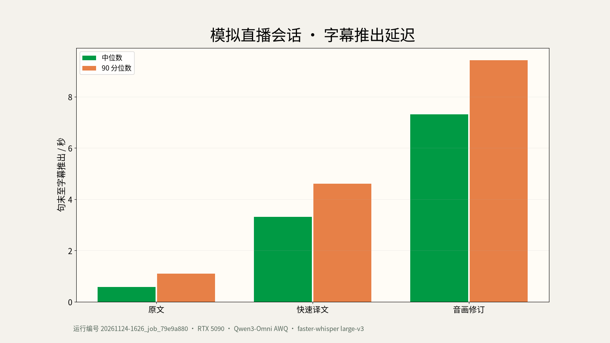
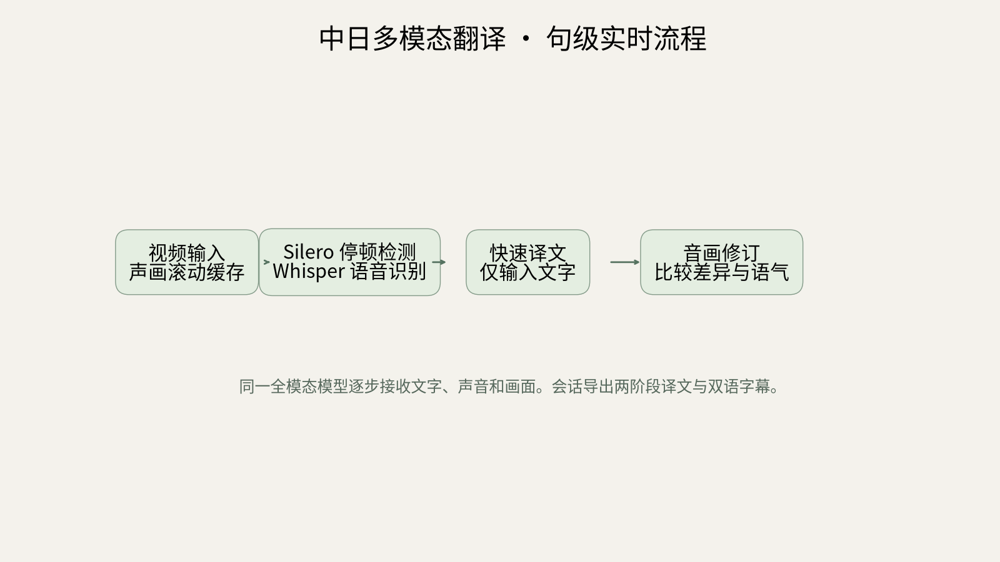

# CJ-VMT 课程报告

## 问题与目标

中文和日语的口语中，语调、对象及动作可能改变一句话的解读。项目把这些信息接入句级字幕翻译，并把同一模型在不同输入条件下的译文放到可操作的页面中。

## 现有材料

据项目材料的检索记录，已有多模态测试覆盖视频歧义和语音韵律。中日方向的公开材料可用于后续验证问句、文体和受众指代。参见 `docs/innovation.md` 与 `docs/method_summary.md`。

## 创新点

据项目材料的检索记录，既有视频和语音评测分别覆盖视觉歧义和语调。原型把固定模型的多模态条件对照、句级两阶段字幕和语气观察放在同一页面。WMT26 评测按文字线索把问句分成 Q1–Q5，并单独观察没有文字疑问标记的 Q5。

## 方法

- 对比模式用同一个 Omni 检查点，固定贪心解码和抽帧参数。保留 ASR 标点的条件作为附加对照。
- 中性化去除语音识别结果中的提问和感叹标点。声音输入只保留目标句及边缘余量。只看画面时使用无音轨的 H.264 片段。完整输入封装门控音频后交错送入模型。
- 实时页面在 Silero 检测停顿或达到句长上限后推送原文。文字快速译文和音画修订依次出现，积压时略过第二遍。
- 先感知后翻译模式记录语调、表情、对象和语气强度。网页对这类内容标明「模型观察，未核实」。规则检查句末标点和括号情绪描述。

## 系统实现

视频 → FFmpeg 标准化 → Whisper 转写和分句 → Qwen-Omni → 对比 → 网页、字幕及运行证据。
课程部署确定使用 RTX 5090 上的 Qwen3-Omni AWQ，运行版本为 `b8f7bfd32ec3e7a59fa78cad0be54463eb89e9a9`。回放分发包使用本地视频、脚本和样式，能直接由浏览器打开。

## 实验设置

公开素材来自 Wikimedia Commons，文件区段、作者和许可见 `docs/demo_media.md`。社区会议和 Wikitongues 包含自然语音，维基新闻片段由原作者使用合成语音播报。离线比较无逐句人工参考。数字只用于验证运行链路与字幕推出延迟。

## 运行结果

| 演示视频 | 翻译方向 | 句数 | 运行编号 |
|---|---|---:|---|
| 社区会议 | ja2zh | 5 | `20261124-1531_ja2zh_2299363b` | <!-- run=20261124-1531_ja2zh_2299363b file=manifest.json key=line_count value=5 -->
| Wikitongues | zh2ja | 5 | `20261124-1532_zh2ja_9c65794c` | <!-- run=20261124-1532_zh2ja_9c65794c file=manifest.json key=line_count value=5 -->
| 维基新闻 | ja2zh | 9 | `20261124-1534_ja2zh_6e0b3627` | <!-- run=20261124-1534_ja2zh_6e0b3627 file=manifest.json key=line_count value=9 -->
| Wikitongues 错配对照 | zh2ja | 2 | `20261124-1537_zh2ja_36865b91` | <!-- run=20261124-1537_zh2ja_36865b91 file=manifest.json key=line_count value=2 -->

在 Wikitongues 片段中，ASR 输出「汤鹤县」，相同模型仅看文字输出「湯鶴県」，音画合并条件输出「唐河県」。此例见 `20261124-1532_zh2ja_9c65794c` 的 `lines.jsonl`。核对原始音轨或人工参考后才能判断这些译文的优劣。

自录语气最小对仍待授权素材。模拟直播采用句末到服务器事件推送的计时，关闭模型冷启动的影响后记录字幕延迟。

WMT26 正式评测运行 `20261125-0247_wmt26-eval_bb2b92a1`，准备记录为 `20261125-0214_wmt26-prepare_800787aa`。评测覆盖 114 段 speech 视频、7 个条件和 800 条文档条件结果，逐行回退 0 次。<!-- run=20261125-0247_wmt26-eval_bb2b92a1 file=manifest.json key=document_count value=114 --> OCR 审计覆盖 114 段、342 个抽帧。主表中，`T_neutral` 的 chrF 为 28.146、COMET 为 0.86998，`T+A` 的 chrF 为 28.542、COMET 为 0.87125，`T+V` 的 chrF 为 28.000、COMET 为 0.86763，`T+V+A` 的 chrF 为 27.277、COMET 为 0.86501。<!-- run=20261125-0247_wmt26-eval_bb2b92a1 file=summary.csv key=id:main/T_neutral/chrf:value value=28.146 --> <!-- run=20261125-0247_wmt26-eval_bb2b92a1 file=summary.csv key=id:main/T_neutral/comet:value value=0.86998 --> <!-- run=20261125-0247_wmt26-eval_bb2b92a1 file=summary.csv key=id:main/T+A/chrf:value value=28.542 --> <!-- run=20261125-0247_wmt26-eval_bb2b92a1 file=summary.csv key=id:main/T+A/comet:value value=0.87125 --> <!-- run=20261125-0247_wmt26-eval_bb2b92a1 file=summary.csv key=id:main/T+V/chrf:value value=28.0 --> <!-- run=20261125-0247_wmt26-eval_bb2b92a1 file=summary.csv key=id:main/T+V/comet:value value=0.86763 --> <!-- run=20261125-0247_wmt26-eval_bb2b92a1 file=summary.csv key=id:main/T+V+A/chrf:value value=27.277 --> <!-- run=20261125-0247_wmt26-eval_bb2b92a1 file=summary.csv key=id:main/T+V+A/comet:value value=0.86501 --> 详细分层、置信区间、问句检验、错配条件和图表见 [WMT26 结果](eval_wmt26.md)。

实时会话 `20261124-1626_job_79e9a880` 实测 3 句。<!-- run=20261124-1626_job_79e9a880 file=manifest.json key=summary.utterances value=3 -->

| 事件 | 中位数（毫秒） | P90（毫秒） |
|---|---:|---:|
| 识别原文 | 584.9 | 1096.6 | <!-- run=20261124-1626_job_79e9a880 file=session/latency_summary.csv key=metric:asr:median_ms value=584.9 --> <!-- run=20261124-1626_job_79e9a880 file=session/latency_summary.csv key=metric:asr:p90_ms value=1096.6 -->
| 快速翻译 | 3319.1 | 4607.7 | <!-- run=20261124-1626_job_79e9a880 file=session/latency_summary.csv key=metric:quick:median_ms value=3319.1 --> <!-- run=20261124-1626_job_79e9a880 file=session/latency_summary.csv key=metric:quick:p90_ms value=4607.7 -->
| 音画修订 | 7314.9 | 9429.5 | <!-- run=20261124-1626_job_79e9a880 file=session/latency_summary.csv key=metric:multimodal:median_ms value=7314.9 --> <!-- run=20261124-1626_job_79e9a880 file=session/latency_summary.csv key=metric:multimodal:p90_ms value=9429.5 -->

会话音画跳过率为 0.0。<!-- run=20261124-1626_job_79e9a880 file=manifest.json key=summary.skip_rate value=0.0 -->

浏览器上传的对比模式会话 `20261124-1630_job_6ae44172` 验证了相同视频的两阶段字幕。原文的中位数为 563.6 毫秒。<!-- run=20261124-1630_job_6ae44172 file=session/latency_summary.csv key=metric:asr:median_ms value=563.6 -->快速翻译的中位数为 3104.5 毫秒。<!-- run=20261124-1630_job_6ae44172 file=session/latency_summary.csv key=metric:quick:median_ms value=3104.5 -->音画修订的中位数为 5546.7 毫秒。<!-- run=20261124-1630_job_6ae44172 file=session/latency_summary.csv key=metric:multimodal:median_ms value=5546.7 -->

日→中模拟直播使用公开社区会议片段，会话 `20261124-2008_job_ab9fe2f5` 输出 5 句。<!-- run=20261124-2008_job_ab9fe2f5 file=manifest.json key=summary.utterances value=5 --> 「先感知后翻译」模式下，快速译文与音画修订的中位延迟分别为 1471.6 和 4340.6 毫秒。<!-- run=20261124-2008_job_ab9fe2f5 file=session/latency_summary.csv key=metric:quick:median_ms value=1471.6 --> <!-- run=20261124-2008_job_ab9fe2f5 file=session/latency_summary.csv key=metric:multimodal:median_ms value=4340.6 -->

摄像头直播会话 `20261124-1704_job_62202687` 以 Chromium 测试设备播放公开素材，同时使用实际 GPU 识别与翻译。会话识别 2 句。<!-- run=20261124-1704_job_62202687 file=manifest.json key=summary.utterances value=2 --> 快速译文中位延迟为 4144.9 毫秒。<!-- run=20261124-1704_job_62202687 file=session/latency_summary.csv key=metric:quick:median_ms value=4144.9 --> 音画修订中位延迟为 5702.9 毫秒。<!-- run=20261124-1704_job_62202687 file=session/latency_summary.csv key=metric:multimodal:median_ms value=5702.9 --> 已验证停止、字幕下载和新生成的录像回放。

WMT25 日→中全文档评测和 WMT26 中→日正式评测已分别归档。WMT25 的加声音条件得分最高，配对 COMET 区间覆盖零。WMT26 的 `T+A` 在主表中获得最高 chrF 和 COMET，音画合并条件的得分低于文字加声音条件。 [WMT25 结果](eval_wmt25.md) · [WMT26 结果](eval_wmt26.md)

## 局限和后续计划

样本规模有限，方言、混合语言、专名与长句可能产生识别和翻译错误。差异高亮无法判定哪句更准确。模型语气标注有待在已授权的最小对素材上核实。摄像头直播已经通过服务器浏览器测试，课堂设备与网络还需现场彩排。WMT26 正式评测已完成，但 WMT 视频只用于本机研究与评测，课堂包不复制其媒体。云 API 和语音配音属于可选工作。结课后按 `docs/roadmap/` 的数据与许可流程推进。
